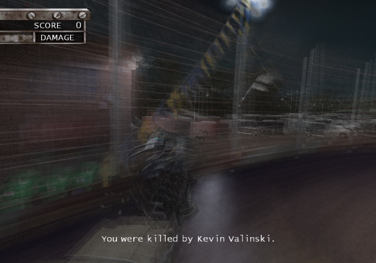
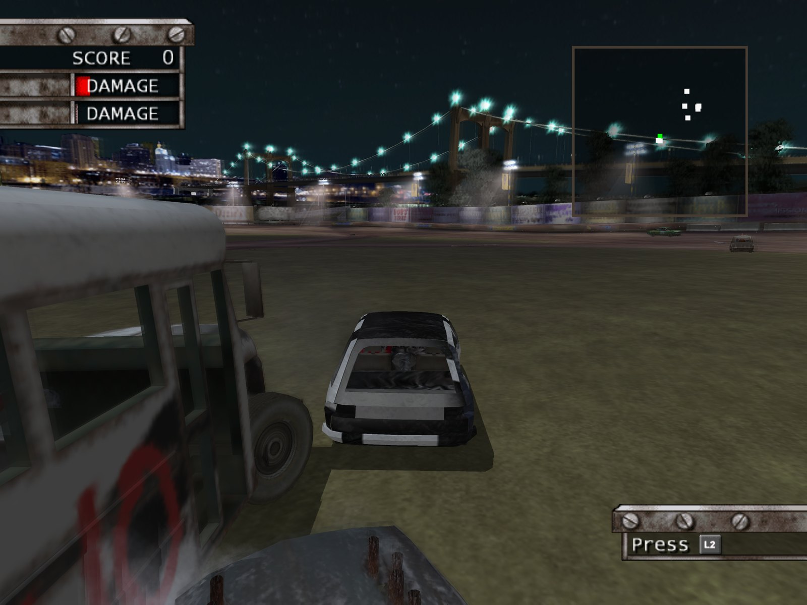
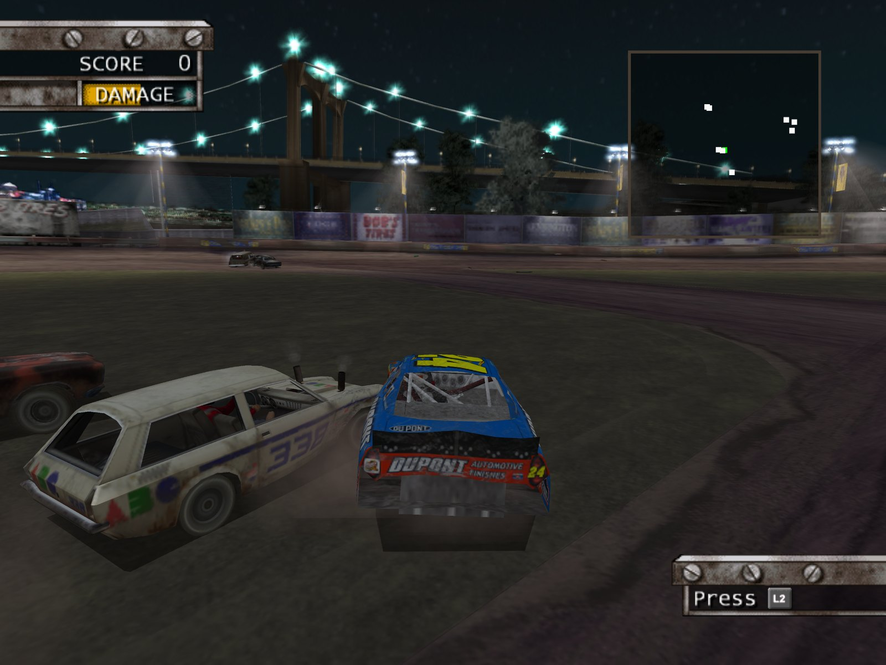
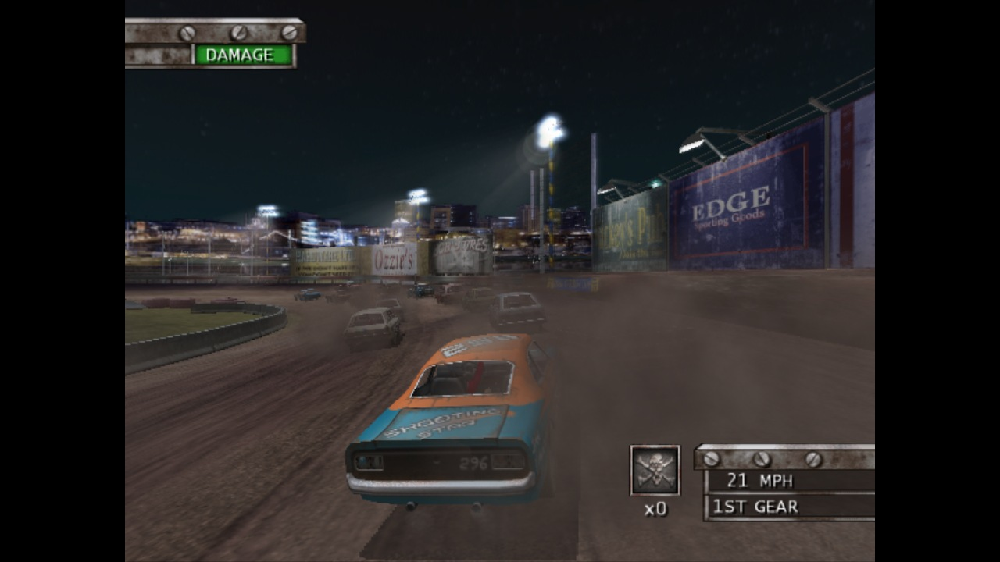
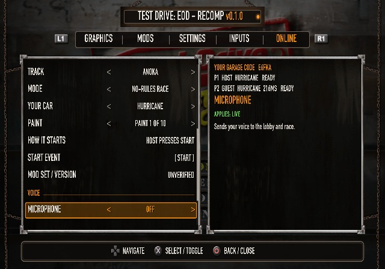
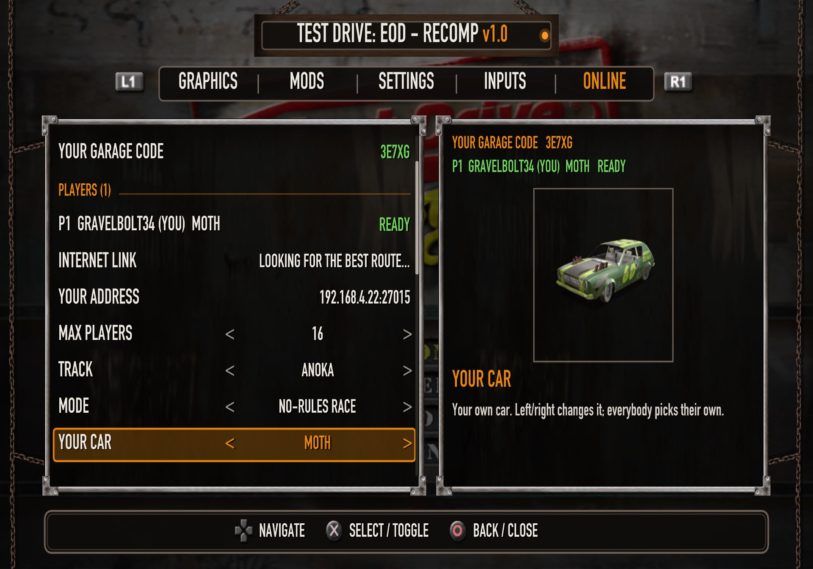

# Eve of Destruction Remaster 1.0 · PC and Mac

**A native, multiplatform remaster of the 2004 demolition racer.** Built on the original static recompilation, this project expands the game with online multiplayer, substantial Career and Battle changes, bonus vehicles, high-resolution rendering, and a growing set of tools for creating and editing mods.

[Download the 1.0 game for Mac and Windows](https://github.com/catsandsoup/eod-recomp/releases/tag/v1.0)

**Development:** [Repository and branch guide](docs/REPOSITORY_MAP.md) · [EOD Creation Kit preview](https://github.com/catsandsoup/eod-recomp/releases/tag/creation-kit-v0.3.2-preview)

The game is available for Apple Silicon macOS and Windows x64. The Creation Kit is a separate development application; its current public preview is for Apple Silicon macOS. The `main` branch is the published game baseline, while `dev/creation-kit` contains the newer editor and asset-tool development.

Play a local split-screen Battle, host an online race, or work through the expanded Career. Choose original 4:3 framing or widescreen, adjust render scale, and use a controller or keyboard and mouse.

## What is included in the game

### Play your way

* **Native PC and Mac applications.** The game is statically recompiled into native code; it is not running inside a conventional emulator.
* **Controller first.** Xbox and PlayStation controllers work out of the box, with analog triggers for gas and brake. Keyboard and mouse work too.
* **Hot-plug 2-player split screen.** Plug in a second pad whenever you like and the game is ready for two.
* **Widescreen and higher resolutions.** Play in original 4:3 framing or true widescreen, with adjustable internal render scale.
* **Everything unlocked outside Career.** Jump straight into any car and any map in the other modes.

### Battle mode everywhere

* **Battle on every map.** Pick 4 AI or 8 AI opponents, with mixed car classes.
* **Battle for two.** 2-player split screen offers 1v1, 4 AI and 8 AI.
* **Battle events in Career.** Fresh events appear in the Career event list.
* **Every rival has a name.** Take out an AI driver, or get taken out, and the game tells you exactly who it was.

### Bonus cars

* **The Phantom.** A mean, black-and-white new ride for the demolition derby.
* **A NASCAR stock car.** Take a Cup-style racer through the mud. It crumples, sheds bumpers and panels, and casts a proper shadow, just like the original cars. More are on the way.
* **Special vehicles in Career.** The School Bus, Hearse, Ambulance, Taxi, Mail Van and Police Car are now stocked at the Career car dealer and eligible for Career events.

### Career, wide open

* **Every shop and event open from day one.** Upgrades, Time Challenges, the Highway, Troy's Place and all 25 Eves are open right away.
* **The dealer sells every car.** Every visit to the auto shop brings in a fresh line-up until you've seen the entire roster — including the Phantom, the NASCAR stock car and all six special vehicles — and swap or trade in cars for a 100% refund so you can try anything at no loss.
* **Never broke, never locked out.** Career cash stays topped up to at least $10,000 in free roam while winnings still add on top, and your rank stays at **1st** without ending the Career.
* **Killable challengers.** Highway and Malt Shop challengers in Career free roam no longer stop taking damage at 90% — you can wreck them outright. Every Career unlock can be toggled live in the **Mods** tab.

### A modern menu that looks like the original

Press **Start + Select** on a controller (or **F1** / **Cmd+,** on a keyboard) at any time to open the in-game menu, styled like the original game. Tabs for **Graphics, Mods, Settings, Inputs and Online** let you change things without leaving your race.

### Online racing

The host picks the track and event. Each driver chooses a car and paint, sees their friend's choice, and marks Ready. End Race returns the party to Online, where the same Garage Code and roster are waiting for the next start.

* **Controller support.** D-pad navigation, shoulder-button tabs, Cross/A to select and Circle/B to go back.
* **Online lobby.** Host a game, join by Garage Code or select a LAN game.
* **Race selection.** The host chooses the track and event. Each player chooses a car and paint.
* **Rematches.** Return to the lobby, change selections and start the next race.
* **Nicknames.** Choose a screen name or use a random callsign. Duplicate names receive a number.
* **Lobby controls.** Set a room limit up to 16, remove a guest or close the lobby. Race capacity follows the selected event.
* **Shared rules.** The host enables turbo, Chicken Fight, invincibility, durability and manual recovery for the race. Personal cheat settings do not override the host.
* **Matching content.** Online admission checks the installed game archives and car mods. Your music library stays local.
* **Voice controls.** Toggle your microphone, mute incoming voices or deafen.

### Your own soundtrack

Drop your own **MP3, AAC, FLAC or WAV** files into a folder and they play alongside the original songs, just like custom soundtracks on the Xbox version. Choose which ones are on from the Mods tab, and the game remembers your picks next time you play. Adjust **Music Volume** in Settings, including mute, independently of engines, effects and voice.

### Dirt, fences and floodlights

## Modding tools and ongoing development

The project now extends beyond the playable remaster. Alongside the game, the repository contains asset-format tools, vehicle-building workflows and a separate Creation Kit for inspecting and editing supported game assets.

### Vehicle creation

The custom-vehicle tools can build a vehicle variant from a retail chassis, generate a livery, change supported performance and vehicle data, and package the result as a game mod. A generated Phantom package has been taken through vehicle selection and a rendered race test.

The current workflow has defined limits: it reuses a retail chassis mesh rather than importing arbitrary modern 3D geometry, and each generated chassis variant targets one native vehicle class. See the [custom vehicle pipeline](https://github.com/catsandsoup/eod-recomp/blob/dev/creation-kit/docs/CUSTOM_VEHICLE_PIPELINE.md).

### Track and environment editing

The Creation Kit development build can browse track assets, preview models and textures, export supported textures to PNG, replace supported same-size indexed textures, edit sky palette values, edit native tables, save changes to an isolated mod project and launch that project in a separate test runtime.

This is asset and environment editing, not yet a general-purpose track creator: arbitrary track geometry, collision compilation and live 3D world placement are not supported. See the [track environment workflow](https://github.com/catsandsoup/eod-recomp/blob/dev/creation-kit/docs/TRACK_ENVIRONMENT_WORKFLOW.md).

### Creation Kit

The Kit is a separate app rather than an in-game menu. Its development work includes searchable asset browsing, model and texture inspection, background export jobs, project-based mod packaging and isolated test sessions. The public [0.3.2 preview](https://github.com/catsandsoup/eod-recomp/releases/tag/creation-kit-v0.3.2-preview) is an early Apple Silicon macOS build; newer work remains on the development branch. See the [Creation Kit development notes](https://github.com/catsandsoup/eod-recomp/blob/dev/creation-kit/docs/CREATION_KIT.md).

### Rendering and runtime work

The remaster is being developed for high-resolution output, widescreen presentation and smooth native rendering, with ongoing work on draw distance, LOD selection, visibility and runtime responsiveness. Performance depends on the machine and build; no single frame-rate result is guaranteed across hardware.

The project also maintains technical documentation for the recompiled game, its renderer, asset formats, gameplay systems and runtime hooks. The [engine documentation index](docs/INDEX.md) maps those investigations to the corresponding source and tools.

## Getting started

1. **Download 1.0.** Unzip the [Mac or Windows archive](https://github.com/catsandsoup/eod-recomp/releases/tag/v1.0).
2. **Open the app.** Launch **Eve of Destruction.app** on Mac or **eod.exe** on Windows.
3. **Choose your game ISO.** The app checks your North American PS2 copy and installs the game files automatically. It remembers the installation for future launches.
4. **Plug in a controller and play.** Open the remaster menu with **Start + Select** or **F1**.

## Frequently asked questions

**Is this an emulator?** No. The game's code has been translated ahead of time into native code, so it runs as a regular app.

**Does it include the game?** No. You must own the game and supply your own copy.

**Which platforms?** The game release supports Apple Silicon macOS and Windows x64. The current Creation Kit preview is for Apple Silicon macOS; a Windows editor is not included in that preview.

**Can I make entirely new cars and tracks?** The vehicle workflow can build supported custom vehicle variants using existing chassis geometry. The Creation Kit can edit supported track environments and assets. Arbitrary mesh import and full new-track geometry/collision creation are not yet supported.

## Legal, credits and licences

This is an unofficial fan project. It is **not affiliated with or endorsed by Atari, Monster Games or the owners of any trademarks** mentioned here. Test Drive: Eve of Destruction and all related names belong to their respective owners.

**No game data is included.** You must own the game to use this port.

Credits: this project builds on [eod-recomp by pareidolico](https://github.com/pareidolico/eod-recomp), the original static recompilation of the game for Windows, which takes its approach from projects such as N64Recomp and Zelda64Recomp. It has since been expanded into a multiplatform remaster with additional game modes, online play, runtime and rendering work, and mod-development tools. The menu system uses [Dear ImGui](https://github.com/ocornut/imgui) (MIT licence) and the Mac version uses SDL3 and Vulkan through MoltenVK. Thanks to everyone who built those projects.
