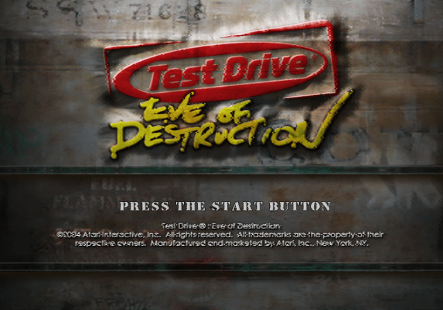
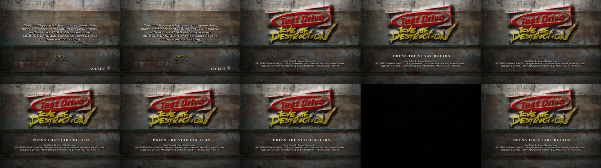

# Test Drive: Eve of Destruction — native PC port (PS2 static recompilation)

This repository turns the PlayStation 2 executable of **Test Drive: Eve of
Destruction** (NTSC-U, `SLUS_209.10`, v1.00) into C/C++ source code that builds
into a native Windows program (Windows 7 or later, 32- or 64-bit, any SSE2 CPU
such as a Core 2 Duo).



## How it works

Hand-decompiling ~717,000 MIPS instructions is not feasible in one go, so the
port uses **static recompilation**, the approach used by projects like
N64Recomp/Zelda64Recomp:

1. **`tools/analyze.py`** finds every function in the executable (call
   targets, vtables and other code pointers, tail-jump targets, orphaned code)
   and every `switch` jump table: about 13,500 functions.
2. **`tools/recomp.py`** translates each MIPS R5900 function into an equivalent
   C function (`gen/rec_*.c`). Every instruction is covered: 64/128-bit
   integer ops, MMI SIMD, FPU, VU0 macro mode, branch delay slots, branch-likely,
   unaligned loads/stores, jump tables and indirect calls.
3. The **runtime** (`runtime/`) replaces the PS2 hardware and operating system
   with high-level emulation:
   * `kernel/` – EE kernel: threads (on host fibers), semaphores, interrupt
     and DMA handlers, alarms, vblank timing, libkernel's kernel patches
   * `core/` – CPU state, memory map, MMI instructions, logging
   * `hw/` – DMA controller, timers, interrupt controller and the IPU
     (MPEG-2 macroblock decoding and colour conversion used by the movies)
   * `vu/` – VU0/VU1 interpreter (with the pipeline/stall timing the game's
     microcode depends on) and VIF0/VIF1 (unpack, MPG, MSCAL, DIRECT, PATH3 masking).
     The game's micro programs are also compiled ahead of time to C++ by
     **`tools/vurecomp.py`** (from the images in `config/vu/`); the
     interpreter runs anything that doesn't match them.
   * `gs/` – Graphics Synthesizer: swizzled 4 MB VRAM in all pixel formats,
     GIF packets, transfers, CLUTs and a software rasteriser implementing the
     full GS pixel pipeline, with a decoded-texture cache and, on CPUs with
     four or more threads, rasterisation spread over worker threads
   * `iop/` – the I/O processor: the SIF RPC protocol, plus emulations of the
     IRX modules the game loads: `fileio` (game data from disk), `padman`
     (DualShock 2), `mcserv` (memory card in a host folder), `loadfile`,
     `iopheap`, multitap, the Logitech wheel driver, the game's `stream.irx`
     disc streamer and `sdrdrv` (sound) on top of an SPU2 emulation
     (ADPCM voices, ADSR, AutoDMA PCM streaming)
   * `platform/` – Win32 (GDI window, XInput/keyboard, waveOut, fibers) and
     POSIX (headless, used for automated testing)
4. **`src/`** holds hand-written C++ that replaces or wraps specific game
   functions (see `config/hle.txt`). Hand-decompiled game code goes here over
   time.

`config/symbols.txt` collects identified function names; `tools/dis.py` is an
annotated disassembler used for reverse engineering.

## Status

| Area | State |
| --- | --- |
| Recompiled code | Complete; boots through the SDK libraries and the game's init |
| Graphics | Software GS renderer (own thread on multi-core CPUs, plus raster workers on 4+ threads) |
| Controller | Keyboard and XInput pads (DualShock 2 emulation incl. pressure) |
| Memory card | Saves to `memcard/port0` next to the game data |
| Game data | Read from the disc files on disk (`DATA/...`) |
| Sound | Sound effects and PCM streams (`sdrdrv` + SPU2); music/speech streamed by `stream.irx` not yet |
| FMV | Intro, attract and menu background movies play (IPU emulation) |
| Races | Load and play (Action mode tested): track, cars, HUD, physics |
| Performance | Below full speed in races (on a 4-thread 2.1 GHz CPU about 14 game frames/s); optimisation in progress |

The game boots, passes the controller and memory card checks, and runs the
menus, the 3D garage and races.



## Game data

The repository does **not** need to contain the game. To run the port you
need your own copy of the disc. Copy the whole disc (at least `SLUS_209.10`
and the `DATA` folder: `DATA/RES`, `DATA/CAR`, `DATA/TRK`, `DATA/IOP`, movies)
into one folder. The executable checks that `SLUS_209.10` is the exact version
this code was generated from.

## Building

Requirements: CMake 3.16+, a C/C++17 compiler, Python 3 with `rabbitizer`
(`pip install rabbitizer`) to (re)generate `gen/`.

```sh
# 1. generate the C translation (also done automatically on first configure)
python3 tools/analyze.py
python3 tools/recomp.py
python3 tools/vurecomp.py     # VU micro programs (optional)

# 2a. Windows (cross compile from Linux/WSL with MinGW-w64), 32-bit, runs on Windows 7+
cmake -S . -B build-win32 -G Ninja -DCMAKE_TOOLCHAIN_FILE=cmake/mingw-i686.cmake -DCMAKE_BUILD_TYPE=Release
ninja -C build-win32          # -> build-win32/eod.exe (static, no DLLs needed)

# 2b. Windows with MSYS2/MinGW on Windows itself
cmake -S . -B build -G "MinGW Makefiles" -DCMAKE_BUILD_TYPE=Release && cmake --build build

# 2c. Linux (headless test build)
cmake -S . -B build-linux -G Ninja -DCMAKE_BUILD_TYPE=RelWithDebInfo && ninja -C build-linux
```

The 32-bit Windows build targets SSE2 (Pentium 4 / Core 2 and newer) and
imports only `kernel32`, `user32`, `gdi32`, `winmm` and `msvcrt`.

## Running

Put `eod.exe` in the folder with the disc files (or pass `--data <folder>`).

| Option | Meaning |
| --- | --- |
| `--data DIR` | folder containing `SLUS_209.10` and `DATA/` |
| `--scale N` | initial window size (N × 320×240) |
| `--log cats` / `--log-file F` | debug logging (`core,kernel,sif,file,gs,...` or `all`) |
| `--frames N` | exit after N frames (testing) |
| `--screenshot-every N --screenshot-dir D` | dump frames as PPM |

Keyboard: arrows = D-pad/left stick, X/Space = ✕, C = ○, Z = □, V = △,
Q/E = L1/R1, A or 1 = L2, D or 3 = R2, Enter = Start, Backspace = Select,
Alt+Enter or F11 = fullscreen. XInput controllers map to the DualShock layout.

## Debugging aids

* `EOD_GS_TRACE=<frame>` logs every primitive drawn in that frame
* `EOD_FPS=1` prints vblanks/s (60 = full speed), game frames/s, how busy the GS
  thread is and how long the EE waits for it, every 5 s
* `EOD_SKIP_MOVIES=1` skips the movies; `EOD_GS_THREAD=0` renders on the main thread;
  `EOD_GS_RASTER=n` sets the number of raster worker threads (0 = none)
* `--log gs` prints per-second renderer statistics (pixels, texture decoding,
  raster jobs and barriers, pixels per triangle type)
* `EOD_VU_DUMP=dir` writes the VU micro programs that run (input for
  `tools/vurecomp.py`, see `config/vu/`); `EOD_VU_INTERP=1` disables the compiled ones
* `EOD_GS_NOTEXCACHE=1`, `EOD_DEBUG_NOMIP=1`, `EOD_DEBUG_PIXEL=x,y` (with
  `EOD_GS_TRACE`: logs every write to that pixel) help bisect rendering bugs
* `EOD_WATCH=addr,...` logs float values at EE addresses when they change;
  `EOD_WATCHW=addr` (Linux) reports the host code that first writes a huge value there
* `cmake -DEOD_TRACE_CALLS=ON` records the last EE function calls, printed on crashes
* `EOD_PAD_SCRIPT=frame:buttons,...` (POSIX build) scripts controller input
* `python3 tools/dis.py -f <addr>` disassembles a function with string/symbol annotations
