# Test Drive: Eve of Destruction — Native PC & Mac Remaster + 3D World Editor

**A native x64/ARM64 static recompilation and modern remaster of the 2004 demolition derby classic (*SLUS_209.10*) — now featuring a hardware-accelerated 3D World Editor with Unreal-style Play-In-Editor (PIE), full track & collision sculpting, AI pathfinding tools, live 4K texture swapping, and online multiplayer.**

[**Download the remaster (Windows x64 & macOS)**](https://github.com/catsandsoup/eod-recomp/releases) · [**Step-by-Step Modding Tutorials**](docs/TUTORIALS.md) · [**World Editor Guide**](docs/WORLD_EDITOR.md) · [**Technical Wiki**](docs/wiki/Home.md) · [**Engine Documentation Index**](docs/INDEX.md)

> For a test build, select the entry marked **Pre-release** on the Releases page and download its player archive under **Assets**. [Renderer development status](docs/NATIVE_RENDERER_SUCCESS.md)

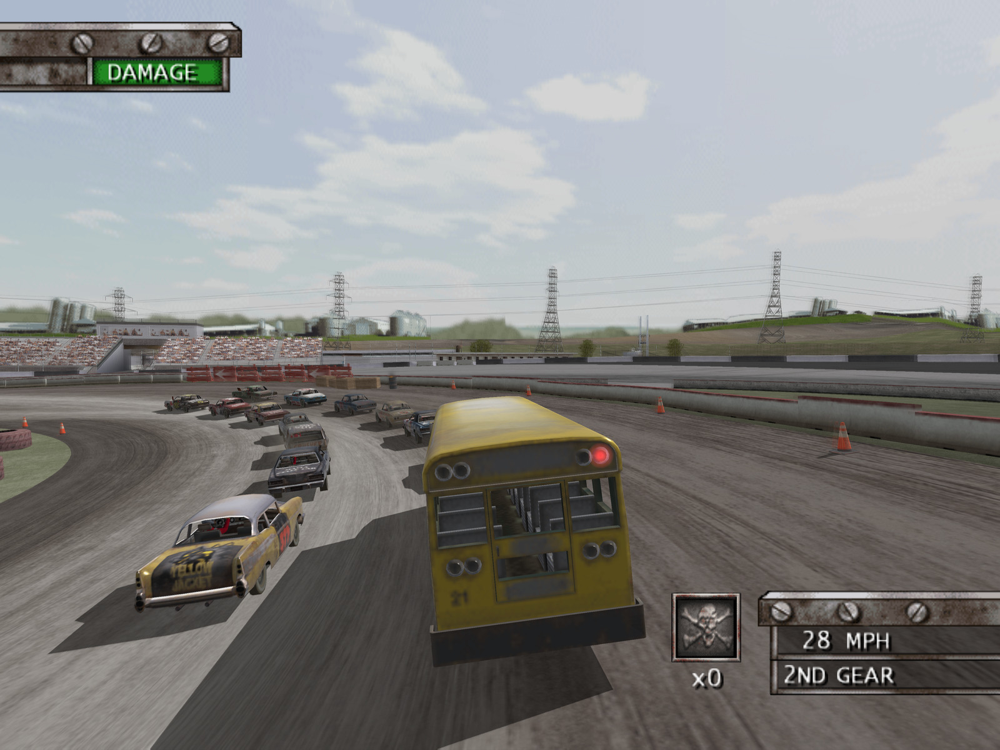

*A school bus joins the rolling start at Mankato. The new Mankato and Career screenshots were captured in a macOS development build with the Modern look at 6× internal resolution.*

<details>
<summary>Earlier remaster gameplay</summary>


*Native 6× internal resolution Vulkan rendering with hardware-decoded VIF meshes, unthrottled LODs, live vertex deformation, and zero PS2 debris caps.*

</details>

---

## Highlights at a Glance

| Pillar | What It Delivers |
|---|---|
| **Native Static Recompilation** | Compiled ahead of time from PS2 MIPS R5900 (`SLUS_209.10`) + VU1 microcode into native **Windows x64 (Vulkan)** and **Apple Silicon macOS (Metal / MoltenVK)** executables — not running inside a traditional emulator. |
| **Instant Classic PS2 ↔ Modern Toggle (`F9`)** | Switch live mid-race between **1:1 Classic PS2** fidelity and the **Modern Native Plume Renderer** with **1×–8×+ internal resolution**, true widescreen (`16:9` / `21:9`) or `4:3`, unthrottled car & world LOD at any distance, and removed PS2 object/debris caps. |
| **3D World Editor & Creation Kit (`< 2 ms`)** | Hardware-accelerated **Qt 6 + OpenGL 3.3 Core** 3D studio running at `< 2 ms` frame times (`500+ FPS` viewport) with **Unreal-style Play-In-Editor (PIE)** embedded directly inside the viewport. |
| **Full Track, Collision & AI Modding** | Sculpt and scale ramps/structures (`track.grf` VIF + `SCOL` drivable terrain collision), flatten 16 m invisible walls (`SOBL`), scatter all 37 retail vehicles & wrecks, redraw `ILIN` AI racing lines, and invent custom game modes (**Free Roam**, **Tag**, **Cat & Mouse**, **Fat Kid / Juggernaut**). |
| **Online Netplay & Split-Screen** | Deterministic rollback/state-sync online lobbies with Garage Codes, up to 16-player room limits, voice chat, content-manifest verification, and hot-plug 2-player local split screen. |
| **1-Click Retail `.ISO` Onboarding & Legal `.eodmod` Sharing** | Point `eod.exe` at your North American PS2 `SLUS_209.10` `.ISO` once on first launch. All mods package as **delta-only `.eodmod` archives** containing zero copyrighted retail assets. |

---

## EOD 3D World Editor & Creation Kit

The **EOD World Editor** (`tools/world_editor/`) turns *Test Drive: Eve of Destruction* into a non-destructive creative sandbox inspired by **Unreal Engine**, **Lumion**, and **Twinmotion**. Every edit writes to an isolated mod layer (`mods/<Project>/`) without ever touching a single byte of your retail game files.

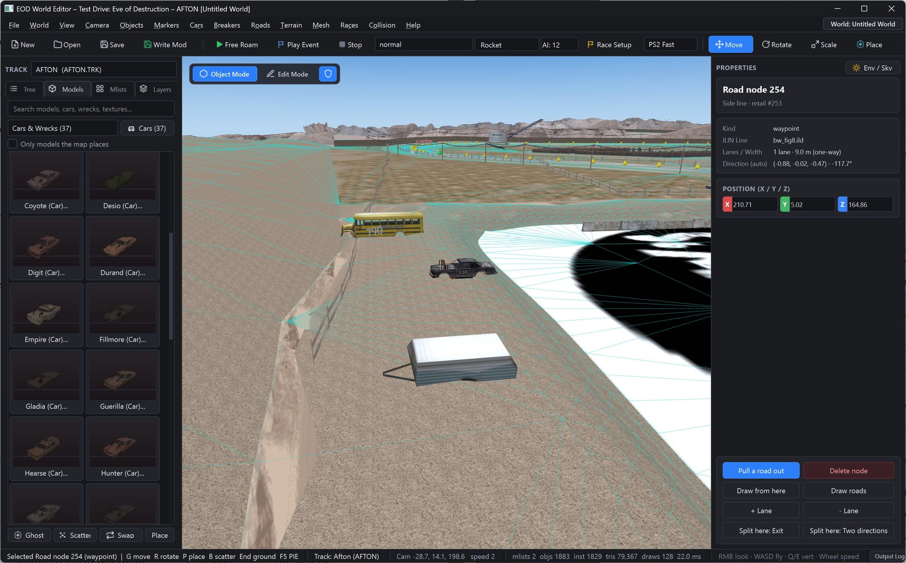

*The World Editor on Woodly (`AFTON.TRK`): Cars & Wrecks library, a placed school bus and wrecks, collision wireframe, and a selected `ILIN` racing-line node.*

### Unreal-Style Play-In-Editor (PIE)

Press **`F5`** (*Play Free Roam*) or **`Shift+F5`** (*Play Event / Race*) to compile your changes in milliseconds and launch `eod.exe` **directly inside the editor's central viewport**. Drive over a ramp you just scaled, test an AI jump line, and press **`Esc`** to pop immediately back to the exact 3D camera position in the editor.

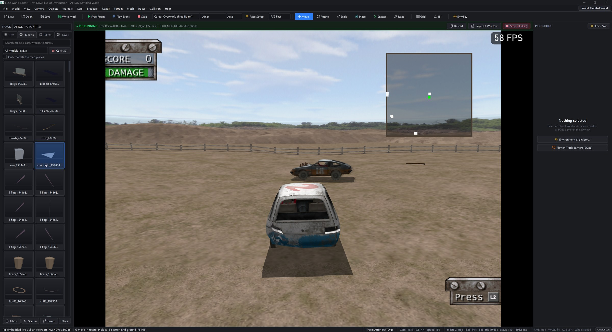

*Live **Play-In-Editor (PIE)** running `eod.exe` at ~60 FPS inside the Qt 6 viewport with one-click Stop (`Esc`), Restart, and Pop-Out controls.*

### Lumion / Twinmotion Placement, Scatter & 37 Cars / Wrecks Library

* **3D Thumbnail Browser:** Browse every track building, jump ramp, barn, fence, and a dedicated **Cars & Wrecks (37)** catalog featuring all 31 playable vehicles, 5 trailers, and the School Bus with studio-lit 3D thumbnails rendered off-thread.
* **Ghost Normal-Snapped Placement (`P`):** Hover over any hill or dirt bank to see a translucent 3D ghost preview automatically aligned to the `SCOL` terrain height and surface normal before clicking to stamp.
* **Scatter / Paint Brush (`B`):** Paint forests, tire barriers, or junkyard car wrecks across the terrain with adjustable radius, density, and random yaw/scale.
* **"Replace Selection With…":** Right-click any tree, sign, or prop (or use **Select All Similar**) and swap it into a wrecked police cruiser, school bus jump, or ramp while preserving world transforms.

### AI Pathfinding (`ILIN`) & Custom Game Mode Builder

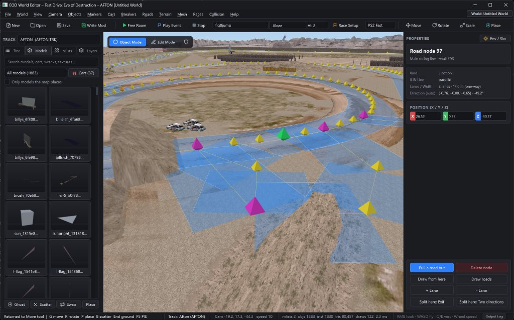

*Interactive `ILIN` AI racing-line spline editing with directional chevrons alongside placed police cruisers inside the dirt ring.*

* **Interactive `ILIN` Road Tool:** Drag, split, insert, or branch AI racing-line nodes in 3D space. The editor automatically recomputes `dirX`/`dirZ` curve tangents, segment lengths, and cumulative lap distances so AI drivers steer cleanly over new custom routes.
* **Event Template & Custom Game Mode Builder:** Switch between retail event layouts (`Jump Race`, `Figure 8`, `Battle`, `Gauntlet`, `Suicide`, `Trailer`, `Push Off`) or configure custom rulesets:
  * **Free Roam on Any Map:** Drive solo or with AI anywhere on any race or demolition track.
  * **AI Auto-Drive & Free Cam:** Let the AI pilot your car while you inspect battles with the free camera.
  * **Tag, Cat & Mouse, and Fat Kid / Juggernaut:** Custom asymmetric mass, speed, and durability rulesets playable immediately in PIE.

### Full Track & Collision Sculpting + Live 4K Texture Inspector

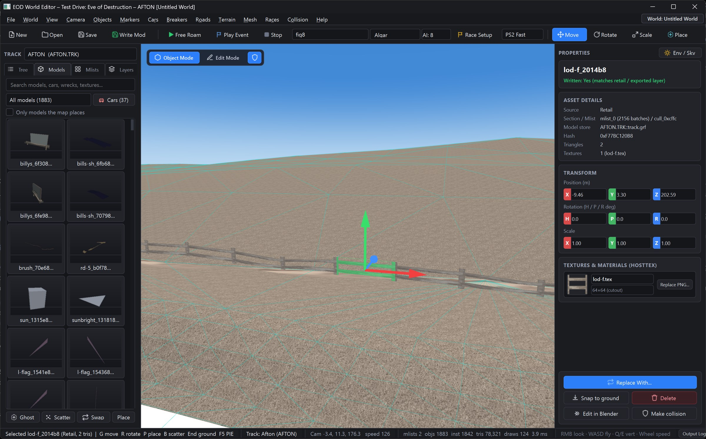

*3D transform gizmo selection with the context-sensitive Properties & `HOSTTEX` Texture Inspector for live PNG texture replacement.*

* **Visual Mesh + `SCOL` Collision Baking:** Move, rotate, and scale static scenery, optional terrain ramps, and event props (`c_<event>.va0`). Baking transforms patches both the hardware `track.grf` `4SPS` VIF vertices/bounding spheres and the underlying `SCOL` (`track.bsc`) drivable collision triangles so you can physically launch off reshaped ramps.
* **Invisible Wall (`SOBL`) Removal:** Visualize `track.sol` collision barriers color-coded by height (Red ≥ 10 m invisible ceilings) and lower individual barriers or click **Flatten All Track Barriers** to open the entire map for boundary-free exploration.
* **Click-to-Swap 4K Textures (`HOSTTEX`) & Skyboxes:** Click any 3D object in the viewport to inspect its native PS2 `.tex`/`.tm0` materials and swap in high-resolution PNGs up to **4096×4096** (compiled to `.eodhtx` + `HOSTTEX/replacements.tsv`), or borrow skyboxes and fog profiles across any of the 15 tracks.
* **NASCAR: Dirt to Daytona Vehicle Importer & Live `SETU` / `VALT` Tuning:** Import stock cars, sprint cars, and trucks from *NASCAR: Dirt to Daytona* (`tools/import_nascar_cars.py`) with full damage deformation, custom engine audio, and live suspension/gearing tuning.
* **Delta-Only `.eodmod` Packaging:** Export compact, conflict-checked `.eodmod` packages (`tools/mod_package.py`) that store only binary deltas and custom assets — 100% legal to share online with zero retail disc data included.

### World Editor & Architecture Documentation

* [**Modding & World Editor Step-by-Step Tutorials (`docs/TUTORIALS.md`)**](docs/TUTORIALS.md) — 7 visual tutorials from ISO setup to track sculpting, barrier removal, car scatter, AI pathfinding, 4K textures, and `.eodmod` publishing.
* [**EOD World Editor User Guide (`docs/WORLD_EDITOR.md`)**](docs/WORLD_EDITOR.md) — quick launch, module table, and keyboard shortcuts.
* [**World Editor Product & JTBD Roadmap (`docs/WORLD_EDITOR_ROADMAP.md`)**](docs/WORLD_EDITOR_ROADMAP.md) — complete 72-archive / 24-format moddable asset matrix and Jobs-To-Be-Done specifications.
* [**World Editor Systems Architecture (`docs/WORLD_EDITOR_ARCHITECTURE.md`)**](docs/WORLD_EDITOR_ARCHITECTURE.md) — ADRs, multi-tier process model, Plume render core, and incremental build graph.
* [**World Editor UX & Zero-Friction Flows (`docs/WORLD_EDITOR_FRICTION_AND_UX.md`)**](docs/WORLD_EDITOR_FRICTION_AND_UX.md) — onboarding, latency budgets, and human-factors design.
* [**GitHub Wiki (`docs/wiki/Home.md`)**](docs/wiki/Home.md) — complete decompilation, file-format encyclopedia, Plume renderer breakdown, and modding reference.

---

## Native PC & Mac Remaster Features

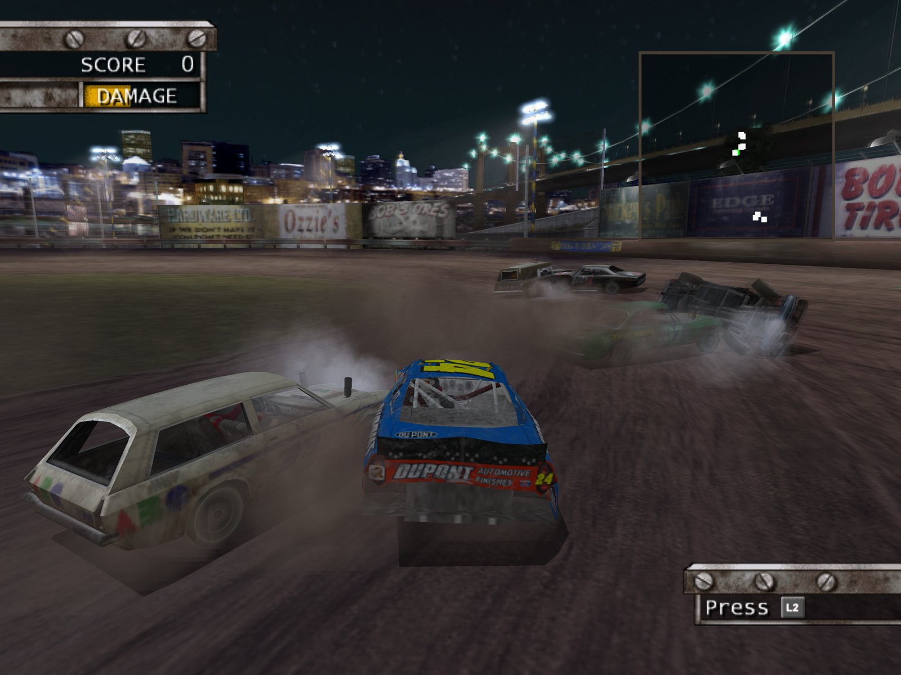

### Play Your Way

* **Native PC and Mac applications.** Statically recompiled from the PS2 binary into native x64 / ARM64 machine code with a custom Vulkan / Metal rendering backend.
* **Instant Classic ↔ Modern Toggle (`F9`).** Press **`F9`** at any time to compare authentic PS2 software-style presentation against the high-resolution Modern Native Plume Renderer (`1×` to `8×+` internal resolution, anisotropic filtering, unthrottled draw distance & highest-LOD vehicles across the entire arena, and expanded particle/debris budgets).
* **Controller first.** Xbox, DualShock, and DualSense controllers work out of the box with analog triggers for gas and brake. Keyboard and mouse work seamlessly too.
* **Hot-plug 2-player split screen.** Plug in a second controller whenever you like and jump into 2-player split-screen action.
* **Widescreen and higher resolutions.** Play in original `4:3` framing or true `16:9` / ultrawide widescreen with edge-anchored HUD elements.
* **1-Click Standalone `.ISO` Setup.** No external extractor scripts needed — select your North American `SLUS_209.10` `.ISO` on first launch and the game extracts and verifies `DATA/` automatically.

### Battle Mode Everywhere

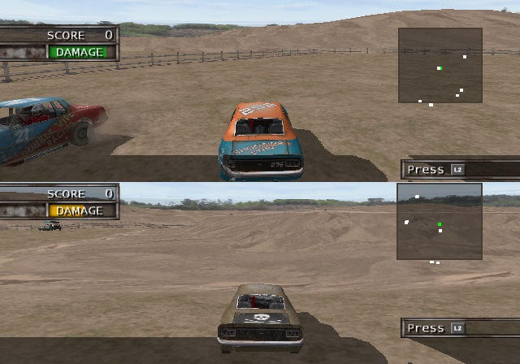

* **Battle on every map.** Pick 4 AI or 8 AI opponents with mixed car classes on any track.
* **Battle for two.** 2-player split screen offers 1v1, 4 AI, and 8 AI demolition battles.
* **Battle events in Career.** Fresh Battle events appear directly in the Career event list.
* **Every rival has a name.** Take out an AI driver — or get wrecked yourself — and the HUD announces exactly who did it.

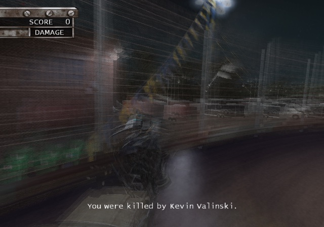

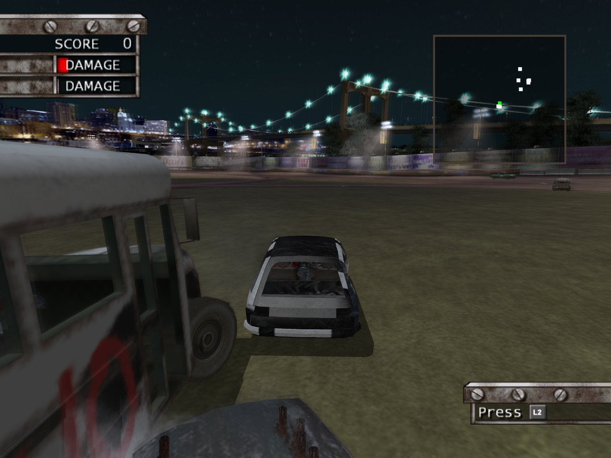

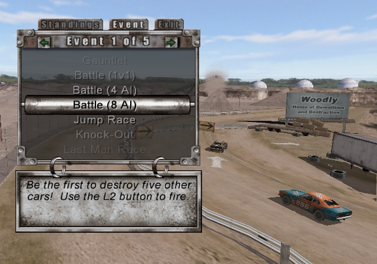

### Bonus Cars & NASCAR Imports

* **The Phantom.** A mean, black-and-white custom demolition machine.
* **NASCAR Stock Cars (*Dirt to Daytona* imports).** Take Cup-style racers through the mud — they crumple, shed bumpers and panels, and cast proper dynamic shadows just like the original roster.
* **Special vehicles in Career.** The School Bus, Hearse, Ambulance, Taxi, Mail Van, and Police Car are stocked at the Career car dealer and eligible for Career events.

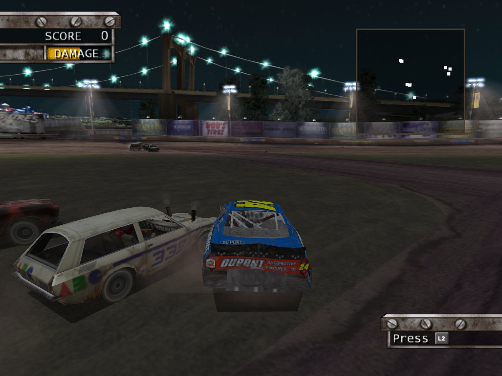
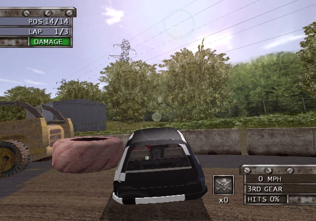

### Career, Wide Open

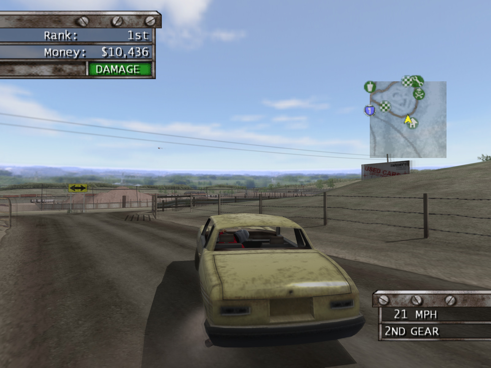

*Heading down a country road in Career free roam.*

* **Every shop and event open from day one.** Upgrades, Time Challenges, the Highway, Troy's Place, and all 25 Eves are open right away.
* **The dealer sells every car.** Every visit to the auto shop brings in a fresh lineup until you've seen the entire roster — including the Phantom, NASCAR stock cars, and all six special vehicles — with 100% trade-in refunds so you can experiment freely.
* **Never broke, never locked out.** Career cash stays topped up to at least $10,000 in free roam while winnings still add on top, and your rank stays at **1st** without ending the Career.
* **Killable challengers.** Highway and Malt Shop challengers in Career free roam no longer stop taking damage at 90% — you can wreck them outright. Every Career unlock can be toggled live in the **Mods** tab.

### A Modern In-Game Menu Styled Like the Original

Press **Start + Select** on a controller (or **`F1`** / **`Cmd+,`** on a keyboard) at any time to open the in-game overlay menu. Tabs for **Graphics, Mods, Settings, Inputs, and Online** let you adjust render scale, aspect ratio, active mods, and soundtrack tracks without leaving your race.

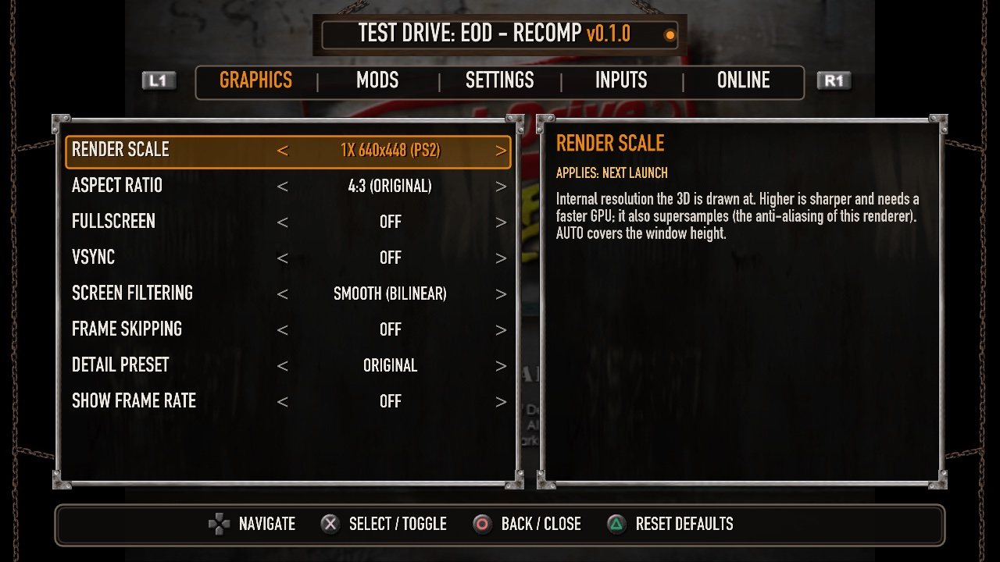

### Online Multiplayer Racing & Derbies

The host picks the track and event. Each driver chooses a car and paint, sees their friends' choices in real time, and marks Ready. End Race returns the party to the Online lobby, where the same Garage Code and roster are waiting for the next rematch.

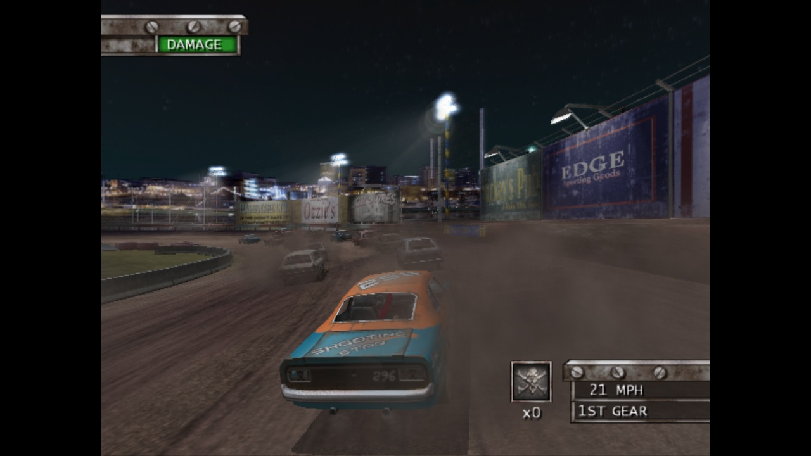

* **Controller-friendly lobby.** D-pad navigation, shoulder-button tabs, Cross/A to select, and Circle/B to go back.
* **Garage Codes & LAN discovery.** Host an internet game, join by a short Garage Code, or pick a LAN session automatically.
* **Lobby & rule controls.** Room limits up to 16 players, shared host rules (turbo, Chicken Fight, invincibility, durability, manual recovery), automatic content-manifest verification for installed mods, and built-in push-to-talk / mute / deafen voice controls.

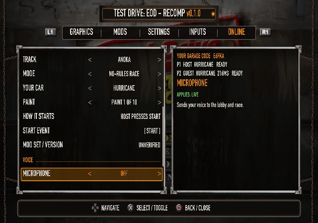

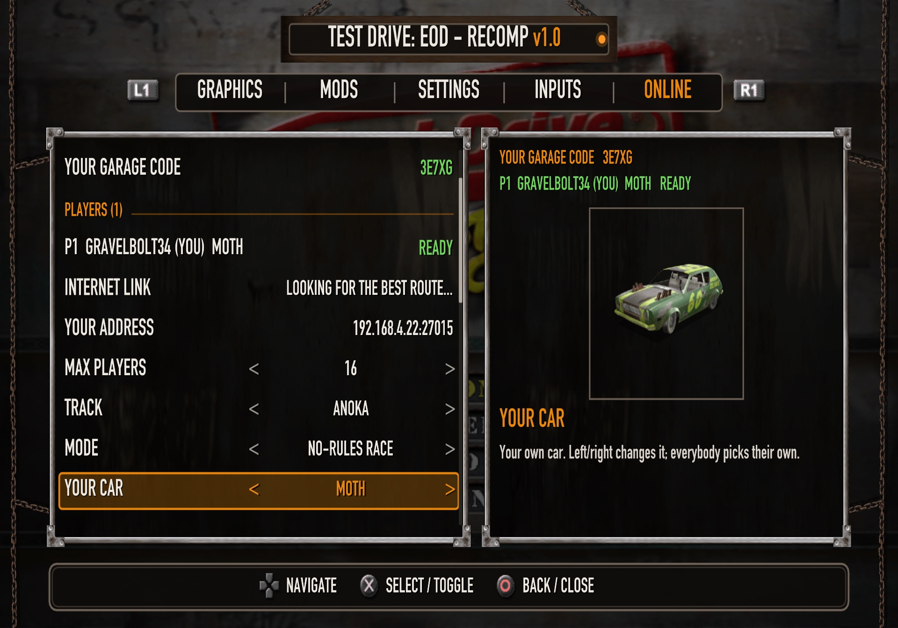

### Your Own Custom Soundtrack

Drop your own **MP3, AAC, FLAC, or WAV** files into your custom music folder and they play alongside the original soundtrack, complete with in-game song toggles in the **Mods** tab and independent **Music Volume** control.

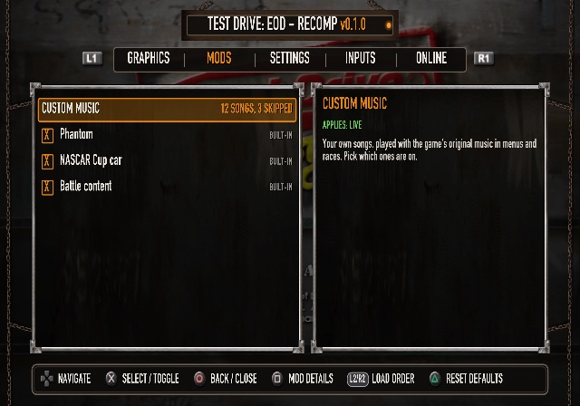

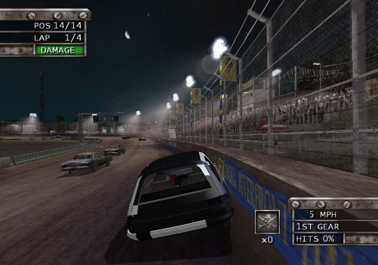

---

## Getting Started (Players & Modders)

### Playing the Game

1. **Download the release.** Choose the version you want and unzip its [Windows x64 or macOS player archive](https://github.com/catsandsoup/eod-recomp/releases).
2. **Launch the game.** Run **`eod.exe`** on Windows or **`Eve of Destruction.app`** on macOS.
3. **Select your retail PS2 `.ISO`.** Point the first-launch prompt at your North American *Test Drive: Eve of Destruction* (`SLUS_209.10`) `.ISO`. The game extracts and verifies `DATA/` automatically and remembers your installation.
4. **Drive!** Press **`F1`** (or **Start + Select**) for the in-game remaster menu, and **`F9`** to toggle between Classic PS2 and Modern high-resolution rendering.

**Updating an existing installation.** Close the game and unzip the new release into a fresh folder. Start that folder’s `eod.exe` (Windows) or `Eve of Destruction.app` (Mac). `eodsetup.exe` opens Windows settings. Press **F1** in the running game to check the version in the remaster menu header. If a shortcut still opens the older build, point it at the newly extracted game.

### Launching the 3D World Editor (Windows 11)

* **From a Release Bundle (`EOD-Recomp-Windows-x64`):** Double-click **`Launch EOD World Editor.bat`** in the root folder.
* **From a Source Checkout:** Double-click **`tools\world_editor\launch_editor.bat`** (or run `tools\world_editor\launch_editor_console.bat` to auto-create the `.venv` environment with `PySide6`, `numpy`, `Pillow`, and `PyOpenGL`).
* Follow [**Tutorial 1 & Tutorial 2 in `docs/TUTORIALS.md`**](docs/TUTORIALS.md) to sculpt your first jump ramp, flatten invisible barriers, and test it live with **`F5` Play-In-Editor (PIE)**.

### Building & Packaging a Standalone Windows Release

To assemble a clean, self-contained Windows x64 release folder (`dist/EOD-Recomp-Windows-x64/`) and `.zip` archive containing `eod.exe`, the 3D World Editor (`tools/world_editor/` + required format modules), `Launch EOD World Editor.bat`, and user documentation — verified free of any retail `DATA/` assets or personal paths:

```powershell
# Verify release inputs and safety guards without writing files:
python tools/package_windows_release.py --verify-only

# Build dist/EOD-Recomp-Windows-x64/ and dist/EOD-Recomp-Windows-x64.zip:
python tools/package_windows_release.py --zip
```

---

## Technical Documentation & Repository Map

The repository includes comprehensive reverse-engineering notes, symbol maps, format specifications, and verification harnesses:

* [**GitHub Wiki Home (`docs/wiki/Home.md`)**](docs/wiki/Home.md) — structured encyclopedic overview of the engine, Plume renderer, file formats, and modding tools.
* [**Step-by-Step Modding & World Editor Tutorials (`docs/TUTORIALS.md`)**](docs/TUTORIALS.md) — 7 hands-on tutorials with screenshots and shortcut tables.
* [**Engine Documentation Index (`docs/INDEX.md`)**](docs/INDEX.md) & [**Repository Map (`docs/REPOSITORY_MAP.md`)**](docs/REPOSITORY_MAP.md) — complete guide to all decompiled subsystems and documentation files.
* [**Native Plume Renderer Specification (`docs/NATIVE_RENDERER.md`)**](docs/NATIVE_RENDERER.md) — VIF mesh decoding, world/sky/water pipelines, per-vertex fog, unthrottled P10 LOD, and `EOD_DIFF` parity verification.
* [**File Formats & World Specs:**](docs/FORMAT_COVERAGE.md) [`WORLD_FORMAT.md`](docs/WORLD_FORMAT.md) · [`COLLISION_AND_BOUNDARIES.md`](docs/COLLISION_AND_BOUNDARIES.md) · [`ILIN_RACING_LINES.md`](docs/ILIN_RACING_LINES.md) · [`VALT_TABLES.md`](docs/VALT_TABLES.md) · [`SETU_CAR_SETUP.md`](docs/SETU_CAR_SETUP.md) · [`HOST_TEXTURE_REPLACEMENT.md`](docs/HOST_TEXTURE_REPLACEMENT.md) · [`CUSTOM_VEHICLE_PIPELINE.md`](docs/CUSTOM_VEHICLE_PIPELINE.md).

---

## Frequently Asked Questions

**Is this an emulator?**
No. The PS2 Emotion Engine MIPS R5900 executable (`SLUS_209.10`) and VU1 microcode programs have been statically translated ahead of time into native C++ / x64 / ARM64 code paired with a native Vulkan / Metal renderer and HLE runtime.

**Does this repository or release include the game's retail assets?**
No. **Zero retail game data (`DATA/`, `.TRK`, `.CAR`, `.RES`, or `.ISO`) is included or redistributed.** You must supply your own legally obtained North American PS2 copy (`SLUS_209.10`). All exported `.eodmod` packages are delta-only overlays.

**Which platforms are supported?**
The game runs natively on **Windows 10/11 x64** (Vulkan) and **Apple Silicon macOS** (Metal via MoltenVK). The 3D World Editor (`tools/world_editor/`) with embedded Play-In-Editor (PIE) targets **Windows 11 x64** (Qt 6 + OpenGL 3.3 Core + Vulkan PIE), while the Swift Creation Kit preview targets **Apple Silicon macOS**.

**What can I mod with the World Editor today?**
You can inspect and edit all 15 retail tracks and 37 vehicles: move, rotate, scale, and duplicate scenery and jump ramps (patching both `track.grf` visual VIF meshes and `SCOL` drivable terrain collision), flatten or adjust `SOBL` invisible barriers, place or scatter any of the 37 retail cars/wrecks, redraw `ILIN` AI racing lines, create custom game modes (Free Roam, Tag, Cat & Mouse, Fat Kid / Juggernaut), swap any texture up to 4K (`HOSTTEX`), borrow skyboxes across tracks, import *NASCAR: Dirt to Daytona* vehicles, and test everything immediately via **Play-In-Editor (`F5`)**.

---

## Legal, Credits & Licences

This is an unofficial fan restoration and research project. It is **not affiliated with or endorsed by Atari, Monster Games, or the owners of any trademarks** mentioned here. *Test Drive: Eve of Destruction* and all related names belong to their respective owners.

**No copyrighted game data is included.** You must own the retail game to use this software.

### Credits

* Builds upon the foundational static recompilation work of [eod-recomp by pareidolico](https://github.com/pareidolico/eod-recomp), inspired by N64Recomp and Zelda64Recomp.
* Expanded into a multiplatform Windows x64 & macOS remaster featuring the Native Plume Renderer, deterministic online netplay, Career & Battle expansions, *NASCAR: Dirt to Daytona* vehicle conversion tools, and the 3D World Editor & Creation Kit.
* Uses [Dear ImGui](https://github.com/ocornut/imgui) (MIT Licence), [SDL3](https://github.com/libsdl-org/SDL) (zlib Licence), [Plume](https://github.com/renderbag/plume), and [PySide6 / Qt 6](https://wiki.qt.io/Qt_for_Python) for the World Editor. Thanks to everyone who built those projects.
