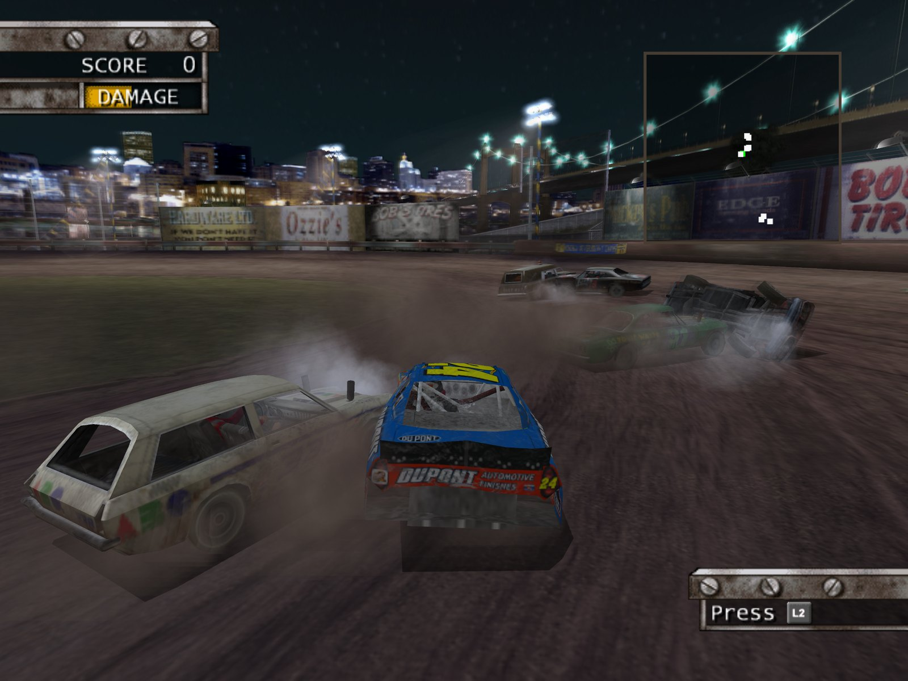
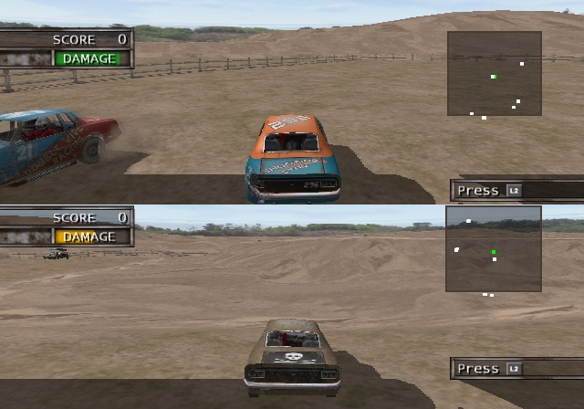
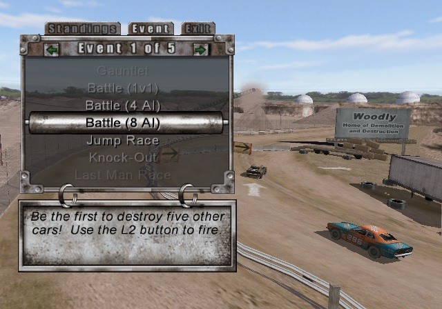
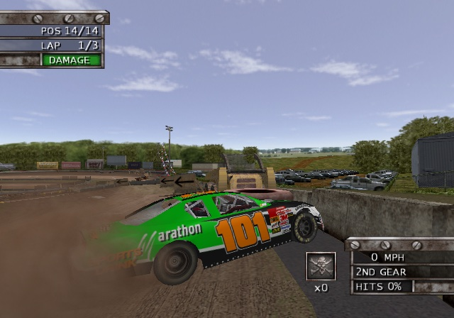
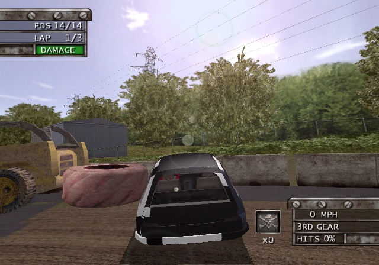
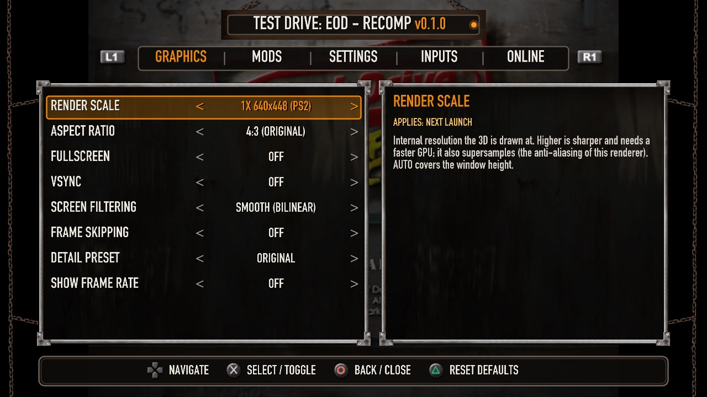
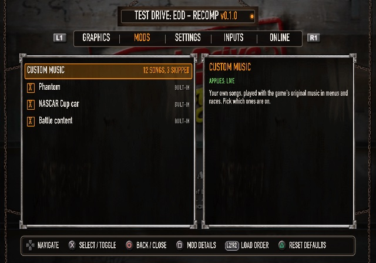
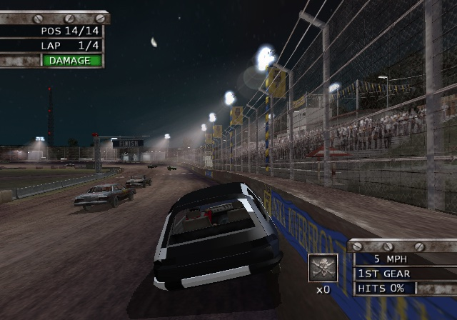

# Test Drive: Eve of Destruction on PC and Mac — the native port

**Smash, crash and race the 2004 PS2 demolition derby classic as a real native app. No emulator. Just one app and a controller.**

**Test Drive: Eve of Destruction** ("TD EOD" to fans) is back. This fan-made **native PC and Mac port** is built with static recompilation, so the original game's code runs directly on your computer instead of inside a PS2 emulator. It runs on **macOS with Apple Silicon** today, with **Windows** on the way.

## Why play it this way?

* **One app.** Open it, point it at your game, drive. There is no emulator to configure and no BIOS to hunt down.
* **Built for today's machines.** Native Apple Silicon performance, widescreen and higher resolutions.
* **The original game, untouched.** Everything from 2004 is preserved. Nothing is removed. New content is added on top.

## Features

### Play your way

* **Controller first.** Xbox and PlayStation controllers work out of the box, with analog triggers for gas and brake. Keyboard and mouse work too.
* **Hot-plug 2-player split screen.** Plug in a second pad whenever you like and the game is ready for two.
* **Widescreen and higher resolutions.** Sharper than the PS2 ever managed, in 4:3 or true widescreen.
* **Everything unlocked outside Career.** Jump straight into any car and any map in the other modes.

### Battle mode everywhere

* **Battle on every map.** Pick 4 AI or 8 AI opponents, with mixed car classes.
* **Battle for two.** 2-player split screen offers 1v1, 4 AI and 8 AI.
* **Battle events in Career.** Fresh events appear in the Career event list.

### Bonus cars

* **The Phantom.** A mean, black-and-white new ride for the demolition derby.
* **A NASCAR stock car.** Take a Cup-style racer through the mud. More are on the way.

### A modern menu that looks like the original

Press **Start + Select** at any time to open the in-game menu, styled like the original game. Tabs for **Graphics, Mods, Settings, Inputs and Online** let you change things without leaving your race.

### Your own soundtrack

Drop your own **MP3, AAC, FLAC or WAV** files into a folder and they play alongside the original songs, just like custom soundtracks on the Xbox version. Choose which ones are on from the Mods tab.

### Dirt, fences and floodlights

## Coming soon

No dates, just where we are headed:

* **Online play with friends** through simple join codes, plus voice chat
* **Higher draw distance and more detail**
* **More cars on track**
* **Texture packs**, including 4K
* **The full NASCAR roster**
* **Mod support** for custom cars and tracks

## Getting started

1. **Get the app.** On Mac, open **Eve of Destruction.app**.
2. **Bring your own game.** You need your own legally obtained copy of Test Drive: Eve of Destruction (North American PS2 version).
3. **Pick your disc image.** On first launch the app asks you to choose your game's disc image (or the disc's folder). It checks that it is the right game, copies what it needs, and shows you progress.
4. **Play.** That is the whole setup. Next time, it launches straight into the game.

Build it yourself

Want to build the app from source? See the [macOS build guide](docs/MACOS.md).

## Frequently asked questions

**Is this an emulator?** No. The game's code has been translated ahead of time into native code, so it runs as a regular app.

**Does it include the game?** No. You must own the game and supply your own copy.

**Which platforms?** macOS on Apple Silicon now. Windows is coming.

## Legal, credits and licences

This is an unofficial fan project. It is **not affiliated with or endorsed by Atari, Monster Games or the owners of any trademarks** mentioned here. Test Drive: Eve of Destruction and all related names belong to their respective owners.

**No game data is included.** You must own the game to use this port.

Credits: this port builds on [eod-recomp by pareidolico](https://github.com/pareidolico/eod-recomp), the original static recompilation of the game for Windows, which takes its approach from projects such as N64Recomp and Zelda64Recomp. The menu system uses [Dear ImGui](https://github.com/ocornut/imgui) (MIT licence) and the Mac version uses SDL3 and Vulkan through MoltenVK. Thanks to everyone who built those projects.

*Keywords: Test Drive Eve of Destruction PC, Eve of Destruction Mac, TD EOD recomp, PS2 demolition derby port, native port, Apple Silicon, static recompilation.*
