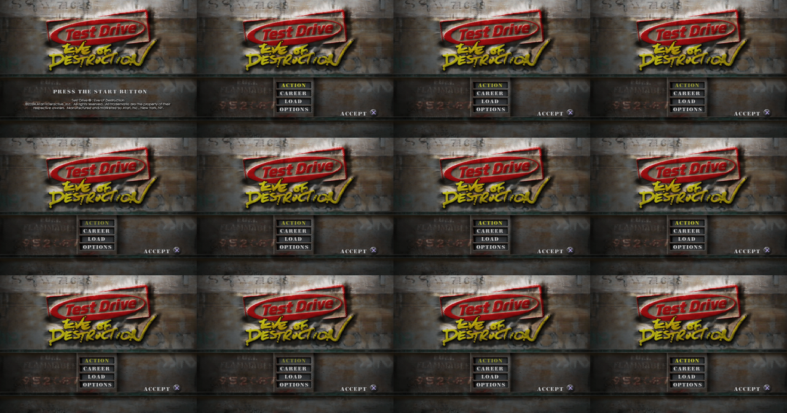

# eod-recomp — Test Drive: Eve of Destruction, native PC port

**Version 1.0.2**

This project turns the PlayStation 2 executable of **Test Drive: Eve of
Destruction** (NTSC-U, `SLUS_209.10`, v1.00) into C/C++ source code that builds
into a native Windows program: Windows 7 or later, 32- or 64-bit, any SSE2 CPU
(Core 2 Duo or newer). It uses **static recompilation**, the approach of
N64Recomp/Zelda64Recomp. It is not an emulator: the game's code is translated
to C ahead of time and runs natively, on top of a runtime that replaces the
PS2 hardware.

**No game files are included.** You need your own copy of the game disc.


## What you get

* **The whole game:** menus, Career and Action modes, the garage, races
  and the movies, with sound effects, music, speech and movie audio.
* **Direct3D 11 renderer** at up to 6x the PS2 resolution, with frame
  skipping so the game keeps full speed on slow PCs. A software renderer is
  included for machines without Direct3D 10-class graphics.
* **Real widescreen:** the game's own 16:9 mode with a wider 3D view and an
  undistorted HUD, forced on from the start if you want it. Movies stay 4:3.
* **In-game menu** (F1, or L3 + R3 on a controller): fullscreen, aspect ratio,
  VSync, scaling, frame skipping, sound, volume, vibration and keyboard
  bindings, changed while playing. Built with
  [Dear ImGui](https://github.com/ocornut/imgui).
* **Keyboard and XInput controllers**, with DualShock 2 pressure emulation.
* **`eodsetup.exe`**, a settings program, with:
  * **PCSX2 save import:** continue a game saved in PCSX2 (`.ps2` memory card).
  * **Save editor:** career money, reputation (unlocks) and all 280 of the
    game's settings.
  * **Garage:** put any of the game's 274 vehicles in the four career slots.
    All 130 dealer cars go into the save. Action mode paint jobs and the
    special vehicles (Bus, Copcar, Hearse, Postal, Taxi, Ambulance) are shown
    by the port over the slot's career car, and drive like that vehicle.
  * **Car durability as rated in the menu** (optional): in the original game a
    car's toughness comes only from its weight, and the durability ratings in
    the menus are never used. This option applies the per-car durability
    values found in the game's own car files, which those ratings follow. The
    table of every car's damage, with and without the option, is in the
    README.txt that comes with the builds (`dist/README.txt`).

## Status

| Area | State |
| --- | --- |
| Recompiled code | Complete: about 13,500 functions |
| Graphics | Direct3D 11 (feature level 10_0+) and software GS renderers |
| Sound | Effects, music, speech and movie audio |
| Movies | All play (IPU / MPEG-2 emulation) |
| Gameplay | Career and Action modes are playable |
| Memory card | Saves in `memcard/port0` next to the game; PCSX2 saves can be imported |
| Performance | Full speed in menus and most races on a low-end laptop (Core i3-6006U, Intel HD 520). The busiest race scenes are limited by the CPU; frame skipping keeps the game at full speed there |

### Known issues and plans

* **CPU use in heavy races.** The game's VU1 micro programs (geometry and
  lighting) are compiled ahead of time to C++ but still take most of the CPU
  time in busy scenes. Making them cheaper is the main remaining work.
* Mouse and keyboard driving and mouselook are not supported.
* `EOD_SKIP_MOVIES=1` (a testing switch) leaves the game silent.

Bug reports are welcome on the
[issue tracker](https://github.com/pareidolico/eod-recomp/issues).


## Downloads

Builds for Windows (64- and 32-bit) and Linux are on the
[Releases](https://github.com/pareidolico/eod-recomp/releases) page. They are
made by the `Release builds` workflow (`.github/workflows/release.yml`), which
needs the `EOD_DECOMP_TOKEN` secret to read the game's executable for the code
generation; the executable is deleted before building and is in no archive.
The game itself is not included.

## Game files

Copy the whole disc (at least `SLUS_209.10`, `SYSTEM.CNF` and the `DATA`
folder) into one folder and put `eod.exe` and `eodsetup.exe` there (or pass
`--data <folder>`). The executable checks that `SLUS_209.10` is the exact
version this code was generated from (NTSC-U v1.00).

## Running

Run `eodsetup.exe` once to choose the settings (renderer, graphics adapter,
window size or fullscreen, aspect ratio, internal resolution, VSync, sound,
keyboard, folders, car durability). It writes them to `eod.ini` next to
`eod.exe` and can start the game. `eod.exe` alone runs with the defaults.

The window title shows the speed ("100% speed" = real time) and the drawn
frames per second.

| Option | Meaning |
| --- | --- |
| `--data DIR` | folder containing `SLUS_209.10` and `DATA/` |
| `--renderer d3d11\|software\|warp` | renderer (`warp`: Direct3D 11 on Microsoft's software device) |
| `--fullscreen` / `--windowed` | override the window mode |
| `--scale N` | initial window size (N × 320×240) |
| `--config FILE` | another settings file |
| `--import-save CARD.ps2` | copy the game's save from a PCSX2 memory card |
| `--save-edit SAVEFILE [money=N] [rep=A,B,POINTS] [slotN=VEHICLE] [setting=value]...` | edit a save (without arguments: list its values; `vehicles` lists the vehicle numbers) |
| `--log cats` / `--log-file F` | debug logging (`core,kernel,sif,file,gs,...` or `all`) |
| `--frames N` | exit after N frames (testing) |
| `--screenshot-every N --screenshot-dir D` | dump frames as PPM |

Keyboard: arrows = D-pad/left stick, X/Space = ✕, C = ○, Z = □, V = △,
Q/E = L1/R1, A or 1 = L2, D or 3 = R2, Enter = Start, Backspace = Select,
Alt+Enter or F11 = fullscreen, F1 = in-game menu. XInput controllers map to
the DualShock layout.

### Settings worth knowing

* **Widescreen:** choose "Widescreen (16:9)" in the game's Options, or 16:9 in
  `eodsetup.exe` / the in-game menu to keep the game in widescreen from the
  start. "4:3" keeps it in the normal mode; "stretch" fills the window.
* **Garage looks** are stored in `eod.ini` as `[Career] CarLooks=career
  vehicle:vehicle,...` (e.g. `845:146`: the white career Durand looks and
  drives like Durand Action paint 3). Without that line, or on a PS2, the
  career car shows as it is.
* **Car durability:** `[Gameplay] CarDurability=1`. The damage a car takes is
  the event's damage setting × 4000 lb ÷ the car's weight × its upgrades'
  factor (Chassis Reinforcement); the option multiplies in each car's
  `damage_scale` (Bus 0.3, Durand 0.5, Limo 0.6, Postal 2.5...).

### Reporting bugs and performance

```bat
set EOD_FPS=1
eod.exe --log gs,core --log-file eod_log.txt 2> eod_fps.txt
```

Attach `eod_fps.txt` and `eod_log.txt` to the report.



## Building

Requirements: your own `SLUS_209.10` in the repository root (the C translation
in `gen/` is generated from it and is not part of the repository), CMake 3.16+,
a C/C++17 compiler and Python 3 with `rabbitizer` (`pip install rabbitizer`).

```sh
# 1. generate the C translation (also done automatically on first configure)
python3 tools/analyze.py
python3 tools/recomp.py
python3 tools/vurecomp.py     # VU micro programs (optional)

# 2a. Windows (cross compile from Linux/WSL with MinGW-w64), 32-bit, runs on Windows 7+
cmake -S . -B build-win32 -G Ninja -DCMAKE_TOOLCHAIN_FILE=cmake/mingw-i686.cmake -DCMAKE_BUILD_TYPE=Release
ninja -C build-win32          # -> build-win32/eod.exe (static, no DLLs needed)

# 2a'. 64-bit Windows (faster on x64 systems)
cmake -S . -B build-win64 -G Ninja -DCMAKE_TOOLCHAIN_FILE=cmake/mingw-x86_64.cmake -DCMAKE_BUILD_TYPE=Release
ninja -C build-win64

# 2b. Windows with MSYS2/MinGW on Windows itself
cmake -S . -B build -G "MinGW Makefiles" -DCMAKE_BUILD_TYPE=Release && cmake --build build

# 2c. Linux (headless test build)
cmake -S . -B build-linux -G Ninja -DCMAKE_BUILD_TYPE=RelWithDebInfo && ninja -C build-linux
```

The 32-bit Windows build targets SSE2 (Pentium 4 / Core 2 and newer) and
imports only `kernel32`, `user32`, `gdi32`, `winmm` and `msvcrt`.

## How it works

Hand-decompiling ~717,000 MIPS instructions is not feasible in one go, so the
port uses **static recompilation**, the approach used by projects like
N64Recomp/Zelda64Recomp:

1. **`tools/analyze.py`** finds every function in the executable (call
   targets, vtables and other code pointers, tail-jump targets, orphaned code)
   and every `switch` jump table: about 13,500 functions.
2. **`tools/recomp.py`** translates each MIPS R5900 function into an equivalent
   C function (`gen/rec_*.c`). Every instruction is covered: 64/128-bit
   integer ops, MMI SIMD, FPU, VU0 macro mode, branch delay slots, branch-likely,
   unaligned loads/stores, jump tables and indirect calls.
3. The **runtime** (`runtime/`) replaces the PS2 hardware and operating system
   with high-level emulation:
   * `kernel/` – EE kernel: threads (on host fibers), semaphores, interrupt
     and DMA handlers, alarms, vblank timing, libkernel's kernel patches
   * `core/` – CPU state, memory map, MMI instructions, logging
   * `hw/` – DMA controller, timers, interrupt controller and the IPU
     (MPEG-2 macroblock decoding and colour conversion used by the movies)
   * `vu/` – VU0/VU1 interpreter (with the pipeline/stall timing the game's
     microcode depends on, including the 4-cycle delay of the MAC/status/clip flags) and VIF0/VIF1 (unpack, MPG, MSCAL, DIRECT, PATH3 masking).
     The game's micro programs are also compiled ahead of time to C++ by
     **`tools/vurecomp.py`** (from the images in `config/vu/`); the
     interpreter runs anything that doesn't match them.
   * `gs/` – Graphics Synthesizer: swizzled 4 MB VRAM in all pixel formats,
     GIF packets, transfers, CLUTs and a software rasteriser implementing the
     full GS pixel pipeline, with a decoded-texture cache and, on CPUs with
     four or more threads, rasterisation spread over worker threads.
     `gs/d3d11/` is the Direct3D 11 renderer: GPU surfaces own the pages of GS
     memory they draw, with GPU conversions between colour/depth formats and
     block layouts (the game's shadows reinterpret depth buffers as colour),
     a content-hashed texture cache and one shader for the GS pixel pipeline
     (`tools/build_shaders.py` compiles it ahead of time through Wine)
   * `iop/` – the I/O processor: the SIF RPC protocol, plus emulations of the
     IRX modules the game loads: `fileio` (game data from disk), `padman`
     (DualShock 2), `mcserv` (memory card in a host folder), `loadfile`,
     `iopheap`, multitap, the Logitech wheel driver, the game's `stream.irx`
     disc streamer and `sdrdrv` (sound) on top of an SPU2 emulation
     (ADPCM voices, ADSR, AutoDMA PCM streaming)
   * `platform/` – Win32 (GDI window, XInput/keyboard, waveOut, fibers) and
     POSIX (headless, used for automated testing)
4. **`src/`** holds hand-written C++ that replaces or wraps specific game
   functions (see `config/hle.txt`). Hand-decompiled game code goes here over
   time.

`config/symbols.txt` collects identified function names; `tools/dis.py` is an
annotated disassembler used for reverse engineering.

## Credits and licences

The menu overlay uses [Dear ImGui](https://github.com/ocornut/imgui) 1.91.8
(MIT licence, `third_party/imgui`). Test Drive: Eve of Destruction is a
trademark of its owners. The game's executable and data files are not
included: you need your own copy of the game to build and to run the port.

## Debugging aids

* `EOD_GS_TRACE=<frame>` logs every primitive drawn in that frame
* `EOD_FPS=1` prints vblanks/s (60 = full speed), game frames/s (drawn or
  skipped), drawn frames/s, how busy the EE and GS threads are and how long
  the EE waits for the GS, every 5 s, followed by where each thread's time
  went (EE: game code, VU programs, VIF, GIF, sound, movies, waiting, idle;
  GS: command processing, drawing state, draws, texture lookups, new
  textures, uploads, readbacks, conversions, present, idle)
* `EOD_SKIP_MOVIES=1` skips the movies; `EOD_GS_THREAD=0` renders on the main thread;
  `EOD_GS_RASTER=n` sets the number of raster worker threads (0 = none);
  `EOD_FRAMESKIP=0` disables frame skipping (when rendering falls behind,
  whole game frames are dropped so the game keeps running at full speed)
* `--log gs` prints per-second renderer statistics (pixels, texture decoding,
  raster jobs and barriers, pixels per triangle type; with Direct3D 11 also draw
  calls, uploads, readbacks and texture cache use); `--log gsxfer` logs every
  GS memory transfer (very large: movies alone write thousands per second)
* `EOD_GS_CENSUS=file` tallies the GS features used (state combinations, rendered
  buffers read back as textures); `EOD_GS_REPLAY_TRACE=1` logs the primitives of a
  replay; `EOD_GS_REPLAY_STOP=n EOD_GS_REPLAY_DUMP=file` dumps GS memory after the
  n-th primitive (compare renderers with `--renderer d3d11|software`);
  `EOD_D3D_SHOW=bp` displays another buffer; `EOD_D3D_NODRAW=1` skips the GPU draw calls (replay
  benchmarks of the CPU side: `--gs-replay` prints the milliseconds per GS category); `EOD_D3D_SYNC_CLUT=1` waits for the GPU on every CLUT
  load from a rendered buffer (by default such CLUTs come from the previous, non-blocking copy); `--renderer warp` runs the Direct3D 11 renderer on Microsoft's
  software device (WARP) instead of the graphics driver, to tell driver problems from renderer bugs
* `EOD_VU1_THREAD=1` (experimental) runs VIF1/VU1, GIF DMA and the GS command stream on a worker thread;
  `EOD_GS_SKIPALL=1` makes the GS skip all drawing (benchmarks of the EE side)
* `EOD_VU_CHECK=1` runs every compiled VU program a second time in the
  interpreter and reports differences; `EOD_VIF_CHECK=1` does the same for the
  fast VIF unpack paths
* `EOD_VU_DUMP=dir` writes the VU micro programs that run (input for
  `tools/vurecomp.py`, see `config/vu/`); `EOD_VU_INTERP=1` disables the compiled ones
* `EOD_VU_REC=file EOD_VU_REC_AT=vblank [EOD_VU_REC_N=runs]` records the state before each VU
  micro program run; `eod --vu-bench file [--repeat N]` replays the recording and prints the
  time spent in the micro programs and a hash of their results (the same with
  `EOD_VU_INTERP=1` when the compiled code is right). `VUREC_COUNT=1 python3 tools/vurecomp.py`
  adds block counters that `--vu-bench` prints (hot loops)
* `EOD_GS_DUMP=file EOD_GS_DUMP_AT=vblank [EOD_GS_DUMP_N=count]` captures the GS state and
  command stream; `eod --gs-replay file [--repeat N]` replays it alone, prints the time and
  writes the final image to `file.ppm` (deterministic renderer benchmarks)
* `EOD_GS_NOTEXCACHE=1`, `EOD_DEBUG_NOMIP=1`, `EOD_DEBUG_PIXEL=x,y` (with
  `EOD_GS_TRACE`: logs every write to that pixel) help bisect rendering bugs
* `EOD_WATCH=addr,...` logs float values at EE addresses when they change;
  `EOD_WATCHW=addr` (Linux) reports the host code that first writes a huge value there
* `EOD_MEMCARD=dir` uses another memory card folder (e.g. an empty one for repeatable tests)
* `EOD_WAV=file` (POSIX build) writes the audio output to a WAV file
* `cmake -DEOD_TRACE_CALLS=ON` records the last EE function calls, printed on crashes
* `EOD_DUMP_RAM=file` writes the 32 MB of EE RAM to a file when the game exits;
  `EOD_POKE=addr=value,...` (hex) writes 32-bit words into EE RAM every vblank
* `EOD_PAD_SCRIPT=frame:buttons,...` scripts controller input (port 0); `tools/padscript.py`
  builds it from button names (see its help for a Career-mode example)
* `python3 tools/dis.py -f <addr>` disassembles a function with string/symbol annotations
