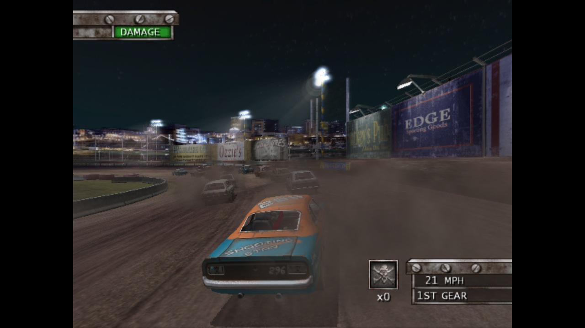

# Eve of Destruction Remaster 1.0

The 2004 demolition racer on PC and Mac.

Pick your game ISO, choose a car, and head for the dirt oval. Play local split screen, host an online lobby, or take the school bus into Battle.

- **PC and Mac.** Windows x64 and Apple Silicon downloads.
- **Choose your ISO.** The app installs the game files automatically and remembers them for your next launch.
- **Controller navigation.** D-pad menus, shoulder-button tabs and controller confirmation after entering a join code.
- **Online lobbies.** Host, join by Garage Code or LAN, choose your car and paint, and return for a rematch.
- **Your screen name.** Choose a nickname or use a random callsign.
- **Host-controlled rules.** Set gameplay modifiers for everyone before the race.
- **Your soundtrack.** Play MP3, AAC, FLAC and WAV files, with separate music volume.
- **Display options.** Widescreen, original 4:3 and adjustable internal resolution.

Bring your own North American PS2 copy of Test Drive: Eve of Destruction. Unzip the download for your platform and open the app.

[See the remaster](https://github.com/catsandsoup/eod-recomp#readme)
