# Explosive Chicken Weapon Subsystem Decompilation (`0x0017DA58`–`0x0017E968`)

Native C++ decompilation of *Test Drive: Eve of Destruction* (`SLUS_209.10`) explosive chicken weapon mechanics, radial blast shockwave, ballistic launch regimes, reload cooldown state machine, projectile detonation, weapon registry, and lifecycle helpers.

- **Implementation:** [`src/decomp_chicken_weapon.h`](../src/decomp_chicken_weapon.h), [`src/decomp_chicken_weapon.cpp`](../src/decomp_chicken_weapon.cpp)
- **Hook integration (preserved 100%):** [`src/game_patches.cpp`](../src/game_patches.cpp), [`src/chicken_replay.cpp`](../src/chicken_replay.cpp)
- **HLE registration:** [`config/hle.txt`](../config/hle.txt)

## 1. Decompiled Functions & Live `EOD_DIFF` Verification

All 12 functions are wrapped with `diff_run` against their recompiled PS2 EE originals (`f_XXXXXXXX_orig`). Live headless `EOD_DIFF` verification was executed in **Battle (8 AI)** on Anoka (`9` cars firing explosive chickens, `t = 0..45.5 s`, plus host/guest online Battle) with **0 mismatches** across every checked call:

| Address | Symbol | Role | `src/decomp_chicken_weapon.cpp` | Live `EOD_DIFF` Calls (Checked / Mismatched) |
|---|---|---|---|---|
| `0x0017DA58` | `ChickenExplosionApplyShockwave` | Radial blast shockwave on 100×100 spatial hash grid (`0x0048D2B4`) | `chicken_explosion_blast_impl` | 21 / 21 checked, **0 mismatched** (solo Battle 8 AI); 32+ / 32+ checked, **0 mismatched** (online host) |
| `0x0017E000` | `ChickenWeaponTrigger` | Ballistic launch (Straight / Mortar / Rain) & release-to-rearm | `chicken_launch_impl` | 5,296 calls / 1,324 checked (`EVERY=4`) + 806 / 806 (`EVERY=1`), **0 mismatched** |
| `0x0017E4D8` | `ChickenWeaponStartCooldown` | 3.0 s native reload cooldown init (`+0x1E0` / `+0x1E4`) | `chicken_reload_start_impl` | 66 / 66 checked (solo Battle 8 AI); 128+ checked (online guest), **0 mismatched** |
| `0x0017E718` | `ChickenWeaponDetonate` | Impact gating, scorch decal, particle burst, blast dispatch, SFX | `chicken_impact_impl` | 433 calls / 109 checked (`EVERY=4`, 9 detonations) + 70 / 70 (`EVERY=1`), **0 mismatched** |
| `0x0017DDB0` | `WeaponRegistryUnregister` | Swap-remove interface from `g_WeaponRegistry` (`0x003CE3F8`) | `weapon_registry_unregister_impl` | 0 calls in mid-match exit (teardown-only; verified by instruction audit) |
| `0x0017DE30` | `WeaponRegistryRegister` | Append `(owner, slot, iface)` row to `g_WeaponRegistry` | `weapon_registry_register_impl` | 9 / 9 checked, **0 mismatched** |
| `0x0017DE78` | `WeaponRegistryQuery` | Linear lookup of weapon interface by `(owner, slot)` | `weapon_registry_query_impl` | 138 / 138 checked, **0 mismatched** |
| `0x0017DFA8` | `ChickenWeaponAlloc` | Allocate `0x228`-byte body, base ctor `0x0017D898`, install vtables | `chicken_weapon_alloc_impl` | 9 / 9 checked, **0 mismatched** |
| `0x0017E440` | `ChickenWeaponGetHudStatus` | Map reload state (`0..3`) to HUD string & ready flag | `chicken_weapon_get_hud_status_impl` | 20 / 20 checked, **0 mismatched** |
| `0x0017E520` | `ChickenWeaponCaptureReplayState` | Snapshot 48-byte pose, region ID, and in-flight flag to replay buffer | `chicken_weapon_capture_replay_impl` | 202 / 202 checked, **0 mismatched** |
| `0x0017E5C8` | `ChickenWeaponUpdate` | Per-frame reload expiry, underground park, rain spawn, flight step | `chicken_weapon_update_impl` | 900 / 900 checked, **0 mismatched** |
| `0x0017E8C0` | `ChickenWeaponRetire` | Silent retirement: physics reset, underground park, reload restart | `chicken_weapon_retire_impl` | 18 / 18 checked, **0 mismatched** |

### Unit Tests Verified
- `native_weapon_test` (`ctest -R native_chicken_weapon`): **197 / 197 checks passed** (launch, cooldown, contact, attribution, radial impulse).
- `eod_live_cheats_test`: **PASS** (live cheats, controller combo triggers, Battle mode, `ChickenReload` override).

## 2. Memory Layouts & Constants

### Global State
| Address | Name | Description |
|---|---|---|
| `0x003C4190` | `kCheatFlagsAddr` | Bitmask: `0x01` Master, `0x08` Weapon (Straight), `0x10` Mortar, `0x80` Rain |
| `0x003CDACC` | `kRaceClockAddr` | `float` simulation race clock in seconds |
| `0x003CE3F8` | `kWeaponRegistryAddr` | `16 × 12`-byte rows: `{ int32_t owner; int32_t slot; uint32_t iface; }` |
| `0x003CE4B8` | `kWeaponRegistryCount` | `int32_t` active registry row count |
| `0x0048D2B4` | `kSpatialHashGridPtr` | Pointer to 100×100 cell table (20 m pitch, `[-1000, +1000]` m in X/Z) |

### Chicken Projectile Body (`0x228` bytes)
Vtables installed by `ChickenWeaponAlloc` (`0x0017DFA8`):
- `body + 0x098`: `0x003F9538` (scene / physics body vtable)
- `body + 0x1DC`: `0x003F9528` (weapon interface vtable; `iface = body + 0x1DC`)

| Offset | Type | Field |
|---|---|---|
| `+0x004` | `int32_t` | Replay buffer slot byte offset |
| `+0x034` | `float[12]` | 3×4 pose matrix (`Right`, `Up`, `Forward`, `Pos`) |
| `+0x064` | `float[3]` | World Right axis (populated by `SceneObjectSetPose`) |
| `+0x070` | `float[3]` | World Up axis |
| `+0x07C` | `float[3]` | World Forward axis |
| `+0x088` | `float[3]` | World position |
| `+0x094` | `int16_t` | Track region / zone ID (copied from firing car `+0x94`) |
| `+0x098` | `uint32_t` | Scene object vtable (`0x003F9538`) |
| `+0x104` | `float[3]` | Linear velocity (m/s) |
| `+0x110` | `float[3]` | Angular velocity (rad/s; zeroed on launch) |
| `+0x1D8` | `int32_t` | Visible / active flag |
| `+0x1DC` | `uint32_t` | Weapon interface vtable (`0x003F9528`) |
| `+0x1E0` | `int32_t` | `WeaponState`: `0` Cooldown, `1` AwaitingRelease, `2` Armed, `3` Disabled |
| `+0x1E4` | `float` | Cooldown deadline (`race_clock + 3.0f` natively) |
| `+0x1E8` | `int32_t` | Owning participant slot index |
| `+0x1EC` | `int32_t` | Pending retire flag (triggers `f_0017F530` on next update) |
| `+0x1F0` | `int32_t` | Impact-armed flag (must be non-zero to detonate) |
| `+0x1F4` | `int32_t` | In-flight flag |
| `+0x1F8` | `float[3]` | Launch SFX world position |
| `+0x204` | `float[3]` | Detonation SFX world position |
| `+0x210` | `uint32_t` | Launch sound emitter pointer |
| `+0x214` | `uint32_t` | Flight-loop sound emitter pointer |
| `+0x218` | `uint32_t` | Detonation sound emitter pointer |
| `+0x21C` | `float[3]` | Local muzzle offset in firing car frame |

### Physics & Ballistic Constants (Exact PS2 IEEE-754 Bits)
- **Straight Battle:** `v = body_fwd * (|car_vel| + 28.0f)` (`0x41E00000`)
- **Feat Mortar:** `v = (car_fwd * 0.707f [0x3F34FDF4] + car_up * 0.4949f [0x3EFD6389]) * 24.888889f [0x41C71C72] + car_vel`
- **Rain Chickens:** `v = (0, -19.62f [0xC19CF5C3], 0)`
- **Explosion Blast:** `radius = 7.5f` (`0x40F00000`), `force = 25000.0f` (`0x46C35000`), `falloff = 1.0f - dist / radius`, contact jitter `±0.2f` (`0xBE4CCCCD` / `0x3E4CCCCD`) along body Right & Forward, upward lift bias `-0.5f` (`0x3F000000`) on `ny` before multiplying by `-falloff * force`, contact class `0x70`.

## 3. Call Graph

```mermaid
flowchart TD
    Trigger["0x0017E000 ChickenWeaponTrigger"] --> SetPose["0x0017AF80 SceneObjectSetPose"]
    Trigger --> Cooldown["0x0017E4D8 ChickenWeaponStartCooldown"]
    Update["0x0017E5C8 ChickenWeaponUpdate"] --> Finalize["0x0017F530 ChickenWeaponFinalizeRetire"]
    Update --> Rain["0x0017EC58 ChickenWeaponSpawnRain"]
    Update --> Step["0x0017F4E0 ChickenWeaponStepFlight"]
    Update --> BodyUpd["0x0017BBC0 PhysicsBodyUpdate"]
    Detonate["0x0017E718 ChickenWeaponDetonate"] --> Scorch["0x00212600 TrackAddBlastScorch"]
    Detonate --> VFX["0x00177348 SpawnExplosionParticles"]
    Detonate --> Blast["0x0017DA58 ChickenExplosionApplyShockwave"]
    Detonate --> BaseCol["0x0017D338 PhysicsBodyOnCollision"]
    Blast --> GetCar["0x00179A08 CarGetByParticipantIndex"]
    Blast --> Grid["0x001D57A8 SpatialHashQuery2x2 (0x0048D2B4)"]
    Blast --> Rng["0x0012F3C8 RngNextFloat01"]
    Blast --> Contact["0x0017B918 ContactRecord (src/car_damage.cpp)"]
    Retire["0x0017E8C0 ChickenWeaponRetire"] --> Reset["0x0017B530 SceneObjectResetPhysics"]
    Retire --> Cooldown
```

## 4. Remaining Chicken/Weapon Callees Recommended for Follow-Up

- `0x0017E968` — `ChickenWeaponDestroy` (destructor; calls `0x0017DDB0` `WeaponRegistryUnregister` and base dtor `0x0017DA48`)
- `0x0017EA10` — `ChickenWeaponInit` (scene nodes, 3 SFX emitters `+0x210/+0x214/+0x218`, muzzle offset `+0x21C`, calls `0x0017DE30`)
- `0x0017EC58` — `ChickenWeaponSpawnRain` (sky-drop chicken spawner in Rain mode)
- `0x0017F4E0` — `ChickenWeaponStepFlight` (in-flight particle trail / orientation update)
- `0x0017F530` — `ChickenWeaponFinalizeRetire` (post-detonation deferred cleanup)
- `0x001D57A8` — `SpatialHashQuery2x2` (100×100 spatial hash grid lookup at `0x0048D2B4` — clean 159-instruction leaf shared across blast & physics queries)

## 5. STAR Handoff

- **Situation:** The 4 core chicken weapon routines (`0x0017DA58`, `0x0017E000`, `0x0017E4D8`, `0x0017E718`) were wrapped in `src/game_patches.cpp` and `src/chicken_replay.cpp` around recompiled `f_XXXXXXXX_orig()` calls.
- **Task:** Decompile all 4 core routines plus clean leaf/lifecycle helpers in `0x0017D800`–`0x0017EC00` into clean, malleable, bit-exact C++ verified by live `EOD_DIFF` while preserving 100% of mod & online hooks.
- **Action:** Added `src/decomp_chicken_weapon.h` and `src/decomp_chicken_weapon.cpp` implementing 12 functions with named constants/offsets and `diff_run` harnesses; routed existing wrappers in `src/game_patches.cpp` and `src/chicken_replay.cpp` through `chicken_*_native()`; updated `config/hle.txt` and `tools/tests/live_cheats_test.cpp`.
- **Result:** Clean zero-warning build of `eod`, `native_weapon_test` (197/197 PASS), and `eod_live_cheats_test` (PASS); live headless `EOD_DIFF` across Battle (8 AI) and online Battle recorded **0 mismatches** across all 11 runtime-executed functions (including 21 solo + 32+ online live blasts, 2,130+ checked launches, 194+ checked reloads, and 179+ checked impacts/detonations).
- **Next decisive test:** Decompile `0x0017EA10` (`ChickenWeaponInit`), `0x0017E968` (`ChickenWeaponDestroy`), `0x0017EC58` (`ChickenWeaponSpawnRain`), and `0x001D57A8` (`SpatialHashQuery2x2`), then verify `0x0017DDB0` + `0x0017E968` on match teardown and `0x0017EC58` in Rain Chickens mode (`0x003C4190 |= 0x81`).
