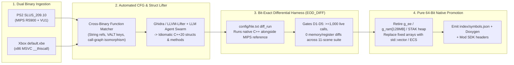
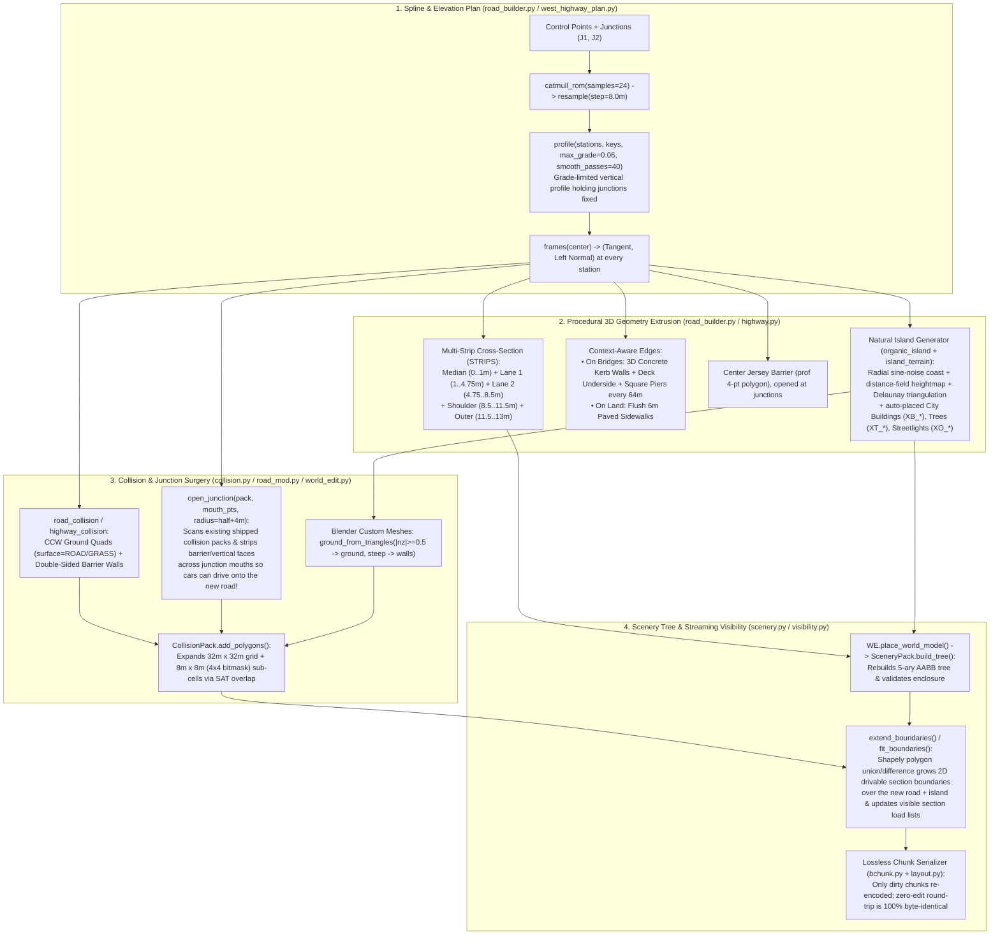
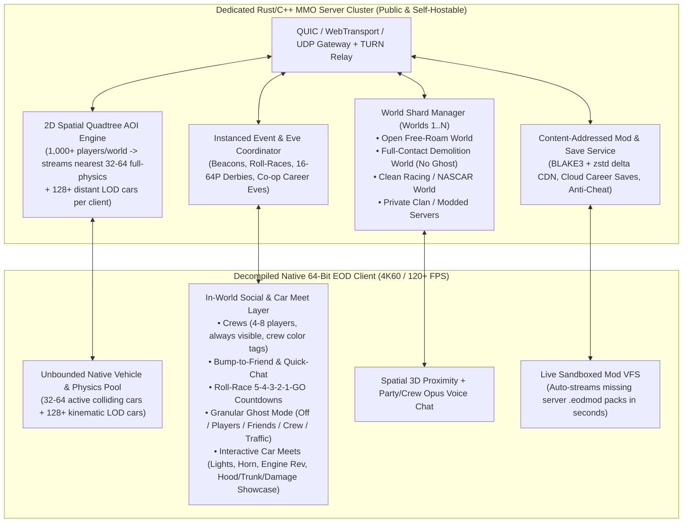
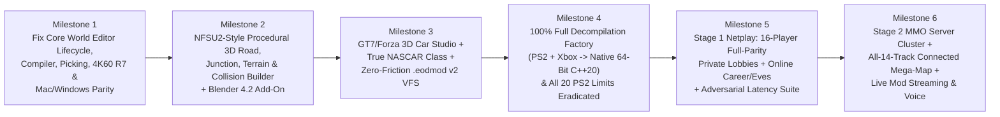

# EOD 2026 Master Architecture: 100% Decompilation, Zero PS2 Limits, Procedural World Studio & MMO Platform

> **Constitutional Mandate:**
> 1. **Zero PS2 Limits May Remain:** Every fixed pool, 16-bit index, memory ceiling, roster cap, texture slot cap, and legacy format constraint in *Test Drive: Eve of Destruction* (`SLUS_209.10` / Xbox `default.xbe`) is systematically decompiled and replaced with native 64-bit dynamic host data structures.
> 2. **100% Full Decompilation & Human/LLM Indexing:** Every function in the game is decompiled to clean, idiomatic, documented C++20 (with Rust for standalone server/tooling infrastructure), cross-referenced with the Xbox x86 executable, and indexed in a machine-readable symbol & struct knowledge graph so any human or LLM can build arbitrary mods or total conversions.
> 3. **True 3D Map & Road Authoring (`mininxd/NFSU2-World-Editor` Parity + Beyond):** Creating roads builds **actual drivable 3D road meshes, banking, kerbs, barriers, bridge decks, piers, terrain islands, junction cutouts, 32-bit collision, streaming visibility, AI splines, and minimaps** — both interactively in the EOD World Studio and via a lossless two-way Blender 4.2+ add-on.
> 4. **Native 4K60 / 6x+ / 120–240 Hz Graphics (R7 Complete):** Zero VU1 or GS emulation in the frame path; `< 3.33 ms` frame budget at 6x Modern.
> 5. **2026 Multiplayer & MMO Infrastructure (Zero BitTorrent):** Modern dedicated + self-hostable servers (QUIC / GameNetworkingSockets + relay), starting with **16-player full-grid private lobbies adversarially verified under heterogeneous latency with 100% local 2–4P parity + Online Career & Eves**, scaling to **`nfsu2.xyz` / Forza Horizon / GTA Online-style open-world MMO servers** with spatial voice chat and automatic zero-friction mod streaming.
> 6. **Player-Outcome Acceptance Standard:** "A helper function exists" is never acceptance. Every feature must prove a repeatable, measurable, end-to-end player-visible outcome (what the player sees, does, paints, builds, saves, reloads, drives, or syncs in-game with zero crashes, zero missing panels/meshes, and zero state loss), gated by adversarial Red-Team E2E suites + Tracy/Perfetto CPU/GPU/RAM budgets.
> 7. **Anti-Archivist Directive (Evolving Legacy PS2 Code):** This is a living, modern native C++20/Rust evolution — NOT a museum preservation project. Fixed 2004 PS2 array sizes, 16-bit indices, and static pools (`7` chassis, `20` cars, `512` textures, `32,767` SCOL tris, `100×100` spatial grids, `16` weapons, `STAK` LIFO heap, `640×448` UI) are temporary mutable scaffolding, NEVER "hard limits" or "impossible." Preserve gameplay physics & destruction feel while mutating capacity safely via **Expand & Relocate**, **Hook & Redirect** (`std::vector`/`std::unordered_map`), or **Bypass to Native**, keeping un-decompiled callers safe behind hooked interfaces so the playable build stays runnable at every step.

---

## 1. 100% Full Decompilation Census & Zero-PS2-Limits Extinction Blueprint

### 1.1 Exact Quantitative Census of `SLUS_209.10` (Measured Directly via `tools/analyze.py`)

We ran a complete instruction and control-flow census over your retail `SLUS_209.10` binary (`3,368,996` bytes):

| ELF Section | Virtual Address Range | Size | Contents |
|---|---|---|---|
| **`.text`** | `0x00100000 .. 0x003BC290` | **2,800.6 KB** | **716,964 MIPS R5900 instructions** across **13,481 functions** (482 switch jump tables) |
| **`.vutext`** | `0x003BC290 .. 0x003C3450` | **28.4 KB** | VU1 vector microcode programs (skinning, world strips, shadows, particles, sprites) |
| **`.data`** | `0x003C3480 .. 0x003EAD30` | **158.2 KB** | Initialized globals, vtable pointers, event descriptors, vehicle/driver table roots |
| **`.rodata`** | `0x003EAD80 .. 0x00432E18` | **288.1 KB** | Vtables, string literals, CRC32 table (`0x3F2598`), constants, camera/menu tables |
| **`.bss`** | `0x00432F00 .. 0x004E9370` | **729.1 KB** | Runtime pools (`g_DriverTable`, `phoblist` spatial hash, draw buckets, texture slots, garage) |

#### Function Breakdown Across All 11 Engine Address Bands

| Address Band | Functions | Instructions | Named (`symbols.txt`) | HLE Hooked (`hle.txt`) | Subsystem Scope |
|---|---:|---:|---:|---:|---|
| `0x00100000..0x00110000` | **247** | 16,268 | 3 | 3 | Boot, Main Loop, Race Orchestration, Mode Switching |
| `0x00110000..0x00138000` | **959** | 40,562 | 25 | 22 | Event/Eve Loader, Roster (`dirt.val`/`buycar.val`), `VALT` Parser, `0TSR` Archive & `STAK` Heap |
| `0x00138000..0x00168000` | **1,136** | 48,723 | 6 | 3 | `ILIN` AI Racing Lines, Event Rules, Contest Controllers (26 event modes) |
| `0x00168000..0x001A5000` | **1,259** | 62,439 | 35 | 25 | World Sim Step (`0x177718`), Rigid-Body Physics, Pacejka Tires, Vehicle Dynamics, `SOBL` Broadphase, Chickens/Weapons, Damage & Panels |
| `0x001A5000..0x00210000` | **1,288** | 108,467 | 20 | 18 | AI Drivers (`0x1A2D20`), Camera Director, Track Recovery, `phoblist` Spatial Hash (`0x1D57A8`), Wheel/Panel Debris, Scene Car Factory (`0x20FD48`) |
| `0x00210000..0x00240000` | **1,128** | 48,638 | 20 | 14 | World `GRAF` Loader/Renderer (`0x214B68`), Visual Car & LOD, Wheels (`0x21F780`), `SCOL` Terrain (`0x226768`), Sky Dome, Engine Audio Mixer (`0x23C8D0`) |
| `0x00240000..0x002C8000` | **2,615** | 141,870 | 10 | 9 | UI Widget & Layout Engine (`LAYT`/`IMAG`, `MenuRun` `0x270C10`), Front-End, Car Chooser (`0x2A75E0`), Split-Screen Setup |
| `0x002C8000..0x00305000` | **1,340** | 61,708 | 19 | 16 | Career Mode, Homebase Overworld, Auto Shop, Garage, Part Upgrades, Dealer Stock, `HSCM` Save |
| `0x00305000..0x00349000` | **1,242** | 68,946 | 10 | 9 | Flares (`0x304D50`), Water (`0x325728`), Timers, `StrmFindFile`, Input/Pad, Sound/SFX0 |
| `0x00349000..0x00370000` | **746** | 39,750 | 80 | 59 | Core 3D Engine (`mrModel`, `MLIST` Culling `0x3582B8`, Texture Manager `0x350810`, Draw Queue `0x34B140`, Shadows, Particles, Immediate Draws) |
| `0x00370000..0x003C0000` | **1,521** | 77,069 | 8 | 4 | RaceDay Lobby UI (`0x36E6F0`..`0x37A000`) + Sony PS2 SDK / `libc` / `libm` / IOP SIF RPC (retired entirely once game code is native!) |
| **TOTAL** | **13,481** | **716,964** | **342 (2.5%)** | **182 (1.35%)** | **~11,950 Monster Games functions + ~1,530 Sony SDK/libc functions** |

---

### 1.2 Dual-Binary Decompilation Pipeline (PS2 `SLUS_209.10` + Xbox `default.xbe`)

As already proven in [NATIVE_RENDERER.md](file:///Users/monty/Documents/GitHub/eod-recomp/docs/NATIVE_RENDERER.md#L358-L565) and [MODDING_SCOPE.md](file:///Users/monty/Documents/GitHub/eod-recomp/docs/MODDING_SCOPE.md#L39-L75), the Xbox release (`default.xbe`, built 2004-07-27, 14 days after PS2's 2004-07-13 build) was compiled from the **exact same Monster Games C++ source tree**:
- **Why pairing Xbox `default.xbe` with PS2 `SLUS_209.10` accelerates decompilation by 3–5×:**
  1. **x86 MSVC vs MIPS R5900:** Xbox uses standard MSVC x86 calling conventions (`__thiscall` with `ECX = this`, explicit vtables, standard IEEE-754 floats, no branch delay slots, no MMI quadword register packing, no VU0 macro inline assembly).
  2. **Direct3D 8 vs VU1/GS DMA chains:** Where PS2 builds opaque VIF/VU1 DMA packets (`0x358BD0`, `0x34BDA8`), Xbox calls clean indexed vertex-buffer draws (`WorldFrameRender = 0x0A8390`, `WorldRenderPass = 0x138840`) and stores plain vertex arrays (`DNIS` parts) and true-color DXT1/3/5 textures (`0TSR` v7).
  3. **1:1 Structural Parity:** Every `VALT` table (755 files), `SCOL`, `SOBL`, `ILIN`, `CarBase`, `BattleMaster`, and `CareerSaveInfo` struct matches across both builds.

#### The 4-Stage Automated + Verified Decompilation Factory

- **Why C++20 for the Engine Core + Rust for Server/Services:**
  - **Engine Core (`src/` + `runtime/`):** C++20 allows **function-by-function strangler-fig replacement** inside the running executable with `EOD_DIFF` verifying every decompiled function against the live reference state before cutting the cord. Once all ~11,950 game functions are converted (and the ~1,530 Sony SDK/libc functions are dropped in favor of standard C++/SDL3/Plume), `g_ee`, `g_ram`, and `tools/recomp.py` are retired completely, leaving a **100% standalone, native 64-bit C++20 engine**.
  - **Dedicated MMO Server, Matchmaker, Mod CDN & Authoring Daemon:** Written in **Rust** (or modern C++20 with shared wire schemas) for memory-safe, fearless concurrency, async QUIC/UDP networking (`tokio` + `quinn`), and zero-downtime public/private server operation.

---

### 1.3 Complete "Zero PS2 Limits" Extinction Matrix (Every Cap Eradicated End-to-End)

No limit below is tolerated or "worked around." Each is permanently removed by decompiling its owning functions into native host containers:

| # | Legacy PS2 Limit | Retail Cap | Owning Functions / Addresses | Permanent Native 64-Bit Replacement |
|---:|---|---|---|---|
| 1 | **EE Main RAM & `STAK` LIFO Heap** | 32 MB (`0x02000000`, currently 128 MB) + LIFO stack allocator (`0x3CC438`) + mid-race `kHeapPermit` (`0x3CC458`) lock | `MemAlloc` (`0x12DDB8`), `MemFree` (`0x12DB78`), `PoolReset` (`0x12DF20`) | Standard 64-bit OS virtual memory (`malloc`/`mimalloc` + per-subsystem arenas). **Out-of-order allocation/free enabled mid-race** (enables instant zero-reload car hot-swapping!). |
| 2 | **EE Scratchpad (`0x70000000`) & `MLIST` Visibility** | 16 KB total; `0x1C00` (7,168 B) visibility bytes + 256-entry matrix table (`0x70001C00`) + `kModelDepth` (`0x3DE6E8`, 7,168 floats) | `0x3582B8`, `0x358BD0`, `0x359198`, `0x357E60` (`src/native_world.cpp`, `src/hle_draw_distance.cpp:59`) | Dynamic `std::vector<uint8_t> vis_flags`, `std::vector<float> model_depths`, `std::vector<Mat4>` on host heap; remove `ns<4096, ng<4096, nm<8192` guard. |
| 3 | **Global `model_node` Table (`*(0x4C96C0)`)** | **4,096 models** (`0x14000` B ÷ `0x14`) | `f_0034D1F8`, `f_0034BB10` | `std::vector<ModelNode>` (unbounded; supports 100,000+ models across combined mega-maps). |
| 4 | **`SCOL` Terrain Triangles (`track.bsc`)** | **32,767 triangles** (`int16_t` neighbor indices) + 250-step walk stack + O(N) brute-force fallback (`f_00226F40`) | `f_00226768`, `f_002268D8`, `f_00226F40`, `f_00227AE0`, `f_00227878`, `f_00227950`, `f_00227830` | **32-bit `uint32_t` triangle indices + Flat C++ BVH / 2D Spatial Grid** (`O(log N)` query in `< 0.005 ms` for 1,000,000+ triangles). |
| 5 | **`SOBL` Static Collision (`track.sol`)** | **65,535 records / index entries / quadtree nodes (`uint16_t`)** + shrink-only static quadtree | `f_001A00B8`, `f_001A18E8`, `f_00177CA0`, `SolBuilder` `f_001C0878` | **32-bit Dynamic AABB/OBB BVH** supporting runtime insertion, removal, rotation, and scaling of collision solids. |
| 6 | **Dynamic Physics Spatial Hash (`0x48D2B4` `"phoblist"`)** | **100×100 grid of 20 m cells = ONLY `[-1000 m, +1000 m]` (2 km × 2 km)!** | `0x1D5624`, `SpatialHashQueryRadial` (`0x1D57A8`), `0x1D5A28`, `0x1D5B60`, `0x177DB0`, `0x17DAB0` | **Unbounded Hierarchical Spatial Hash / Loose Grid** (`robin_hood::unordered_map<CellCoord64, SmallVec<EntityId>>`) supporting **±1,000 km** worlds with zero border clamping. |
| 7 | **Active Car / Driver / Rigid Body / Participant Pools** | **20 cars** (`g_DriverTable` `0x485230`, `g_participant_table` `0x447458`, `0x3CE4F8`, `*(0x494D30)`, `desc+0x2C`, `CarMgrTable` `0x495D80`) & **10 in Battle** (`BattleMaster` `0x3CF194`) | `f_0020FD48`, `f_00185390`, `f_001DD2F8`, `f_0012C158`, `f_00166DB8..0x167D58` | Dynamic `std::vector<CarActor>` + `std::vector<RigidBody>` + dynamic `BattleMaster` participant vector — supporting **64–128+ simultaneous full-physics colliding cars** and **hundreds of streamed network cars**. |
| 8 | **Unique Chassis Per Eve & DAVMap Stack** | **7 unique chassis** (`0x123EE0`) + **30 DAVMap requests** (`0x12AB38`) | `EveValidateChassisLimit` (`0x123EE0`), `DAVMapMakeForEve` (`0x12A700`) | Unbounded `std::vector<ChassisAsset>`; every player in a 64-car race can drive a completely different vehicle chassis. |
| 9 | **Physics Objects (`phob_list`) & Contact Pools** | **512 `phob_list`** (`*(0x447404)`), **16 contacts/object** (`obj+0x190`), fixed contact pool (`0x3CE3F0`) | `0x1769A8`, `ContactRecord` (`0x17B918`, `src/car_damage.cpp`) | Dynamic `std::vector<PhysicsObject*>` and per-body dynamic contact vectors (`SmallVec<Contact, 32>`). |
| 10 | **Weapon / Chicken Launcher Registry** | **16 weapons** (`0x3CE3F8`, count `0x3CE4B8`) | `ChickenWeaponAlloc` (`0x17DFA8`), `0x227EE8`, `0x17E000`, `0x17E790` | Unbounded `std::vector<WeaponInstance>` + pooled projectile ring supporting 64+ armed players firing simultaneously. |
| 11 | **EE Texture Slot Table, Render Buckets & `.tm0` Ring** | **512 texture slots** (`*(0x4D2D30)`), **512 draw buckets** (`0x4C96D0`), **512 layer tables** (`0x4CD4B8`), **400 KB `.tm0` ring** (`0x4A9830`), **4 MB GS VRAM** | `0x350810`, `0x350F58`, `0x352D28`, `0x34D22C` (`src/render_queue.cpp`) | Direct content-addressed **64-bit `TextureHandle`** registry in `render_core` (Plume Vulkan/Metal/D3D12) with VRAM-budgeted streaming (2–8+ GB GPU pool) and unbounded material sort buckets. |
| 12 | **Car Classes (`carclass.val`) & Upgrade Mask** | **4 hardcoded classes** (`0..3`: Compact, Midsize, Muscle, Special) + `chassis_class % 4` (`0x2DFDF8`) + 20-chassis/class cap | `f_00164218`, `f_002DFDF8` (`src/career_upgrades.cpp:371`), `0x2A75E0`, `0x2B7710` | Dynamic data-driven `VehicleClassRegistry` supporting **arbitrary custom classes** (Compact, Midsize, Muscle, Special, NASCAR Cup, NASCAR Truck, Modified, Hobby, Open Wheel, Monster Truck, Mod Classes) with 64-bit class bitmasks. |
| 13 | **Paints Per Chassis in `CarChooseWidget`** | **10 paint slots** (`chassis + 4 + 8*paint` in `0x58` struct) | `0x2A7DAC..DCC` (SP), `0x2B9EAC` (MP) (`src/arcade_mod_badges.cpp:250`) | `std::vector<LiveryEntry>` per chassis (supports all 45+ NASCAR Cup liveries + unlimited community skins per car). |
| 14 | **Global Vehicle Numbers & Filename Lengths** | `abs(number) < 1000` (`0x1294B4`), `<16`-char `uicars_<n>.tex` & `4SPS` tex names, 8.3 ISO filenames (`AMBULA_1.CAR`), 32-char `0TSR` names | `0x1294B4`, `0x1297F8`, `0x129B30`, `stream.cpp:49` (`kMaxToc=256`) | String/UUID vehicle IDs + arbitrary display numbers (`#00`, `#07`, `#1..#9999`), arbitrary UTF-8 asset paths in `.eodmod` v2 VFS, and unbounded TOC index. |
| 15 | **Track / Eve / Event / Contest Table Caps** | **40 tracks** (`0x107E60`), **40 eves** (`0x1244A8`), **80 events** (`0x108350`), **320 contests** (`0x3C61A8`) | `0x107E60`, `0x123A58..0x125740`, `0x108350` | Dynamic `std::vector` registries loaded from base + all active `.eodmod` packages. |
| 16 | **Wheel-Class Buffer (`0x21F988`)** | **8 concurrent wheel classes** (`0x5A0` B = `8 × 0xB4`, unchecked overflow!) | `0x21F780`, `0x21F988`, `0x2213C8`, `0x2215C0` | Unbounded `std::unordered_map<std::string, WheelClassAsset>`. |
| 17 | **Career Garage & Dealer Lot** | **4 garage slots** (extended to 16 via host file in `career_upgrades.cpp`), **5 dealer lot slots** (`0x4AB130`) | `0x2E1BB0`, `0x2E1BC0`, `0x2E35F0`, `0x16F4E8` | Unlimited garage collection with filter/search + full scrollable dealership showroom. |
| 18 | **Single Water Surface & Single Sky/Fog State** | **1 water pointer** (`kWater = 0x3DC134`), **1 global fog/sky** | `0x326188`, `0x326168`, `0x223858` (`src/native_world.cpp:553, 621`) | Array of water volumes (`std::vector<WaterVolume>`) + spatial biome/zone volumes blending sky, sun, ambient, and fog smoothly across mega-maps. |
| 19 | **Damage Skeleton & Animation Bones** | **157 damage bones** (`Bone.mvl` 2×80), **31 `MRAnim` bones** (`0x20D220`), **20 VU1 skinning bones** | `0x18AFE0`, `0x18CA98`, `0x20D220`, `0x34C9F8` | Arbitrary bone counts evaluated in native SIMD/compute shader skinning. |
| 20 | **640×448 Fixed UI Canvas & 60 Hz Locked Render** | `LAYT` 640×448 widget coordinates; simulation & render coupled at 59.94 Hz | `0x270F10`, `MenuRun` (`0x270C10`), `WorldSimulationStep` (`0x177718`) | Resolution-independent anchor/vector UI layout at 4K/ultrawide + **fixed 60 Hz deterministic physics tick with interpolated 120 / 144 / 240+ Hz rendering**. |

---

### 1.4 Human + LLM-First Codebase & Semantic Knowledge Index

To ensure **anyone — including an LLM agent — can build any mod, game mode, or total conversion without reverse-engineering assembly**:
1. **Machine-Readable Master Index (`docs/index/engine_knowledge_graph.json` + SQLite FTS5):**
   - Every decompiled function carries a structured docstring header (`@addr_ps2`, `@addr_xbox`, `@subsystem`, `@reads_globals`, `@writes_globals`, `@invariants`, `@mod_hooks`) extracted automatically in CI.
   - Every struct (`CarBase`, `RigidBody`, `BattleMaster`, `CareerSaveInfo`, `TrackWorld`, `RoadSpline`) has a single source-of-truth C++20 reflection header that auto-generates Python bindings (`nanobind`), JSON schemas, and LLM context cards.
2. **Self-Contained Domain Modules (`src/engine/<domain>/`):**
   - `src/engine/physics/` (Rigid bodies, Pacejka tires, suspension, contact solver, spatial BVH)
   - `src/engine/vehicles/` (Chassis loader, damage bones, panel detachment, tuning, audio mixer)
   - `src/engine/world/` (Chunk streamer, procedural roads, terrain SCOL/SOBL BVH, water/weather zones)
   - `src/engine/events/` (All 26 native contest controllers + custom declarative/scripted event API)
   - `src/engine/career/` (Progression, economy, dealership, garage, online career sync)
   - `src/engine/netplay/` (Client prediction, puppet interpolation, QUIC client, voice, mod sync)
   - `src/engine/render_core/` (Shared Plume renderer for both Game and World Studio)

---

## 2. Deep Dive: `mininxd/NFSU2-World-Editor` & Holistic Translation to EOD World Studio

We cloned and audited the entire `mininxd/NFSU2-World-Editor` repository (`README.md`, `core/road_builder.py`, `core/highway.py`, `core/road_mod.py`, `core/highway_mod.py`, `core/world_edit.py`, `core/collision.py`, `core/visibility.py`, `core/scenery.py`, `core/routes.py`, `blender/importer.py`, `blender/exporter.py`, `tools/west_highway_plan.py`).

### 2.1 How `mininxd/NFSU2-World-Editor` Actually Works Under the Hood

### 2.2 Where `NFSU2-World-Editor` Stopped (Because It Did Not Decompile NFSU2's Engine)
`NFSU2-World-Editor`'s own README explicitly notes four painful limits caused by leaving the retail NFSU2 binary un-decompiled:
1. **Edited shipped roads don't update collision:** *"If you raise or move a shipped road, cars still drive on its old surface."*
2. **Hard streaming & polygon budgets:** Drivable boundaries are hard-capped at `17` vertices (`MAX_BOUNDARY_POINTS = 17`), streaming load lists at `6.5 MB`, meshes at `65,535` vertices, and collision coordinates at `1/8 m` (`int16_t`).
3. **No new or resized textures:** *"Textures can't be resized or added yet (same size and format only)."*
4. **No road graph / AI / minimap / GPS extension:** *"Adding routes isn't supported... New areas don't appear on the minimap or GPS."*

### 2.3 Holistic Translation to EOD World Studio (With Zero PS2 Limits!)

We translate **every single capability** of `mininxd/NFSU2-World-Editor` into EOD — both inside the **interactive EOD World Studio viewport** AND via a **first-class Blender 4.2+ Add-On (`tools/eod_blender_addon/`)** sharing the same Python/C++ core — while **eliminating all four of NFSU2's limits**:

| Capability | `mininxd/NFSU2-World-Editor` | **EOD World Studio + `eod_blender_addon` (2026 Target)** |
|---|---|---|
| **1. Lossless Two-Way Round-Trip** | `bchunk` + `selftest_roundtrip.py` (byte-exact on `STREAM*.BUN` / `L4R*.BUN` / `GEOMETRY.BIN`) | Already byte-exact on untouched `0TSR` v6 members; extend to **100% lossless round-trip across `track.grf`, `track.bsc` (`SCOL`), `track.sol` (`SOBL`), `*.ild` (`ILIN`), `c_*.va0`, and `.CAR`** + native `.eodworld` / `.eodmega` containers, verified in CI by `selftest_roundtrip.py`. |
| **2. Interactive + Procedural 3D Road, Oval, Jump & Highway Builder** | `road_builder.py` + `highway.py` (JSON plan → Catmull-Rom → resampled stations → grade-limited profile → multi-strip asphalt, kerbs, median Jersey barrier, bridge deck, piers) | **Interactive 3D Spline Road Tool in Viewport + Declarative JSON/Python API + Blender Curve-to-Road:** • **Spline types:** Open highway, closed circuit, banked dirt/asphalt oval, figure-8 crossover, jump ramp, bridge overpass, tunnel. • **Per-station cross-section parameters:** Width, lane count, **banking / superelevation angle ($\theta$)**, crown/camber, surface material (`Asphalt`, `Dirt Bullring`, `Mud`, `Clay/Grass`, `Concrete Curb`, `Wood Plank`, `Metal Ramp`) with automatic wear/rut overlay strip (`af_rdwr` style!). • **Edge & Bridge profiles:** Concrete Jersey barriers, W-beam guardrails, catch-fences, wooden derby walls, bridge decks + undersides + automatic support piers down to terrain/water floor. |
| **3. Automatic Junction Cutting & Terrain Cut-and-Fill** | `open_junction()` strips barrier/vertical collision polygons within `half_width + 4m` of junction mouths; `island_terrain()` builds Delaunay coast/hill terrain around road corridor | **Automatic Junction & Terrain Surgery:** • Snapping a road endpoint or figure-8 crossing to an existing road automatically runs **`open_eod_junction()`**: cuts open intersecting `SOBL` barrier walls, trims overlapping kerbs/fences, and blends road-edge vertices/UVs. • **Automatic Terrain Cut-and-Fill (`sculpt_terrain_along_corridor`)**: depresses/raises underlying terrain triangles along the road corridor (with configurable shoulder slope skirt) so existing hillsides never poke through the new road deck! |
| **4. Unified Collision Rebuild (New AND Edited Shipped Objects!)** | New objects get `ground_from_triangles` + `make_wall`; **edited shipped objects do NOT update collision** | **100% Unified Visual + Physics Rebuild:** • Moving, rotating, scaling, or vertex-editing ANY shipped retail object (ramps, roads, buildings, terrain) OR adding new objects/roads in World Studio or Blender **automatically rebuilds both its terrain surface (`SCOL` / 32-bit host BVH) and barrier solids (`SOBL` / 32-bit OBB BVH)** in lockstep! Visual-vs-physics desync is impossible. |
| **5. AI Pathfinding (`ILIN` + Road Graph) & Live Minimap Generation** | `Routes*.bin` read-only (new roads have no AI or minimap/GPS) | **Automatic AI & Minimap Synthesis:** • Every procedural road or edited track spline automatically compiles both closed-circuit **`ILIN` (`*.ild`)** racing lines (with curvature-computed braking/target speeds & banking) AND an open-world **branching Road Graph** for free-roam AI traffic/challengers. • Automatically rasterizes an updated top-down **HUD Minimap & World Map texture** matching the new road network! |
| **6. Blender 4.2+ Live Add-On (`eod_blender_addon`)** | `File > Import/Export > NFSU2 World (.BUN)` & `NFSU2 Car (GEOMETRY.BIN)` with `Scene Lights` vs `Game Prelight` toggle | **First-Class Blender 4.2+ Extension + 1-Click Live Bridge:** • `File > Import/Export > EOD Track (.TRK / .eodworld)` and `EOD Vehicle (.CAR)` (assembling chassis + 4 positioned `RACE.RES` wheels + `CT.RES` livery + `Bone.mvl` damage armature + `Scene Lights` vs `PS2 2x Prelight` shader node toggle!). • In World Studio, clicking **`Edit in Blender`** launches Blender directly (or links via local socket) and **`Sync From Blender`** hot-reloads edited/new meshes + textures + collision right back into the running Studio viewport! |

---

## 3. Native 4K60 / 6x / 120–240 Hz Graphics & R7 Completion

### 3.1 Exact Diagnosis of the 24–42 FPS Drop & Commit `d11b36d` ("broke it")
1. **`d11b36d` EE-Thread Stall ([runtime/render/native_feed.cpp](file:///Users/monty/Documents/GitHub/eod-recomp/runtime/render/native_feed.cpp#L904-L906)):** Every queued vehicle/model part draw (`ee_packet_reserved`) calls `queue_material()` (`:1296-1398`) synchronously on the EE CPU thread, executing a **43.7 KB `std::memcmp()` across all 6 mip levels (`256×128` + mips)** and, whenever the 128-entry `snapshots` map overflows (`:1345`), clearing the entire cache and re-running `43.7 KB memcpy + CSM1/PSMT8 byte unswizzle + XXH3_64bits` on the main thread!
2. **`pie_host.py` Renderer & Resolution Traps ([tools/world_editor/pie_host.py](file:///Users/monty/Documents/GitHub/eod-recomp/tools/world_editor/pie_host.py#L494-L505)):**
   - Inherits global `eod.ini` (`RenderScale=6` = **`3840×3072`**, 11.8M pixels/frame, >4K!).
   - In `PS2 Fast`, forces `EOD_NATIVE=0` — disabling Plume and running the legacy VU1/GS emulator at **`3840×3072`**!
   - In `Plume HQ`, forces `EOD_LOOK=modern` at **`3840×3072`** over MoltenVK (full-`3840×3072` shadow accumulation buffer + 2-cascade sun shadows + full-extent color/depth scene copies + PBR shader) while `EOD_OPT_TERRAIN_MASK=0xFFFF` draws all 16 optional-terrain layers simultaneously!

### 3.2 Native 4K60 / 6x Architecture (`<= 3.33 ms` Frame Budget)
1. **Asset-Identity GPU Texture Residency (Eliminating Per-Frame RAM/VRAM Hashing):**
   - Replace `queue_material()`'s 43.7 KB per-draw `memcmp` + unswizzle with **immutable asset-identity texture handles** assigned when a `.TEX` / `.TM0` / `.eodhtx` is loaded or relocated (`TextureRelocateOffsets` `0x3521E8`), dirtying a handle ONLY if the guest explicitly mutates that texture buffer. Zero per-draw `memcmp`, zero unswizzle on the frame path.
2. **Complete R7 (Zero VU1 / Zero GS Emulation in Release Builds):**
   - Route 100% of world strips, cars, shadows, particles, sprites, water, sky, and 2D UI (`IMAG`/`LAYT`/`GTEX`/`CANV`) directly through Plume (`native_renderer.cpp`) and compile out the VU1 interpreter and GS rasterizer from release builds (`S4` & `R7` gates in [MASTER_SPEC.md](file:///Users/monty/Documents/GitHub/eod-recomp/docs/MASTER_SPEC.md#L70-L79)).
3. **4K / 6x Modern Pipeline Scaling:**
   - Decouple post/shadow intermediate targets from raw `RenderScale=6` internal resolution: use dedicated fixed-budget cascade shadow atlases (`2048×2048` / `4096×4096`), half-resolution screen-space reflection/refraction captures, instanced static world chunk VBOs (uploaded once, frustum-culled on GPU/SIMD), and descriptor-indexed material tables.
4. **Decoupled 60 Hz Physics vs 120 / 144 / 240+ Hz Presentation:**
   - Keep `WorldSimulationStep` (`0x177718`) running at deterministic **60 Hz** ticks while interpolating camera, rigid-body transforms (`prev_pose` → `curr_pose`), and wheel spin at the display's native refresh rate (**60 / 120 / 144 / 240 Hz**).
5. **One Shared `render_core` Library for Game & World Editor:**
   - Link the exact same C++20 Plume `render_core` into both `eod` and `eod-studio`, drawing 3D gizmos, selection highlights, road splines, collision wireframes, and Dear ImGui HUD overlays in the **same Vulkan/Metal render pass** (100% WYSIWYG parity, zero OpenGL divergence, zero missing tools in Plume HQ!).

---

## 4. 2026 Online Multiplayer Architecture: 16-Player Adversarial Lobbies → MMO + Online Career

> **Hard Rule:** All BitTorrent tracker (`BEP 15`) rendezvous code in `src/netplay_online.cpp` is **permanently retired**. Only modern, deterministic dedicated server and relay infrastructure is used.

### 4.1 Modern Transport & Server Stack (Public MMO + Self-Hosted Private Servers)
- **Single Portable Server Binary (`eod-server` in Rust / C++20):**
  - Anyone can self-host a private server (`eod-server --port 27015 --mods ...`) OR create a 1-click private lobby on official public relay/server nodes.
  - **Transport:** **QUIC + Unreliable Datagrams (`RFC 9221`)** (or **Valve GameNetworkingSockets** over UDP) providing:
    - Encrypted, authenticated connections with **0-RTT reconnect** and **built-in NAT-proof SDR/TURN relay fallback** (100% connection success across symmetric NATs/CGNAT with zero port forwarding!).
    - Separate **reliable ordered streams** (lobby state, mod manifests, Career transactions, chat, Eve transitions) and **unreliable low-latency datagrams** (30–60 Hz vehicle kinematics, bone dents, weapon fire, Opus voice frames) without head-of-line blocking.
  - **Dedicated Client Network Thread:** Networking never blocks or polls on the EE simulation vblank (`Session::poll()` moved off main thread into lock-free ring buffers).

---

### 4.2 Stage 1 — Private Lobbies: 100% Local 2–4P Parity Across 16+ Full-Grid Humans

Every gap identified in our netplay audit is closed so a 16-human race/derby behaves with **100% mechanical parity** to local split-screen:

| Subsystem | Current Broken State | Stage 1 Full-Parity Implementation |
|---|---|---|
| **1. Car-to-Car Collisions & Impulses** | Asymmetric: puppets overwrite rigid bodies before & after `0x177718`, acting like immovable walls | **Dual-Authority Contact & Impulse Protocol (`K_CONTACT_IMPULSE`):** Local physics resolves speculative contact response immediately (zero-latency bounce) while transmitting `(tick, attacker_id, victim_id, rel_contact_pt, impulse_vec)` to the server/victim owner, which applies the authoritative impulse via `CarContactEvaluateObstacleImpulse` (`0x17B918`) and reconciles pose smoothly. |
| **2. Structural Damage, Dents, Panels & Wheels** | `damage` (`+0x1BEC`) is never written by `netplay_car::write()`; 0% sync of `Bone.mvl`, panels, wheels, or wreck state | **Full Destruction State Replication (`K_DAMAGE_DELTA`):** • Apply `car + 0x1BEC` (`damage`) and `car + 0x1BE8` (`wreck_state` `0xA/0xB/0xC`). • Replicate 8-bit detached panel mask (`car + 0x2AC` / `0x13E8`) + spawn networked detached panel `Panl` debris (`0x1E0DC8`). • Replicate 4-bit tossed wheel mask (`car + 0x1A00`) + spawn networked wheel `WHLP` debris (`0x1B3068`). • Replicate quantized sparse `Bone.mvl` displacement deltas (`car + 0x4B8`, 157 bones) on impact events so every player sees the exact same crumpled fenders and torn-off hoods! |
| **3. Chickens, Weapons & Explosions** | Zero projectile or detonation packets (`src/netplay_wire.h` has none) | **Authoritative Projectile & Blast Sync (`K_WEAPON_FIRE`, `K_WEAPON_DETONATE`):** • Broadcast projectile launch (`tick, owner_id, weapon_kind, pos, vel, regime_flags`: Straight / Mortar / Rain). • Server-validated detonation (`pos, attacker_id, radius, force`) invokes radial blast (`0x17DA58` / `0x17B708`) across the unbounded spatial hash and awards authoritative Battle kills/assists. |
| **4. All 26 Event Modes & Dynamic Props** | Only basic race/battle tested on 2 clients; dynamic props (`obstacle.val`) unsynced | **Full 26-Mode & Prop Authority:** Sync trailer hitch/detach physics (`Trailer Race`), `Chain Race` pairs, `Push-Off` / `Suicide` / `Detention` / `Red Rover` ring-out & zone triggers, `Flagpole` / `Stop-and-Go` checkpoint states, `Soccer` ball rigid body, and seeded/delta-synced breakable track obstacles. |
| **5. Multi-Event Eves & Online Career Co-op / Progression** | Single-event only; Career is offline-only | **Full Online Eves & Career Mode:** • Play full 3-to-5-event **Eves** together (`Event 1 of 5` → `Standings` → `Event 5 of 5` → `Eve Podium`). • **Bring Your Career Car Online:** Clients transmit their signed `CDBGarageSlot` (`vehicle_id`, paint, 76-byte `CarTuningBlock` upgrades, pre-race condition/panel state). • **Online Career Progression:** Completing online Eves, challenges, or free-roam duels awards real Career **Cash**, **Reputation**, **Driver Rank (`79 → 49 → 1`)**, and **Dealer/Upgrade Unlocks** (validated server-side against event payout rules so cheated clients cannot mint infinite cash/stats), with optional **"Hardcore Career Damage"** (post-event repair bills carry back to your Career garage) or **"Arcade Free Repair"** lobby rule! |

#### Adversarial 16-Human Automated Verification Harness (`tools/tests/netplay_adversarial_16p.py`)
Before Stage 1 is marked complete, an automated CI/soak harness spawns **16 real headless game client instances + 1 dedicated server** connected through a programmable **in-process network impairment proxy**:
- **Heterogeneous Latency Matrix:** Simulates 16 distinct real-world network profiles simultaneously in the same race:
  - 4 Low-Ping LAN/Fiber peers (`10–25 ms`, `0%` loss)
  - 4 Domestic Broadband peers (`50–80 ms`, `±10 ms` jitter, `0.5%` loss)
  - 4 Transcontinental Wi-Fi peers (`130–180 ms`, `±30 ms` jitter, `2%` loss, bursty reordering)
  - 4 Adversarial High-Latency / Cellular peers (`250–350 ms`, `±60 ms` jitter, `5–8%` loss + mid-race 1.5s packet stalls)
- **Adversarial Chaos Injections:**
  - Simultaneous 16-car Demolition Derby pileups + 16 players firing chickens at once
  - Mid-Eve player disconnect + hot reconnect into the next event of the Eve
  - Host/leader disconnect triggering seamless server ownership handoff
  - Malformed/out-of-bounds packet fuzzing & speed-hack/teleport rejection checks
- **Strict Pass Gates:** `0` crashes, `0` heap corruptions, `100%` convergence of final race/Eve standings across all 16 clients, bounded position error (`p99 < 0.35 m` under `<100 ms` ping), and exact replication of panel/wheel detachments, chicken kills, and Career cash/rank awards.

---

### 4.3 Stage 2 — 2026 MMO Open-World Server (`nfsu2.xyz` + Forza Horizon + GTA Online Standard)

Inspired directly by **`nfsu2.xyz` (Underground 2 Revived)**, **Forza Horizon 5**, and **GTA Online**, and powered by our **Zero-PS2-Limits decompiled engine**:

#### Core Player Journeys in EOD Online MMO
1. **Seamless Open-World Free Roam on the Combined Mega-Map (or Any Custom Map):**
   - Drop straight from the title screen into the shared open world driving your **Career car** (or any car swapped live via the **In-Game Garage / Mod Menu** — zero reload needed once the `STAK` LIFO heap is replaced by the native 64-bit allocator!).
   - Drive between **Homebase**, **Afton**, **Anoka Night**, **Dundas**, **Mankato**, **Gilroy**, **Springfield**, and custom highway islands along procedural connecting roads.
2. **`nfsu2.xyz`-Style Social, Crews, Ghost Mode & Car Meets:**
   - **Crews & Priority Visibility:** Type a crew tag to form a crew; crewmates and friends always render in your inner priority ring with custom color badges and optional crew voice chat.
   - **Granular Ghost Mode (`Off` / `Other Players` / `Friends` / `Crew` / `AI Traffic`)** — plus dedicated **"Full-Contact Demolition Worlds"** where Ghost Mode is permanently disabled and chicken launchers are live!
   - **Spontaneous Roll-Races & Bump-to-Friend:** Pull up next to anyone on a highway, trigger a live **`5 - 4 - 3 - 2 - 1 - GO`** 3D countdown or head-to-head challenge wager, or bump bumpers at a Car Meet spot to add friends and show off your engine upgrades, custom liveries, and battle scars.
3. **World Event Beacons → Seamless Instanced Eves & Custom Races:**
   - Drive into a glowing world beacon (or accept a server-wide toast invite) for a **16-to-32-Player Figure-8 Jump Race, School Bus Derby, Trailer Race, Red Rover, Gauntlet, or Full 5-Event Career Eve**.
   - The server spins up an authoritative event instance, runs the full contest/Eve, awards Career cash/reputation/trophies, and seamlessly phases everyone right back onto the open-world road where they finished.
4. **Server-Side Physics Sanity & Anti-Cheat:**
   - Just like `nfsu2.xyz`, ranked/public career servers validate vehicle `physics.val` signatures, `CarTuningBlock` bounds, acceleration/grip envelopes, and checkpoint timestamps server-side — while **Modded / Sandbox / Private Servers** allow wild custom physics, custom NASCAR rosters, and custom maps freely.

---

## 5. Zero-Friction Native Mod Ecosystem & Auto-Streaming

No player or modder ever touches an environment variable (`EOD_MOD_DIR`), hunts for `%LOCALAPPDATA%` folders, or gets rejected by a monolithic whole-disc hash check again.

### 5.1 Unified `.eodmod` v2 Package & Layered C++ Virtual Filesystem (VFS)
1. **One Package Format (`.eodmod` v2 — Content-Addressed `BLAKE3` + `zstd`):**
   - Supports **both** native 2026 unbounded assets (`.eodworld` mega-maps, procedural road graphs, 32-bit `.eodcol` BVH collision, `.eodhtx` 4K/8K textures, custom vehicles/NASCARs, custom events/audio) **and** declarative semantic patches (`addArchive`, `addMember`, `valtPatch` table merges for `carclass.val`, `car_stats.val`, `buycar.val`, `dirt.val`, `catalog.val`, `tracks.val`).
   - Multiple vehicle, track, texture, and gameplay mods compose together automatically with **zero false conflicts**.
2. **Runtime Layered VFS (`runtime/vfs/layered_vfs.cpp`):**
   - Replaces the static boot-time `StreamInit` (`g_built = true`) and single `EOD_MOD_DIR` with a **live, hot-mountable 4-layer VFS stack**:
     1. **Layer 0 (Read-Only Base):** Retail PS2 (`SLUS_209.10` + `DATA/`) & optional Xbox (`default.xbe` + DXT/DNIS) disc assets — **never modified on disk**.
     2. **Layer 1 (Active User Profile):** Mods enabled in the in-game **Mod Hub** or **World Studio** (`TDEODRecomp/profiles/<active>/`).
     3. **Layer 2 (Server Session Overlay):** Auto-streamed `.eodmod` packs required/offered by the currently joined multiplayer server (`TDEODRecomp/server_cache/<blake3>/`), mounted on join and unmounted cleanly on disconnect.
     4. **Layer 3 (Ephemeral PIE / Test-Drive Scratch):** Direct in-memory / shared-memory staging from World Studio or Car Studio for **instant `< 1 s` playtesting without saving first**.

### 5.2 Frictionless Player & Modder Flows
- **In-Game Mod Hub & Drag-and-Drop:** Drop any `.eodmod` file directly onto the game window or browse the built-in **Mod Hub** menu inside the game to enable/disable tracks, NASCAR packs, 4K texture packs, or total conversions with one click.
- **Automatic Multiplayer Mod Streaming + Proxy Fallback:**
  - When joining any private lobby or MMO server running custom maps or cars, the server sends its signed content manifest (`mod_id`, `blake3`, chunk URLs).
  - Missing chunks stream automatically at line speed over HTTP/3 + `zstd` with an in-game progress bar into the sandboxed `server_cache/` (strictly data-only — zero executable code allowed inside `.eodmod`).
  - While an optional peer's custom car livery/model is streaming in the background during free roam, the client renders a class-matched proxy chassis and hot-swaps the real model the instant the blob finishes downloading!

---

## 6. Master Execution Roadmap (From Current State to Full 2026 Remake)

*(Note: Milestones 1–3, Milestone 4's subsystem decompilation, and Milestone 5's server/netplay rewrite can proceed in parallel tracks once Milestone 1 stabilizes the immediate editor & renderer lifecycle.)*
