# Test Drive: Eve of Destruction (`SLUS_209.10`) — Modding & World Editor Tutorials

Welcome to the official step-by-step modding and level-design guide for **EOD Recomp** and the **EOD World Editor & Creation Kit** on Windows 11 x64 (and macOS).

Whether you just dumped your retail PlayStation 2 disc and want to play at 4K/60+ FPS with a 1-frame Classic/Modern toggle, or you want to tear down track fences, build custom dirt jumps, scatter wrecked school buses across the infield, reroute AI pathfinding splines, import *NASCAR: Dirt to Daytona* stock cars, and share compact `.eodmod` packages online, these seven progressive tutorials walk you through every workflow from start to finish.

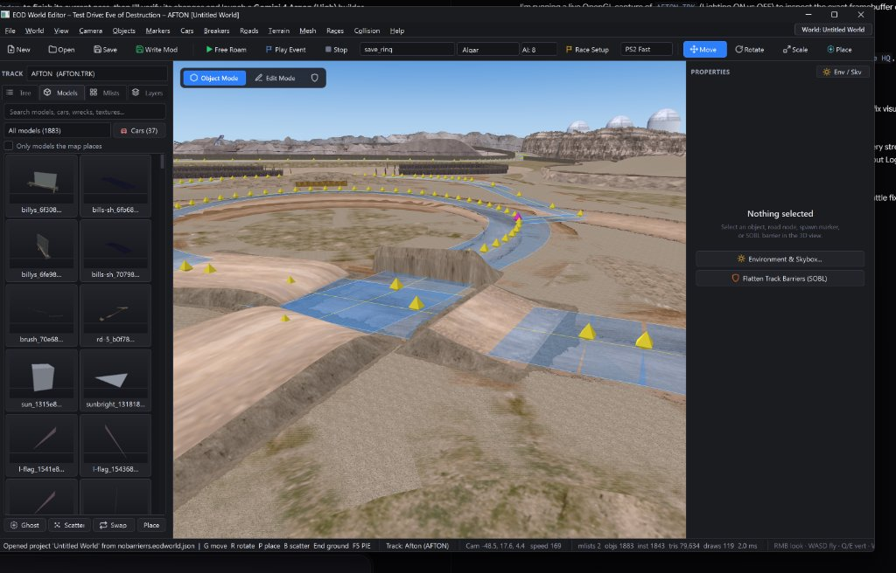

---

## Table of Contents

- [Quick Keyboard & Controller Shortcut Reference](#quick-keyboard--controller-shortcut-reference)
- [Tutorial 1: Zero-Friction Setup from a Retail PS2 ISO (`SLUS_209.10`)](#tutorial-1-zero-friction-setup-from-a-retail-ps2-iso-slus_20910)
- [Tutorial 2: Your First Track Mod in the EOD World Editor](#tutorial-2-your-first-track-mod-in-the-eod-world-editor)
- [Tutorial 3: Deleting Fences, Removing Invisible Barriers (`SOBL`) & Multi-Selection](#tutorial-3-deleting-fences-removing-invisible-barriers-sobl--multi-selection)
- [Tutorial 4: Placing Cars, Wrecked AI Cars & Scattering Props (Lumion/Twinmotion Workflow)](#tutorial-4-placing-cars-wrecked-ai-cars--scattering-props-lumiontwinmotion-workflow)
- [Tutorial 5: Editing AI Pathfinding (`ILIN` Road Tool) & Inventing Custom Game Modes](#tutorial-5-editing-ai-pathfinding-ilin-road-tool--inventing-custom-game-modes)
- [Tutorial 6: Live 4K Textures (`HOSTTEX`), Skybox Swapping & Importing *NASCAR: Dirt to Daytona* Cars](#tutorial-6-live-4k-textures-hosttex-skybox-swapping--importing-nascar-dirt-to-daytona-cars)
- [Tutorial 7: Packaging, Sharing & Installing `.eodmod` Mods Online](#tutorial-7-packaging-sharing--installing-eodmod-mods-online)

---

## Quick Keyboard & Controller Shortcut Reference

### In-Game (`eod.exe`)

| Shortcut / Pad Chord | Action |
|---|---|
| **`F9`** or **`L1 + R1 + R3`** | **Instant Classic / Modern Toggle** (switches in 1 frame `<= 33 ms` between PS2 Classic and Modern Remastered PBR) |
| **`F1`** or **`L3 + R3`** | **Open / Close In-Game Menu & Mods Overlay** (Display, Audio, Controls, Gameplay/Mods, System) |
| **`F11`** or **`Alt + Enter`** | Toggle Borderless / Exclusive Fullscreen |
| **`Triangle`** (Pad) | Cycle Gameplay Camera Views (`NearChase`, `Chase`, `Chassis`, `Bumper`, `Cockpit`) |
| **`Select`** (Pad) | Manual Vehicle Track Recovery (when `ManualRecovery=1` disables the 3-second auto-reset timer) |
| **`L2`** (Pad, with mods) | Fire Explosive Chicken (`ChickenFight=true`) and/or Activate High-Velocity Turbo Boost (`TurboBoost=true`) |
| **`L1 + R1 + Up`** | Live toggle Straight-Shot Chicken Fight |
| **`L1 + R1 + Right`** | Live toggle High-Velocity Turbo Boost |
| **`L1 + R1 + Square`** | Live toggle Human Invincibility (`GodMode`) |

### EOD World Editor (`tools/world_editor/`)

| Shortcut | Action |
|---|---|
| **`RMB` (Hold) + `W/A/S/D`** | Fly Camera Forward / Left / Backward / Right |
| **`RMB` (Hold) + `Q / E`** | Fly Camera Down / Up |
| **`Shift`** (while flying) | **2.8× Camera Speed Boost** (`Mouse Wheel` adjusts base fly speed) |
| **`F`** | **Frame Selection** (smoothly focuses camera on selected 3D object, road node, or barrier) |
| **`G`** / **`R`** / **`S`** | **Move** / **Rotate** / **Scale** 3D Gizmo Mode |
| **`P`** | **Ghost Place Mode** (live 3D preview snapped to `SCOL` terrain height & normal; `R` / `Shift+R` rotates ±15°; `LMB` stamps) |
| **`B`** | **Scatter / Paint Brush Mode** (paint non-overlapping props or wrecked cars inside a 3D terrain circle) |
| **`End`** or **`Ctrl + G`** | **Drop to Ground** (raycasts `SCOL` terrain under selection and seats its bounding-box base on the surface) |
| **`Shift + LMB`** | **Multi-Select** (add/remove objects from active selection set) |
| **`Ctrl + D`** | Duplicate selected object in place |
| **`Del`** | Delete selected object(s) (moves retail static/event props to `Y = -5000.0` tombstones or removes editor-placed items) |
| **`F2`** | Export selected model to Blender OBJ round-trip |
| **`Ctrl + Z`** / **`Ctrl + Y`** | Undo / Redo (full `QUndoStack` history across transforms, scatter strokes, barriers, textures, and roads) |
| **`Ctrl + S`** | Save non-destructive `.eodworld.json` project overlay |
| **`Ctrl + Shift + S`** | **Write Mod Layer** (compiles patched `.TRK`, `c_*.va0`, `track.sol`, `*.ild`, and `HOSTTEX/.eodhtx` to `mods/<Project>/`) |
| **`Ctrl + Shift + E`** | **Package Mod as `.eodmod`…** (exports compact delta-only distributable mod archive) |
| **`F5`** | **Play Free Roam (PIE)** — compiles dirty changes and launches `eod.exe` directly inside the central viewport |
| **`Shift + F5`** | **Play Event / Race (PIE)** — launches the configured event/race inside the embedded viewport |
| **`Esc`** / **`Shift + Esc`** | Exit active placement/brush tool, or **Stop PIE** and return to the 3D editor |

---

## Tutorial 1: Zero-Friction Setup from a Retail PS2 ISO (`SLUS_209.10`)

> **Goal:** Go from a single legally dumped North American PlayStation 2 `.ISO` (`SLUS_209.10`) to driving at 60 FPS in native widescreen with instant Classic/Modern switching and live gameplay mods—without installing 7-Zip, virtual DVD drives, or hex utilities.


### Step 1: Verify Your Retail Disc Image (`SLUS_209.10`)

EOD Recomp targets the retail North American PS2 release of *Test Drive: Eve of Destruction* (**`SLUS_209.10`**).
- **Supported Input Formats:** Standard `2048`-byte sector `.iso` files, raw `2352`-byte Mode 1 / Mode 2 Form 1 `.bin` images, or an already-extracted folder containing `SLUS_209.10` and `DATA/`.
- **Canonical `SLUS_209.10` ELF SHA-256:**
  ```text
  4f60053dc141365f5ae50737622f8408be30ced513b4c109427c926461f2e2ae
  ```
- **Region Check:** The built-in validator automatically reads `SYSTEM.CNF` from sector 16 (`BOOT2 = cdrom0:\SLUS_209.10;1`). If you accidentally drop the European PAL release (*Driven to Destruction*, `SLES_527.67`) or a truncated rip (`< 1.8 GB`), the extractor stops before writing a single byte and explains the exact mismatch.

### Step 2: Zero-Friction ISO Extraction (3 Ways)

You never need external archive tools. Pick whichever method you prefer:

#### Option A: Drag-and-Drop into the EOD World Editor (Recommended)
1. Double-click **`tools\world_editor\launch_editor.bat`**.
2. On first launch (when no extracted disc is found), the **First-Run ISO Setup Wizard** opens automatically.
3. Drag and drop your `Test Drive - Eve of Destruction (USA).iso` directly onto the dropzone (or click **Auto-Scan PC** to search `Downloads`, `Desktop`, `Documents`, and mounted drives `D:..Z:`).
4. The built-in pure-Python ISO-9660/UDF reader (`tools/iso_extractor.py`):
   - Checks that your target drive has at least **2.6 GB** of free space (the unpacked disc is **2.18 GB** across 70 `0TSR` v6 archives, 40 `.PSS`/`.M2V` videos, 13 `.IRX` modules, and the 81 MB `SPEECH.BNK`).
   - Strips ISO-9660 `;1` version suffixes (`AFTON.TRK;1` → `DATA/TRACKS/AFTON.TRK`).
   - Verifies every `0TSR` v6 archive's internal directory CRC-32 (`rst0.eod_crc`, polynomial `0x04C11DB7`) on the fly while streaming.
   - Extracts into an atomic staging directory (`disc.staging_<pid>/`), writes `disc_manifest.json`, and swaps it into `%LOCALAPPDATA%\EODRecomp\disc\` (or your chosen game directory).

#### Option B: Command-Line Extraction
```powershell
python tools/iso_extractor.py --iso "C:\Downloads\Test Drive - Eve of Destruction (USA).iso" --out "D:\Test Drive - Eve of Destruction (USA)"
```

#### Option C: Point to an Existing Extracted Folder
If you already unpacked your ISO to `D:\Test Drive - Eve of Destruction (USA)`, the World Editor and `eod.exe` auto-discover `DATA\TRACKS\*.TRK` and `DATA\CAR\*.CAR` immediately.

> [!IMPORTANT]
> **Sacred Read-Only Disc Rule:** Neither `eod.exe` nor the EOD World Editor ever modifies a single byte inside your extracted `DATA/` folder. All mods, custom tracks, and 4K textures live in isolated overlay folders (`mods/<ProjectName>/` or `%LOCALAPPDATA%\EODRecomp\profiles\`) loaded via `EOD_MOD_DIR`.

### Step 3: Launching `eod.exe` & Instant PC Boot

Run **`eod.exe`** from your build or game directory:
```powershell
.\eod.exe --data "D:\Test Drive - Eve of Destruction (USA)"
```
- **Instant PC Boot (JTBD 5):** By default, `eod.exe` skips the startup `.PSS` legal/attract movies, bypasses artificial 50 ms PS2 loading screen delays, and skips the PS2 Memory Card slot check—booting straight to the Main Menu in under 2 seconds!
- To jump straight into a specific race or track from the command line without navigating menus, set `EOD_DIRECT_START`:
  ```powershell
  $env:EOD_DIRECT_START="mode=action;track=AFTON;event=jump_race;car=Bus;ai=8;humans=1"
  $env:EOD_SKIP_MOVIES="1"
  .\eod.exe
  ```

### Step 4: The **`F9`** Classic vs. Modern Toggle

Once on track, press **`F9`** on your keyboard (or **`L1 + R1 + R3`** on a controller):
- **PS2 Classic Look (`ModernRenderer=0`):** Pixel-faithful PlayStation 2 rendering drawn by our native **Plume** renderer (`EOD_NATIVE=1`). Uses the game's exact submission order, GS alpha-blend equations (including reverse-subtract shadow volumes), `V4-5` prelit vertex colors (`Cv * Ct >> 7`), and exact `TEX1` mipmap LOD math—verified against offline software GS replay (`SSIM >= 0.98`, `MAE <= 1/255`).
- **Modern Remastered Look (`ModernRenderer=1`):** 2026 physically based rendering (Filament BRDF/IBL math in native HLSL) driven by `material_table.json` (2,728 tagged retail textures), cascaded sun shadows, sky IBL, clear-coat car paint, chrome, glass, water refraction on Woodly (`AFTON.TRK`), and depth-faded GPU particle VFX.
- **1-Frame Switch (Gate P5):** Switching between Classic and Modern completes in **1 frame (`<= 33 ms`)** with **0 MB** GPU memory growth even across 100 consecutive toggles.

### Step 5: Mastering the **`F1`** In-Game Menu & Mods Tab

Press **`F1`** (or click both sticks **`L3 + R3`**) at any time—in menus or mid-race—to open the Dear ImGui overlay:

````carousel
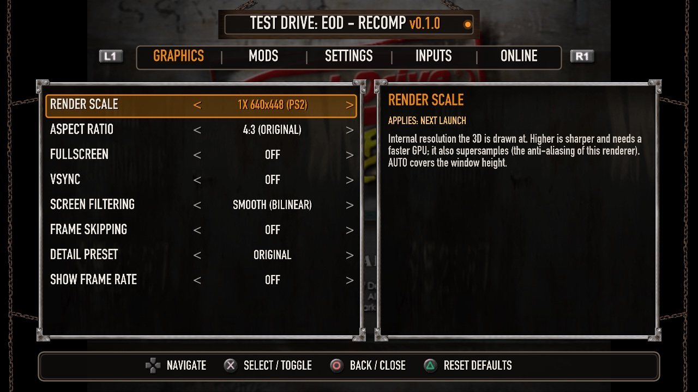
<!-- slide -->
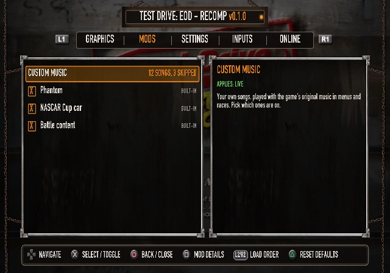
````

1. **Display Tab:**
   - **Internal Resolution (`RenderScale`):** Scale from **`1x` (`640×448`)** up to **`6x` (`3840×2688` 4K)** and **`8x` (`5120×3584`)**.
   - **Aspect Ratio:** Select **`16:9 Widescreen`** for true Hor+ field-of-view expansion (`DisplaySetAspectMode 0x0034D328`) with automatic HUD edge anchoring (`±106.67` native units) so your speedometer and lap text sit cleanly at the 16:9 screen corners without stretching!
   - **Car & World Detail (`Detail`):** Set to **`Maximum`** (Gate P10) to lock all 20 vehicles to their highest complete mesh (`Low1.mod`) at every visible distance and double 2P split-screen draw distance from `1150m` to `2300m`.
2. **Gameplay / Mods Tab:**
   - **Unlock All Out of the Box (`UnlockAll=true`):** Unlocks all 40 Career Eve events, all 8 Feat cheats, all 7 prize-mask bytes, and all 16 points-gated tracks/cars (including Welch and bonus vehicles) immediately.
   - **Straight-Shot Chicken Fight (`ChickenFight=true`):** Press **`L2`** in any race or Career event to fire forward ballistic explosive chickens at $\vec{v}_{\text{car}} + 28.0\text{ m/s}$ (3.0s reload cooldown).
   - **Chicken Blast Force & Radius Sliders:** Crank the default `7.5 m` / `25,000 N` shockwave up to **`4.0x`** (`30 m` radius / `100,000 N` force) to send opponent School Buses flipping over grandstands!
   - **Turbo Boost (`TurboBoost=true`) & Turbo Scale:** Press **`L2`** for `45,000 N × mass` rocket thrust while lifting the hardcoded PS2 `100 mph` (`44.44 m/s`) speed cap up to **`174+ mph`** (`TurboScale=1.75` to `3.0`).
   - **Single Player Battle Mode & Battle Bots:** Injects multi-car **Battle** contests (`0x18000224`) into solo Action & Career menus across all 14 tracks and equips 3 AI Battle Bots with spline navigation, lead-pursuit ramming, and explosive chicken launchers.
   - **Manual Recovery Only (`ManualRecovery=1`):** Stops the annoying 3-second wrong-way/rollover countdown from auto-teleporting you while exploring off-track; you only reset when you intentionally hold **`Select`**.
   - **Custom Music:** Drop `.wav` or `.ogg` tracks into `mods/music/` to mix your own soundtrack into the in-game radio.

---

## Tutorial 2: Your First Track Mod in the EOD World Editor

> **Goal:** Open **Woodly (`AFTON.TRK`)** or **Dundas (`DUNDAS.TRK`)** in the EOD World Editor, navigate the 3D scene, switch Event Templates, select and scale up a dirt jump ramp (baking both its visual `4SPS` VIF mesh and its `SCOL`/`SOBL` driving collision), and test the jump immediately inside **Play-In-Editor (PIE)**.

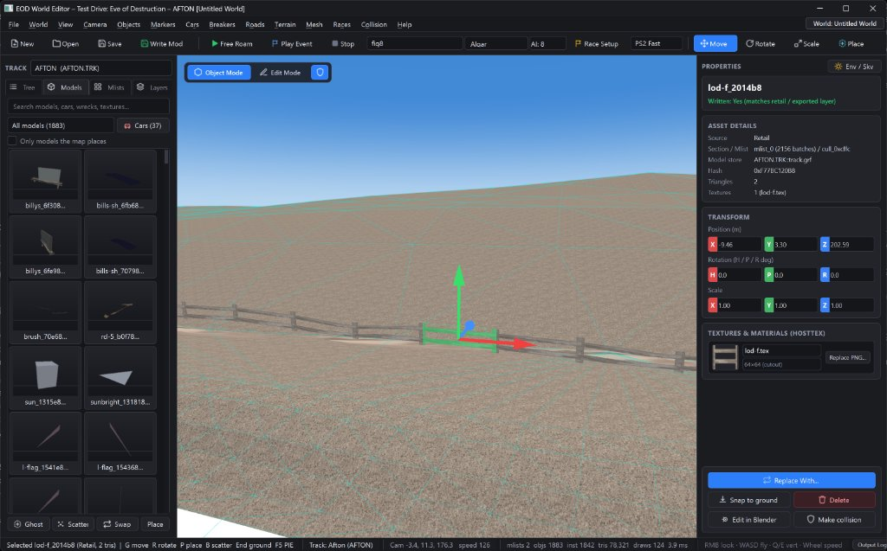

### Step 1: Launch the World Editor & Open Woodly (`AFTON.TRK`)

1. Run **`tools\world_editor\launch_editor.bat`** (or `python tools/world_editor/app.py --track AFTON`).
2. In the **Left Explorer Panel**, use the **Track** dropdown at the top to select **`AFTON (Woodly)`** (or **`DUNDAS`**).
3. Wait ~1 second while the background worker parses `track.grf` (`GRAF` v18, 1,907 display leaves), `track.bsc` (`SCOL` v4, 9,519 drivable terrain triangles), `track.sol` (`SOBL` v3, 1,245 solid collision boxes), `*.ild` (`ILIN` AI racing lines), and the track's 32-tile PS2 sky dome (`sky01A..16B.tex`).
4. Notice the authentic PS2 lighting: the viewport renders Woodly's **1.36 million prelit `V4-5` vertex colors** (`0x80 = 1.0` neutral texture brightness) and real sky dome rather than washed-out fake normals!

### Step 2: Navigate the 3D Viewport Like a Pro

- **Fly Camera:** Hold **`RMB`** (Right Mouse Button) and use **`W / A / S / D`** to fly horizontally, **`E`** to rise, and **`Q`** to descend.
- **Speed Control:** Hold **`Shift`** while flying for a **2.8× speed boost**, or roll the **`Mouse Wheel`** up/down to adjust base movement speed (`5 m/s` to `250 m/s`).
- **Frame Any Object (`F`):** Left-click any barn, bridge, or ramp in the 3D viewport (or click its name in the **Explorer → Tree** tab) and press **`F`** to smoothly orbit and zoom the camera right to it.
- **Renderer Profile Dropdown (Top Toolbar):**
  - **`⚡ PS2 Fast`:** Authentic PS2 `Cv * Ct >> 7` prelit shading, low VRAM footprint, 0% CPU/GPU when idle.
  - **`✨ Plume HQ`:** High-resolution trilinear/anisotropic filtering, full LOD, and enhanced cascade shading.
  - **`🍃 Eco / Laptop`:** Caps interactive fly camera to 30 FPS and culls small props beyond 450m to sip battery power.

### Step 3: Switch Event Templates (`Jump Race`, `Figure 8`, `Battle`, `Gauntlet`)

Every retail `.TRK` archive hosts up to **27 different event layouts** stored in `c_<event>.va0` files (`c_jump_race.va0`, `c_fig8_race.va0`, `c_battle.va0`, `c_gauntlet.va0`, `c_demo_derby.va0`) plus **Optional Terrain** geometry (`GRAF` subtype `20` + `SCOL` triangle flag bits `+0x1E`).

1. In the top toolbar (or **`Races → Custom Race & AI Editor…`** / Explorer event filter), switch the active **Event Template** between:
   - **`Jump Race` (`c_jump_race`)** — activates dirt crossover ramps (`Optional Terrain` mode masks `2 / 3 / 4 / 6`), concrete wall chicanes (`wall`, `arrow_wall`), hay bales, and explosive barrel stacks.
   - **`Figure 8` (`c_fig8_race`)** — enables the figure-8 intersection ramps and perimeter barriers.
   - **`Battle` (`c_battle`)** — opens the full multi-car combat arena and places Battle respawn points and chicken weapon triggers.
   - **`Gauntlet` / `Suicide` / `Demolition Derby`** — switches to tight infield derby rings (`bound`, `ringout` polygons) and trailer obstacles (`Semi_Trailer`, `tank`).
2. Watch the 3D viewport update live as event-specific ramps, concrete barriers, and smashable props (`dyno` objects) swap in and out!

### Step 4: Select, Move & Scale a Dirt Jump Ramp (With Drivable Collision!)

Let's turn a modest dirt ramp on Woodly into a massive stadium launch ramp that cars can physically drive up:

1. **Select the Ramp:**
   - In the Left Explorer's search box, type **`ramp`** (or filter by the semantic tag **`[Ramp]`**), or click directly on a dirt jump ramp in the 3D viewport with **`LMB`**.
   - The ramp highlights in translucent emerald green and displays its 3D transform gizmo (**Red = X**, **Green = Y / Up**, **Blue = Z / Forward**).
2. **Move & Rotate (`G` / `R`):**
   - Press **`G`** (Move tool) and drag the **Green (Y)** arrow or **Blue (Z)** arrow to position the ramp on the main straightaway.
   - Toggle **`Grid Snap`** (`1.0 m`) and **`Angle Snap`** (`15°`) in the top toolbar if you want crisp alignment.
   - Press **`End`** (or **`Ctrl + G`**) to **Drop to Ground**, automatically raycasting `SCOL` (`track.bsc`) terrain so the base of the ramp sits flush with the dirt road.
3. **Scale the Ramp (`S`):**
   - Press **`S`** (Scale tool) or enter exact values in the **Right Properties Panel → Transform → Scale**:
     - Set **Scale X = `1.50`** (50% wider), **Scale Y = `1.85`** (85% taller launch peak!), **Scale Z = `1.40`** (longer approach slope).
4. **Bake Both Visual VIF Vertices AND Driving Collision (`SCOL` / `SOBL`):**
   - In the PS2 engine, visual meshes (`track.grf` `4SPS` VIF batches) and physical collision (`track.bsc` `SCOL` terrain triangles + `track.sol` `SOBL` boxes) are separate data structures. If you only move or scale a visual mesh, your car will drive straight through the air or hit the old unscaled collision!
   - Look at the **Object Inspector (Right Panel)** under the **Collision & Mesh Baking** section:
     - Check **`☑ Bake Scaled/Moved Vertices into VIF Stream`** (rewrites the `4SPS` batch `q199` world offset / quantized `V3-16` vertex positions via `vif_patch.py` and updates the model's `mrModel` bounding sphere + `mlist` frustum spheres + `0x102` cull spheres).
     - Click **`🔨 Bake / Sync Driving Collision (`SCOL` + `SOBL`)`** (or enable **`☑ Auto-Sync Collision on Transform`**). This automatically transforms overlapping `SCOL` optional-terrain triangles (`Table 1` edge planes + `Table 2` height plane $a x + b y + c z + d = 0$) and/or compiles aligned `SOBL` ramp slope collision prisms into `track.sol` so your tires climb the exact new scaled ramp surface!

### Step 5: Test Immediately in Play-In-Editor (PIE) (`F5`)

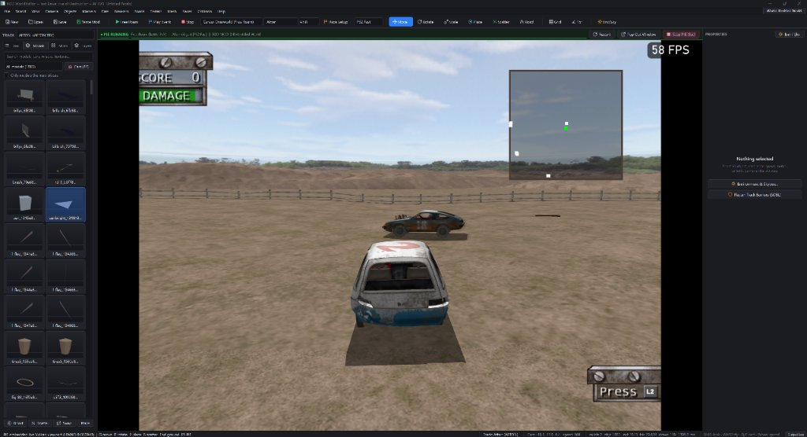

1. Press **`F5`** (or click the green **`▶ Play Free Roam`** / **`🏁 Play Event / Race`** button in the top toolbar).
2. The World Editor performs an **Incremental Dirty-Only Compile** (`< 200 ms`):
   - It patches only the modified `track.grf`, `track.bsc`/`track.sol`, and `c_<event>.va0` bytes into `mods/<YourProject>/DATA/TRACKS/AFTON.TRK` and recomputes their `0TSR` CRC-32 checksums (`rst0.eod_crc`).
   - It pauses the editor's 3D rendering loop and background workers so 100% of your CPU/GPU goes to the game.
   - It launches `eod.exe` with `EOD_MOD_DIR`, `EOD_DIRECT_START`, and `EOD_SKIP_MOVIES=1`, embedding the live Vulkan game window right inside the central editor viewport!
3. **Drive up your giant scaled ramp** at full throttle and launch across the stadium!
4. When you're ready to tweak the ramp angle by another 5 degrees, press **`Shift + Esc`** (or click **`■ Stop PIE`** in the green top bar). You are back in the 3D editor at your exact camera position in `< 5 ms`.

---

## Tutorial 3: Deleting Fences, Removing Invisible Barriers (`SOBL`) & Multi-Selection

> **Goal:** Tear down entire trackside fence lines in seconds using `Shift+Click`, `Select All Similar`, and `Delete All Similar`—including their hidden `lod-*` billboard twins—and flatten the 16-metre `SOBL` invisible walls so you can drive anywhere in the surrounding countryside.

### Why Cars Bounce Off "Thin Air" on Retail Tracks

Removing a fence in *Test Drive: Eve of Destruction* requires removing **three separate layers** that Monster Games authored in `SLUS_209.10`:
1. **High-LOD 3D Fence Meshes (`track.grf` leaves):** Dozens of individual fence segments (`fnce.tex`, `wire.tex`, `rail.tex`) placed end-to-end around the track.
2. **Overlapping `lod-*` & Billboard Twins (`GRAF` LOD groups `0x0` & `MSCAL 0x6A` sprites):** Multi-child LOD groups (`type 0`) hold lower-detail duplicate fence meshes (`child 1`, `child 2`) or camera-facing `lod-*` cards that only appear when the camera pulls back 50–100 metres. If you only delete `child 0`, the fence seems to disappear up close—and then pops back into existence as you drive away!
3. **16-Metre Invisible Collision Slabs (`track.sol`, `SOBL` v3):** As proven in [`docs/COLLISION_AND_BOUNDARIES.md`](COLLISION_AND_BOUNDARIES.md), the physical barriers in `track.sol` are 264-byte (`0x108`) Oriented Bounding Boxes with a half-height of **`ry = 15.0 m`** centered ~1 m above the road. Their top edge sits **16 metres in the air**, blocking cars even when launched off a ramp!

Here is how to wipe out all three layers cleanly in under 30 seconds:

### Step 1: Multi-Select Fence Segments with `Shift + Click`

1. Fly your camera to the fence line you want to open up (for example, the outer wooden/chain-link fence separating Woodly's track from the infield barns, or Dennison's highway access gap).
2. **`LMB` Click** the first fence post/panel to select it.
3. Hold **`Shift`** and **`LMB` Click** adjacent fence sections to add them to your multi-selection set.
   - Selected objects all highlight in emerald green, and the bottom status bar shows: `Selected 6 objects (842 tris)`.
   - You can drag the 3D gizmo to move the entire multi-selection together, or press **`Del`** to delete all selected pieces in one undoable step.

### Step 2: Wipe Out Entire Fence Lines + `lod-*` Twins with `Select All Similar` & `Delete All Similar`

Instead of clicking 80 fence panels one by one:

1. Click **one** fence segment (e.g., an object using `fnce.tex`, `wd-fnc1.tex`, or `chlink.tex`).
2. **Right-click (`RMB`)** in the viewport (or look at the **Object Inspector** in the right panel) and choose one of:
   - **`Select All Similar (Same Texture / Family)`** — automatically selects every object across `track.grf` that shares the primary texture or model family **AND** automatically includes every sibling child in the same `GRAF` LOD group (`0x0`) plus overlapping `lod-*` billboard twins!
   - **`Delete All Similar (Fences + LOD Twins)`** — deletes the selected fence, every matching fence segment on the track (or within your chosen radius), and all of their `lod-*` low-detail LOD siblings in a single `QUndoCommand`!
3. Under the hood, when you compile (`Ctrl+Shift+S` or `F5`), deleted retail `track.grf` static leaves and their `lod-*` twins have their `q199.y` world offset patched to **`Y = -5000.0 m`** (and their `mlist` / `0x102` cull spheres updated) while preserving the exact binary byte size of `track.grf`.

> [!TIP]
> **Surgical Radius Delete:** Want to open a 40-metre gap in a fence without deleting the fences on the other side of the stadium? Select 2–3 fence panels across the gap, right-click, and select **`Delete Selected + Overlapping LOD Twins in Radius (15m)`**. That removes both the high-detail meshes and any hidden `lod-*` duplicates at those coordinates while leaving the rest of the track's fences intact!

### Step 3: Inspect & Flatten Invisible Barriers (`SOBL` `track.sol`)

Now that the visual fence is gone, let's remove the 16-metre invisible wall behind it:

1. Click the **`🛡 Collision Shield`** pill in the top-left corner of the 3D viewport (or toggle the **`SOBL Barriers`** layer in `Explorer → Layers`).
2. Every `SOBL` box in `track.sol` appears as a 3D wireframe box color-coded by its height above ground:
   - **Red (`>= 10.0 m`):** Full-height 16 m invisible wall ceilings (e.g., 574 of the 709 boxes on Anoka!).
   - **Orange (`3.0 m – 10.0 m`):** Medium barriers and building walls.
   - **Yellow (`< 3.0 m`):** Low kerbs, pit walls, or already-lowered barriers.
3. Choose how you want to lower or remove the barriers:
   - **Option A — Surgical Single/Multi-Barrier Flatten:** Click any red wireframe barrier above your deleted fence to open the **SOBL Barrier Inspector** (Page 5 of the Right Properties Panel).
     - Click **`Flatten Barrier (-0.5 m Below Ground)`** to sink its top edge below the dirt so cars drive smoothly across it, **or** set **`Target Top Above Ground = 1.2 m`** and click **`Apply Height`** to turn a 16 m invisible ceiling into a jumpable 1.2 m low wall!
   - **Option B — Flatten Interior / Infield Barriers (Keep Outer Perimeter):** Go to **`Collision → Flatten Interior Barriers (Keep Outer Perimeter)`**. This uses a 2D XZ convex-hull filter to sink all infield, barn, and shortcut invisible walls below ground while preserving the outermost world-edge wall so AI cars don't fall off the map edge.
   - **Option C — True Open-World Free Roam (Flatten All):** Click **`Collision → Remove / Flatten All Track Barriers`** (or the **`Flatten All Track Barriers`** button in the SOBL Inspector). Every vertical invisible wall on the entire track drops below ground in one undoable command!
4. Press **`F5` (`Play Free Roam`)** and drive straight through the former fence line out into the open hills and barns!
   - Remember to enable **`Manual Recovery Only`** in the `F1 → Gameplay` menu so the PS2's off-track referee doesn't teleport you back to the asphalt.

---

## Tutorial 4: Placing Cars, Wrecked AI Cars & Scattering Props (Lumion/Twinmotion Workflow)

> **Goal:** Populate your track with parked or wrecked vehicles from all 37 retail `.CAR` archives, stamp props with **Ghost Place (`P`)** aligned to terrain normals, paint whole junkyard clusters with the **Scatter Brush (`B`)**, and use **Replace Selection With…** to swap boring trees into crashed School Buses with real in-game collision.

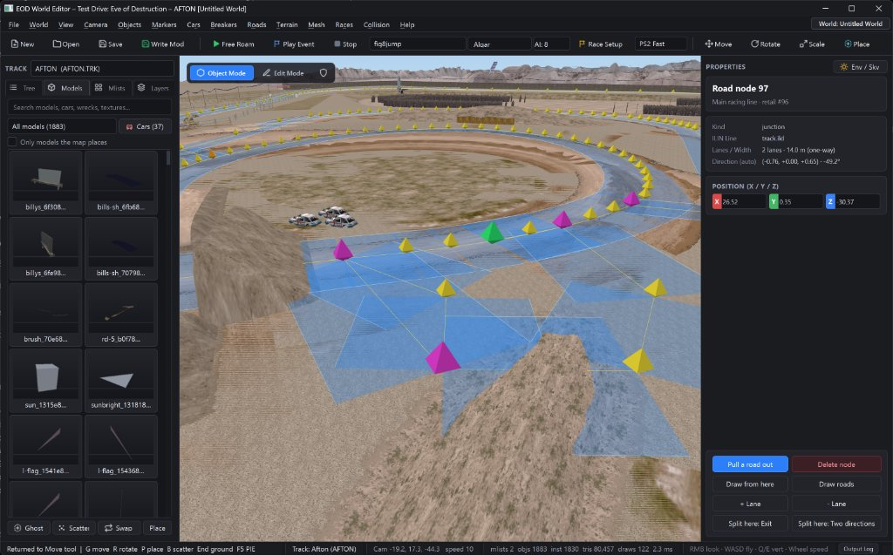

### Step 1: Browse the `Cars & Wrecks (37)` Catalog

1. In the **Left Explorer Panel**, switch to the **`Models`** tab and click the **`🚗 Cars & Wrecks (37)`** quick-filter pill (or select `Cars & Wrecks (37)` in the category dropdown).
2. A background worker automatically scans all **37 retail `.CAR` archives** in `DATA/CAR/` (31 playable cars like `ALGAR`, `VENOM`, `COPCAR`, `AMBULANCE`, `TAXI`, `HEARSE`, `LIMO`, `POSTAL`, plus `BUS.CAR` and the 5 trailers `TRAILER`..`TRAILER5`), decoding their `Low1.mod` / `Low3.mod` meshes and default liveries (`CT.RES`).
3. Shaded 3D studio thumbnails populate the 2-column grid (and are cached to `%LOCALAPPDATA%\EODRecomp\cache\thumbnails\` so future launches load in `< 15 ms`).
4. You can also filter track props by semantic tags: **`[Ramp]`**, **`[Building]`**, **`[Foliage]`**, **`[Fence/Wall]`**, **`[Billboard]`**, or **`[Event Prop]`**.

### Step 2: Precision Stamping with Ghost Place (`P`)

Inspired by **Lumion** and **Twinmotion**, Ghost Placement lets you preview any vehicle or prop directly on the 3D terrain before placing it:

1. Click any vehicle or prop card in the Explorer grid (for example, **`BUS (School Bus)`**, **`HEARSE`**, or **`W_Jump4`**).
2. Press **`P`** (or click **`Place (P)`** in the toolbar / Explorer footer).
3. Move your cursor across the 3D viewport:
   - A translucent cyan/emerald **3D Ghost Preview** glides smoothly over the terrain.
   - As you move across hills, banks, or dirt ramps, the ghost raycasts `SCOL` (`track.bsc`) and **automatically tilts its pitch and roll (`normal_to_pitch_roll`)** to sit naturally on the slope!
4. **Rotate Before Stamping:**
   - Press **`R`** to rotate the ghost **`+15°`** clockwise (or **`Shift + R`** for **`-15°`**).
   - Toggle **`Grid Snap`** (`1.0 m`) in the toolbar to quantize X/Z placement coordinates.
5. **Stamp (`LMB`):**
   - Left-click anywhere on the terrain to stamp an instance. Keep clicking to place a row of bus jumps or parked police cruisers!
   - Press **`Esc`** when finished to exit Ghost Place Mode. Every stamp is undoable with **`Ctrl + Z`**.

### Step 3: Painting Junkyards & Forests with the Scatter Brush (`B`)

Want to line a corner with 25 wrecked cars, tire stacks, or pine trees in two seconds?

1. Select a model (or multiple models) in the Explorer grid (e.g., **`TAXI`**, **`COPCAR`**, or a tree/barrel prop).
2. Press **`B`** (or click **`Scatter (B)`** in the toolbar).
3. A glowing green **3D Terrain Brush Ring** appears under your cursor, along with the floating **Scatter Brush HUD** at the top center of the viewport:
   - **Radius (`3 m – 120 m`):** Size of the circular paint zone (adjust with slider or **`[`** / **`]`** keys).
   - **Density (`1 – 40`):** Number of instances to spawn per stroke.
   - **Random Yaw (`☑`):** Randomizes heading `0°..360°` so scattered wrecks and trees don't look like clones.
   - **Scale Jitter (`0% – 35%`):** Adds organic size variation.
   - **Align to Normal (`☑`):** Tilts each spawned item to match the underlying `SCOL` hill slope.
   - **Auto-Overlap Rejection:** The scatter engine checks candidate AABBs against existing props so scattered cars never clip inside each other!
4. **Hold `LMB` and drag** across the infield or hillside to paint a full demolition junkyard in one stroke.
   - One entire drag stroke is grouped into a single `ScatterPlaceCommand`, so one **`Ctrl + Z`** cleanly undoes the whole stroke if you want to try a different density.

### Step 4: Turn Trees or Props into Wrecked Cars with `Replace Selection With…`

One of the fastest ways to remix a track is swapping existing trackside props or event obstacles into vehicles or ramps while keeping their exact coordinates and orientations:

1. Select one or more objects in the 3D viewport (for example, click a tree, hay bale, or concrete wall block, or use **`Shift + Click`** to select 10 trees along the backstretch).
2. **Right-click (`RMB`) → `Replace Selection With…`** (or click the **`🔄 Replace With…`** button in the Object Inspector on the right).
3. In the searchable **Replace Model Dialog**:
   - Click the **`🚗 Cars & Wrecks (37)`** filter tab (or search for any prop across the track).
   - Click **`AMBULA_1 (Ambulance)`**, **`GLADIA_1 (Gladiator)`**, or **`BUS (School Bus)`** and press **OK**.
4. Every selected tree immediately transforms into an Ambulance or School Bus at the exact same position, yaw, and terrain elevation!
5. **In-Game Compilation & Collision (`export_mod_layer`):**
   - When you press **`Ctrl + Shift + S`** or **`F5` (Play PIE)**, the compiler doesn't just save `.eodworld.json`—it compiles your swapped and scattered vehicles/props directly into the binary `.TRK` archive (`track.grf` leaf model pointers / `c_<event>.va0` `$NNNN$object` `unfloat_frame64` records + injected `.mod`/`.tex` members and `obstacle.val` / `SOBL` collision boxes) so you can physically slam into your parked School Buses in-game!

---

## Tutorial 5: Editing AI Pathfinding (`ILIN` Road Tool) & Inventing Custom Game Modes

> **Goal:** Reshape the AI racing line (`*.ild` `ILIN` splines) with automatic tangent & lap-length recalculation, force **Free Roam** on any race layout, toggle **AI Auto-Drive** & **Free Cam**, and set up three fan-favorite custom game modes: **Tag**, **Cat & Mouse**, and **Fat Kid / Juggernaut**.

### Step 1: Open the `Road (ILIN)` Tool & Inspect AI Splines

In `SLUS_209.10`, computer-controlled cars follow 60-byte nodes stored in **`ILIN`** (`*.ild`) files inside each `.TRK` archive (`f_00137A68` loads the line and stamps `0x104F128B` at header `+0`; `f_0013D9A8` selects `oval.ild`, `fig8.ild`, `track.ild`, or backwards `bw_oval.ild`, `bw_fig8.ild`, `bw.ild`). The same spline also drives road tire-wear and smoke emitters!

1. Click **`Road`** in the top toolbar (or toggle the **`ILIN Racing Lines`** layer in `Explorer → Layers`).
2. The track's active `.ild` centerline appears as a 3D directional ribbon elevated slightly above the road surface, with interactive **Yellow / Magenta Diamond Node Handles** at every 60-byte waypoint.
3. Click any diamond node to open the **Road Node (`ILIN`) Inspector** (Page 2 of the Right Properties Panel), which displays:
   - **Active Line Selector:** Switch between `oval.ild`, `fig8.ild`, `track.ild`, `opt6.ild`, etc.
   - **Node Index & Coordinates:** `X` and `Z` in metres (left-handed world space; `Y` elevation is sampled dynamically from `SCOL` terrain).
   - **Stored Tangent Vector (`dirX`, `dirZ` at `+8, +12`)**, **Segment Length (`segLen` at `+24`)**, and **Cumulative Distance (`dist` at `+28`)**.

### Step 2: Drag, Split & Branch AI Nodes (With Auto-Recalculated Tangents!)

If you built a new dirt jump or placed a barricade of wrecked buses on the main straight, let's reroute the AI racing line so all 19 AI opponents veer onto your jump ramp:

1. **Drag Existing Nodes:**
   - Select any diamond node on the `.ild` spline and drag its **Red (X)** or **Blue (Z)** gizmo arrow toward your new ramp or shortcut.
   - **Color-Coded Hover States in the Road Tool HUD:**
     - **White Hover:** Select / Move node (or click empty terrain to append a new node).
     - **Cyan Hover (`Split`):** Click the ribbon segment *between* two diamond nodes (or click **`Split Segment`** in the Road Inspector) to insert a new intermediate waypoint for tighter cornering accuracy.
     - **Green Hover (`Join` / `Branch`):** Drag or link a side-line node (`+36` header offset / `+56` node `sidePtr`, fixed-point `16.16` merge parameter at `+16`) to create an alternate passing lane or split joker lap!
2. **Automatic Tangent & Lap-Length Recalculation (No Stale AI Swerving!):**
   - In raw binary `ILIN` files, `dirX/dirZ` (`+8, +12`), `segLen` (`+24`), `dist` (`+28`), and the three header lap-length floats (`+12, +16, +20`) are stored rather than computed at load time. If a tool only edits `X/Z`, AI drivers read stale tangent vectors and slam on their brakes or swerve into walls!
   - The EOD World Editor (`tools/formats/ilin.py` + `trk.compile_ild`) **automatically recalculates every modified loop on save/compile**:
     $$\text{segLen}_i = \sqrt{(x_{\text{next}} - x_i)^2 + (z_{\text{next}} - z_i)^2}, \quad (\text{dirX}_i, \text{dirZ}_i) = \frac{(x_{\text{next}} - x_i, z_{\text{next}} - z_i)}{\text{segLen}_i}$$
     and updates cumulative distances, the 3 header lap-length floats, and the pointer fix-up table (`+44`) when nodes are split or added!

### Step 3: Moving the Start Grid, Spawns & Event Triggers

1. Ensure the **`Markers / Spawns`** layer is enabled in Explorer.
2. Click any **Start Grid**, **Battle Respawn**, **Chicken Spawn**, or **Event Trigger** 3D marker cone in the viewport.
3. In the **Marker Inspector** (Page 3 of the Right Panel) or using the 3D **Move (`G`)** and **Rotate (`R`)** gizmos:
   - Drag the Start Grid anywhere on the map (for example, line all cars up at the top of a hill or inside a barn!).
   - Press **`End`** (`Drop to Ground`) so vehicles spawn cleanly on the `SCOL` surface without falling from the sky.

### Step 4: Force Free Roam, AI Auto-Drive & Free Cam

Open **`Races → Custom Race & AI Editor…`** (or click **`⚙ Custom Race`** in the toolbar):
- **Force Free Roam on Any Race Layout:** Select **`Free Roam (Unbounded Sandbox)`** as the launch mode (or click **`▶ Play Free Roam (F5)`**). This loads your chosen track and event props with lap timers and wrong-way resets disabled so you can explore or test stunts indefinitely.
- **AI Auto-Drive (Spectator / AI Test Mode):** Check **`☑ AI Auto-Drive Player Car`** (or pass `EOD_AI_PLAYER=1` / toggle in `Custom Race`). The engine attaches the `AICarUpdate` (`0x001A2D20`) spline-following and tactical-combat controller to slot 0 so you can watch how the AI drives your edited `ILIN` line hands-free!
- **Free Cam & Photo Mode (`P11`):**
  - While in-game, cycle all 10 native cameras (`NearChase`, `Chase`, `FarChase`, `Cockpit`, `Bumper`, `Chassis`, `Rear`, `RearChase`, `Overhead`, and trackside cinematic **`TV`** cameras via `EOD_CAMERA_KEYS` / `Triangle`), **or** pause and activate **Free Camera / Photo Mode** (orbit, fly, roll, FOV, depth-of-field, hide HUD, and export crisp `7680×4320` 8K PNG captures in `< 2 s`).

### Step 5: Inventing 3 Custom Game Modes (`Tag`, `Cat & Mouse`, `Fat Kid / Juggernaut`)

By combining the **Custom Race & AI Editor**, **Scatter Brush**, **SOBL Barrier Editor**, and **F1 Live Gameplay Mods**, you can create completely new single-player and netplay game modes and save them right into your `.eodworld.json` / `COMMON.RES#<track>_eves.val`:

#### Mode 1: Tag / Keep-Away (Arena & Open-Infield Chase)
- **Concept:** High-speed evasion in a custom obstacle arena where AI pursuers relentlessly hunt the player (or human peers chase the "It" driver in netplay).
- **How to Build It in the World Editor:**
  1. Open **`DUNDAS.TRK`** or **`ANOKA.TRK`** and flatten all interior **`SOBL`** barriers (`Collision → Flatten Interior Barriers`) so the entire infield, pit lane, and figure-8 crossover form one open playground.
  2. Use the **Scatter Brush (`B`)** to dot the infield with jump ramps (`W_Jump4`) and destructible hay-bale chicanes.
  3. Open **`⚙ Custom Race`**:
     - **Event Type:** `Survival` (`save_ring` `0x1800421c`) or `Demolition Derby` (`kill_derby` `0x1880221e`).
     - **AI Behavior:** Enable **`AI Vengeance`** (`0x003C4190` bit `0x20`, `ai_vengeance` at `0x00193B20`—forces every AI driver on the map to target and T-bone the player car!) and set **AI Speed Scale = `1.15x`**.
     - **Player Car:** Pick a nimble subcompact (`MOTH` or `DIGIT`) while assigning heavy muscle cars (`OUTLAW`, `CANNON`) to the AI chasing pack.

#### Mode 2: Cat & Mouse (Multi-Class Team Relay & Blocker Gauntlet)
- **Concept:** Fast, fragile "Mouse" cars (`MOTH`, `BLITZ`, `DIGIT`) must complete 5 laps while heavy "Cat" enforcers (`BUS`, `HEARSE`, `AMBULA_1`, `BULLDOG`) try to wreck them or block choke points.
- **How to Build It in the World Editor:**
  1. Open **`GILROY.TRK`** or **`AFTON.TRK`** in the **`Road (ILIN)`** tool.
  2. Drag the `.ild` racing line through a narrow bottleneck (e.g., between two barns or across Woodly's water crossing) and place concrete `wall2` / wrecked car chicanes on either side using **Ghost Place (`P`)**.
  3. In **`⚙ Custom Race`**:
     - **Event Type:** `No-Rules Race` (`normal_race` `0x00002110`) or `Red Rover / Gauntlet`.
     - **Laps:** `5` · **AI Count:** `12` (mix of `BUS` / `HEARSE` heavy blockers and fast compacts).
     - **In-Game F1 Tuning:** Enable **`Turbo Boost`** (`TurboScale = 1.6x`) and **`Manual Recovery Only`** so getting slammed off a bridge into the ditch requires fighting your way back onto the road!

#### Mode 3: Fat Kid / Juggernaut (1 Unstoppable Boss Bus vs. The Pack)
- **Concept:** Inspired by Halo 3 custom games—one massive, nigh-indestructible **Juggernaut** (`BUS` School Bus or `LIMO` armed with high-impulse explosive chickens and turbo) vs. fast runners on a custom stunt circuit.
- **How to Build It in the World Editor:**
  1. Open **`BAXTER.TRK`** or **`EAGAN.TRK`**, select the `c_battle` or `c_gauntlet` template, and ring the arena with huge dirt jump ramps (`Scale Y = 2.0x`) so fast cars can leap *over* the Juggernaut if they time it right.
  2. Lower the barn roof `SOBL` collision boxes (`Target Top Above Ground = 2.5 m`) so agile cars can jump onto roof platforms to escape!
  3. In **`⚙ Custom Race`** + **`F1 → Gameplay`**:
     - **Juggernaut Player Setup:** Choose **`BUS (School Bus)`** (`790`), enable **`Invincible Humans (GodMode)`** (`L1+R1+Square` or `Invincible=1`), **`Chicken Fight`**, **`Chicken Blast Force = 3.0x`** (`75,000 N`), **`Chicken Blast Radius = 2.0x`** (`15.0 m`), and **`Turbo Scale = 1.5x`**.
     - **Challenge Variant (Survive the AI Juggernaut):** Pick **`MOTH`** (the most fragile car on the disc), turn **off** invincibility, enable **`Battle Bots`** (armed with AI chicken launchers via `0x00227EE8`), and try to survive 5 kills against 3 explosive-chicken-firing School Buses!

---

## Tutorial 6: Live 4K Textures (`HOSTTEX`), Skybox Swapping & Importing *NASCAR: Dirt to Daytona* Cars

> **Goal:** Reskin any track surface or billboard with a 4K PNG in one click, transplant skyboxes and fog between tracks, import stock cars and Cup wheels from *NASCAR: Dirt to Daytona* (`SLUS_204.41`), and tune real vehicle suspension & gearing in `physics.val`.

````carousel
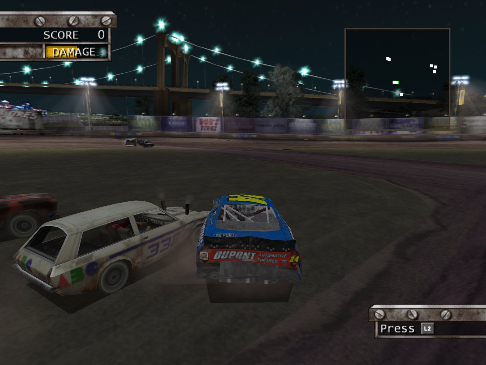
<!-- slide -->
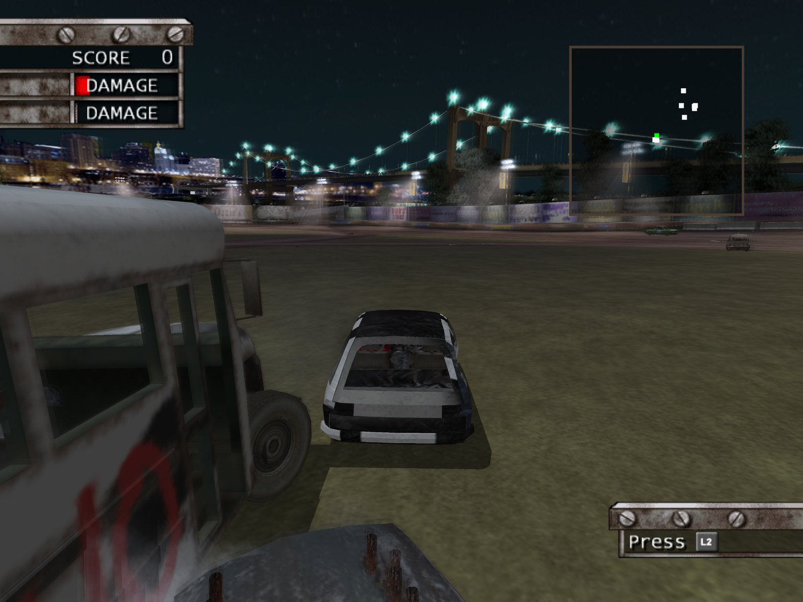
````

### Part A: Click-Surface 4K Texture Replacement (`HOSTTEX` / `.eodhtx`)

Retail PS2 textures (`TEX` v10, 4,923 on disc) are 4-bit (`PSMT4`) or 8-bit (`PSMT8`) indexed images capped at 256 colors and small resolutions (`64×64` to `512×256`). EOD Recomp's **Vulkan Host Texture Replacement** engine (`runtime/gs/texture_replacements.cpp`, `F_TEX_HOST = 0x8000`) lets you replace any surface with true-color 32-bit RGBA textures scaled up to **`32x` (`4096×4096` 4K)** with zero palette banding:

1. **Click Any 3D Object in the World Editor:**
   - Click a billboard, barn wall, asphalt road chunk, or start/finish banner in the 3D viewport.
2. **Inspect Materials in the Right Properties Panel:**
   - Scroll to the **Texture / Material Inspector** card in the Object Inspector.
   - You will see clickable thumbnail cards for every texture used by that model (e.g., `bboard02.tex — 256×128`), along with its FNV-1a 64-bit `indexKey` and `paletteKey`.
3. **Click `🖼 Replace PNG…`:**
   - Select any 8-bit RGBA `.png` from your computer whose dimensions are a power-of-two multiple $k \in \{1, 2, 4, 8, 16, 32\}$ of the retail texture (up to `4096×4096`).
   - **Instant Viewport Update:** The OpenGL 3.3 / Plume viewport uploads your new PNG on the very next frame! If you made a mistake, press **`Ctrl + Z`** to restore the retail texture immediately.
4. **Automatic `.eodhtx` & `HOSTTEX/replacements.tsv` Compilation:**
   - When you press **`Ctrl + Shift + S`** or **`F5` (Play PIE)**, the editor automatically:
     - Computes the retail texture's canonical `indexKey` and `paletteKey` (`tools/texture_identity.py`).
     - Converts alpha to the PS2 GS domain (`(a * 128 + 127) / 255` when native max alpha `<= 0x80`) so transparency and cutouts match retail behavior without dark halos.
     - Generates a full 2×2 box-filtered RGBA8 mipmap chain and writes a memory-mapped **`.eodhtx`** container under `mods/<Project>/HOSTTEX/`.
     - Updates `mods/<Project>/HOSTTEX/replacements.tsv` so `eod.exe` hot-loads your 4K texture in both **PS2 Classic** and **Modern Remastered** modes!

### Part B: Skybox Swapping & Atmosphere Control

Want to drive Woodly (`AFTON.TRK`) under Anoka's floodlit night sky or Dundas's golden sunset clouds?

1. Open the **Environment / Skybox Drawer** (`World → Environment / Skybox` or click **`☀ Env / Sky`** in the toolbar).
2. **1-Click Atmosphere Presets:**
   - Try **`Track Default`** (loads the track's authentic 32-tile PS2 `Sky` model `sky01A..16B.tex` and retail `FogColor`), **`Clear Day`**, **`Golden Sunset`**, **`Anoka Night`**, **`Overcast Storm`**, or **`Desert Noon`**.
3. **Fine-Tune Sun & Fog Sliders (60 FPS Live Preview):**
   - Adjust **Sun Azimuth (`0°..360°`)**, **Sun Elevation (`-10°..90°`)**, **Ambient Brightness**, and **Fog Color / Start / End / Density**.
4. **Cross-Track Skybox Transplant (`Borrow Sky From Track…`):**
   - In the **`Borrow Sky From Track`** dropdown, select any of the 14 sky-equipped retail tracks (e.g., borrow **`ANOKA`** or **`GILROY`** sky onto **`AFTON`**).
   - The viewport sky dome immediately swaps to the borrowed track's 32 sky tiles!
   - On **`Ctrl + Shift + S`** or **`F5` (Play PIE)**, the compiler extracts all 32 `sky01A..16B.tex` tiles from the donor track and emits `.eodhtx` replacements keyed to your active track's sky `indexKey`s in `HOSTTEX/replacements.tsv` (or you can export/edit a seamless panoramic PNG strip via `python tools/sky_export.py export`).

### Part C: Importing *NASCAR: Dirt to Daytona* (`SLUS_204.41`) Vehicles

Monster Games built *Test Drive: Eve of Destruction* (`SLUS_209.10`, 2004) on the same core engine lineage as *NASCAR: Dirt to Daytona* (`SLUS_204.41`, 2002). However, dropping raw NASCAR `.CAR` files into EOD draws nothing because NASCAR's VIF streams invoke VU1 microcode `MSCAL 0x2D` with `V4-5` 5-bit normals and `TEX` v9 (`0x60`-byte headers), whereas EOD cars require `MSCAL 0x5C` with `V4-8` 8-bit normals (`STROW = 65536.0f`), `TEX` v10 (`0x80`-byte headers), and a 157-bone `Bone.mvl` damage skeleton.

Our automated pipeline (**`tools/import_nascar_cars.py`**) handles the entire binary transcode automatically!

1. **Extract Your Retail *NASCAR: Dirt to Daytona* (`SLUS_204.41`) `DATA/` Folder.**
2. **Run the NASCAR Vehicle Importer:**
   ```powershell
   python tools/import_nascar_cars.py `
     --nascar-data "D:\NASCAR - Dirt to Daytona (USA)\DATA" `
     --eod-data "D:\Test Drive - Eve of Destruction (USA)\DATA" `
     --output "mods\nascar_cupcar" `
     --kind stock `
     --name Cupcar `
     --number 777 `
     --class midsize `
     --paint Car24.tex
   ```
3. **What `import_nascar_cars.py` Builds for You:**
   - **Registers a New Playable Chassis (`CUPCAR.CAR`):** Clones donor tables via `create_custom_car.py` into the **`Midsize`** class (`COMMON.RES#carclass.val`, `buycar.val`, `dirt.val`) with non-colliding racing number `#777` (and dealer number `#778`) so it appears in both Arcade and Career Dealership carousels with custom `UICAR.RES` portraits.
   - **VIF Microcode & Normal Transcoding (`transcode_vif_stream`):** Rewrites every `4SPS` VIF stream across `Low0.mod`–`Low3.mod` from NASCAR `MSCAL 0x2D` to EOD `MSCAL 0x5C`, expands 16-bit `V4-5` normals to EOD `V4-8` normals with `STROW (0x47800000 x3, 0x7F80)`, converts `V1-8 @150` low-LOD skin bytes to weighted `V4-8` skin words, and synthesizes a 157-bone `Bone.mvl` deformation skeleton so the NASCAR stock car crumples realistically in demolition derbies!
   - **`TEX` v9 → v10 Livery Conversion:** Converts NASCAR `PAINT256.RES` liveries (`Car24.tex` plus AI driver numbers) from `0x60`-byte v9 headers to `0x80`-byte EOD v10 `.tex` and `.tm0` hi-res stream textures inside `CT.RES`.
   - **Independent Slow & Fast Cup Wheels (`nascar_wheels.py`):** Converts NASCAR's `Rtire0..4` and high-speed blurred `Rtire0f..4f` wheel models (`MSCAL 0x26 → 0x55`) into namespaced `ncu0..4.mod` and `ncu0f..4f.mod` inside `RACE.RES` (`wheel_class = ncu`), preserving every retail EOD car's native wheels!
4. **Launch & Drive Your NASCAR Stock Car:**
   ```powershell
   $env:EOD_MOD_DIR="$PWD\mods\nascar_cupcar"
   .\eod.exe
   ```
   Select **Midsize → Cupcar (#777)** in Arcade, Career, or the World Editor's **`⚙ Custom Race`** vehicle picker!

### Part D: Live Suspension, Gearing & Physics Tuning (`physics.val` vs. `SETU`)

> [!WARNING]
> **Don't Fall for the `SETU` (`.gar`) Trap!**
> Every `.TRK` archive contains 196-byte `.gar` files (`default.gar`, `Advanced.gar`, `arcade.gar`, `ai.gar` — FourCC `SETU`, 64 files total). As proven by our disassembly audit in [`docs/SETU_CAR_SETUP.md`](SETU_CAR_SETUP.md), **`SLUS_209.10` contains zero code that loads `SETU` or `.gar` files**—they are unused leftovers from the NASCAR engine! The World Editor clearly marks all `.gar` files and 80 dead `physics.val` keys with an **`[Unused by PS2 Runtime]`** warning badge.

To make suspension, gearing, grip, or mass changes that you actually **feel** on track, edit the vehicle's **`DATA/CAR/<CAR>.CAR#physics.val`** (`VALT` v11 table, consumed by `0x00185470`):

| `physics.val` Section & Key | Active in `SLUS_209.10`? | What It Controls (`0x00185470` / `0x0018AFE0`) |
|---|---|---|
| **`[Chassis]` `mass`** | **Yes (Verified)** | Vehicle curb weight in lbs (multiplied by `0.4545` to kg; also scales collision momentum and `damage_tweak = 1818.0 / (mass * 0.4545)` at `0x0018AFE0`). |
| **`[Chassis]` `spring_factor`** | **Yes (Verified)** | Global suspension stiffness & ride-height multiplier (increase to `1.35..1.80` for heavy jump landings without bottoming out). |
| **`[Chassis]` `grip`** / **`slip`** | **Yes (Verified)** | Master lateral/longitudinal Pacejka tire traction and drift slip angle on dirt/asphalt/mud. |
| **`[Chassis]` `brake_factor`** | **Yes (Verified)** | Master footbrake stopping torque multiplier. |
| **`[Chassis]` `damage_scale`** | **Yes (Verified)** | Structural durability multiplier (`0.5` = tank-like resilience, `2.0` = glass cannon). |
| **`[Transmission]` `num_gears`**, **`g1`..`g4`** | **Yes (Verified)** | Forward gear ratios (`0x00186E54` formats `"g%d"`). Higher `g1` (e.g., `3.60`) gives explosive off-the-line launch torque. |
| **`[Transmission]` `rear_end_ratio`** | **Yes (Verified)** | Final drive differential ratio (`0x001860E8`, default `5.0`). Lower values (`3.20..3.80`) raise top speed on long highway tracks like Anoka and Baxter; higher values (`5.20..6.00`) maximize short-oval acceleration. |
| **`[Engine]` `redline`**, **`torque_curve`** | **Yes (Verified)** | Peak RPM limit and engine torque lookup curve. |
| **`[Front]` / `[Rear]` `wheel_class`** | **Yes (Verified)** | Selects wheel geometry & dimensions from `RACE.RES#<wheel_class>.val` (`0x0021C3C8`, e.g., `mid`, `com`, `mus`, `bus`, or imported NASCAR `ncu`). |

You can edit any car's `physics.val` in the Creation Kit's **VALT Schema Inspector** (which shows plain-English labels, units, and retail min/max ranges) or via Python (`tools/valt.py`), and save the patched `.CAR` archive into your `mods/<Project>/DATA/CAR/` overlay!

---

## Tutorial 7: Packaging, Sharing & Installing `.eodmod` Mods Online

> **Goal:** Package your custom track, 4K textures, and custom race into a compact, legal, delta-only **`.eodmod`** file (`50 KB – 8 MB` instead of a 70 MB copyrighted `.TRK` dump), combine multiple mods with **3-Tier Conflict Merging**, and race friends online with 0-desync netplay parity.

### Why `.eodmod` Delta Packages Beat Raw `.TRK` Folder Dumps

When you press `Ctrl+Shift+S` during local editing, the editor writes a ready-to-run `mods/<Project>/DATA/TRACKS/<TRACK>.TRK` file (`~45–70 MB`) so `eod.exe` can mount it directly. However, sharing a full 70 MB `.TRK` file online has two major problems:
1. **Legal & Bandwidth Bloat:** 99% of that 70 MB `.TRK` file is unmodified copyrighted retail disc data.
2. **Mod Collisions:** If Mod A and Mod B both distribute a full `AFTON.TRK`, installing Mod B overwrites Mod A completely.

An **`.eodmod`** package solves both problems: it diffs your project against the verified retail disc (`SLUS_209.10`) and bundles **only your changed archive members, 4K `HOSTTEX` PNGs, and sub-record `.eodworld.json` deltas** into a tiny zip archive with cryptographic SHA-256 provenance!

### Step 1: Export a Delta-Only `.eodmod` Package

#### From the World Editor GUI (1 Click)
1. Go to **`File → Package Mod as .eodmod…`** (or press **`Ctrl + Shift + E`**).
2. Fill in the package metadata card:
   - **Mod ID:** `woodly-mega-jumps` (lowercase slug)
   - **Display Name:** `Woodly Mega Jumps & Bus Junkyard`
   - **Version:** `1.0.0` (SemVer)
   - **Author & Description:** Brief summary of your changes.
3. Click **`Build .eodmod Package`**.
   - The packager automatically captures a `preview.png` viewport thumbnail, runs a byte-for-byte diff against your retail `DATA/` archives, stores only modified members (`native/DATA/TRACKS/AFTON.TRK/track.grf`, `track.sol`, `c_jump_race.va0`), bundles any 4K textures (`host/`) and your structured `.eodworld.json` delta (`deltas/`), and verifies that re-composing the package against the retail disc reproduces your mod build **byte-for-byte**!

#### From the Command Line (`tools/mod_package.py`)
```powershell
# 1. Create a package directory from an editor project (stores changed members only)
python tools/mod_package.py from-project "mods\WoodlyJumps\project.eodproject" `
  --disc "D:\Test Drive - Eve of Destruction (USA)" `
  --id woodly-mega-jumps `
  --version 1.0.0 `
  --name "Woodly Mega Jumps & Bus Junkyard" `
  --out "build_pkgs\woodly-mega-jumps"

# 2. (Optional) Add a standalone 4K host texture replacement PNG to the package
python tools/mod_package.py add-host "build_pkgs\woodly-mega-jumps" `
  --disc "D:\Test Drive - Eve of Destruction (USA)" `
  --asset "DATA/TRACKS/AFTON.TRK#bboard02.tex" `
  --image "my_art\custom_4k_billboard.png" `
  --any-palette

# 3. Verify integrity and zip into a single .eodmod file
python tools/mod_package.py verify "build_pkgs\woodly-mega-jumps" --disc "D:\Test Drive - Eve of Destruction (USA)"
python tools/mod_package.py zip "build_pkgs\woodly-mega-jumps" "Woodly-Mega-Jumps-v1.0.0.eodmod"
```

### Step 2: Installing `.eodmod` Packages & Managing Load-Order Conflicts

Players receiving your `.eodmod` file can install and combine multiple mods effortlessly:

#### In the World Editor / Mod Manager GUI
1. **Drag and drop** any `.eodmod` file directly onto the EOD World Editor window (or open **`File → Mod Manager & Profiles…`**).
2. Check or uncheck mods to enable/disable them in your active profile, and drag rows to reorder load priority.
3. **How 3-Tier Conflict Merging Works (`tools/mod_install.py`):**
   - **Tier 1 — Disjoint Members in the Same Archive (Automatic Merge):** If Mod A edits `AFTON.TRK#track.grf` (scenery) and Mod B edits `AFTON.TRK#track.sol` (flattened barriers) or `AFTON.TRK#oval.ild` (AI line), `mod_install.py` patches both members into a single composed `AFTON.TRK` automatically with zero conflict!
   - **Tier 2 — Disjoint Sub-Records in the Same Member (`deltas/*.eodworld.json` Merge):** If Mod A moves Ramp `#1352` on Woodly and Mod B scatters buses in the infield via `.eodworld.json` deltas, the composer merges their non-overlapping object/barrier/ILIN/VALT edits on top of the retail base member!
   - **Tier 3 — True Same-Member / Same-Record Collision (Explicit Winner Selection):** If two enabled mods replace the exact same binary member with different raw bytes, composition halts safely (never corrupting `active/`) and prompts you to pick the winning mod (`accept-conflict`).

#### From the Command Line (`tools/mod_install.py`)
```powershell
# Install one or more .eodmod packages into your profile
python tools/mod_install.py install "Woodly-Mega-Jumps-v1.0.0.eodmod" --disc "D:\Test Drive - Eve of Destruction (USA)"
python tools/mod_install.py install "Anoka-4K-Night-Textures.eodmod" --disc "D:\Test Drive - Eve of Destruction (USA)"

# Check status, resolve a specific member conflict if needed, and compose the active overlay
python tools/mod_install.py status
python tools/mod_install.py accept-conflict "DATA/TRACKS/AFTON.TRK#track.grf" woodly-mega-jumps
python tools/mod_install.py compose

# Print the EOD_MOD_DIR path for launching eod.exe
python tools/mod_install.py launch-env
```
> [!NOTE]
> **Atomic Rollback & Career Save Protection:** Every `mod_install.py` command builds `active/` in a temporary sibling folder, verifies `SLUS_209.10` and every untouched member's CRC-32, and swaps `active/` atomically. Disabling or uninstalling a mod immediately restores 100% vanilla retail bytes.

### Step 3: Multiplayer Netplay Parity (Racing Modded Tracks Online)

````carousel
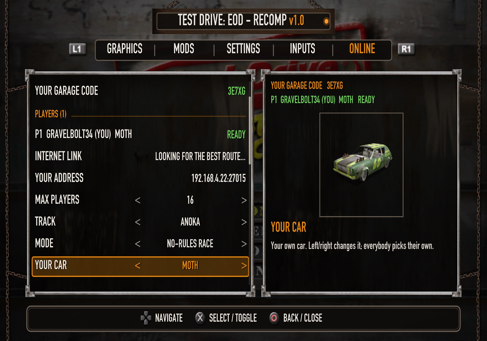
<!-- slide -->
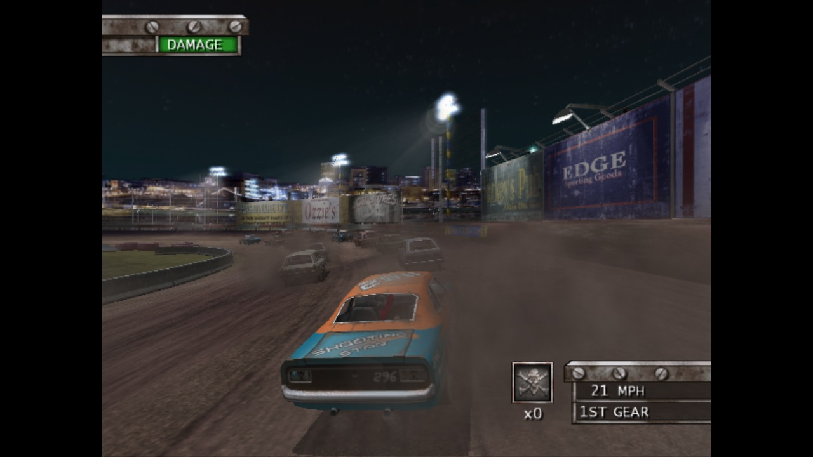
<!-- slide -->
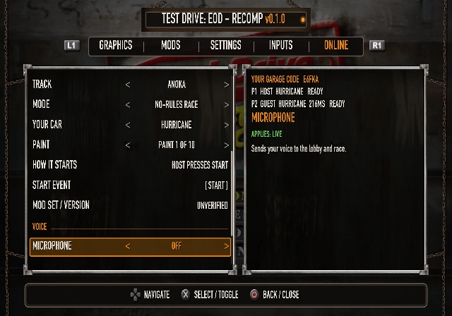
````

EOD Recomp features deterministic lockstep netplay (`59.94 Hz` `WorldSimulationStep` at `0x00177718`, seeded by `RaceSessionSeedRng` at `0x00176918`). To guarantee **0 desyncs** (Gate P7) when playing modded tracks or vehicles online:

1. **Physics-Affecting Mods Must Match Across All Peers:**
   - Every player in the lobby must load the exact same physics-affecting `.eodmod` packages (`track.sol` `SOBL` barriers, `track.bsc` `SCOL` terrain, `c_*.va0` physical event props, `*.ild` AI splines, `physics.val` car tuning, and `COMMON.RES` event tables).
   - Compare the composed `active/PROFILE.TXT` SHA-256 manifest before starting: if two players have identical `PROFILE.TXT` native member hashes, their simulation state is bit-for-bit identical!
2. **Visual-Only Mods (`HOSTTEX` / `F9` Classic vs. Modern) Are Client-Independent:**
   - Because `HOSTTEX` 4K texture replacements (`.eodhtx`), `RenderScale` (`1x`–`8x`), and the **`F9` Classic/Modern toggle** operate purely in the host Plume/Vulkan presentation layer without touching EE RAM (`0x00000000..0x02000000`) or physics ticks, Player 1 can play at **8x Modern PBR with 4K textures** while Player 2 plays at **1x PS2 Classic** in the same online race with **zero desyncs**!
3. **Automatic Online Pool Sync (`ExpandDebris`):**
   - Offline (`ExpandDebris=1`), EOD Recomp dynamically expands the PS2's 16-slot detached wheel (`0x00484E68`) and 16-slot detached panel (`0x00494D60`) debris pools up to 512 active phobs so flying wheels never vanish.
   - When an online netplay session starts (`netplay_hooks::race_rules() >= 0`), the engine automatically locks debris ring behavior across all connected peers so every flying wheel and detached hood simulates in lockstep.
4. **`[MOD]` Roster Badges (JTBD 4):**
   - Any track or vehicle overridden by your active `EOD_MOD_DIR` profile automatically displays a clean **`[MOD]`** badge in the Single-Player and Multiplayer Arcade selection rosters so everyone in the lobby can see at a glance which tracks and cars are modded.

---

## Further Reading & Technical Reference

- **[GitHub Wiki Home](wiki/Home.md)** — Complete technical index for `SLUS_209.10`
- **[Architecture Overview](wiki/Architecture-Overview.md)** — EE, VU1, GS, IOP, 32 MB memory map, and PS2 limit removals
- **[Native Plume Renderer](wiki/Native-Plume-Renderer.md)** — Stages R0–R8, VIF mesh decoder, dual Classic/Modern rendering, and P1–P13 gates
- **[File Formats Encyclopedia](wiki/File-Formats-Encyclopedia.md)** — Deep-dive specifications for all 24 FourCC formats (`0TSR`, `GRAF`, `MODL`, `VIF`, `TEX`, `ILIN`, `SCOL`, `SOBL`, `VALT`, `SETU`, `LAYT`, `IMAG`, `LANG`, `HSCM`, `.eodhtx`)
- **[Decompiled Subsystems & Symbols](wiki/Decompiled-Subsystems-and-Symbols.md)** — Function addresses, HLE hooks, `EOD_DIFF` verification harness, physics, chicken weapons, AI, and career
- **[World Editor & Creation Kit](wiki/World-Editor-and-Creation-Kit.md)** — Editor software architecture, JTBD matrix, and fishbone UX specification
