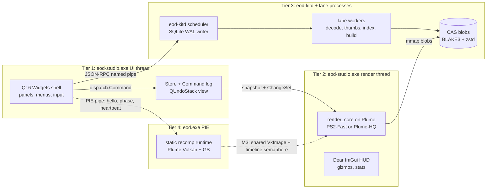
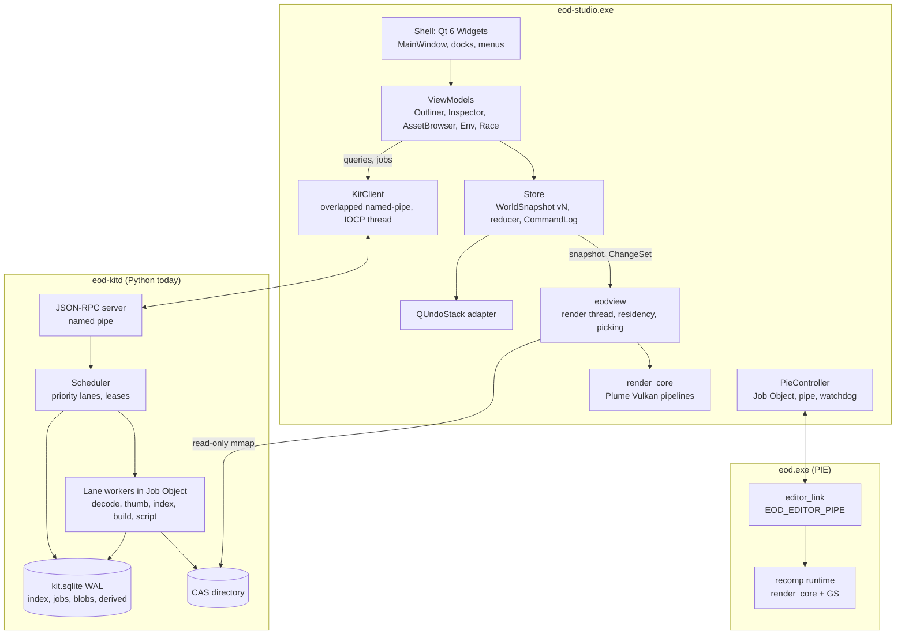
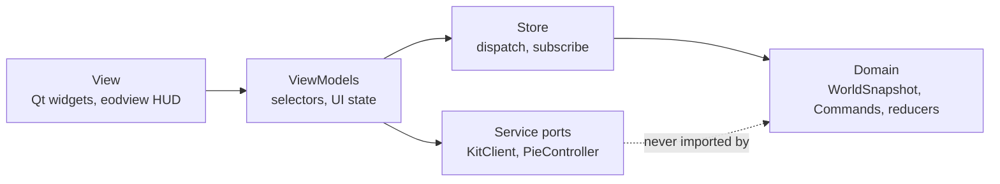
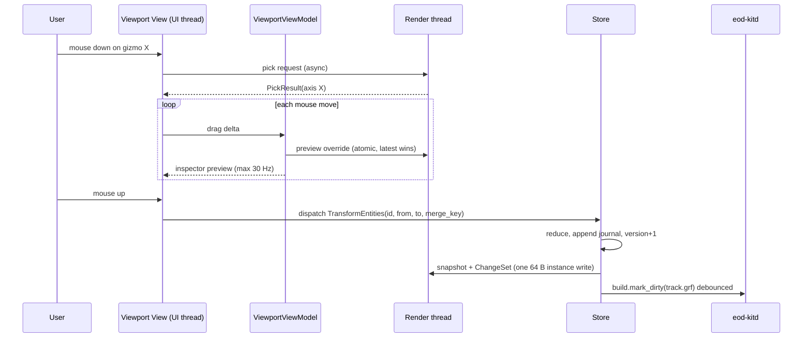
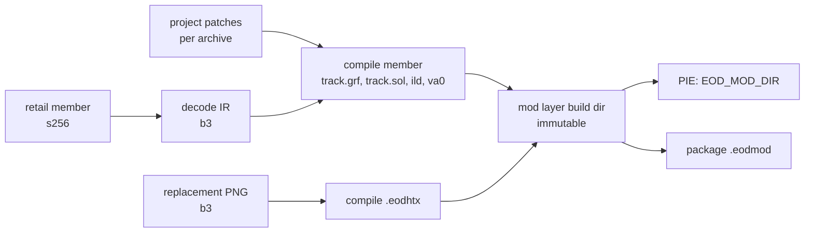
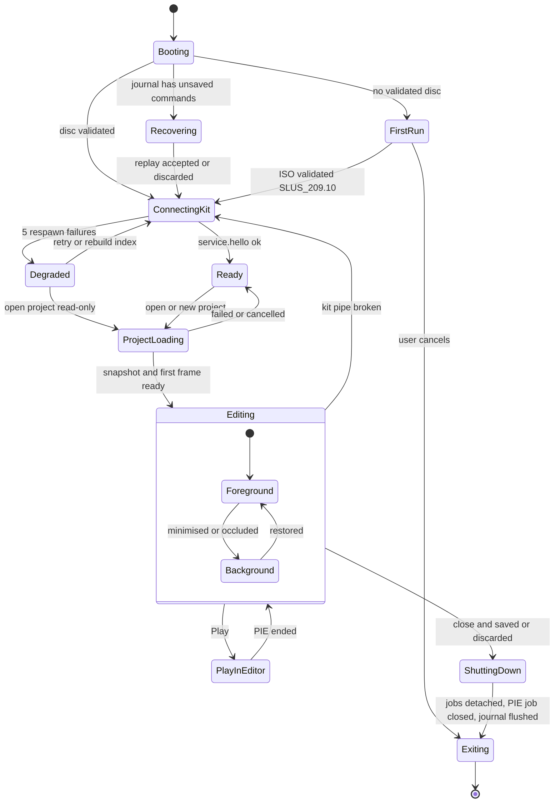
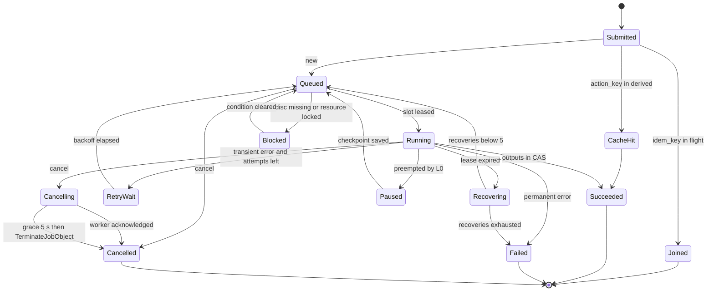
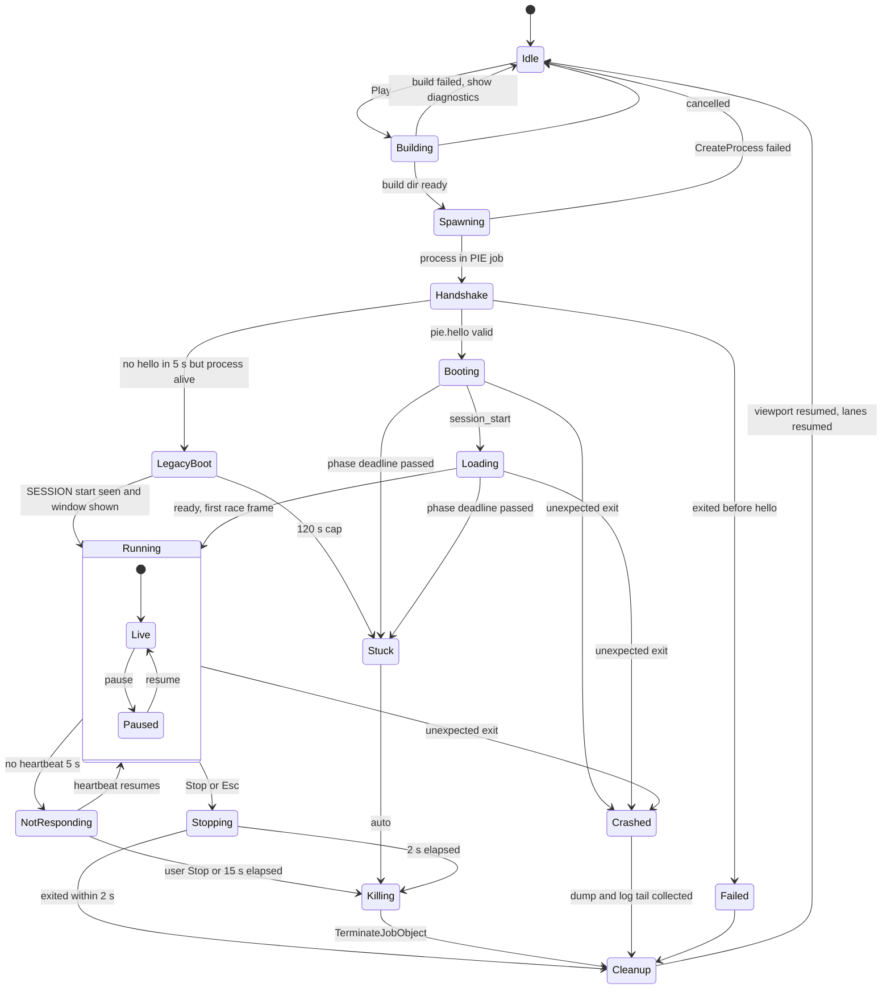
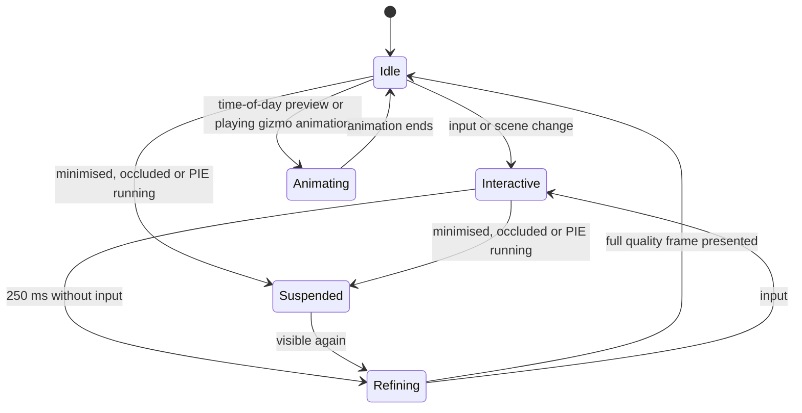

# EOD World Editor & Modding Suite: Systems & Software Architecture Specification

| | |
|---|---|
| **Status** | Proposed (architecture baseline v1). Every ADR below is *Accepted-pending-owner-review*. |
| **Scope** | Standalone Windows 11 x64 World Editor & Modding Suite for *Test Drive: Eve of Destruction* (`SLUS_209.10`), its background services, and its Play-In-Editor (PIE) link to `eod.exe`. macOS stays a secondary target (the Kit service already runs there). |
| **Replaces** | §6 "Multi-Threading, Performance & Non-Blocking UI Architecture" of [WORLD_EDITOR_ROADMAP.md](WORLD_EDITOR_ROADMAP.md) and the architecture table in [WORLD_EDITOR.md](WORLD_EDITOR.md). The roadmap stays the source of truth for *what* users can do (JTBD, asset matrix). This document defines *how the software is built*. |
| **Companion** | [WORLD_EDITOR_FRICTION_AND_UX.md](WORLD_EDITOR_FRICTION_AND_UX.md) (onboarding, fishbones, UX). |
| **Evidence rule** | Every claim about the current code cites a file and line. Every claim about Windows or a library cites the API it relies on. Numbers marked **target** are SLOs to be measured, not results. |

---

## 0. Decision Summary (ADR Index)

| ADR | Decision (one line) | Section |
|---|---|---|
| **ADR-01** UI platform | **Option (d): hybrid.** A native C++20 **render & scene core on Plume** (shared with `eod.exe`), inside a **Qt 6 Widgets shell**. The shell stays PySide6 through M3 and moves to C++ Qt 6 at a measured gate (M4). WinUI 3 is rejected. A full custom GPU UI is rejected; Dear ImGui is kept only for in-viewport HUDs. | §2.1 |
| **ADR-02** Viewport renderer | **One render core with two quality profiles**: **PS2-Fast** (native 640×448 internal res, CLUT textures, no MSAA, 30 FPS cap, ≤ 128 MB VRAM) and **Plume-HQ** (display res, mips, aniso, P10 LOD, 60 FPS / refresh). Both use **prelit vertex colour as the lighting truth**, so the editor shows what the game shows. | §2.2, §4 |
| **ADR-03** PIE presentation | **No cross-process `SetParent`, ever.** M0–M2: floating game window placed over the viewport. M3: zero-copy **shared-texture composition** (Vulkan external memory + timeline semaphore) with input forwarding. | §2.3 |
| **ADR-04** Process topology | **4 isolation tiers in 3+N processes**: `eod-studio` (UI thread + render thread), `eod-kitd` (Kit service: SQLite writer + job scheduler) with lane worker processes in a capped Job Object, and `eod.exe` (PIE) in its own kill-on-close Job Object. | §2.4, §6 |
| **ADR-05** App state | **Unidirectional Store (MVU core) + MVVM panels + ECS-lite render mirror.** The domain is immutable, versioned snapshots. Every edit is a `Command` with an inverse patch. `QUndoStack` is a *view* of the command log. | §2.5, §5 |
| **ADR-06** IPC | **JSON-RPC 2.0, newline-delimited, over Windows named pipes** (the existing Kit protocol, new transport). Bulk data never goes over the pipe: only CAS hashes or named shared-memory sections. | §2.6, §9 |
| **ADR-07** Hashing & caching | **BLAKE3-256 for content-addressed blobs** (`b3:` prefix). **SHA-256 stays for retail identity** (existing `files.sha256`, `assets.member_sha256`, retail write-back checks). SQLite in **WAL** mode with a **single writer** (`eod-kitd`). | §2.7, §7 |
| **ADR-08** Scripting | **Python** for authoring automation (runs in a Kit lane, never in the UI process). **Declarative JSON recipes** (`eod-recipe/1`) are the only *distributable* logic. Lua is deferred. | §2.8, §9.4 |



---

## 1. Context, Evidence & Budgets

### 1.1 Current system inventory (as of `12e7044`)

| Component | Path | Facts relevant to architecture |
|---|---|---|
| Editor shell | [`tools/world_editor/`](../tools/world_editor/) | PySide6 6.12, `QOpenGLWidget` OpenGL 3.3 Core, `QThreadPool` workers, `QUndoStack` in [main_window.py](../tools/world_editor/main_window.py#L98). About 470 KB of Python. `viewport_gl.py` alone is 2,794 lines. |
| Viewport | [viewport_gl.py](../tools/world_editor/viewport_gl.py) | PyOpenGL, `OpenGL.ERROR_CHECKING = False` ([L25](../tools/world_editor/viewport_gl.py#L25)). On-demand repaint: the flight timer runs only while keys are held ([L804-807](../tools/world_editor/viewport_gl.py#L804-L807)). |
| PIE host | [pie_host.py](../tools/world_editor/pie_host.py) | `subprocess.Popen` plus a 60 ms `EnumWindows` poll plus cross-process `SetParent`. |
| Workers | [workers.py](../tools/world_editor/workers.py) | `CancelToken` and generation IDs (good). In-process threads, pool size `max(2, min(4, cpus-1))` ([L158-164](../tools/world_editor/workers.py#L158-L164)). |
| Kit service | [`tools/kit_service/`](../tools/kit_service/) | **The right backbone already exists**: SQLite WAL store ([db.py](../tools/kit_service/db.py#L80-L90)), numbered migrations, persistent job queue with leases, idempotency keys, transient/permanent retry with exponential backoff ([jobs.py](../tools/kit_service/jobs.py#L448-L470)), per-lane worker **processes** to escape the GIL ([lanes.py](../tools/kit_service/lanes.py#L1-L5)), entity state machines ([states.py](../tools/kit_service/states.py)), and JSON-RPC 2.0 NDJSON ([server.py](../tools/kit_service/server.py#L2)). **It is POSIX-only today**: `import fcntl` (server.py L12, client.py L11), `AF_UNIX` sockets, `os.killpg` / `start_new_session` (jobs.py L293, L371), and the workspace default `~/Library/Application Support/EODCreationKit` ([common.py](../tools/kit_service/common.py#L10)). |
| Game renderer | [`runtime/render/`](../runtime/render/) | Plume owns the single Vulkan 1.3 instance and device ([plume_device.h](../runtime/render/plume_device.h#L14-L28)). Only Plume's Vulkan backend is compiled. Its D3D12 backend exists upstream (`plume_d3d12.cpp`) but needs Windows SDK DirectX headers (CMakeLists.txt L181-183). |
| Mesh decoder | [vif_mesh.h](../runtime/render/vif_mesh.h#L1-L16) | C++17 with **no game or runtime dependencies** and allocation-free reuse: it can go into the editor unchanged. |
| Window / UI in game | `runtime/platform/sdl3/platform_sdl3.cpp` L288 | SDL3 window. Dear ImGui is already vendored (`third_party/imgui`, CMakeLists.txt L83-87). |
| Game boot contract | [session_start.h](../src/session_start.h) | `EOD_DIRECT_START`, `EOD_MOD_DIR`, `EOD_SKIP_MOVIES`. Progress is logged to **stderr** as `[SESSION] ...` lines ([session_start.cpp](../src/session_start.cpp#L236-L273)). |

### 1.2 Root-cause analysis: why the PySide6 + OpenGL prototype lagged

Every row is a defect in the *architecture*, not a tuning issue. The fix column names the section of this spec that removes the cause.

| # | Symptom | Root cause (evidence) | Fix |
|---|---|---|---|
| R1 | UI and viewport stutter while tracks, cars or thumbnails load | **GIL contention.** `QThreadPool` workers run pure-Python parsing (`load_track_world`, `load_car_catalog`, PIL rasterising) *in the UI process*. The thumbnail worker has to `time.sleep(0.002)` every 4 items to give the GIL back ([workers.py L149-151](../tools/world_editor/workers.py#L149-L151)), which treats the symptom, not the cause. PyOpenGL calls on the UI thread need the same GIL. | §6 Tier 3 (out-of-process lanes) |
| R2 | Hitch on every move, delete, layer toggle | **O(world) rebuild on the UI thread inside `paintGL`.** `_rebuild_static_batches` loops every object and every part in Python, transforms vertices with numpy, concatenates, and re-uploads with `glBufferData` ([viewport_gl.py L1345-1385](../tools/world_editor/viewport_gl.py#L1345-L1385)). It is triggered by `_static_dirty` from `paintGL` ([L1805-1806](../tools/world_editor/viewport_gl.py#L1805-L1806)). Texture uploads also happen in `paintGL` ([L1803-1804](../tools/world_editor/viewport_gl.py#L1803-L1804)). | §4.3 (instance buffers, dirty ranges) |
| R3 | Laggy hover in Place and Scatter tools | **CPU picking in Python on every mouse move.** It loops over `self.world.objects` with numpy Möller–Trumbore ([L2236-2241](../tools/world_editor/viewport_gl.py#L2236-L2241)) and does a terrain raycast per move ([L2409](../tools/world_editor/viewport_gl.py#L2409)). | §4.5 (GPU ID buffer + C++ BVH) |
| R4 | Inspector flicker and CPU spikes while dragging gizmos | **The View mutates the Domain, then broadcasts per mouse event.** `self.selected_obj.position = ...` followed by `objectSelected.emit(...)` on *every* mouse move ([L2431-2455](../tools/world_editor/viewport_gl.py#L2431-L2455)), so the properties panel refreshes at mouse rate. | §5 (Store, preview channel, 30 Hz throttling) |
| R5 | Weak iGPUs hit their fill-rate limit | `QSurfaceFormat.setSamples(4)` globally ([app.py](../tools/world_editor/app.py)). `QOpenGLWidget` renders into an FBO that Qt then composites, so every frame costs an MSAA resolve plus a blit, even in "PS2 fast" mode. | §4.2 (PS2-Fast: no MSAA, 640×448 internal) |
| R6 | Editor freezes when the game hitches; focus weirdness | **Cross-process `SetParent`** ([pie_host.py L290](../tools/world_editor/pie_host.py#L290)) *implicitly attaches the input queues* of the two threads, transitively. A stall in `eod.exe`'s window thread then stalls the editor UI. This is documented Win32 behaviour (Raymond Chen, *"Is it legal to have a cross-process parent/child or owner/owned window relationship?"*). | §2.3 ADR-03 |
| R7 | "Play" sits on a loading bar forever | **No readiness signal.** The editor polls `EnumWindows` every 60 ms. After 250 attempts it only changes a label ([L265-272](../tools/world_editor/pie_host.py#L265-L272)). There is no watchdog for a game that hangs in boot. `stderr` is not captured (`Popen` without pipes, [L237-241](../tools/world_editor/pie_host.py#L237-L241)), so `[SESSION] unknown track ...` diagnostics are lost. | §9.3 PIE protocol, §10.4 FSM |
| R8 | UI freezes up to 2.5 s on Stop | `self._proc.wait(timeout=2.5)` **on the UI thread** ([L349-351](../tools/world_editor/pie_host.py#L349-L351)). | §6 Tier 4 (async process wait) |
| R9 | Orphaned `eod.exe` after an editor crash | No Job Object. The child outlives the parent. | §6.4 (`JOB_OBJECT_LIMIT_KILL_ON_JOB_CLOSE`) |
| R10 | Slow "Play" on every launch | **Full mod-layer export each time** (`export_mod_layer` [main_window.py L812-824](../tools/world_editor/main_window.py#L812-L824)). It includes SHA-256 of the whole retail `.TRK` twice ([project_state.py L1103, L1267](../tools/world_editor/project_state.py#L1103)), on the same GIL-bound pool. | §7.4 incremental build graph |
| R11 | Kit service unusable on the target OS | POSIX-only transport and process control (see §1.1). | §9.1, §12 M0 |

### 1.3 Reference hardware & Service-Level Objectives

**Reference "shitbox" (minimum supported):** 4 logical cores with no SHA-NI (for example a 2C/4T Skylake/Kaby Lake laptop), 8 GB RAM, an Intel UHD 620-class iGPU with Vulkan 1.3 drivers, SATA SSD or HDD, Windows 11 23H2+. Minimum GPU = `eod.exe`'s minimum (Vulkan 1.3, [plume_device.h L15](../runtime/render/plume_device.h#L15)). An iGPU without Vulkan is out of scope for v1 (see §13, Plume D3D12 option).

**Reference "mainstream":** 6C/12T, 16 GB, GTX 1650 / RX 6500-class dGPU.

| SLO (target, measured on the shitbox) | Value |
|---|---|
| UI thread: input event → layout/paint complete, p99 | **< 4 ms**. No disk I/O, no parsing, no `glBufferData`/`vkQueueSubmit`. |
| UI thread stall > 50 ms (ETW "UI hang" counter) | **0 per hour** of scripted editing |
| Idle (no input for 2 s, window visible) | **0 FPS rendered, < 1 % CPU, GPU 3D engine ≈ 0 %** |
| Viewport interactive frame (camera fly), PS2-Fast | ≤ 33 ms (30 FPS cap), p95 |
| Viewport interactive frame, Plume-HQ on mainstream | ≤ 16.6 ms, p95 |
| Cold start → shell interactive | < 2.0 s (M4 C++ shell), < 3.5 s (PySide6 shell) |
| Track open, warm cache (decoded IR in CAS) | < 1.5 s to first full frame |
| PIE: click Play → first in-race frame, transform-only edit, warm | < 8 s on the shitbox (game boot dominates). Compile part < 1 s. |
| PIE loading bar | **Never indefinite.** Every phase has a deadline (§9.3). |
| RSS, editor process, one track open | < 400 MB (PS2-Fast) |
| VRAM, editor viewport | ≤ 128 MB PS2-Fast, ≤ 512 MB Plume-HQ |
| Background work while editing | ≤ `cores − 2` worker processes, below-normal priority, EcoQoS |

---

## 2. Architecture Decision Records

### 2.1 ADR-01: Windows 11 UI platform & renderer host

**Context.** The shell must host (1) dense tool UI (outliner, property grids, asset browser with about 7,300 items, menus, dialogs, docking, IME/text, accessibility), and (2) a 3D viewport that renders EOD data exactly like the game, power-efficiently, on weak iGPUs. The repo builds with **llvm-mingw + Ninja**, links **Plume (Vulkan)**, **SDL3** and **Dear ImGui**, and keeps macOS buildable.

**Options evaluated** (weights reflect the owner's priorities: stability on low-end, renderer parity, migration cost).

| Criterion (weight) | (a) Custom GPU UI/WM in C++ (Slate / Blender `wmWindow` style on Plume) | (b) WinUI 3 / Windows App SDK + C++/WinRT `SwapChainPanel` | (c1) Qt 6 C++ | (c2) Qt 6 PySide6 (status quo) | (d) Hybrid: C++ Plume core + thin Qt shell |
|---|---|---|---|---|---|
| Renderer parity with `eod.exe` (×3) | 5: same Plume device | 2: `SwapChainPanel` takes only a **DXGI composition swap chain** (`ISwapChainPanelNative::SetSwapChain`), so Vulkan needs D3D11/12 interop textures or Plume's unbuilt D3D12 backend | 4: native child `QWindow` + Vulkan surface | 1: separate GL 3.3 re-implementation (the current divergence that broke Woodley/Afton lighting) | **5**: reuses `vif_mesh.cpp` + an extracted `render_core` |
| UI-thread isolation / no-lag (×3) | 4: full control, but immediate-mode UIs redraw per event | 4 | 5: C++ event loop, no GIL | 2: GIL shared with any in-process Python work | **5**: render on own thread, work out of process |
| Tool-UI completeness: docking, trees, IME, a11y, native dialogs (×2) | 1: years of work (Slate/Blender scale) | 4: modern controls, weak docking | 5 | 5 | **5** |
| Toolchain fit: llvm-mingw, CMake, macOS (×2) | 5 | **0**: C++/WinRT, MIDL and XAML compiler are MSVC/NuGet-centric. Windows App SDK runtime must be deployed. Windows-only, so it ends the macOS path the Kit already serves. | 4: Qt ships LLVM-MinGW x64 kits (Qt 6.8+), LGPL dynamic linking | 4 | **4** |
| Footprint on the shitbox (×2) | 5 | 3: XAML runtime and composition overhead | 4 | 2: Python + PySide6 startup and RSS, PyInstaller bundles often trip SmartScreen/AV | **4** |
| Migration cost from today (×2) | 1: rewrite everything | 1: rewrite everything | 2 | 5 | **4**: strangler: viewport first, panels later |
| **Weighted total (max 70)** | 49 | 32 | 61 | 41 | **66** |

**Decision: Option (d), concretely:**

1. **`render_core` (C++20, new, shared library target):** Plume device, PS2-Fast / Plume-HQ pipelines, mesh/texture residency, culling, picking, Dear ImGui HUD. Extracted from `runtime/render/native_renderer.cpp` (material/GS-state → Plume pipeline translation, fog) and `runtime/render/vif_mesh.cpp` (verbatim). **The same library is linked by `eod.exe`**, so editor and game cannot drift.
2. **`eodview` (C++20):** the viewport host. It owns the render thread, takes snapshots and ChangeSets from the Store, and creates the Vulkan surface on a native child window **created on the UI thread** (same thread, so no input-queue attachment).
3. **Shell = Qt 6 Widgets.** PySide6 through M3 (it binds `eodview` via nanobind and releases the GIL on every call). At **gate M4** it ports to C++ Qt 6 *if* any SLO in §1.3 is missed or for packaging (single signed exe, no PyInstaller). The architecture (Store, IPC, tiers) is identical either way, so the gate decides language, not design.
4. **Dear ImGui** draws only *inside* the viewport (gizmo labels, mode pill, brush HUD, perf HUD), in the render thread's last pass. This removes today's Qt overlay widgets (`ModePillOverlay`, `ScatterHudOverlay`, [viewport_gl.py L790-802](../tools/world_editor/viewport_gl.py#L790-L802)), which cannot composite over a native Vulkan child window (the Win32 "airspace" problem).

**Rejected:**
- **(b) WinUI 3**: toolchain incompatibility with llvm-mingw, DXGI-only presentation surface, Windows-only, runtime deployment burden.
- **(a) Fully custom UI**: right for Unreal/Blender-sized teams, not for this project.
- **(c2) PySide6 forever**: the GIL and Python↔C++ marshalling of the world graph put the UI thread back in the same runtime as data work.

**Consequences.** One render codebase for game and editor. A Python→C++ seam (nanobind) exists through M3. The kit/importer stays Python (fast iteration on decoders) until C++ ports of decoders are needed for speed.

### 2.2 ADR-02: Dual-profile viewport (PS2-Fast vs Plume-HQ)

**Decision.** One `render_core` with two **profiles**, switchable at runtime without reloading the scene (pipelines and resources for both are created lazily and cached):

- **Lighting model is identical in both.** The prelit per-vertex colour (V4-5 RGBA, PS2 modulate semantics) is the truth. HQ does **not** add fake dynamic normals lighting (the root cause of the broken Woodley/Afton look, see companion doc Fishbone 2). An optional "Preview sun" overlay is a debug view, off by default.
- **PS2-Fast** = what the PS2 drew, as cheaply as possible (power-sipping default on battery and on the shitbox).
- **Plume-HQ** = what `eod.exe EOD_NATIVE=1` draws (R5 fog, mips, P10 LOD), at display resolution.

Full spec in §4.2. **Parity gate:** editor frames vs `eod.exe` captures of the same camera are scored with `tools/p3_compare.py` (R5 A1). Target for editor PS2-Fast vs game Classic: SSIM ≥ 0.97, MAE ≤ 4/255. Plume-HQ vs game native: SSIM ≥ 0.98.

### 2.3 ADR-03: PIE presentation without cross-process window parenting

**Context.** R6 (input-queue attachment) and R7 (blind polling) make `SetParent` embedding fundamentally unstable. Godot 4.4 also embeds an out-of-process game for crash isolation, which confirms the *process* split. We reject its HWND re-parenting technique for the reasons above.

**Decision.**

| Stage | Mode | Mechanism |
|---|---|---|
| M0–M2 (default) | **Play in Window** | `eod.exe` keeps its own top-level SDL3 window. The editor passes `EOD_WINDOW_RECT=x,y,w,h` (new, §9.3.3) so it opens exactly over the viewport, borderless optional. No parent/owner relationship. The viewport shows a live **PIE status card** (phase, FPS, heartbeat, Stop/Restart/Focus). |
| M3 | **Play in Viewport** (zero-copy) | `eod.exe` renders its final image into a ring of 3 **exportable `VkImage`s** (`VK_KHR_external_memory_win32`, named NT handles via `VkExportMemoryWin32HandleInfoKHR::name = Local\eod-pie-<nonce>-img<i>`) and signals an exported **timeline semaphore** (`VK_KHR_external_semaphore_win32`). `eodview` imports them on the **same adapter** (LUID match via `VkPhysicalDeviceIDProperties`, negotiated in `pie.hello`) and draws the latest completed image as a textured quad. Input is forwarded over the PIE pipe while the viewport is "possessed" (click to possess, `Shift+F1` to release, like UE). Gamepads go directly to the game (SDL background joystick events). |
| Fallback | Automatic | LUID mismatch (hybrid-GPU laptop), missing extensions, or a protocol mismatch drops back to Play in Window with a toast. |
| Never | `SetParent`, `SetWindowLongPtr(GWLP_HWNDPARENT)` across processes | Banned by lint (grep gate in CI over `tools/` and `editor/`). |

### 2.4 ADR-04: Process topology & isolation tiers

**Decision.** Tiers 1–4 as specified in §6. The **Kit service (`eod-kitd`) is the single owner** of the SQLite writer, the CAS, and the job scheduler for *all* clients (editor, MCP tools, CLI). Today's `tools/kit_service` is that service, ported to Windows (§12 M0). The editor UI process never parses retail binaries.

### 2.5 ADR-05: Application state pattern

**Options:** MVVM only (bindings, but mutable shared models invite R4-style bugs). MVU/Redux (single source of truth, pure reducers, trivially undoable). ECS (excellent for render and simulation, poor fit for undoable authoring data with cross-references).

**Decision.**
- **MVU core:** one `Store` holds the immutable `WorldSnapshot`. `dispatch(Command)` runs a pure reducer and yields `(new_snapshot, ChangeSet, inverse_patch)`.
- **MVVM at the edges:** panels get ViewModels (selectors over the snapshot plus UI-local state) with throttled, coalesced notifications.
- **ECS-lite render mirror:** the render thread keeps flat SoA arrays (instance transforms, material IDs, bounds) keyed by `EntityId`, updated from ChangeSets. It never sees the authoring graph.

Details in §5.

### 2.6 ADR-06: IPC transport & contract

**Decision.** Keep the Kit's **JSON-RPC 2.0 NDJSON** framing (it is already implemented and tested) and add a **Windows named-pipe transport** next to the POSIX socket. Pipe security and naming are in §9.1. The same framing is used for the PIE link. Payloads > 64 KiB are forbidden on the pipe. Pass `{"blob":"b3:..."}` (CAS) or `{"shm":"Local\\eod-...","size":n}` instead.

### 2.7 ADR-07: Content addressing

**Decision.** `b3:` BLAKE3-256 for every derived blob (decoded meshes, RGBA/CLUT textures, mip chains, thumbnails, compiled members, built archives). BLAKE3 is several times faster than SHA-256 on CPUs without SHA-NI (the shitbox). SHA-256 stays the **retail identity** hash: it is already stored in `files.sha256`, `assets.archive_sha256` / `member_sha256` and `thumbnails.member_sha256` ([db.py L15-42](../tools/kit_service/db.py#L15-L42)), and is used for retail write-back verification ([project_state.py L1103-1278](../tools/world_editor/project_state.py#L1103)). Multihash-style prefixes (`b3:`, `s256:`) make any future change a migration rather than a rewrite.

### 2.8 ADR-08: Scripting & modding API

**Decision.**
- **Python 3** for author-side automation (batch prop swaps, procedural scatter, validation). Scripts run in a dedicated **`script` lane process** of `eod-kitd` (Job Object: CPU, memory and time caps). They talk to the world **only through the transaction API**, which returns a Command batch to the editor, which becomes one undo step.
- **Declarative JSON recipes** (`eod-recipe/1`: races, prop swaps, triggers) are the only logic shipped inside `.eodmod` packages. Installing a mod never executes code.
- **Lua deferred**: no runtime hook in `eod.exe` needs it yet. Adding a third language costs more than it buys today. Revisit when in-game triggers need an interpreter (§9.4.3).

---

## 3. Target System Architecture

### 3.1 Component view



### 3.2 Proposed source layout (new code only; nothing existing is moved until its milestone)

| Path | Language | Contents | Milestone |
|---|---|---|---|
| `editor/render_core/` | C++20 | Plume pipelines, PS2/HQ profiles, residency, culling, ID-buffer picking, ImGui backend. Consumes `vif_mesh.h`. | M1 |
| `editor/eodview/` | C++20 + nanobind | Render thread, snapshot mirror, Python binding (`eodview.pyd`). | M1 |
| `editor/studio/` | C++20 Qt 6 | C++ shell (only after gate M4). | M4 |
| `editor/common/winproc/` | C++20 | Job Object, named pipe, process spawn helpers (shared by studio and kitd launcher). | M0–M2 |
| `tools/kit_service/transport.py` | Python | `UnixTransport` / `PipeTransport` abstraction. | M0 |
| `tools/kit_service/winproc.py` | Python (ctypes) | Job Objects, priority, EcoQoS, named events. | M0 |
| `tools/world_editor/core/` | Python | `store.py`, `commands.py`, `snapshot.py` (Domain + Store, Qt-free). | M2 |
| `runtime/app/editor_link.cpp` | C++ | PIE pipe client inside `eod.exe` (gated by `EOD_EDITOR_PIPE`). | M2 |

### 3.3 Reuse map (current → target)

| Current | Target | How |
|---|---|---|
| `runtime/render/vif_mesh.cpp/.h` | `render_core` dependency | Link as-is (no game deps by design). |
| `runtime/render/native_renderer.cpp` (GS state → Plume, fog) | `render_core/materials.cpp`, `fog.cpp` | Extract pure functions. `native_renderer.cpp` then calls them, guarded by `EOD_DIFF` 0-mismatch per MASTER_SPEC rules. |
| `runtime/render/native_shaders.hlsl` + `native_shaders_spv.inc` | `render_core/shaders/` | Same HLSL source, same SPIR-V build step. |
| `runtime/render/plume_device.cpp` | Pattern only | The editor creates its *own* Plume device (separate process). The device-creation options patch (`cmake/patches/plume-create-options.patch`) is reused. |
| `tools/world_editor/viewport_gl.py` | Retired at M1 | Tool logic (gizmo math, snapping, scatter rules) moves to `core/tools/*.py` (pure). Rendering moves to C++. |
| `tools/world_editor/workers.py` | Retired at M0/M1 | `CancelToken` semantics move into the Kit job API. |
| `tools/world_editor/pie_host.py` | `PieController` | Rewritten per §6.4 and §9.3. `build_pie_launch_spec` is kept (env contract). |
| `tools/world_editor/project_state.py` `QUndoCommand`s | `core/commands.py` | Each becomes a pure `Command` (apply / inverse). The `QUndoCommand` becomes a 10-line adapter. |
| `tools/world_editor/world_loader.py` | Kit lane recipe `decode.track` | Runs out of process. Output = IR blob in CAS. |
| `tools/kit_service/*` | `eod-kitd` | Windows transport, Job Objects, migration 3 (§7.2), priority lanes (§8). |

---

## 4. Rendering Architecture (Tier 2)

### 4.1 Render thread loop

The render thread is the **only** thread that touches the Plume device and queue in `eod-studio`. Inputs arrive through three channels, each without locks on the UI side:

| Channel | Type | Semantics |
|---|---|---|
| Scene | SPSC ring of `{snapshot_ptr, ChangeSet}` | Apply in order. Coalesce if > 1 pending. |
| View | `std::atomic<CameraState>` (seqlock) | Latest wins. Camera never queues. |
| Resources | MPSC queue of `{blob_hash, kind}` ready in CAS | The render thread maps the blob, uploads through a staging ring with an upload budget per frame (2 MB PS2-Fast, 8 MB HQ) so streaming never spikes a frame. |

```
loop:
  wait(cv, until = frame_requested || resources_pending || shutdown)   // 0 % CPU when idle
  drain scene ring  -> update instance SoA, dirty ranges only
  drain uploads     -> within per-frame byte budget, rest next frame
  if !visible || pie_suspended: continue
  acquire swapchain image (FIFO present mode)
  cull (frustum vs per-object AABB in a uniform grid / BVH) -> draw list
  record: sky -> opaque (sorted by pipeline, texture) -> alpha (game order) -> overlays -> ImGui HUD -> ID buffer (on pick request)
  submit, present
  cadence FSM decides whether another frame is requested (§10.5)
```

**Present mode:** `VK_PRESENT_MODE_FIFO_KHR` always. `MAILBOX` and `IMMEDIATE` render frames that are never shown, which wastes power.

**Resize:** the UI thread posts the new size. The render thread recreates the swapchain. The UI thread never waits on the GPU.

### 4.2 Quality profiles

| Aspect | **PS2-Fast** (default on battery or shitbox) | **Plume-HQ** |
|---|---|---|
| Internal resolution | 640×448 (×1), optional ×2. Nearest or bilinear upscale blit | Display resolution, optional SSAA ×1.5 when idle (progressive refinement) |
| Textures | **CLUT kept indexed** (4/8-bit index + palette, looked up in the shader): about 4× less VRAM than RGBA8 | RGBA8 decoded, game mip chains (`.tm0`, R5 A2), 4× anisotropic, HOSTTEX `.eodhtx` replacements |
| Filtering | GS semantics (point/bilinear per `TEX1`) | Trilinear + aniso |
| Lighting | Prelit vertex colour × texture (PS2 2× modulate) | Same. HQ is about precision, not a different look. |
| Fog | Per-vertex fog from the game's fog tables (R5 A1: `FogConfigureRange 0x0033ECB8`, `GsFogWriteTables 0x003653F8`) | Same tables, per-pixel interpolation |
| Draw distance / LOD | Game default LOD selection | P10 "maximum" (highest car and world LOD at all distances) |
| MSAA | Off | 4× (only if the GPU reports it cheap; off on iGPU by default) |
| Frame cap (interactive) | 30 FPS | Display refresh, capped at 60 |
| VRAM budget | ≤ 128 MB | ≤ 512 MB |
| Shadows / post | None | None in v1 (the game has none to match) |

Switching profiles is a `RenderSettings` change on the View channel. No scene reload.

### 4.3 Scene representation & dirty updates (fixes R2)

- **Meshes are uploaded once per model**, in model space. Today's per-world baked batches are gone.
- **Instances:** a GPU instance buffer (`mat4x3` + material ID + flags, 64 B) indexed by a dense `InstanceIndex`. A transform edit writes **one 64 B range**. Delete or hide flips a flag bit. Adds append (free-list compaction runs when idle).
- **Draws:** `vkCmdDrawIndexed` per (pipeline, texture) group with instancing. Retail tracks are a few thousand instances, well within CPU limits in C++ without indirect draws. Indirect draws are an M3+ option.
- **Selection / ghost / brush ring:** separate small dynamic buffers, rewritten per frame only while active.

### 4.4 Residency & VRAM

- An LRU over GPU resources keyed by blob hash, with a per-profile budget (§4.2). Eviction prefers off-screen, then far-away.
- **PIE suspend:** when PIE starts, the viewport stops rendering and **releases transient targets and evictable textures** (keeps meshes of the open track) so the game gets the iGPU's shared memory. The pre-PIE camera frame is kept as a still image.
- **`VK_ERROR_DEVICE_LOST`:** the render thread tears down, recreates the device, and re-uploads from CAS (everything is content-addressed, so nothing is lost). After 3 losses in 60 s it drops to PS2-Fast and shows a banner (§8.4).

### 4.5 Picking & raycasts (fixes R3)

- **Click-select:** an R32_UINT ID attachment written in the main pass only when a pick is pending. A 1×1 region is copied to a host-visible buffer and read **1–2 frames later**, asynchronously. The result goes to the UI as `PickResult{entity, sub_part, depth}`.
- **Hover / placement / scatter / snap-to-ground:** a C++ BVH over SCOL terrain triangles and object AABBs, built by a lane job when a track is decoded (stored as a CAS blob, loaded with the track). It is queried on the render thread (≤ 0.2 ms per query) with coalesced requests (latest mouse position wins), and posts results back.
- **Gizmo axis picking:** analytic, in the render thread, against current gizmo geometry.

### 4.6 Power policy (sips power)

| Condition | Policy |
|---|---|
| No input for 250 ms and no animation | Render one final full-quality frame (HQ progressive refine), then **stop** (0 FPS) |
| Window minimised or fully occluded (`DXGI`/SDL occlusion or `WM_SIZE` minimised, DWM cloaked) | Stop rendering. Release swapchain on minimise. |
| On battery (`PowerSettingRegisterNotification(GUID_ACDC_POWER_SOURCE)`) or Battery Saver (`GUID_POWER_SAVING_STATUS`) | Force 30 FPS cap. Suggest PS2-Fast. Pause Tier-3 index and thumbnail lanes. |
| PIE running | Viewport suspended (§4.4). Kit lanes L2/L3 paused (§8.1). |
| Background lane processes | `BELOW_NORMAL_PRIORITY_CLASS` + **EcoQoS** (`SetProcessInformation(ProcessPowerThrottling, PROCESS_POWER_THROTTLING_EXECUTION_SPEED)`). L3 adds `PROCESS_MODE_BACKGROUND_BEGIN` (low I/O and memory priority). |
| User is blocked waiting on a job (modal progress, PIE compile) | **Priority inheritance**: that job's process is raised to `NORMAL` and EcoQoS is cleared until it completes. |
| GPU selection | PS2-Fast prefers the integrated adapter on hybrid laptops (lower power). HQ prefers discrete. For PIE in-viewport mode (M3) the editor tells the game which LUID to use, so both share one adapter. |

---

## 5. Application Architecture: Domain / Store / View

### 5.1 Layering rules (enforced)



| Rule | Enforcement |
|---|---|
| `core/` (Domain + Store) imports **no Qt, no PyOpenGL, no binary parsers** (`world_graf`, `vif_mesh`, `world_loader`, PIL). | `import-linter` contract in CI (Python). CMake target link graph (C++). |
| Views never mutate domain objects; they `dispatch`. | Domain objects are frozen (`@dataclass(frozen=True, slots=True)` / `const` in C++). Mutation raises. |
| Views never call the Kit or open files. They go through ViewModel service ports, which are async and return futures resolved on the UI thread. | Lint: `open(`, `Path.read_bytes`, `sqlite3` banned under `views/`. |
| Reducers are pure, O(changed entities), and run in < 1 ms. | Unit benchmarks. Debug assert timing. |

### 5.2 Domain model (immutable, versioned)

```text
WorldSnapshot
  version: u64                      monotonic per project
  base: DiscRef {disc_id, track_archive, s256 of retail .TRK}
  entities: PersistentMap<EntityId, Entity>       structural sharing, O(log n) updates
  indices:  PersistentMap<Component, Set<EntityId>> derived lazily, memoised per version
  environment: Environment          sky, sun, fog, borrowed sky source
  race: CustomRaceConfig            event type, laps, AI, player car, ILIN line
Entity = EntityId + components:
  Transform{pos, hpr, scale} | ModelRef{asset_id, model_key, b3 IR hash}
  Placement{category, layer, visible, deleted_tombstone}
  RoadNode{ilin_line, lanes, links} | Marker{kind, heading}
  Barrier{sobl_index, height}       | CollisionBox{...}
  Provenance{retail_index | created_by_command}
EntityId:  retail "R:<archive>:<table>:<index>"  (stable across sessions)
           new    "N:<ULID>"                     (sortable, collision-free)
```

- **Persistence of retail truth:** retail entities are *not* copied into the project. The project stores **overlay patches** against the retail base (today's `.eodworld.json` v2 overlay model, [project_state.py](../tools/world_editor/project_state.py#L1)). A snapshot is `retail_base ⊕ patches`.
- **Implementation:** Python M2 uses `dict` copy-on-write per changed entity (a few thousand entities make this cheap) with frozen dataclasses. C++ M4 uses `immer` (persistent vector and map, Boost licence) or a hand-rolled HAMT.

### 5.3 Commands, ChangeSets, undo

```text
Command  { id, kind, params, origin: user|script|system, merge_key?, txn_id? }
reduce(snapshot, cmd) -> (snapshot', ChangeSet, inverse: Command)
ChangeSet { version_from, version_to,
            added: [EntityId], removed: [EntityId],
            modified: {EntityId: ComponentMask},
            env_changed: bool, race_changed: bool,
            dirty_archives: {track.grf, track.sol, *.ild, c_*.va0, HOSTTEX, ...} }
```

- **CommandLog** (append-only) is the single history. `QUndoStack` holds thin `QUndoCommand` adapters whose `redo()` / `undo()` call `store.dispatch(cmd)` / `store.dispatch(inverse)`.
- **Merge:** drags carry `merge_key=(entity, "transform")`. `QUndoCommand.mergeWith` collapses a drag into one entry.
- **Transactions:** scripts and multi-step tools (scatter stroke) open `txn_id`. One undo entry per transaction.
- **Preview channel (fixes R4):** during a gizmo drag the ViewModel holds a *transient* transform override, sent only to the render thread's View channel. Nothing is dispatched until mouse-up, which dispatches **one** `TransformEntities` command. The inspector shows the preview through the ViewModel at ≤ 30 Hz.
- **System results:** async jobs (for example "regenerate collision for edited barrier") come back as `origin=system` commands attached to the triggering transaction, not as separate undo steps.
- **Crash journal:** every dispatched command is appended (WAL, `synchronous=NORMAL`) to `<project>/.eodproj/journal.sqlite` *before* subscribers are notified. On boot after a crash: Recovering state (§10.1) replays journal entries after the last explicit save.

### 5.4 Store → subscribers

| Subscriber | Receives | Rate |
|---|---|---|
| Render thread (`eodview`) | `(snapshot_ptr, ChangeSet)` via SPSC ring | Every dispatch, coalesced |
| Outliner / Inspector ViewModels | ChangeSet filtered by selection or visible rows | Coalesced to ≤ 30 Hz (`QTimer` single-shot, 33 ms) |
| Build graph (Kit) | `dirty_archives` + entity IDs | Debounced 500 ms, or immediate on Play |
| Autosave | Version counter | Every 60 s idle or 200 commands |

### 5.5 Sequence: drag-move an object



---

## 6. Multi-Threading, Process Isolation & Degrees of Stability

### 6.1 Tier inventory

| Tier | Where | Threads / processes | Priority & power | Budget | Hard prohibitions |
|---|---|---|---|---|---|
| **T1 UI** | `eod-studio` main thread | 1 | Normal (foreground boost) | **< 4 ms per event**, p99 | Disk/parse I/O, SQLite, `vkQueueSubmit`, blocking waits of any kind (`wait()`, `join()`, sync RPC), Python work > 1 ms |
| T1b I/O completion | `eod-studio` | 1 IOCP thread (pipes to Kit and PIE) | Normal | Parse JSON envelopes only | Touching widgets (posts to UI via queued signal) |
| **T2 Render** | `eod-studio` | 1 render thread + 1 optional upload thread (`VK_QUEUE_TRANSFER` if present) | `THREAD_PRIORITY_ABOVE_NORMAL` while interactive, normal otherwise | ≤ 33 ms PS2-Fast, ≤ 16.6 ms HQ. Sleeps when idle. | File parsing (it only maps CAS blobs), domain mutation |
| **T3 Workers** | `eod-kitd` + lane processes | `bg_slots = clamp(logical_cores − 2, 1, 6)` concurrent lane processes (shitbox: **2**) | `BELOW_NORMAL_PRIORITY_CLASS` + EcoQoS. L3: `IDLE_PRIORITY_CLASS` + `PROCESS_MODE_BACKGROUND_BEGIN`. Job Object CPU hard cap. | Chunked work, cancellation checked ≤ every 10 ms | Any UI. Writing outside CAS / staging / declared outputs. |
| **T4 PIE** | `eod.exe` | Game's own threads (EE, VIF1 offload, GS, audio) | Normal. **Editor tiers 2/3 yield while PIE runs.** | Game-defined | Writing to retail data or the user's real save (§9.3.3) |

### 6.2 Windows mechanisms per tier

| Mechanism | API | Used by |
|---|---|---|
| Kill child tree when the parent dies | `CreateJobObjectW` + `JOBOBJECT_EXTENDED_LIMIT_INFORMATION.BasicLimitInformation.LimitFlags = JOB_OBJECT_LIMIT_KILL_ON_JOB_CLOSE \| JOB_OBJECT_LIMIT_DIE_ON_UNHANDLED_EXCEPTION` | Studio → `eod.exe`. Studio → `eod-kitd`. kitd → lanes. |
| Atomic job assignment (no race between spawn and assign) | `InitializeProcThreadAttributeList` + `PROC_THREAD_ATTRIBUTE_JOB_LIST` in `STARTUPINFOEXW` (or `CREATE_SUSPENDED` → `AssignProcessToJobObject` → `ResumeThread`) | All spawns |
| CPU cap for all background work | `JobObjectCpuRateControlInformation`, `JOB_OBJECT_CPU_RATE_CONTROL_ENABLE \| JOB_OBJECT_CPU_RATE_CONTROL_HARD_CAP`, `CpuRate = 10000 × (cores − 1.5) / cores` (shitbox: about 62 %) | kitd lanes job |
| Memory cap per worker (zip bombs, malformed mods) | `JOB_OBJECT_LIMIT_PROCESS_MEMORY` (default 1.5 GB, 768 MB on 8 GB machines) | Lane jobs, script lane |
| Background priority | `SetPriorityClass(BELOW_NORMAL_PRIORITY_CLASS)`, `PROCESS_MODE_BACKGROUND_BEGIN` (self only) | Lanes |
| Efficiency mode | `SetProcessInformation(ProcessPowerThrottling, {EXECUTION_SPEED})` | Lanes (cleared for user-blocking jobs) |
| Async process exit (no UI wait) | `RegisterWaitForSingleObject` on the process handle (C++), or `QWinEventNotifier(process_handle)` (PySide6) | PieController, Kit lane supervisor |
| Instant cross-process cancel wake-up | Named event `Local\eod-job-<id>-cancel` (`CreateEventW`) | Kit jobs |
| Single-instance service | `CreateNamedPipeW(..., FILE_FLAG_FIRST_PIPE_INSTANCE)` (replaces `fcntl` `server.lock`) | eod-kitd |
| Crash dumps | `SetUnhandledExceptionFilter` → `MiniDumpWriteDump` into `%LOCALAPPDATA%\EODStudio\crashes\` (studio, kitd lanes via faulthandler, `eod.exe` when `EOD_EDITOR_PIPE` is set) | All tiers |

### 6.3 Degrees of stability: failure → blast radius → recovery

| Failure | Detected by | Blast radius (target) | Automatic recovery | User sees |
|---|---|---|---|---|
| Malformed `.TRK` / `.CAR` / mod archive crashes the decoder | Lane process exit or exception → `error_class` | **One job** | Lane process replaced on next use ([lanes.py L85-95](../tools/kit_service/lanes.py#L85-L95)). Asset quarantined after a permanent failure. | Asset badge "could not decode" + details |
| Decoder infinite loop | Job lease expires (no heartbeat for `LEASE_SECONDS` = 15 s, [jobs.py L30](../tools/kit_service/jobs.py#L30)) or per-recipe wall-clock limit | One job | Job Object terminate → `transient` retry once → `permanent` | Toast with Retry |
| Worker memory blow-up | Job memory limit → process killed | One job | Marked `resource_exhausted` (permanent) | Toast |
| `eod-kitd` crash | Pipe broken (IOCP read error) | Thumbnails and queries pause. **Editing continues.** | Studio respawns kitd (backoff 0.5 → 8 s). Jobs resume from DB (leases expire, `MAX_RECOVERIES`=5). | Status-bar "Kit reconnecting…" |
| Kit unavailable for good (DB corrupt, disk full) | Respawn fails 5× | Degraded mode | Derived DB can be rebuilt (`index.rebuild`). Projects are unaffected (separate DB). | Banner with "Rebuild index" |
| Render thread GPU device lost | `VK_ERROR_DEVICE_LOST` | Viewport only | Recreate device, re-upload from CAS. 3 strikes → PS2-Fast. | 1 s grey frame, banner after 3 |
| Render thread crash (C++ fault) | SEH / vectored handler in `eodview` | Process (same address space) | **Journal guarantees no lost edits.** Restart → Recovering. M3 option: run `eodview` out of process with shared-texture output if field data shows crashes. | Restart dialog with recovered edits |
| `eod.exe` crash during PIE | Process-exit wait fires with an unexpected code, or `pie.crashing` | **PIE only** | Job closes. Minidump collected. Stderr tail attached. Back to Editing. | "Game crashed" card with log tail, Restart |
| `eod.exe` hang | Heartbeat missed 5 s | PIE only | 5 s: "Not responding: Wait / Stop". 15 s: auto-terminate (`TerminateJobObject`). | Card with countdown |
| `eod.exe` stuck in boot (no `ready` phase) | Phase deadline (§9.3.2) | PIE only | Terminate, show the last phase + stderr | "Stuck at: disc mount (30 s)" |
| Antivirus locks a just-written file | `ERROR_SHARING_VIOLATION` / `ERROR_ACCESS_DENIED` on rename | One job step | Jittered retry (§8.3) | Nothing (invisible), or a toast after 8 failures |
| Python script raises or loops | Lane exception / time limit | Script job | Transaction discarded. **No partial edits** (atomic Command batch). | Script console with traceback |
| Power loss mid-save | n/a | n/a | Project save = temp + `MoveFileExW(MOVEFILE_REPLACE_EXISTING \| MOVEFILE_WRITE_THROUGH)`. Journal replays. | Recovered on next boot |

### 6.4 PIE child process: spawn & teardown contract (fixes R6–R9)

1. **Build** (L0 lane): incremental compile into an **immutable build directory** `mods\.builds\<project>\<build_b3_short>\` (§7.4). `EOD_MOD_DIR` points at that directory, so the game never reads half-written files. Stale builds are garbage-collected (keep last 3).
2. **Spawn:** create the pipe server `\\.\pipe\eod-pie-<studio_pid>-<nonce>` first, then `CreateProcessW` with `PROC_THREAD_ATTRIBUTE_JOB_LIST` = PIE job (`KILL_ON_JOB_CLOSE`). Environment = `build_pie_launch_spec` env ([pie_host.py L91-96](../tools/world_editor/pie_host.py#L91-L96)) + `EOD_EDITOR_PIPE`, `EOD_EDITOR_TOKEN`, `EOD_WINDOW_RECT`, `EOD_GPU_LUID`. `stdout`/`stderr` are redirected to an **anonymous pipe read by the IOCP thread** into a 256 KB ring (log tail and `[SESSION]` fallback parsing).
3. **Handshake:** wait asynchronously for `pie.hello` (deadline 5 s). Legacy `eod.exe` without `editor_link` falls back to *degraded readiness*: `[SESSION] start:` on stderr ([session_start.cpp L253](../src/session_start.cpp#L253)) + window shown (`SetWinEventHook(EVENT_OBJECT_SHOW, ..., pid)`, out-of-context, **no polling**).
4. **Stop:** send `pie.stop{graceful:true}` → wait asynchronously up to 2 s → `TerminateJobObject`. The UI never blocks. The editor returns to Editing immediately and the card shows "stopping…".
5. **Editor exit or crash:** the job handle closes → kernel kills `eod.exe` (no orphans).

---

## 7. Databases, Caching & Content Addressing

### 7.1 Storage map

| Store | Location (Windows) | Owner (single writer) | Contents | Rebuildable? |
|---|---|---|---|---|
| Kit DB `kit.sqlite` | `%LOCALAPPDATA%\EODCreationKit\` (replaces the macOS default in [common.py L10](../tools/kit_service/common.py#L10); portable mode: `.\data\` if `EODStudio.portable` exists next to the exe) | `eod-kitd` | Asset index, FTS5, relations, jobs, locks, entity states (migrations 1–2), CAS metadata, action cache, build graph (migration 3) | Index and CAS: **yes**. Jobs history: no (non-critical). |
| CAS | `%LOCALAPPDATA%\EODCreationKit\cas\b3\<2>\<2>\<hash>.zst` | kitd lanes (write), studio (read-only mmap) | Immutable blobs | Yes |
| Project DB | `<project>\.eodproj\project.sqlite` | Studio | Snapshot checkpoints, command journal, editor layout | Journal: no (it is the crash safety net) |
| Project file | `<project>\<name>.eodworld.json` (v2 overlay, existing) | Studio | Human-readable, diffable save | Source of truth |
| Mod builds | `<game>\mods\.builds\...` → packaged `.eodmod` | kitd build lane | Compiled mod layers | Yes (from project + retail) |
| Retail disc | Read-only | Nobody writes | ISO / extracted `DATA` | n/a. Write-back verifies retail SHA-256 is unchanged (existing behaviour). |

### 7.2 SQLite policy

- **WAL**, `synchronous=NORMAL`, `foreign_keys=ON`, `busy_timeout` (existing [db.py L85-88](../tools/kit_service/db.py#L85-L88)). Add `PRAGMA mmap_size=268435456`, `temp_store=MEMORY`, `wal_autocheckpoint=1000`, and `PRAGMA optimize` on idle close.
- **One writer process** (kitd). The studio opens `kit.sqlite` **read-only** (`file:...?mode=ro`, `PRAGMA query_only=1`) on the IOCP thread for fast lookups (asset search results, thumbnails' blob hashes). All writes go through RPC.
- **One connection per thread.** `db.connect(check_same_thread=False)` sharing a single connection ([db.py L83](../tools/kit_service/db.py#L83)) is replaced by a per-thread pool in kitd.
- **Never on network shares or synced folders** (WAL needs shared memory). kitd refuses UNC and OneDrive-redirected workspace paths, with an explanation.
- Numbered migrations, never edit a released one ([db.py L5](../tools/kit_service/db.py#L5)). **Migration 3** (proposed):

```sql
CREATE TABLE IF NOT EXISTS blobs(
    hash TEXT PRIMARY KEY, size INTEGER NOT NULL, stored_size INTEGER NOT NULL, codec TEXT NOT NULL,
    kind TEXT, created REAL, last_access REAL, pins INTEGER NOT NULL DEFAULT 0) WITHOUT ROWID;
CREATE INDEX IF NOT EXISTS blobs_lru ON blobs(pins, last_access);
CREATE TABLE IF NOT EXISTS derived(
    action_key TEXT PRIMARY KEY, recipe TEXT NOT NULL, recipe_version INTEGER NOT NULL,
    inputs TEXT NOT NULL, params TEXT NOT NULL, output TEXT NOT NULL REFERENCES blobs(hash),
    meta TEXT, seconds REAL, created REAL) WITHOUT ROWID;
CREATE INDEX IF NOT EXISTS derived_output ON derived(output);
CREATE TABLE IF NOT EXISTS build_nodes(
    project TEXT NOT NULL, node TEXT NOT NULL, kind TEXT NOT NULL, recipe TEXT, state TEXT NOT NULL,
    input_key TEXT, output TEXT, error TEXT, updated REAL, PRIMARY KEY(project, node)) WITHOUT ROWID;
CREATE TABLE IF NOT EXISTS build_edges(
    project TEXT NOT NULL, src TEXT NOT NULL, dst TEXT NOT NULL, PRIMARY KEY(project, src, dst)) WITHOUT ROWID;
CREATE INDEX IF NOT EXISTS build_edges_dst ON build_edges(project, dst);
ALTER TABLE thumbnails ADD COLUMN blob TEXT;
ALTER TABLE thumbnails ADD COLUMN profile TEXT
```

(The statement list stays semicolon-separated without semicolons inside literals, as `_statements()` requires. `thumbnails` keeps `member_sha256` as retail identity. The new `blob` column points into CAS. `profile` is `ps2` or `hq`.)

### 7.3 Content-addressed store

- **Address:** `b3:` + 64 hex (BLAKE3-256 of the **uncompressed** payload). Stored zstd level 3 (level 1 for thumbnails). Payloads < 4 KB are stored raw.
- **Write protocol (idempotent, crash-safe):** write `<hash>.tmp-<pid>` in the target directory → close → `MoveFileExW(tmp, final, MOVEFILE_REPLACE_EXISTING)`. If `final` already exists with the same hash, delete tmp (dedupe). Then `INSERT OR IGNORE INTO blobs`. A crash leaves at worst a `.tmp-*` file, which the idle GC sweeps.
- **Readers** (studio render thread) open with `FILE_SHARE_READ | FILE_SHARE_DELETE` and map the file, so GC can unlink a blob that is in use without sharing violations.
- **Eviction:** LRU by `last_access` (updated in batches), budget default 2 GB (shitbox) / 8 GB, **pins** for blobs referenced by open projects or the last 3 builds.
- **Action cache (Bazel-style):** `action_key = b3(canonical_json{recipe, recipe_version, inputs:[sorted input hashes], params})`. A hit in `derived` skips the work entirely. Bumping `recipe_version` (decoder fix) invalidates exactly that recipe's outputs.

| Recipe | Inputs | Output blob |
|---|---|---|
| `decode.track@N` | retail `.TRK` s256 | Track IR (instances, models index, ILIN, markers, SCOL/SOBL, env) |
| `decode.model@N` | member s256 | Mesh (model space, render_core vertex layout) |
| `decode.texture@N` | member s256 + palette key | CLUT blob (PS2-Fast) / RGBA8 + mips (HQ) |
| `bvh.scol@N` | Track IR hash | BVH blob (§4.5) |
| `thumb@N` | model blob + texture blobs + profile + size | WebP/PNG thumbnail |
| `compile.grf@N` | retail member + patch set hash | `track.grf` bytes |
| `compile.sol@N`, `compile.ild@N`, `compile.va0@N`, `compile.hosttex@N` | ... | Member bytes |
| `pack.mod@N` | all compiled member blobs + manifest | Mod layer directory tree / `.eodmod` |

### 7.4 Incremental dirty-asset compilation graph (fixes R10)



- Nodes are keyed by `action_key`. A ChangeSet's `dirty_archives` marks nodes dirty (`build_nodes.state`). **Play** = topological rebuild of dirty nodes only, then `pack` as hard links (`CreateHardLinkW`) from CAS-materialised files into a new build directory. Unchanged members cost about 0 ms. Linking falls back to a copy across volumes.
- Retail SHA-256 is computed **once** at index time (`files.sha256` with `(size, mtime_ns)` validation, existing `file_hashes` table). The double hash at export (R10) goes away.
- **Target:** transform-only edit → compile + pack **< 1 s** on the shitbox.

---

## 8. Concurrency: Job Queues, Retries, Cancellation, Backpressure

### 8.1 Priority lanes

| Lane | Priority | Examples | Concurrency (shitbox / mainstream) | Process policy | Queue |
|---|---|---|---|---|---|
| **L0 Interactive/PIE** | Highest, **preempts** | PIE build, Save-as-mod, user-awaited decode of the clicked asset | 1 / 2 | Normal priority, no EcoQoS (priority inheritance) | FIFO, bounded 16 |
| **L1 Viewport Asset** | High | Decode models and textures of the open track, BVH | 1 / 3 | Below normal | Priority by camera distance, bounded 256 |
| **L2 Thumbnails** | Medium | Visible asset-browser tiles only | 1 / 2 (shares slots with L1) | Below normal + EcoQoS | **LIFO**, bounded 512, drop-oldest invisible |
| **L3 Background Index** | Lowest | Disc index, FTS rebuild, CAS GC, prefetch other tracks | 1 / 1 | Idle + background mode + EcoQoS | Persistent (jobs table), batch drain |

Mapping to existing code: `jobs.LANE_SLOTS` (`export`, `index`, `build`, `game`; [jobs.py L49](../tools/kit_service/jobs.py#L49)) and `lanes.LANE_PROCS` (`model`, `write`; [lanes.py L20](../tools/kit_service/lanes.py#L20)) become L0 = `game` + `build`(user-awaited), L1 = `model`, L2 = `model`(thumb kind), L3 = `index` + `export`. Today each lane sizes itself independently from `os.cpu_count()`. On 4 cores that can mean 6+ processes. **Replace it with one global semaphore `bg_slots`** that lanes draw from by weight.

**Scheduler (kitd):**
```
pick_next():
  for lane in [L0, L1, L2, L3]:
     if lane.paused: continue                         # L2/L3 paused while PIE runs or on battery saver
     job = lane.peek_ready(now)                       # respects next_run_at (backoff)
     if job and (slots_free() or (lane == L0 and preempt_lowest())): return job
  age-boost: a job waiting > 30 s rises one lane (no starvation), never above L1
preempt_lowest(): cooperative pause of the newest L3 then L2 job (checkpoint, requeue); never kills L1
```

### 8.2 Idempotency & dedupe

- `idem_key = b3(kind, canonical(params), sorted input hashes)` (the existing `jobs.idem_key` column and `KINDS[...].dedupe_succeeded`, [jobs.py L37-43](../tools/kit_service/jobs.py#L37-L43)).
- **Single-flight:** submitting a job whose `idem_key` is `queued` or `running` returns the existing `job_id` (the caller subscribes to it). A `succeeded` job with intact outputs returns its result immediately (action-cache hit).
- Outputs go only to CAS (content-addressed, so re-running is harmless) or to **declared** destinations under resource locks (existing `locks` table). Side effects on mod profiles go through the `states.py` machines (`package`, `project`, `profile`).

### 8.3 Retry & backoff policy

Backoff = **full jitter**: `delay = random(0, min(cap, base × 2^attempt))`. The existing code uses deterministic `min(60, base × 2^(n−1))` ([jobs.py L462](../tools/kit_service/jobs.py#L462)). Jitter is added so N lanes retrying the same AV-locked file do not stampede.

| Error (code) | Class | Base / cap / max attempts | Notes |
|---|---|---|---|
| `ERROR_SHARING_VIOLATION` (32), `ERROR_LOCK_VIOLATION` (33) | transient-io | 50 ms / 2 s / 8 | Antivirus, Search indexer, the previous `eod.exe` still exiting |
| `ERROR_ACCESS_DENIED` (5) on a file **we just created or renamed** | transient-io | 50 ms / 2 s / 8 | Defender scan-on-close. On other paths: permanent (permissions). |
| `ERROR_USER_MAPPED_FILE` (1224) | transient-io | 200 ms / 5 s / 5 | Target mapped by the game. Immutable build dirs make this rare. |
| `ERROR_DISK_FULL` (112), `ERROR_HANDLE_DISK_FULL` (39) | permanent-env | n/a | CAS GC runs once, then the error reaches the user |
| `ERROR_NOT_READY` (21), `ERROR_FILE_NOT_FOUND` on disc paths | wait-user | n/a | ISO unmounted. Job parks in `blocked` until the disc is back. |
| `SQLITE_BUSY` | transient-db | `busy_timeout`, then 25 ms / 1 s / 10 | Should be rare (single writer) |
| `SQLITE_CORRUPT` on `kit.sqlite` | permanent-env | n/a | Offer rebuild (index is derived) |
| Lane process died before answering | transient (reads), permanent (writes) | 0.5 s / 8 s / 3 | Matches the existing rule "a write is never repeated" ([lanes.py L153-161](../tools/kit_service/lanes.py#L153-L161)) |
| Lease expired (worker lost) | recovery | n/a / n/a / `MAX_RECOVERIES` = 5 | Resume from checkpoint where `resumable` |
| Decoder `Status != Ok` (`Truncated`, `BadHeader`, …) | permanent-data | n/a | Quarantine (`entity_state(kind='asset', state='quarantined')`) |
| `VK_ERROR_DEVICE_LOST` | transient-gpu | 0 / 1 s / 3 per 60 s | Then PS2-Fast fallback |
| `VK_ERROR_OUT_OF_DEVICE_MEMORY` | transient-gpu | evict 50 %, retry once | Then lower profile |
| `eod.exe` crash | **never auto-retried** | n/a | The user decides (crash loops are worse than a dialog) |

### 8.4 Cooperative cancellation

- **Token tree:** `CancelToken(parent)`. Cancelling a parent (for example "close track") cancels all children (decodes, thumbnails, BVH). The existing generation IDs ([workers.py L40-52](../tools/world_editor/workers.py#L40-L52)) stay to discard stale completions.
- **Cross-process:** `job.cancel` → `jobs.cancel_requested=1` + `SetEvent(Local\eod-job-<id>-cancel)`. The worker checks the token at chunk boundaries (≤ 10 ms of work, for example per member or per 64 KB of VIF). After `CANCEL_GRACE` = 5 s ([jobs.py L31](../tools/kit_service/jobs.py#L31)) the supervisor calls `TerminateJobObject` on that job's worker.
- **Cancel is idempotent and always succeeds from the caller's view.** The UI marks the job `cancelling` and moves on immediately.

### 8.5 Backpressure

| Point | Mechanism |
|---|---|
| UI → Kit (thumbnails) | Request only visible tiles. Batch per 50 ms. Cancel on scroll-away. LIFO. Max 64 in flight per client. |
| UI → Kit (viewport assets) | Requests are sorted by camera distance and re-prioritised (not re-submitted) when the camera moves |
| Kit → UI notifications | `job.progress` coalesced to ≤ 10 Hz per job. Clients may set `progress_hz`. |
| Render uploads | Per-frame byte budget (§4.1). Excess waits. |
| Scripts | `submit` returns `{"busy": true, "retryAfterMs": n}` when the lane queue is full |
| Store → panels | ≤ 30 Hz coalescing (§5.4) |

---

## 9. APIs, IPC Contracts & Scripting

### 9.1 Transport (all internal links)

| Property | Value |
|---|---|
| Framing | JSON-RPC 2.0, one UTF-8 JSON object per line (`\n`), max 1 MiB per line (bulk ≤ 64 KiB by policy) |
| Windows transport | Named pipe, byte mode, overlapped I/O / IOCP |
| Kit pipe name | `\\.\pipe\eod-kit-<b3(user SID)[:12]>-<b3(workspace path)[:12]>` |
| PIE pipe name | `\\.\pipe\eod-pie-<studio pid>-<128-bit nonce>` |
| Security | `PIPE_REJECT_REMOTE_CLIENTS`. DACL = current user SID only (SDDL `D:P(A;;GA;;;<SID>)`). Client verifies `GetNamedPipeServerProcessId` == PID in `service.json`. PIE requires `EOD_EDITOR_TOKEN` in `pie.hello`. |
| Singleton | First instance via `FILE_FLAG_FIRST_PIPE_INSTANCE`. Losers connect as clients (replaces `fcntl` lock). |
| POSIX transport | Existing `AF_UNIX` socket (macOS), unchanged |
| Versioning | `service.hello` / `pie.hello` exchange `protocol: {major, minor}` + `capabilities: [...]`. Major mismatch → refuse with a clear message. Minor → feature-gate. |
| Python implementation | `transport.py`: `PipeTransport` built on `asyncio` `ProactorEventLoop` pipe servers, or `pywin32` overlapped I/O. `client.py` swaps `socket.AF_UNIX` for `CreateFileW` on the pipe. |

### 9.2 Kit service API (`eod-kitd`)

Existing namespaces stay (`service.*`, `index.*`, `job.*`, backend actions). Additions are marked **new**.

| Method | Kind | Params → Result |
|---|---|---|
| `service.hello` **new** | call | `{client, protocol, pid}` → `{protocol, capabilities, workspace, dbSchema}` |
| `service.status` / `service.ping` | call | existing |
| `index.search` / `index.get` / `index.census` | call (read-only) | existing (FTS5 trigram) |
| `asset.decode` **new** | call → job | `{assetId, recipe, profile}` → `{jobId}` or `{blob}` on cache hit |
| `asset.thumbnails` **new** | call | `{items:[{assetId,size,profile}], lane:"L2"}` → `{ready:[{assetId,blob}], pending:[jobId]}` |
| `build.markDirty` **new** | notify | `{project, nodes:[...]}` |
| `build.run` **new** | call → job | `{project, target:"pie"\|"package", lane:"L0"}` → `{jobId, buildDir?}` |
| `mod.package` / `mod.install` / `profile.*` | call → job | existing state-machine guarded actions ([states.py](../tools/kit_service/states.py)) |
| `script.run` **new** | call → job | `{path\|source, projectVersion, args}` → `{jobId}`. Result = Command batch. |
| `job.submit` / `job.status` / `job.cancel` / `job.list` | call | existing |
| `job.subscribe` **new** | call | `{jobIds}`. Server then pushes `job.progress` / `job.done`. |
| `job.progress` | **notification** (server → client) | `{jobId, done, total, message, seq}` |
| `job.done` | notification | `{jobId, state, result?, error?, errorClass?}` |
| `index.changed` **new** | notification | `{disc, assets:[...]}` |

**Error model:** JSON-RPC error `code` (`-32000` app errors, existing `APP_ERROR` in [common.py](../tools/kit_service/common.py#L15)) + `data:{errorClass, hint, retryAfterMs?}` (extends the existing `KitError(code, message, hint, details)`).

### 9.3 PIE protocol (`eod.exe` ↔ studio)

#### 9.3.1 Messages

| Direction | Method | Payload | Notes |
|---|---|---|---|
| game → studio | `pie.hello` | `{protocol:{major:1,minor:0}, token, pid, build:"<git hash>", renderer:"gs"\|"native", gpu:{luid, deviceUUID, name}, caps:["sharedTexture","inputForward","pause"]}` | First message, ≤ 5 s after spawn |
| game → studio | `pie.phase` | `{phase, t_ms, detail?}` | See phase table |
| game → studio | `pie.heartbeat` | `{frame, fps, frameMs, eeMs, gsMs}` | Every 500 ms from a **dedicated thread** (not the EE thread, so a stuck EE frame is visible as `frame` not advancing while heartbeats continue) |
| game → studio | `pie.log` | `{level, text}` | Mirrors `[SESSION]`, errors (rate-limited) |
| game → studio | `pie.frame` (M3) | `{index, timelineValue, width, height}` | Shared image `index` ready at semaphore value |
| game → studio | `pie.exiting` / `pie.crashing` | `{code}` / `{exception, dumpPath}` | Best effort |
| studio → game | `pie.placeWindow` | `{x,y,w,h,borderless}` | The game moves **its own** window (no cross-process sizing) |
| studio → game | `pie.focus` / `pie.pause` / `pie.resume` | `{}` | |
| studio → game | `pie.input` (M3) | `{type:"key"\|"mouse"\|"text", ...}` | Injected via `SDL_PushEvent` |
| studio → game | `pie.stop` | `{graceful:true}` | Game exits ≤ 2 s |

#### 9.3.2 Readiness phases & deadlines (shitbox values; scaled ×0.5 on mainstream after calibration)

| Phase | Emitted where (runtime hook) | Deadline from previous | Progress bar segment |
|---|---|---|---|
| `spawned` | Studio, after `CreateProcessW` | n/a | 0–5 % |
| `hello` | `editor_link` init in `runtime/main.cpp`, before disc mount | 5 s | 5–10 % |
| `disc_mounted` | After the disc/ISO filesystem init (`runtime/main.cpp` disc setup) | 20 s | 10–30 % |
| `catalog_ready` | `session_start.cpp` catalog log ([L198](../src/session_start.cpp#L198)) | 20 s | 30–45 % |
| `session_start` | `[SESSION] start:` ([L253](../src/session_start.cpp#L253)) or career start ([L236](../src/session_start.cpp#L236)) | 15 s | 45–60 % |
| `loading_track` | First frame after session start with the loading screen (heartbeats advancing) | 10 s | 60–90 % (interpolated by heartbeats) |
| `ready` | **First presented in-race frame** (platform present after the race camera is active) | 45 s | 100 %, show game |

If a deadline passes **and heartbeats have stopped**, the state is NotResponding. If heartbeats continue but the phase is late, the deadline extends once by 50 % ("still loading…"), then the state is Stuck. **Hard cap 120 s total.** The bar is never indeterminate.

#### 9.3.3 Required `eod.exe` changes (spec only; owned by runtime workers)

| Env var | Effect |
|---|---|
| `EOD_EDITOR_PIPE`, `EOD_EDITOR_TOKEN` | Enable `runtime/app/editor_link.cpp`: connect, `hello`, phases, heartbeat thread, handle `stop/pause/placeWindow`. **Absent = zero behaviour change** (keeps `EOD_DIFF` equivalence). |
| `EOD_WINDOW_RECT=x,y,w,h[,borderless]` | SDL3 window initial geometry (`platform_sdl3.cpp` `SDL_CreateWindow`, L288/L506) |
| `EOD_GPU_LUID=<hex>` | Plume adapter selection matches the editor (M3 shared texture) |
| `EOD_PIE=1` | PIE session flag: **isolated save/memcard directory** (never the player's real Career), crash dumps on, quit-to-editor instead of the front end on "Exit". The exact save-path mechanism must be verified against the runtime's memcard implementation (Rule 1: never guess). |

### 9.4 User-facing modding & scripting API

#### 9.4.1 Python transaction API (runs in the kitd `script` lane)

```python
import eod

def run(ctx: eod.ScriptContext):
    world = ctx.world                      # read-only snapshot at ctx.version
    with ctx.transaction("Swap barrels for wrecked AI cars") as tx:
        for obj in world.query(model="BARREL*", layer="Props", within=eod.Box((-200, 0, -200), (200, 50, 200))):
            tx.replace_model(obj.id, "CAR:Phantom", variant="wreck")
            tx.set_transform(obj.id, yaw=eod.random.uniform(0, 360), seed=obj.id)
        tx.set_barrier_height(barrier=12, height=0.0)
    # the batch returns to the editor and is dispatched as ONE undoable transaction;
    # conflicts (the snapshot moved on) are rebased per entity or rejected with a diff
```

- **API surface:** `world.query/get/bounds/raycast`, `assets.search/get/thumbnail`, `tx.place/delete/replace_model/set_transform/set_env/set_race/road.*/barrier.*`, `ctx.log/progress/cancelled`.
- **Guarantees:** no file I/O through the API; deterministic `seed=`; time/CPU/memory caps; cancellation via `ctx.cancelled`. Python is **not** a security sandbox. Scripts are a trusted-author tool, and the UI warns on first run of a downloaded script.
- **Headless:** `eod-cli script run swap.py --project MyMod` uses the same lane, the same transaction, and writes the project.

#### 9.4.2 JSON recipes (distributable, declarative, `eod-recipe/1`)

```json
{
  "$schema": "eod-recipe/1",
  "kind": "race",
  "id": "afton-night-sprint",
  "requires": { "disc": "SLUS_209.10", "track": "AFTON" },
  "race": { "event": "Race", "laps": 3, "ai": 6, "playerCar": "Algar", "ilinLine": 2,
            "grid": [{ "x": 112.0, "y": 4.2, "z": -38.5, "heading": 270 }] }
}
```

```json
{
  "$schema": "eod-recipe/1",
  "kind": "prop_swap",
  "id": "wreckage-everywhere",
  "requires": { "disc": "SLUS_209.10" },
  "rules": [ { "match": { "model": "CONE*", "tracks": ["*"] }, "replaceWith": "CAR:Copcar", "variant": "wreck", "probability": 0.35, "seed": 7 } ]
}
```

The recipe compiler (kitd `build` lane) expands recipes into Commands, then into compiled members. The output is deterministic (seeded). `custom_race.json` written today by `project_state.py` becomes a `race` recipe.

#### 9.4.3 Triggers (future, runtime-dependent)

`kind: "trigger"` (`on: lap_complete | enter_volume | timer`, `do: spawn_wreck | set_weather | message`) requires a runtime interpreter hook in `eod.exe` that does not exist yet. The schema is reserved and the compiler rejects it until the runtime advertises capability `triggers/1` in `pie.hello`. Lua is reconsidered here (ADR-08).

---

## 10. Finite State Machines

All machines are implemented as **table-driven FSMs** (same style as `states.Machine` in [states.py](../tools/kit_service/states.py#L23-L45)). Illegal transitions are logged to `state_log` and rejected, never silently applied.

### 10.1 App lifecycle



Note: `Editing → ConnectingKit` keeps the editing UI usable (snapshot and render stay local). Only Kit-backed features grey out.

### 10.2 Viewport tool mode

```mermaid
stateDiagram-v2
    [*] --> Select
    Select --> Move: G
    Select --> Rotate: R
    Select --> Scale: S
    Move --> Select: Esc
    Rotate --> Select: Esc
    Scale --> Select: Esc
    Select --> Place: P or asset drag
    Select --> Scatter: B
    Select --> Road: road tool
    Select --> Barrier: barrier tool
    Place --> Select: Esc
    Scatter --> Select: Esc
    Road --> Select: Esc or End Road
    Barrier --> Select: Esc
    state Gizmo {
        [*] --> Hover
        Hover --> Dragging: mouse down on axis
        Dragging --> Hover: mouse up and commit one Command
        Dragging --> Hover: Esc or RMB and revert preview
    }
    Move --> Gizmo
    Rotate --> Gizmo
    Scale --> Gizmo
    state Scatter {
        [*] --> BrushHover
        BrushHover --> Painting: LMB down opens txn
        Painting --> BrushHover: LMB up commits txn
    }
    Select --> Flying: RMB held
    Flying --> Select: RMB released
    Select --> Locked: PIE starts
    Locked --> Select: PIE ends
```

Rules: `Flying` is an orthogonal camera overlay (the tool state is restored on release). `Locked` disables all editing commands while PIE runs in viewport mode (Play in Window keeps editing allowed, but the build is stale, shown by a badge).

### 10.3 Asset import / compile job



DB mapping (keeps `jobs.state` values from [jobs.py L28-29](../tools/kit_service/jobs.py#L28-L29)): `Queued`, `RetryWait`, `Paused`, `Blocked` → `queued` (`next_run_at` / `note`). `Running`, `Cancelling`, `Recovering` → `running` (`cancel_requested`, lease). Terminal states are unchanged. `Joined` / `CacheHit` are API-level outcomes with no row.

### 10.4 Play-In-Editor lifecycle



Invariants: (1) every non-terminal state has a timeout or a user action out; (2) `Cleanup` always closes the job handle, resumes L2/L3 lanes and the viewport, and restores tool mode; (3) Restart = `Stopping → Cleanup → Building` with the same launch spec.

### 10.5 Render cadence (power) FSM



`Idle` and `Suspended` render **0 frames**. `Interactive` runs at the profile cap (30 or 60). `Animating` runs at 30. `Refining` renders exactly one frame (HQ full resolution or SSAA).

---

## 11. Observability & Verification

| Signal | Mechanism | Gate |
|---|---|---|
| UI thread latency | Event-loop watchdog thread pings the UI thread every 100 ms. Stall > 50 ms logs a stack (C++: `CaptureStackBackTrace`; Python: `faulthandler.dump_traceback`). | 0 stalls per hour in the scripted CI session |
| Frame timing | Render-thread CPU/GPU timestamps (`vkCmdWriteTimestamp`), shown in the ImGui perf HUD | §1.3 percentiles |
| Idle power | CI: 60 s idle, sample process CPU time and GPU engine counters (`\GPU Engine(*)\Utilization Percentage` PDH) | < 1 % CPU, 0 frames |
| ETW | TraceLogging provider `EOD.Studio` (UI events, dispatches, jobs, PIE phases), viewable in WPA | n/a |
| PIE reliability | Headless CI: 20× Play/Stop cycles with a legacy and a link-enabled `eod.exe` | 0 hangs, 0 orphans (`tasklist` check), ready < SLO |
| Parity | `tools/p3_compare.py` editor-vs-game captures (§2.2) | SSIM thresholds |
| Fault injection | Env `EOD_KIT_FAULT=<recipe>:<crash\|hang\|oom>`, `EOD_PIE_FAULT=<phase>:<hang\|crash>` | Each row of §6.3 has a test |
| Layering | `import-linter` contracts + "no SetParent" grep | Must pass |

The existing `test_editor.py` suite keeps running unchanged through M0–M1 as the regression floor.

---

## 12. Migration Plan (strangler, each milestone shippable)

| Milestone | Scope | Exit criteria (measured) |
|---|---|---|
| **M0: Stabilise the prototype** (inside current PySide6) | (1) PIE: Job Object, async exit wait (`QWinEventNotifier`), stderr capture with `[SESSION]` parsing, phase-based progress with deadlines, `SetEventHook` instead of `EnumWindows` polling, **remove `SetParent` embedding** (Play in Window over the viewport rect), non-blocking Stop. (2) Kit service Windows port: `transport.py` (named pipes), `winproc.py` (Job Objects instead of `killpg`/`start_new_session`), `%LOCALAPPDATA%` workspace, `FILE_FLAG_FIRST_PIPE_INSTANCE` lock. (3) Route track load, car scan, thumbnails and mod compile through Kit lanes (processes) instead of `QThreadPool`. (4) Viewport quick wins: per-object model-matrix draws instead of baked world batches (no `_rebuild_static_batches` on move), a spatial grid for picking, inspector throttled to 30 Hz, preview-only drags, MSAA off in PS2 mode. | 0 UI stalls > 50 ms during track load. Stop ≤ 50 ms UI time. 0 orphan `eod.exe` after `taskkill /f` of the editor. PIE never shows an indeterminate bar. `kit_service` tests pass on Windows. |
| **M1: Native viewport** | `editor/render_core` + `editor/eodview` (C++20, Plume Vulkan, `vif_mesh.cpp`, render thread, cadence FSM, PS2-Fast + HQ profiles, ImGui HUD, ID-buffer picking, BVH). Hosted in PySide6 through `QWidget.createWindowContainer` on a UI-thread-created native window. Scene fed from Kit IR blobs (Python never touches vertex arrays). Retire `viewport_gl.py`. | §1.3 frame SLOs on the shitbox. Idle = 0 frames. Parity SSIM gates. |
| **M2: Domain/Store + PIE link** | `core/` Store, Commands, journal, ViewModels. `QUndoCommand` adapters. Extract `render_core` materials/fog from `native_renderer.cpp` (with `EOD_DIFF` 0-mismatch). `runtime/app/editor_link.cpp` + env vars (§9.3.3). | Crash test: kill the editor mid-edit → 100 % of commands recovered. PIE phases reported by the game. |
| **M3: Incremental pipeline & zero-copy PIE** | Migration 3, CAS, action cache, build graph, immutable build dirs, hard-link pack. Shared-texture Play in Viewport + input forwarding. Python transaction API + JSON recipes. | Transform edit → Play compile < 1 s. In-viewport PIE at game FPS with < 1 frame added latency. |
| **M4: Shell gate** | Measure the PySide6 shell against §1.3. **If any UI SLO is missed, or for signed single-exe distribution**, port panels to C++ Qt 6 (`editor/studio/`) one dock at a time behind the same ViewModel interfaces. Python remains in `eod-kitd` and scripting. | Cold start < 2 s. RSS < 400 MB. Installer passes SmartScreen with a signed binary. |

**Never in scope:** modifying retail ISO data. Writing `docs/MASTER_SPEC.md`. Shipping `SetParent` embedding.

---

## 13. Risks & Open Questions

| Risk / question | Impact | Mitigation / owner decision needed |
|---|---|---|
| Two Vulkan devices (editor + game) on a weak iGPU | Memory pressure during PIE | Viewport suspend and trim (§4.4). M3 shares the adapter with images only, not devices. |
| Hybrid-GPU laptops: editor and game land on different adapters | Shared texture is impossible | LUID negotiation. Fallback to Play in Window. |
| iGPUs without Vulkan 1.3 on Windows (Haswell-era HD 4600) | Cannot run editor *or* game | Out of scope v1. Option: build Plume's D3D12 backend (needs Windows SDK DirectX headers, CMakeLists.txt L181) for `render_core` only. |
| nanobind/C++ seam during M1–M3 | Build complexity (Python ABI vs llvm-mingw) | Pin CPython version. Build `eodview.pyd` with the same llvm-mingw toolchain (CPython supports MinGW-built extensions via the stable ABI, `abi3`). **Verify early (M1 spike).** |
| Qt licensing (LGPL) for a C++ shell | Distribution obligations | Dynamic linking, ship Qt DLLs, provide the relinking notice |
| Python Kit performance for decoding at scale | Slow first index | Action cache makes it a one-time cost. Hot decoders can later call `vif_mesh.cpp` via a C extension. |
| `EOD_PIE=1` save isolation mechanism | Risk of touching a real Career save | Runtime worker must locate the memcard path implementation before implementing (Rule 1) |
| Defender scanning CAS writes | Throughput on first index | Retry policy. Document Windows 11 **Dev Drive** (ReFS, Defender performance mode) as an optional workspace location. |

---

## Appendix A: Windows API checklist

`CreateJobObjectW`, `SetInformationJobObject` (`JobObjectExtendedLimitInformation`, `JobObjectCpuRateControlInformation`), `AssignProcessToJobObject`, `TerminateJobObject`, `InitializeProcThreadAttributeList` / `UpdateProcThreadAttribute(PROC_THREAD_ATTRIBUTE_JOB_LIST)`, `CreateProcessW(EXTENDED_STARTUPINFO_PRESENT)`, `RegisterWaitForSingleObject`, `CreateNamedPipeW(PIPE_REJECT_REMOTE_CLIENTS | FILE_FLAG_FIRST_PIPE_INSTANCE | FILE_FLAG_OVERLAPPED)`, `GetNamedPipeServerProcessId`, `CreateIoCompletionPort`, `CreateEventW` (named, `Local\`), `SetPriorityClass`, `SetProcessInformation(ProcessPowerThrottling)`, `PowerSettingRegisterNotification(GUID_ACDC_POWER_SOURCE, GUID_POWER_SAVING_STATUS)`, `SetWinEventHook(EVENT_OBJECT_SHOW, WINEVENT_OUTOFCONTEXT)`, `MoveFileExW(MOVEFILE_REPLACE_EXISTING | MOVEFILE_WRITE_THROUGH)`, `CreateHardLinkW`, `MiniDumpWriteDump`, `DwmGetWindowAttribute(DWMWA_CLOAKED)`. Vulkan: `VK_KHR_external_memory_win32`, `VK_KHR_external_semaphore_win32`, `VK_KHR_timeline_semaphore` (core 1.2), `VkPhysicalDeviceIDProperties` (LUID).

## Appendix B: Glossary

**CAS**: content-addressed store. **ChangeSet**: per-dispatch diff of the snapshot. **IR**: decoded intermediate representation of a retail asset. **Lane**: priority class of Kit work with its own processes. **PIE**: Play-In-Editor. **PS2-Fast / Plume-HQ**: viewport quality profiles (§4.2). **Shitbox**: the reference minimum PC (§1.3).

---

## 14. Hard Latency Targets, Rust vs C++20 Evaluation & JTBD Failure Modes (Owner Mandate)

### 14.1 Rust vs C++20 for Native Hot Paths
- **Where Rust wins:** zero-UB memory safety for binary parsers (`0TSR`, `GRAF`, `VIF`, `TEX`, `ILIN`, `SCOL`, `SOBL`, `ISO-9660`), fearless `rayon` parallelism, `memmap2` zero-copy binary caches, `blake3` SIMD hashing, and fast standalone CLI/library compilation (`cargo` -> `cdylib`/C-ABI or `PyO3`).
- **Where C++20 wins here:** direct zero-FFI sharing with `runtime/render/plume_device.cpp`, `runtime/render/vif_mesh.cpp` (already parses all 44,584 retail `4SPS` parts in 160 ms), and `eod.exe`'s existing `llvm-mingw` + CMake + Ninja build.
- **Decision:** Keep the **Plume Vulkan `render_core`** in C++20 (zero FFI against `plume_device.cpp` / `vif_mesh.cpp`), and allow **Rust (optional `eod_fast_io` crate) or C++20 SIMD/mmap** for the binary cache/ISO/archive hot path — **never** pure-Python loops on the interactive hot path.

### 14.2 Hard Latency & Power Targets (Warm Cache, Mid/Low-Spec Windows 11 PC)

| Metric | Hard Target (p95) | How It Is Achieved | What Failure Looks Like (Reject Build) |
| --- | --- | --- | --- |
| **Full 3D Track Open (warm mmap cache)** | **`< 15 ms`** to first 3D frame | Pre-baked memory-mapped binary `.eodscene` blob (`CreateFileMappingW` -> direct VBO/IBO upload + progressive async texture streaming) | Any >15 ms UI stall, white/black screen hang, or re-parsing raw `.TRK`/VIF on open |
| **Model Edit (move / rotate / scale / delete / swap)** | **`< 1 ms`** | Update 64-byte per-instance `mat4` / visibility flag in GPU SSBO/UBO + dirty flag; **zero** full-world VBO rebuilds | Rebuilding static track VBOs, frame hitch >16 ms, or gizmo lag during drag |
| **Model Import (place prop / car / OBJ)** | **`< 5 ms`** | Memory-mapped pre-decoded mesh cache + sub-allocated GPU vertex/index arena (no full scene re-upload) | Synchronous Python VIF/OBJ parse blocking UI, >5 ms hitch, or texture stalls |
| **Texture Edit & Import (PNG swap / `.eodhtx`)** | **`< 1 ms`** GPU swap | Async PNG decode on worker -> direct `glTexSubImage2D` / Vulkan staging ring upload + `CreateFileMappingW` `.eodhtx` | Heap-allocating full 4K `.eodhtx` (OOM), synchronous `glGenerateMipmap` stutter, or needing track reload |
| **PIE Jump-In (Play Free Roam / Race live)** | **`< 30–50 ms`** | **Warm-standby `eod.exe`** (or in-process Plume hot-swap) + `< 5 ms` incremental byte-patch delta (never re-copying 70 MB `.TRK` or re-hashing unchanged archives) | Cold-booting 3–10 s, copying 70 MB `.TRK` on every click, stuck blue progress bar, or `SetParent` UI freeze |
| **Idle Power / Resources (PS2-Fast mode)** | **`0% GPU`, `< 0.5% CPU`, `<= 128 MB VRAM`** | Event-driven redraws (`0 FPS` after 250 ms idle), no spin timers, background workers capped to `EcoQoS` | Laptop fans ramping while idle, >1% idle CPU, or `mouseMoveEvent` firing 120 Hz raycasts |

### 14.3 JTBD Failure-Mode Matrix (What Failure Looks Like for Every User Job)

| JTBD | User Outcome | Pass Condition | What Failure Looks Like |
| --- | --- | --- | --- |
| **JTBD-A: ISO-Only Standalone Setup** | Drop retail `SLUS_209.10` `.ISO` → ready to edit & play | Auto-extracts to `%LOCALAPPDATA%\TDEODRecomp\disc`, validates CRCs, zero manual paths | Hardcoded `D:\...`, `fcntl` crash on Windows, cryptic PAL/`.cue` error, or Defender rename crash |
| **JTBD-B: Authentic 3D World Editing** | Move/rotate/delete/replace scenery & wrecks with accurate PS2/Plume visuals | Prelit `V4-5` vertex colors match game, banners right-side-up, `< 1 ms` gizmo edits, 100% undoable | Pitch-black Woodley lighting, backwards/flipped banners, laggy drag, or edits lost on reload |
| **JTBD-C: Instant PIE (Free Roam / Any Race)** | Click Play → driving in `< 30–50 ms` with edits live | Warm-standby / incremental delta patch, live stdout log drawer, clean Stop returning to edit | Stuck loading bar, silent failure with no copyable log, `SetParent` freeze, or stale vanilla track |
| **JTBD-D: Track Layout, Barriers & AI (`SOBL`/`ILIN`)** | Remove/adjust barrier heights, redraw AI lines, build custom races | Visual barrier height editing, recalculated `ILIN` tangents/lengths, verified in `eod.exe` | AI cars spinning out from stale `ILIN` tangents, broken `SOBL` quadtree, or invisible walls left behind |
| **JTBD-E: Live Skybox, Lighting & 4K Textures** | Swap skybox/fog/PNG textures and see them immediately in editor & game | `< 1 ms` GPU swap, `CreateFileMappingW` `.eodhtx`, works in both Classic & Modern looks | 2.7 GB heap OOM on Windows, wrong mip/key, or needing manual file copying |
| **JTBD-F: Safe Mod Packaging & Distribution** | Share tiny legal `.eodmod` packs that install in 1 click without breaking saves | Delta-only `.eodmod`, 3-tier conflict merge, per-profile saves, `[MOD]` badge in Arcade roster | Shipping copyrighted 70 MB `.TRK`, silent mod overwrite, corrupted career save, or unattributable crash |
| **JTBD-G: Shitbox Stability & Diagnostics** | Runs smoothly on low-end PC; crashes/errors never freeze UI | 4-tier isolation, Output Log drawer with Verbose + Copy button, Safe Mode recovery | Worker crash kills editor, background scan lags PIE, or unhandled exception disappears silently |
