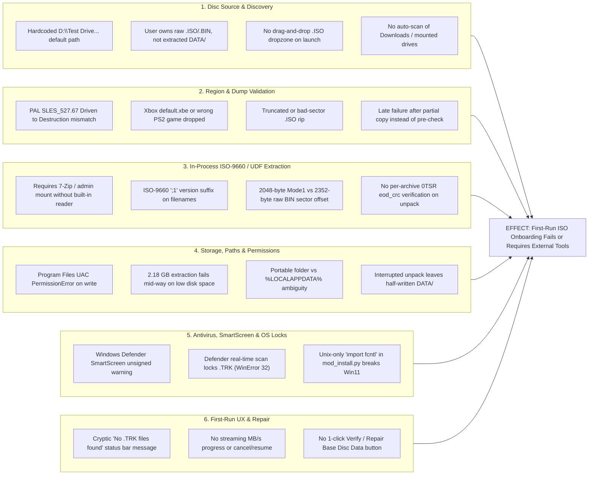
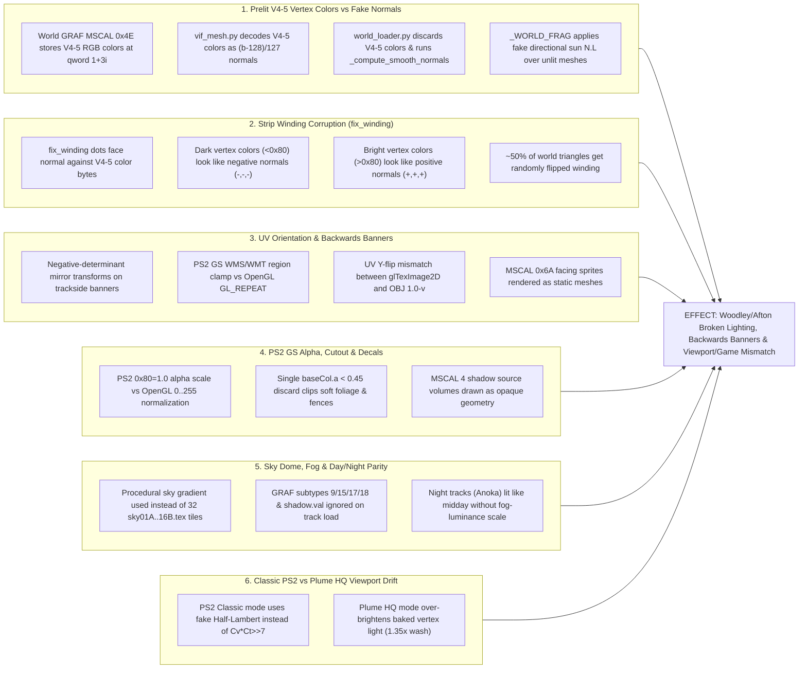
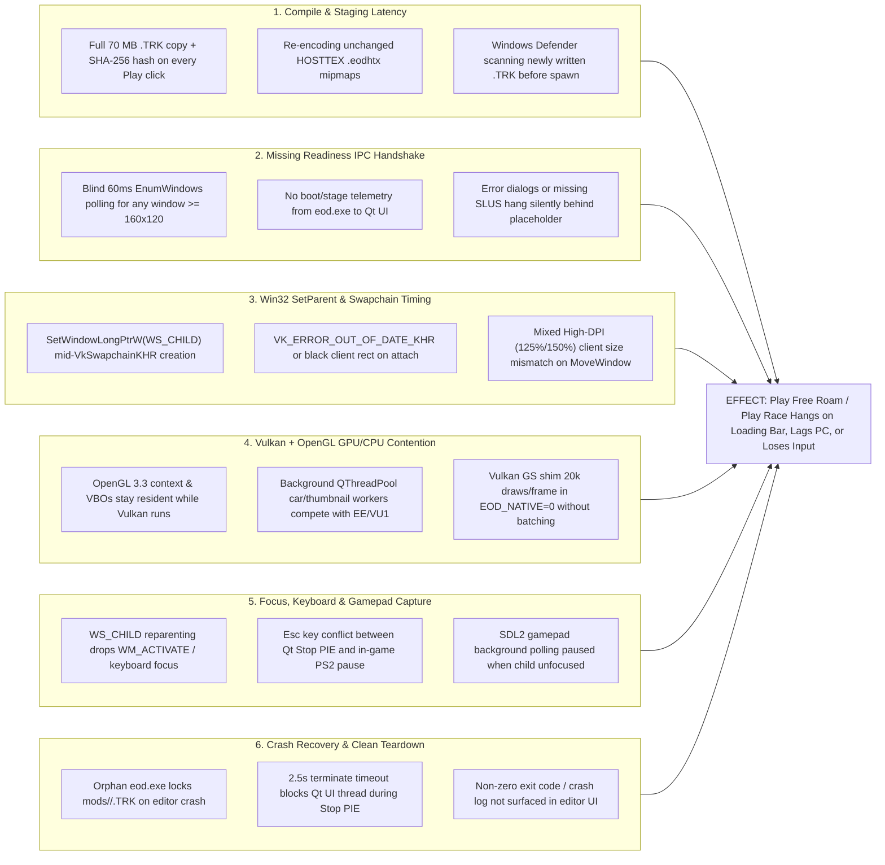
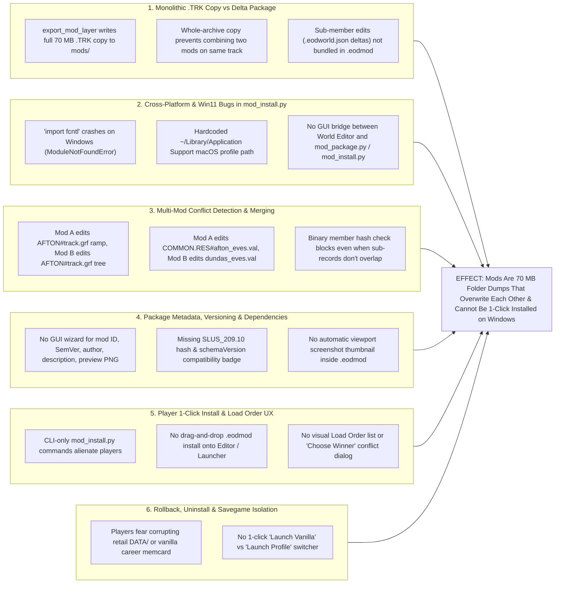
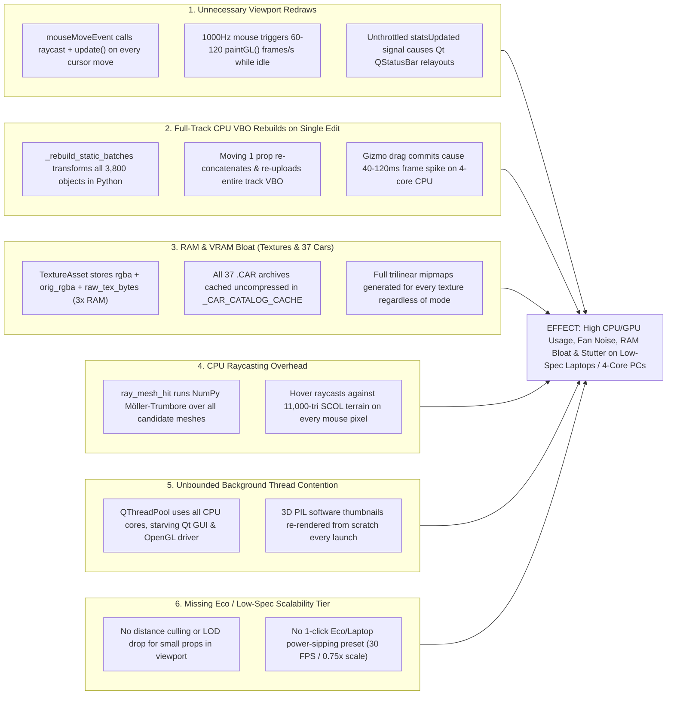
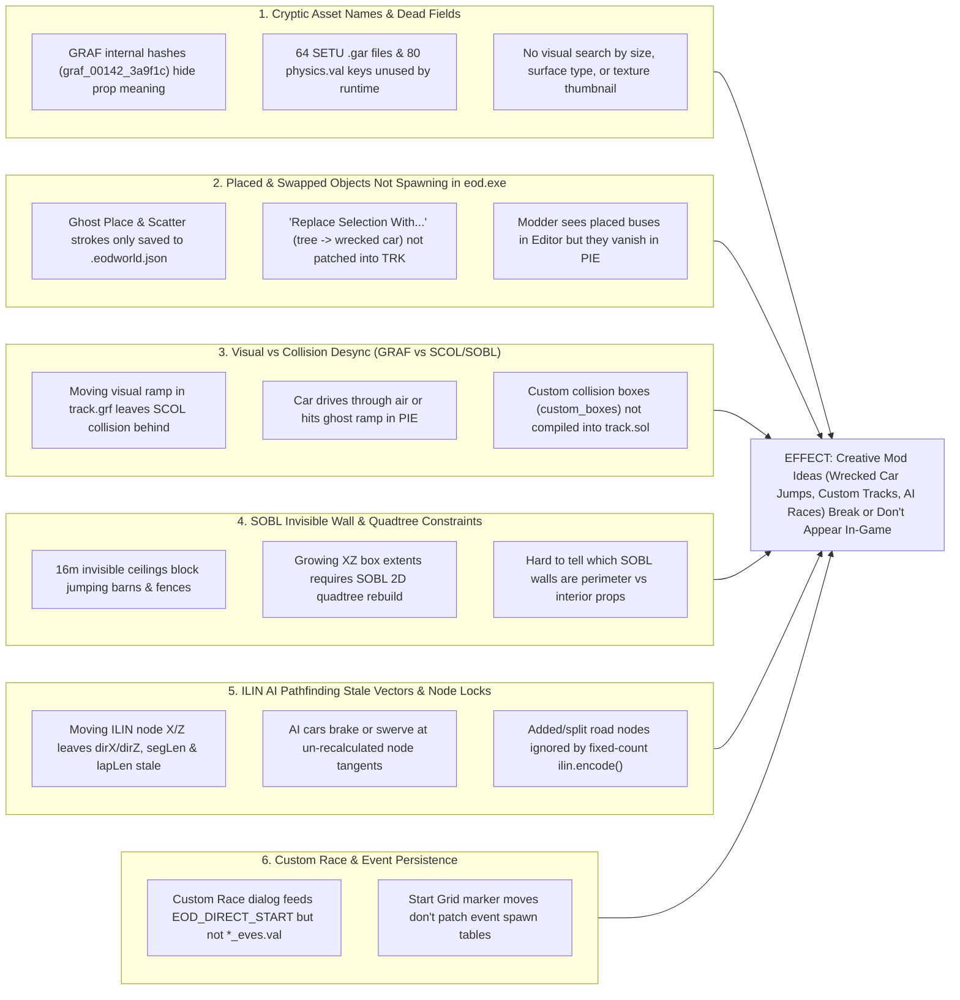

# EOD World Editor & Creation Kit — Standalone ISO Onboarding, Mod Distribution Fishbone Analysis & Game-Dev Tool UX Specification

> **Target Platform & Binary:** Windows 11 x64 (`eod.exe` static recompilation of PS2 *Test Drive: Eve of Destruction*, NTSC-U `SLUS_209.10`, Plume Vulkan + PS2 GS Backend) & **EOD World Editor** (`tools/world_editor/`, PySide6 Qt 6.12 + OpenGL 3.3 Core + Embedded Win32 Vulkan Play-In-Editor).
>
> **Document Scope:** Exhaustive end-to-end **Ishikawa (Fishbone) Friction Analysis** across 6 problem domains (from a brand-new user who only owns a retail PS2 `.ISO` to authoring, playtesting, and distributing multi-mod profiles), **80.lv Game-Dev Tool UI Principles**, **5-Tool Competitor UI Synthesis** (*NFSU2 FRS World Editor*, *Twinmotion*, *Lumion*, *Unreal Engine 5*, *Minecraft Bedrock Editor*), and an **Actionable Top-10 Priority Implementation Checklist** for `DeepCoder`.

---

## Table of Contents

1. [Executive Summary & End-to-End Friction Map](#1-executive-summary--end-to-end-friction-map)
2. [Part 1: Exhaustive Fishbone (Ishikawa) Friction Analysis & Concrete Resolutions](#2-part-1-exhaustive-fishbone-ishikawa-friction-analysis--concrete-resolutions)
   - [Fishbone 1: Zero-Friction Standalone ISO Setup](#21-fishbone-1-zero-friction-standalone-iso-setup)
   - [Fishbone 2: Asset Decompilation, Editing & Lighting / Visual Fidelity](#22-fishbone-2-asset-decompilation-editing--lighting--visual-fidelity)
   - [Fishbone 3: Play-In-Editor (PIE) Launch, Embedding & Stability](#23-fishbone-3-play-in-editor-pie-launch-embedding--stability)
   - [Fishbone 4: Mod Packaging, Conflict Resolution & Distribution](#24-fishbone-4-mod-packaging-conflict-resolution--distribution)
   - [Fishbone 5: Low-Spec ("Shitbox") Performance & Power Sipping](#25-fishbone-5-low-spec-shitbox-performance--power-sipping)
   - [Fishbone 6: Modder Authoring Friction](#26-fishbone-6-modder-authoring-friction)
3. [Part 2: 80.lv Game-Dev Tool UI Principles & 5-Competitor UI Synthesis](#3-part-2-80lv-game-dev-tool-ui-principles--5-competitor-ui-synthesis)
   - [80.lv Game-Dev Tool UI Design Principles Applied to EOD](#31-80lv-game-dev-tool-ui-design-principles-applied-to-eod)
   - [Competitor UI Synthesis across 5 Reference Tools](#32-competitor-ui-synthesis-across-5-reference-tools)
   - [Unified EOD World Editor Target Workspace & Interaction Contract](#33-unified-eod-world-editor-target-workspace--interaction-contract)
4. [Part 3: Actionable Top-10 Priority Implementation Checklist (For DeepCoder)](#4-part-3-actionable-top-10-priority-implementation-checklist-for-deepcoder)

---

## 1. Executive Summary & End-to-End Friction Map

A new player or modder enters the **EOD Recomp + World Editor** ecosystem with one thing: a legally dumped retail North American PS2 `.ISO` of *Test Drive: Eve of Destruction* (`SLUS_209.10`). Every manual prerequisite, visual discrepancy, UI freeze, or silent failure between **"I have the `.ISO`"** and **"I am driving through a custom stadium full of wrecked buses and sharing a 1-click `.eodmod` with friends"** compounds drop-off.

Auditing the live repository (`tools/world_editor/*.py`, `tools/vif_mesh.py`, `tools/world_graf.py`, `tools/world_export.py`, `tools/world_collision.py`, `tools/mod_package.py`, `tools/mod_install.py`, `docs/VIF_MESH_DECODER.md`, `docs/MODERN_RENDERER_RCA.md`) reveals **six systemic friction domains**:

1. **Onboarding Barrier:** `world_loader.py` defaults to an already-extracted folder `D:\Test Drive - Eve of Destruction (USA)` and `mod_package.py` requires an extracted directory containing `SLUS_209.10` and `DATA/`. A user with a raw `.ISO` currently needs external tools (7-Zip / WinCDEmu) to unpack it manually.
2. **Woodley / Afton Viewport Lighting & UV/Winding Corruption:** Retail world geometry (`track.grf` `MSCAL 0x4E` / `MSCNT`, 1,367,745 vertices) stores **prelit `V4-5` baked vertex colors** in VIF qword `1+3i`, **not** normals. Currently, `vif_mesh.py` decodes qword `1+3i` as `(b - 128) / 127` signed normals, `fix_winding()` dots face normals against those RGB color bytes (randomly flipping ~50% of world triangles!), and `world_loader.py` (`_pack_decoded_parts`) discards the vertex colors entirely in favor of `_compute_smooth_normals()` + fake OpenGL directional Lambertian sun lighting.
3. **Play-In-Editor (PIE) Launch Latency, Blind HWND Polling & Contention:** Launching PIE compiles/copies 70 MB `.TRK` archives, polls Win32 `EnumWindows` blindly every 60 ms without a readiness IPC handshake, reparents `eod.exe`'s SDL2/Vulkan window via `SetParent` while the swapchain is initializing, and keeps the OpenGL context + background threads alive in parallel with `eod.exe`.
4. **Mod Distribution & Windows Compatibility Blockers:** `tools/mod_install.py` imports Unix-only `fcntl` on line 11 (crashing immediately on Windows 11) and defaults to macOS `~/Library/Application Support`. Furthermore, `export_mod_layer` writes monolithic 70 MB `.TRK` copies rather than sub-member delta packages (`.eodmod`), causing false conflicts when two mods edit different objects or events in the same track.
5. **Low-Spec ("Shitbox") CPU/GPU & Memory Overhead:** `ViewportGL.mouseMoveEvent` triggers raycasts and full `paintGL()` redraws at mouse-polling rates (up to 120+ Hz) even when idle; moving a single object rebuilds and re-uploads the entire track's static VBO on the CPU in Python; and `TextureAsset` holds 3 copies of every texture buffer in RAM.
6. **Authoring-to-Runtime Gap:** While moving/deleting retail objects patches `track.grf` (`q199`) and `c_<event>.va0` (`frame64`), **editor-placed objects**, **Scatter Brush strokes**, and **Replace Selection With…** (e.g., swapping a tree into a wrecked school bus) currently serialize only to `.eodworld.json` / `mod_layer_manifest.json` rather than compiling into in-game `c_<event>.va0` / `track.grf` records that `eod.exe` spawns.

---

## 2. Part 1: Exhaustive Fishbone (Ishikawa) Friction Analysis & Concrete Resolutions

### 2.1 Fishbone 1: Zero-Friction Standalone ISO Setup



#### Fishbone 1 — Root Cause & Concrete Resolution Matrix

| Sub-Cause ID | Exact Friction Point & Codebase Evidence | Concrete Engineering Resolution | Target Module / API |
|---|---|---|---|
| **F1-01** | **Raw `.ISO` Not Accepted Directly:** `world_loader.py` (`DEFAULT_GAME_DIR`) and `mod_package.py` (`disc_root()`) require an already-extracted folder with `SLUS_209.10` and `DATA/`. Users only have `Test Drive - Eve of Destruction (USA).iso`. | Add a pure-Python zero-dependency **ISO-9660 + UDF Sector Reader** (`tools/iso_extractor.py`) supporting both standard `2048`-byte `.iso` sectors and `2352`-byte Mode 1 / Mode 2 Form 1 `.bin` images without admin rights, virtual drives, or 7-Zip. | `tools/iso_extractor.py` (new), `tools/world_editor/dialogs.py` |
| **F1-02** | **No First-Run Welcome / Drag-and-Drop Wizard:** If `DATA/TRACKS/*.TRK` is missing on startup (`main_window.py:156`), the editor shows an empty black viewport and a tiny status bar message. | When no valid disc root is configured, automatically display a modal **First-Run ISO Setup Card** with: (1) Big drag-and-drop `.ISO` / Folder dropzone, (2) **Auto-Scan PC** button (checks `Downloads`, `Desktop`, `Documents`, mounted optical drives `D:..Z:`), and (3) **Browse `.ISO` or Extracted Folder…**. | `tools/world_editor/dialogs.py` (`FirstRunIsoDialog`), `main_window.py` |
| **F1-03** | **PAL / Wrong Dump / Corrupt Rip Confusion:** A user who drops PAL *Driven to Destruction* (`SLES_527.67`), *NASCAR: Dirt to Daytona* (`SLUS_204.71`), or a truncated download gets generic file-not-found errors. | Before extracting a single byte, read `SYSTEM.CNF` and the root directory from the ISO primary volume descriptor (sector 16): verify `BOOT2 = cdrom0:\SLUS_209.10;1`, verify `SLUS_209.10` exact byte size and SHA-256 against the canonical NTSC-U fingerprint, and display a human-friendly diagnostic banner if PAL (`SLES_527.67`) or a truncated image (`< 1.8 GB`) is detected. | `tools/iso_extractor.py` (`validate_eod_iso()`) |
| **F1-04** | **ISO-9660 `;1` Filename Suffixes & Case Mismatches:** ISO-9660 directory records store uppercase names with version suffixes (`SLUS_209.10;1`, `AFTON.TRK;1`). | Strip `;1` version suffixes during extraction, preserve canonical uppercase relative paths (`SLUS_209.10`, `DATA/TRACKS/AFTON.TRK`, `DATA/CAR/ALGAR.CAR`, `DATA/RES/COMMON.RES`), and verify every `0TSR` archive's internal directory checksums (`rst0.eod_crc`) on the fly while streaming from the `.ISO`. | `tools/iso_extractor.py`, `tools/rst0.py` |
| **F1-05** | **Disk Space, UAC Permissions & Portable vs AppData Paths:** Extracting ~2.18 GB into `C:\Program Files\...` fails with `PermissionError`, or running out of disk space leaves a broken partial `DATA/` directory. | Default extraction target to `%LOCALAPPDATA%\EODRecomp\disc\` (or `./disc/` if a `portable.txt` marker exists and the app directory is writable). Run `shutil.disk_usage()` pre-flight (require `>= 2.6 GB` free). Extract into `disc.staging_<pid>/`, write `disc_manifest.json` (with per-file size + SHA-256) only after 100% of files verify, then atomically `os.replace()` to `disc/` and persist the path in `%LOCALAPPDATA%\EODRecomp\settings.json`. | `tools/iso_extractor.py`, `tools/world_editor/world_loader.py` |
| **F1-06** | **Windows Defender `WinError 32` & `mod_install.py` `fcntl` Crash:** `tools/mod_install.py:11` imports Unix-only `fcntl` (crashing on Windows) and rapid file writes trigger transient Windows Defender real-time scan locks (`PermissionError: [WinError 32]`). | Replace `import fcntl` in `tools/mod_install.py` with a cross-platform `file_lock()` helper (`msvcrt.locking` on `sys.platform == "win32"`, `fcntl.flock` on POSIX), default Windows profile root to `%LOCALAPPDATA%\EODRecomp\profiles`, and wrap atomic file renames (`os.replace`) in a 5-attempt exponential backoff retry (`25ms, 50ms, 100ms, 200ms, 400ms`) for `WinError 32` / `WinError 5`. | `tools/mod_install.py`, `tools/modding_backend.py` |

---

### 2.2 Fishbone 2: Asset Decompilation, Editing & Lighting / Visual Fidelity



#### Deep Dive: Why Woodley (`AFTON.TRK`) & Afton Lighting Broke and Why Banners Were Backwards

1. **The Prelit `V4-5` Vertex Color Discovery (`docs/VIF_MESH_DECODER.md` lines 38–64 & `runtime/vu/scene_emit.cpp`):**
   - In `SLUS_209.10`, VU1 batch qword `1+3i` has **two completely different formats** depending on the VU1 microcode program and `STROW`:
     - **Normal Batches (`MSCAL 0x5C` cars, `0x63` drivers, standalone props — 601,688 vertices):** Unpacked with `V4-8` offset mode and `STROW = (65536.0f, 65536.0f, 65536.0f, 0x7F80)` (unpacked X lane `& 0xFFFFFF00 == 0x47800000`). Lanes 0..2 are signed normals `(b - 128) / 128.0f`, and byte 3 bit 7 is the `ADC` strip-restart flag.
     - **Prelit World Color Batches (`track.grf` `MSCAL 0x4E` / `MSCNT`, `paint.mod`, `envsky`, `sci_wall` — 1,367,745 vertices across the disc):** Unpacked with **`V4-5`** (16-bit `R5G5B5A1` where `R = (v & 31) << 3`, `G = ((v >> 5) & 31) << 3`, `B = ((v >> 10) & 31) << 3`, and bit 15 is `ADC`). These are **baked PS2 vertex colors** where `0x80` (`128`) = `1.0×` neutral texture brightness and `248` (`0xF8`) = `1.9375×` specular/sun highlight!
   - **What Broke in `tools/vif_mesh.py` and `tools/world_editor/world_loader.py`:**
     - `tools/vif_mesh.py:254` treats every `nq` (`1+3i`) as `nrm = tuple((nq[c] - 128) / 127.0 for c in range(3))`.
     - Immediately after, `tools/vif_mesh.py:315` calls `fix_winding(verts, strip_triangles(verts))`, which takes the dot product of each triangle's geometric cross-product normal against `verts[a]['n'] + verts[b]['n'] + verts[c]['n']`. For all 1.36 million world vertices, `verts[i]['n']` is actually `(RGB_color - 128) / 127.0`! Whenever a vertex in Woodley/Afton is in shadow (`RGB < 128`), `vn` points toward `(-1, -1, -1)`; whenever it is sunlit (`RGB > 128`), `vn` points toward `(+1, +1, +1)`. Consequently, `fix_winding()` randomly flips triangle winding across every building, banner, and terrain strip!
     - Then, `tools/world_editor/world_loader.py:870` ignores `v["n"]` completely, calls `_compute_smooth_normals(pos_arr, idx_arr)` on the winding-corrupted triangles (forcing any triangle with `fn.y < 0` to flip its normal upward!), and uploads a `[px, py, pz, nx, ny, nz, u, v]` 8-float vertex layout with **zero vertex color attribute**.
     - Finally, `viewport_gl.py` (`_WORLD_FRAG` lines 174–199) shades the track using synthetic `dot(n, sunDir)` Half-Lambert lighting. On Woodley (`AFTON.TRK`) and Anoka Night, all baked vertex lighting, trackside shadow pools, interior barn darkness, and prelit dirt/grass blending are destroyed.
2. **Why Trackside Banners & Billboards Rendered Backwards:**
   - Trackside banners and start/finish arches use UV coordinates `(s, t) = f32(V2_16) + q198.xy`. When `world_export.py` or texture replacement paths flip image rows vertically (OpenGL bottom-left vs PNG top-left) without matching `v` orientation, or when single-sided banner quads have negative scale / mirrored winding from `fix_winding()`, the texture maps across the quad in reverse.

#### Fishbone 2 — Root Cause & Concrete Resolution Matrix

| Sub-Cause ID | Exact Friction Point & Codebase Evidence | Concrete Engineering Resolution | Target Module / API |
|---|---|---|---|
| **F2-01** | **`V4-5` Prelit Vertex Colors Discarded & Misinterpreted as Normals:** `vif_mesh.py:254` & `world_loader.py:870` throw away baked PS2 vertex colors on all 1,367,745 world vertices. | In `vif_mesh.py` (`decode_part`), distinguish normal qwords (`mem[1+stride*i][0] & 0xFFFFFF00 == 0x47800000`) from color qwords (`V4-5` or non-`0x47800000`), exactly matching `runtime/render/vif_mesh.cpp` and `runtime/vu/scene_emit.cpp`. Emit both `v["n"]` (unit normal for `V4-8`, or geometric face normal for `V4-5`) AND `v["c"]` (`(r, g, b, a)` normalized so PS2 `0x80 = 1.0`, default `(1.0, 1.0, 1.0, 1.0)` for normal-only meshes). | `tools/vif_mesh.py`, `tools/world_editor/world_loader.py` |
| **F2-02** | **`fix_winding()` Corrupts World Triangle Strips:** `vif_mesh.py:283` dots geometric face normals against `V4-5` color bytes. | Never run `fix_winding()` on `V4-5` colour batches (`has_normals == False`), matching `docs/VIF_MESH_DECODER.md` line 64 (*"For colour batches... use `fix_winding = false` for raw strip parity. World geometry is drawn without culling."*). Only run `fix_winding()` on genuine `V4-8` normal batches (`MSCAL 0x5C`/`0x63`). | `tools/vif_mesh.py` (`triangulate_batch`) |
| **F2-03** | **OpenGL Viewport Lacks Vertex Color Attribute (`location = 3`):** `MeshPart.vertices` (`world_loader.py:321`) only packs 8 floats `[px, py, pz, nx, ny, nz, u, v]`. | Expand `MeshPart.vertices` to 12 floats (or 8 floats + packed `RGBA8` / 4-float `[cr, cg, cb, is_prelit]` at `layout(location = 3) in vec4 aColor`). In `_WORLD_FRAG`: when `aColor.w > 0.5` (prelit world geometry) and `uRenderMode == 0` (**PS2 Classic**), compute `rgb = baseCol.rgb * aColor.rgb * uTint.rgb` (exact PS2 `Cv * Ct >> 7` parity, zero fake dynamic `N.L`!). When `uRenderMode == 1` (**Plume HQ**), modulate baked vertex color with sun/shadow cascade factor (`0.43` shadowed to `1.0` sunlit) without over-exposing (`docs/MODERN_RENDERER_RCA.md` line 69). | `tools/world_editor/world_loader.py`, `tools/world_editor/viewport_gl.py` |
| **F2-04** | **Backwards Banners, UV Wrapping & Facing Sprites (`MSCAL 0x6A`):** Mirrored banner UVs, PNG replacement vertical flip mismatch, and `MSCAL 0x6A` camera-facing sprites. | (1) Disable backface culling (`glDisable(GL_CULL_FACE)`) on world batches (matches PS2 GS world state). (2) Keep `decompile_tex` and `load_png_rgba` top-row-first consistent with raw PS2 `(s, t)` UVs (`q198.xy + V2_16`), and verify UV chirality on `a_stfn.mod`/`b_stfn.mod` banners. (3) Tag `MSCAL 0x6A` batches so billboards orient properly, and skip `MSCAL 4` shadow-volume source meshes in the visible static batcher unless the Shadow Volume debug layer is toggled on. | `tools/world_editor/world_loader.py`, `tools/world_editor/viewport_gl.py`, `tools/world_editor/project_state.py` |
| **F2-05** | **Procedural Sky Gradient vs Real 32-Tile Track Sky Dome & Per-Track Fog:** Every track loads with identical `"Track Default"` blue gradient & `fog_color = (0.44, 0.55, 0.68)` even on `ANOKA` (night) or `AFTON` (Woodley). | On track load, parse the track's embedded `GRAF` subtype `4` (`Sky` model + `sky01A..16B.tex`), subtypes `9/15/17/18` (`Sun`, `Ambient`, `SunBright`, `FogColor`), and `shadow.val`. Render the real 32-tile textured sky dome by default (falling back to the procedural sky shader only on `EMPTYT_1` or when a procedural preset is chosen), and initialize `EnvironmentState` with the track's true retail fog color/range and daylight luminance! | `tools/world_editor/world_loader.py`, `tools/world_editor/viewport_gl.py`, `tools/sky_export.py` |

---

### 2.3 Fishbone 3: Play-In-Editor (PIE) Launch, Embedding & Stability



#### Fishbone 3 — Root Cause & Concrete Resolution Matrix

| Sub-Cause ID | Exact Friction Point & Codebase Evidence | Concrete Engineering Resolution | Target Module / API |
|---|---|---|---|
| **F3-01** | **Redundant 70 MB `.TRK` Copy, SHA-256 & `.eodhtx` Rebuild on Every Play Click:** `project_state.py` (`export_mod_layer`) re-hashes the retail `.TRK`, writes a fresh `.TRK.tmp`, and regenerates `.eodhtx` mipmaps even when nothing changed since the last compile. | Track a monotonic `world_dirty_revision` and per-member dirty bitmask (`dirty_graf`, `dirty_sobl`, `dirty_ilin`, `dirty_va0`, `dirty_hosttex`). If `compiled_revision == world_dirty_revision` and `mods/<Project>/mod_layer_manifest.json` exists, **skip compilation entirely (`0 ms`)** and launch `eod.exe` immediately! When dirty, use `mod_package.cached_file_sha()` `(path, mtime_ns, size)` and cache `.eodhtx` outputs by `(png_path, mtime_ns, indexKey)` so unchanged textures never re-mipmap. | `tools/world_editor/project_state.py`, `tools/world_editor/main_window.py` |
| **F3-02** | **Blind `EnumWindows` Polling & Static Loading Text:** `pie_host.py:208` shows `"Starting eod.exe in viewport..."` and blindly polls `EnumWindows` up to 250 times (15 s) with zero visibility into `eod.exe`'s startup phase or stdout/stderr errors. | Launch `eod.exe` with `stdout=subprocess.PIPE, stderr=subprocess.STDOUT` read asynchronously by a lightweight `QSocketNotifier` / reader thread. Stream live startup stages into the PIE loading banner (`[1/4] Verifying Mod Layer → [2/4] Initializing Vulkan Device → [3/4] Loading Track AFTON.TRK → [4/4] Embedding Viewport`), and only call `_attach_hwnd()` after `eod.exe` has created its swapchain and painted its first frame (or emitted its window-ready log line). | `tools/world_editor/pie_host.py` |
| **F3-03** | **Win32 `SetParent` + SDL2/Vulkan Swapchain Race & High-DPI Scaling:** Calling `SetParent` before Vulkan finishes initial swapchain creation or passing logical Qt pixels instead of physical Win32 client pixels causes black frames or clipped viewports. | In `_attach_hwnd()`, query `GetClientRect(parent_hwnd)` directly via `ctypes.windll.user32.GetClientRect` (which always returns exact physical Win32 pixels regardless of Qt DPI rounding), apply `WS_CHILD | WS_VISIBLE | WS_CLIPSIBLINGS | WS_CLIPCHILDREN`, call `SetParent`, then send `WM_SIZE` / `SetWindowPos(..., SWP_FRAMECHANGED | SWP_SHOWWINDOW)` and `AttachThreadInput` + `SetFocus(child_hwnd)` so SDL2 immediately resizes its Vulkan swapchain and receives keyboard input. | `tools/world_editor/pie_host.py` |
| **F3-04** | **OpenGL + Vulkan + Worker Thread Resource Contention (PC Lag):** While PIE is running, background threads or idle Qt timers can contend with `eod.exe`'s EE/VU1/GS threads. | When switching `center_stack` to `PieHostWidget`: (1) Stop `ViewportGL._timer` and suppress all `ViewportGL` updates (`viewport.setUpdatesEnabled(False)`), (2) Cancel/pause all `QThreadPool` thumbnail and car-catalog workers, (3) Default PIE to `EOD_NATIVE=1` (Plume Vulkan native pass, which reduces GS draw calls from ~20,000/frame down to ~35/frame per `docs/MODERN_RENDERER_RCA.md` line 92!) with a toolbar toggle for `PS2 Classic (EOD_NATIVE=0)` parity checking. | `tools/world_editor/main_window.py`, `tools/world_editor/pie_host.py` |
| **F3-05** | **Keyboard Focus & `Esc` Shortcut Collision + Background Gamepad Input:** Once `eod.exe` is focused as a `WS_CHILD`, pressing `Esc` is consumed by `eod.exe` (pausing the PS2 game) rather than Qt's `Key_Escape`, or gamepads stop responding when clicking the Qt inspector. | (1) Pass `SDL_HINT_JOYSTICK_ALLOW_BACKGROUND_EVENTS=1` and `SDL_HINT_MOUSE_FOCUS_CLICKTHROUGH=1` in `build_pie_launch_spec()`'s `env` dict so XInput/SDL controllers always work even if Qt panels have focus! (2) Reserve `Shift+Esc` (or `F5` toggle / top bar `Stop PIE` button) as a global low-level hotkey to exit PIE, while allowing plain `Esc` inside the embedded game to open the PS2 pause menu naturally. | `tools/world_editor/pie_host.py` |
| **F3-06** | **Orphan `eod.exe` Processes Locking `.TRK` Files & Blocking Teardown:** If the editor crashes, `eod.exe` stays alive holding a file lock on `mods/<Project>/DATA/TRACKS/<TRACK>.TRK`; and `stop_pie()` blocks the Qt main thread for up to `2.5s` inside `self._proc.wait(timeout=2.5)`. | (1) Assign `self._proc` to a Win32 Job Object configured with `JOB_OBJECT_LIMIT_KILL_ON_JOB_CLOSE` so Windows kernel automatically terminates `eod.exe` if the Python editor exits or crashes. (2) Make `stop_pie()` restore the OpenGL viewport immediately (`< 5 ms`) and reap the terminating `Popen` process asynchronously on a background `QThreadPool` worker. (3) If `eod.exe` exits unexpectedly with `returncode != 0`, display the last 25 lines of its captured stdout/stderr in a non-blocking diagnostic drawer. | `tools/world_editor/pie_host.py` |

---

### 2.4 Fishbone 4: Mod Packaging, Conflict Resolution & Distribution



#### Fishbone 4 — Root Cause & Concrete Resolution Matrix

| Sub-Cause ID | Exact Friction Point & Codebase Evidence | Concrete Engineering Resolution | Target Module / API |
|---|---|---|---|
| **F4-01** | **`tools/mod_install.py` Crashes on Windows (`import fcntl`) & Uses macOS Path:** Line 11 `import fcntl` fails on Windows 11; line 24 uses `~/Library/Application Support/EODCreationKit/profiles`. | Fix `tools/mod_install.py` to use `msvcrt.locking` on Windows (`fcntl.flock` on macOS/Linux) and resolve `DEFAULT_ROOT` to `Path(os.environ.get("LOCALAPPDATA", "~/AppData/Local")) / "EODRecomp" / "profiles"` on Windows. | `tools/mod_install.py` |
| **F4-02** | **70 MB Monolithic `.TRK` Exports Instead of Compact `.eodmod` Archives:** Exporting a single moved ramp or texture via `Ctrl+Shift+S` copies the entire 70 MB `.TRK` into `mods/<Project>/`. | Add **`File → Package Mod as .eodmod…` (`Ctrl+Shift+E`)** in the World Editor, invoking `mod_package.py` to package **only modified archive members** (`native/<archive>/<member>`), **4K host replacement PNGs/mips** (`host/`), the **structured delta overlay** (`deltas/<track>.eodworld.json`), and an auto-captured `preview.png` viewport thumbnail into a single `.eodmod` zip (typically `50 KB – 8 MB`). | `tools/mod_package.py`, `tools/world_editor/main_window.py`, `tools/world_editor/dialogs.py` |
| **F4-03** | **Three-Tier Conflict Resolution (Archive → Member → Sub-Record Delta Merge):** Under raw archive replacement, two mods touching `AFTON.TRK` collide. Under member-level replacement (`mod_install.py`), Mod A touching `AFTON.TRK#track.grf` and Mod B touching `AFTON.TRK#track.sol` compose cleanly, **but** two mods both touching `AFTON.TRK#track.grf` (or `COMMON.RES#afton_eves.val`) still block on member hash mismatch. | Implement **3-Tier Hierarchical Composition** in `mod_install.py`: <br>1. **Tier 1 (Disjoint Members in Same `.TRK`/`.RES`):** Automatic member-level merge (already in `mod_install.py`). <br>2. **Tier 2 (Same Member, Disjoint Sub-Records via `deltas/*.eodworld.json`):** When two mods both modify `track.grf`, `track.sol`, `c_*.va0`, or `*.val` and include `deltas/`, merge their non-overlapping `retail_edits[obj_id]`, `sobl_edits[rec_index]`, `ilin_edits[node_idx]`, and `VALT` section keys in load order on top of the retail base member! <br>3. **Tier 3 (True Sub-Record or Binary Collision):** Surface a visual **Conflict Resolver Dialog** showing the exact colliding object/texture/member with 1-click **"Use Mod A"** vs **"Use Mod B"** (`accept-conflict`). | `tools/mod_install.py`, `tools/world_editor/project_state.py`, `tools/world_editor/dialogs.py` |
| **F4-04** | **Drag-and-Drop `.eodmod` Installation & Visual Profile Manager:** Players need Mod Organizer 2 / Vortex ease of use without touching a terminal. | Accept `.eodmod` files dragged directly onto the World Editor window (or opened via `.eodmod` file association). Add a **`Mod Manager / Profiles…`** dialog listing installed `.eodmod` packages with checkboxes (`Enable/Disable`), drag-to-reorder load priority, conflict badges, disk size, and **1-Click Compose & Play**. | `tools/world_editor/main_window.py`, `tools/world_editor/dialogs.py` |
| **F4-05** | **Guaranteed Zero-Mutation Rollback & Modded Save Isolation:** Disabling a mod must provably restore 100% vanilla behavior. | `mod_install.compose()` builds `profiles/<profile>/active/` in a temporary sibling directory, verifies `SLUS_209.10` and untouched retail member CRCs, atomically swaps `active/`, and writes `active/PROFILE.TXT`. When a profile modifies career `VALT` tables, automatically point `EOD_MEMCARD_DIR` to `profiles/<profile>/saves/` so vanilla career saves are never polluted. | `tools/mod_install.py`, `tools/world_editor/pie_host.py` |

---

### 2.5 Fishbone 5: Low-Spec ("Shitbox") Performance & Power Sipping



#### Fishbone 5 — Root Cause & Concrete Resolution Matrix

| Sub-Cause ID | Exact Friction Point & Codebase Evidence | Concrete Engineering Resolution | Target Module / API |
|---|---|---|---|
| **F5-01** | **Idle Mouse Movement Triggers 60–120 FPS Redraws & Raycasts:** `viewport_gl.py` (`setMouseTracking(True)`) runs gizmo/road/terrain raycasts on every `mouseMoveEvent` and triggers `self.update()` even when no button is pressed and no hover state changed. | Make idle `mouseMoveEvent` strictly state-change driven: <br>1. In `select`/`move`/`rotate`/`scale` tools with no mouse button down, only raycast the selected object's 3 gizmo axes (3 line tests = `< 0.02 ms`), and **only call `self.update()` if `new_hover_axis != self._gizmo_hover_axis`**! <br>2. In `place`/`scatter`/`road` tools, coalesce mouse-move terrain raycasts to at most `30 Hz` (or `>= 3 px` cursor delta). Result: **true `0.0%` CPU / `0.0%` GPU when idle or moving the cursor across the screen.** | `tools/world_editor/viewport_gl.py` |
| **F5-02** | **Moving 1 Object Rebuilds the Entire Track's Static VBO on the CPU:** `_rebuild_static_batches()` (`viewport_gl.py:1345`) loops over all 1,500–3,800 objects, transforms all vertices in Python/NumPy, and re-uploads all static VBOs whenever a single object is transformed. | Exclude `self.selected_obj` from `_static_batches` while it is selected (or track a small `_dynamic_objects` set for recently edited objects) and draw the active selection from its pre-uploaded local-space `_sel_batches` VAO using `uModel = obj.world_matrix()` on the GPU! Only fold dirty objects back into `_static_batches` lazily or keep a chunked/per-texture VBO bucket so transforming an object takes **`< 0.1 ms` (zero VBO rebuild during or after gizmo drag)**. | `tools/world_editor/viewport_gl.py` |
| **F5-03** | **3× Texture Memory Duplication in Python RAM:** `TextureAsset` (`world_loader.py:398`) keeps `rgba`, `orig_rgba` (duplicate copy!), and `raw_tex_bytes` simultaneously in memory for all track and car textures. | Set `orig_rgba = b""` until a texture is actually replaced (`is_replaced == True`); compute `index_key` / `palette_key` once or keep only `raw_tex_bytes` (which is 4-bit/8-bit indexed and `4×–8×` smaller than RGBA8!) and release `ta.rgba` after uploading to OpenGL unless needed for CPU thumbnail rendering. Cuts Python texture RAM footprint by **>65%**. | `tools/world_editor/world_loader.py`, `tools/world_editor/viewport_gl.py` |
| **F5-04** | **Persistent Disk Cache for 3D Studio Thumbnails:** `ThumbnailBatchWorker` software-rasterizes 3D model and car thumbnails in PIL on every editor launch. | Cache rendered `112×84` PNG thumbnails under `%LOCALAPPDATA%\EODRecomp\cache\thumbnails\<track_or_car>_<model_hash_hex>.png`. On startup, load cached PNGs straight into `QImage` in `< 15 ms` total with zero 3D software rasterization math. | `tools/world_editor/thumbnails.py`, `tools/world_editor/explorer_panel.py` |
| **F5-05** | **Worker Thread Budget & Scalability Toggle (`Eco` / `PS2 Fast` / `Plume HQ`):** Uncapped `QThreadPool` saturates 4-core CPUs; integrated GPUs struggle with high fill-rate + MSAA. | (1) Cap background `QThreadPool` max thread count to `max(1, min(4, (os.cpu_count() or 2) - 1))` so at least one physical core is always reserved for the Qt 6 UI + OpenGL thread. (2) Add **`Eco / Laptop (Power Saver)`** to the toolbar renderer dropdown: disables MSAA, skips sky/fog smoothstep math, caps fly-camera timer to `30 FPS` (`33 ms`), and culls small props (`bbox_radius < 4m`) beyond `450m`. | `tools/world_editor/workers.py`, `tools/world_editor/viewport_gl.py`, `tools/world_editor/main_window.py` |

---

### 2.6 Fishbone 6: Modder Authoring Friction



#### Fishbone 6 — Root Cause & Concrete Resolution Matrix

| Sub-Cause ID | Exact Friction Point & Codebase Evidence | Concrete Engineering Resolution | Target Module / API |
|---|---|---|---|
| **F6-01** | **Swapped Models (`Replace Selection With…`) & Placed/Scattered Props Don't Materialize Inside `eod.exe`:** In `project_state.py` (`export_mod_layer`), retail translations (`q199` / `c_*.va0` `frame64`) are patched into `track.grf` / `c_*.va0`, **but** `ReplaceObjectModelCommand` (swapping a tree into a wrecked car or barn) and `PlaceObjectCommand` / `ScatterPlaceCommand` only write to `mod_layer_manifest.json` (`editor_placed_objects`)! When the modder clicks Play PIE, their scattered wrecks or swapped models are missing in-game. | Bridge editor placements & swaps into real `SLUS_209.10` binary records during `export_mod_layer`: <br>1. **Same-Archive `GRAF` Model Swap:** When a retail `track.grf` object is replaced with another `track.grf` model, patch its display-leaf `model_offset` pointer (or copy/transplant the target `mrModel` VIF vertices into the instance slot) and update its cull sphere (`0x102`) + `mlist` sphere. <br>2. **Event Prop (`c_<event>.va0`) Model Swap & New Prop Spawning:** Patch the `$NNNN$object` `model` key and 64-byte `unfloat_frame64` transform in `c_<event>.va0` (and inject `.CAR` `Low3.mod` / `.tex` members into `<TRACK>.TRK` or `RACE.RES` so placed wrecked cars load natively as static/dyno props in `eod.exe`!). | `tools/world_editor/project_state.py`, `tools/world_export.py`, `tools/world_graf.py` |
| **F6-02** | **`ILIN` AI Racing Line Edits Leave Stale Tangents (`dirX`, `dirZ`) & Distances:** `formats/ilin.py` (`encode()`) only patches `node.<n>.x` and `node.<n>.z` (8 bytes/node). As documented in `docs/ILIN_RACING_LINES.md` line 54, `dirX/dirZ` (`+8, +12`), `segLen` (`+24`), `dist` (`+28`), and the 3 header lap-length floats (`+12/+16/+20`) stay stale, causing AI cars to swerve or misjudge braking zones! | Upgrade `formats/ilin.py` (`encode()` / `recalculate_ilin_geometry()`): whenever any node `(X, Z)` changes, automatically recompute for every node around the loop: <br>- `segLen[i] = hypot(x[next] - x[i], z[next] - z[i])` (`+24`) <br>- `dirX[i] = (x[next] - x[i]) / segLen[i]`, `dirZ[i] = (z[next] - z[i]) / segLen[i]` (`+8, +12`) <br>- cumulative `dist[i]` (`+28`) and write total loop length to header `+12`, `+16`, and `+20`. <br>- When node count changes (split/add/delete), invoke `trk.compile_ild()` to rebuild the 60-byte node array and pointer fix-up table (`+44`). | `tools/formats/ilin.py`, `tools/trk.py`, `tools/world_editor/project_state.py` |
| **F6-03** | **Visual Ramp Moves Desync from `SCOL`/`SOBL` Collision:** Moving a visual ramp or building in `track.grf` leaves its `SCOL` (`track.bsc`) or `SOBL` (`track.sol`) collision volume at the old coordinates. | (1) When selecting or dragging a retail `static` or `optional-terrain` object whose AABB overlaps a `SOBL` box in `track.sol`, offer a **"Link & Move Matching SOBL Collision Box"** toggle in the Object Inspector (updating the `SOBL` box `centre` in lockstep when within quadtree cell bounds, or flagging quadtree rebuild). (2) When moving a pure `SCOL`-backed terrain ramp, show a clear non-modal amber HUD banner: *"Visual mesh moved — click 'Generate Collision Box' so cars can drive on the new position."* | `tools/world_editor/viewport_gl.py`, `tools/world_editor/properties_panel.py`, `tools/world_collision.py` |
| **F6-04** | **Cryptic `GRAF` Model Hashes (`graf_00142_...`) & Dead `VALT`/`SETU` Keys:** Modders hunting for "Barn", "Jump Ramp", "Grandstand", or "Billboard" must scroll through hundreds of `graf_NNNNN` items. | Build an automatic **Semantic Prop Classifier** (`tools/world_editor/world_loader.py`) using texture names (`barn*`, `ramp*`, `tree*`, `fenc*`, `sign*`, `blea*`, `tire*`, `bus*`), bounding-box aspect ratio, and `GRAF` subtype to auto-assign human-readable display tags (`[Ramp]`, `[Building]`, `[Foliage]`, `[Fence/Wall]`, `[Billboard]`, `[Car/Wreck]`) and filter pills in Explorer. Flag all 64 `SETU` (`.gar`) files and 80 dead `physics.val` keys with an explicit `[Unused by PS2 Runtime]` badge. | `tools/world_editor/world_loader.py`, `tools/world_editor/explorer_panel.py` |
| **F6-05** | **Selective Barrier Flattening (Barn / Infield vs Outer Perimeter):** `Flatten All Track Barriers` lowers every tall `SOBL` wall on the track, which can let AI cars fall off the outer world void on tracks like Dundas or Welch. | Add two distinct 1-click actions + brush mode in the `Collision` menu and `SOBL` Inspector: <br>1. **`Flatten Interior / Infield Invisible Walls (Keep Outer Perimeter)`** (filters out `SOBL` boxes on the outermost convex hull boundary of the track). <br>2. **`Flatten Selected / Brush-Painted Barriers`** (hold `LMB` in Shield mode to paint-flatten only the barn or shortcut walls you want to jump!). <br>3. **`Flatten All Track Barriers (Full Free-Roam Open World)`**. | `tools/world_editor/main_window.py`, `tools/world_editor/properties_panel.py`, `tools/world_editor/viewport_gl.py` |
| **F6-06** | **Custom Race Persistence into `COMMON.RES#<track>_eves.val`:** `CustomRaceDialog` saves `custom_race.json` and launches PIE via `EOD_DIRECT_START`, but if a player loads the mod outside PIE via the game's native menus, the event laps/AI count in `COMMON.RES#<track>_eves.val` are unchanged. | During `export_mod_layer`, if `world.custom_race` has been customized, also patch the matching event section in `mods/<Project>/DATA/RES/COMMON.RES#<track>_eves.val` (`laps`, `num_ai`, `line`, `opt_terrain`) with valid `rst0.eod_crc` so the custom race works both in 1-click PIE and in the retail Action/Event menu! | `tools/world_editor/project_state.py`, `tools/valt.py` |

---

## 3. Part 2: 80.lv Game-Dev Tool UI Principles & 5-Competitor UI Synthesis

### 3.1 80.lv Game-Dev Tool UI Design Principles Applied to EOD

Synthesizing the core lessons from 80 Level's *"UI Design for Game Dev Tools"* (featuring Falk Sonnabend, Senior UX Designer on the CRYENGINE Sandbox team at Crytek) and modern DCC ergonomics:

| # | 80.lv Game-Dev Tool UX Principle | Why Traditional Dev Tools Fail | Concrete Application in EOD World Editor (`tools/world_editor/`) |
|---|---|---|---|
| **1** | **Serve Diverse Personas Under One Cohesive Architecture (Adaptive Complexity)** | Tools built by engineers dump raw binary struct fields (`q199`, `unfloat_frame64`, `SOBL ry`, `0TSR CRC`) onto every user, overwhelming Tinkerers and Texture Artists while still frustrating Power Modders. | **3-Layer Progressive Disclosure:** <br>• **Layer 1 (Tinkerer / Artist):** Visual 3D viewport + 1-click cards (*"Replace PNG…"*, *"Flatten Barrier"*, *"Borrow Sky From Track"*, *"Play Free Roam (F5)"*). <br>• **Layer 2 (Level Designer):** Scatter brush parameters, ILIN spline handles, Custom Race dialog, `VALT` curated sliders with real units (`m`, `deg`, `kg`). <br>• **Layer 3 (Researcher / Reverse Engineer):** Collapsible *"Retail Provenance & Binary Offsets"* accordion showing `track.grf` byte offset, `indexKey` FNV-1a 64 hash, `SOBL` record `#`, and `EOD_DIRECT_START` string. |
| **2** | **Viewport-First Real Estate (Working Canvas vs. Periphery)** | Thick toolbars, multi-row ribbons, and permanently open sub-panels shrink the 3D viewport below 50% of screen area, inducing claustrophobia and constant panel resizing. | **>= 72% 3D Viewport Area Guarantee at `1540×930`:** <br>• Single compact `34px` main toolbar. <br>• Collapsible left Explorer (`308px`) and right Context Inspector (`330px`) with quick `Tab` / `Ctrl+Space` **"Maximize Viewport"** toggle. <br>• Context-sensitive floating translucent HUD pills (`ModePillOverlay`, `ScatterHudOverlay`, `RoadToolHudOverlay`, `PlaceHudOverlay`) anchored to viewport top edge that auto-hide the instant the tool exits. |
| **3** | **Dark Contrast Calibration & Visual Hierarchy** | Pure `#000000` backgrounds with `#FFFFFF` borders cause halation/eye strain over multi-hour sessions and make colored 3D gizmos or status badges hard to parse at a glance. | **Calibrated 4-Tier Dark Luminance Ramp (`theme.py`):** <br>• Root canvas / recessed lists: `#111318` (`BG_ROOT`) <br>• Primary panel surface: `#171A21` (`BG_PANEL`) <br>• Elevated cards / floating HUDs: `#1E222B` (`BG_ELEVATED`) with `1px solid #2A2F3A` subtle borders <br>• Semantic color accents reserved strictly for meaning: **R/G/B (`#EF4444` / `#22C55E` / `#3B82F6`)** for X/Y/Z axes, **Emerald `#2ECC71`** for PIE Play / Clean Mod State, **Amber `#F59E0B`** for Dirty / Unwritten changes, **Coral `#F87171`** for Tall Invisible Walls / Destructive actions. |
| **4** | **Natural Left-to-Right Eye Flow & Spatial Grouping** | Scattershot menus force users' eyes to zig-zag across the screen between selecting an asset, placing it, and tweaking its properties. | **Strict Left → Center → Right Information Flow:** <br>1. **Left (`ExplorerPanel`):** *What exists / What to pick* (Track selector, Scene Tree, 3D Model & 37-Car Library, Visibility Layers). <br>2. **Center (`ViewportGL` / `PieHostWidget`):** *Where to act & test* (3D manipulation, Ghost/Scatter painting, live embedded `eod.exe` PIE). <br>3. **Right (`PropertiesPanel`):** *How the selected item behaves* (Transform, Replace Model, Clickable Texture Inspector, SOBL Height, Environment/Sky). |
| **5** | **Cognitive Load Reduction Over Raw "Click-Count" Obsession** | Cramming 50 icon-only buttons into a toolbar reduces click count to 1, but forces users to hover-read 50 tooltips every session. | **Icon + Crisp Verb Labels on Primary Actions + Modal Tool Consoles:** Toolbar buttons pair distinct SVG icons with short 1–2 word labels (`Play Free Roam`, `Play Event`, `Place`, `Scatter`, `Road`, `Env / Sky`). Secondary tool options (`Radius`, `Density`, `Scale Jitter`, `Align Normal`) appear *only* inside the top-center floating HUD card when that tool is active. |
| **6** | **Discoverable Muscle-Memory Shortcuts & Non-Modal Feedback** | Modal `"Saved successfully!"` popup boxes interrupt flow; hidden hotkeys go unused by 90% of users. | **Zero Modal Interruption on Routine Actions:** <br>• Every toolbar button and floating HUD badge displays its hotkey inline (`Play Free Roam (F5)`, `Place (P)`, `Scatter (B)`, `Move (G)`, `Rotate (R)`, `Drop to Ground (End)`). <br>• Routine operations (`Save`, `Snap`, `Texture Swap`, `Flatten Barrier`, `Undo/Redo`) report instant feedback in the bottom status bar + dirty badge without popping up blocking `QMessageBox` dialogs. |

---

### 3.2 Competitor UI Synthesis across 5 Reference Tools

We synthesize concrete, battle-tested UI/UX mechanisms from the 5 reference editors specified for EOD:

| Reference Tool | Signature UX Strengths | What We Adopt Directly into EOD World Editor | Concrete EOD Component / Implementation |
|---|---|---|---|
| **1. NFSU2 FRS World Editor** | • **In-Viewport Driving / PIE** at the press of a button<br>• **3D Road / Spline Curve Handles** with diamond nodes & lane ribbons<br>• **Direct Road / Bridge / Wall Property Inspector**<br>• **Always-On Bottom Profiler Status Bar** (`FPS`, `Frame ms`, `Draws`, `Tris`, `Camera XYZ`, `Track Zone`) | • **1-Click Embedded PIE (`F5` / `Shift+F5`)** transitioning the 3D editor viewport straight into live drivable `eod.exe` at the active track.<br>• **ILIN Road Tool** with elevated 3D yellow/magenta diamond handles, directional lane ribbons, and Green (`Join`) / Cyan (`Split`) / White (`New Node`) hover states.<br>• **Dedicated SOBL Wall & Road Node Inspector pages**.<br>• **Live 4-Segment Bottom Status Bar** (`Action Status` \| `Zone/Track` \| `X, Y, Z` \| `FPS · ms · Draws · Tris` \| `QProgressBar + Cancel`). | `pie_host.py`, `viewport_gl.py` (`RoadToolHudOverlay`, `_draw_roads`), `properties_panel.py` (Pages 2 & 5), `main_window.py` (`_build_status_bar`) |
| **2. Twinmotion** | • **Clean Dark Minimalism** with generous padding and rounded cards<br>• **Library / Populate / Materials / Env** workflow<br>• **Right-Side Environment / Weather / Sky Sliders** with 1-click mood presets<br>• **"Replace Selection With…"** preserving transform<br>• **Floating Gizmo & Note/Marker Tools** | • **Environment / Skybox Drawer** (Page 4 of `PropertiesPanel`) with instant 60 FPS sliders for **Sun Azimuth / Elevation**, **Ambient Intensity**, **Fog Start / End / Density / Color**, 1-click mood presets (*Clear Day*, *Golden Sunset*, *Anoka Night*, *Overcast Storm*, *Desert Noon*), and **"Borrow Sky From Track…"**.<br>• **Click-Object Texture / Material Inspector** with live thumbnail cards and **"Replace PNG…"**.<br>• **Right-Click → "Replace Selection With…"** (`ReplaceModelDialog`) to swap any tree/prop into any of the 37 retail Cars & Wrecks in-place. | `properties_panel.py` (Pages 1 & 4), `dialogs.py` (`ReplaceModelDialog`), `world_loader.py` (`ENVIRONMENT_PRESETS`), `theme.py` |
| **3. Lumion** | • **Ultra-Fast Cluster / Scatter Placement Circle** projected directly on the 3D terrain<br>• **Ghost Preview Snapped to Ground Normal** before clicking to stamp<br>• **Visual Category Icon Dock & Live 3D Preview Cards** | • **Ghost Placement Mode (`P`)**: translucent cyan/green 3D model follows cursor across `SCOL` terrain, auto-aligning pitch/roll to surface normal (`normal_to_pitch_roll`), `R`/`Shift+R` rotates ±15°, `LMB` stamps.<br>• **Scatter / Paint Brush (`B`)**: glowing 3D terrain circle ring (`3m–120m` radius, `1–40` density, random yaw, scale jitter, normal align, auto-AABB overlap rejection) painting whole forests or junkyard car piles in one undoable stroke.<br>• **2-Column Shaded 3D Studio Thumbnail Grid** in Explorer with dedicated **`Cars & Wrecks (37)`** quick-filter pill. | `viewport_gl.py` (`PlaceHudOverlay`, `ScatterHudOverlay`, `scatter_at_point`), `explorer_panel.py`, `thumbnails.py` |
| **4. Unreal Engine 5** | • **Top Toolbar Play / Stop PIE Group** with mode dropdown & embedded viewport border<br>• **Outliner + Details Split** on the periphery<br>• **Selection Mode vs. Place Actors Mode** + Grid/Angle Snapping toggles (`1.0m`, `15°`)<br>• **Engine Scalability / Renderer Mode Toggle** | • **UE5-Style PIE Toolbar Group**: **`▶ Play Free Roam (F5)`**, **`🏁 Play Event / Race (Shift+F5)`**, **`■ Stop (Esc)`**, **`⚙ Custom Race`**, plus live green `#142219` top PIE control bar (`● PIE RUNNING`, `Restart`, `Pop Out Window`, `Stop PIE`).<br>• **Grid Snap (`1.0 m`) & Angle Snap (`15°`)** checkable toolbar toggles.<br>• **Scalability / Renderer Mode Combobox** (`⚡ PS2 Fast (Low-Spec)` vs `✨ Plume HQ (Modern)` vs `🍃 Eco / Laptop`) syncing both the OpenGL 3.3 viewport shader and `eod.exe`'s `EOD_NATIVE` launch flag. | `main_window.py` (`_build_toolbar`), `pie_host.py` (`PieHostWidget`), `viewport_gl.py` (`set_render_mode`) |
| **5. Minecraft Bedrock Editor** | • **Clean Top Hotbar / Mode Pill** (`Object Mode` / `Edit Mode` / `Shield`)<br>• **Left Tool / Asset Rail**<br>• **Right Vibrant Visuals / Lighting Inspector**<br>• **3D Orientation / Axis Gizmo & Selection Highlight** | • **Top-Left Floating `ModePillOverlay`** (`Object Mode` · `Edit Mode` · `🛡 Collision Shield`) sitting cleanly inside the viewport corner.<br>• **Translucent Emerald Selection Highlight (`uHighlightMix`)** + crisp R/G/B 3D Move arrows, Rotate rings, and Scale cubes with hover-axis brightening.<br>• **Top-Right Viewport Orientation Compass / Camera Speed HUD** + instant `F` Frame Selection and `End` Drop to Ground. | `viewport_gl.py` (`ModePillOverlay`, `_draw_gizmo`, `_WORLD_FRAG` `uHighlightMix`) |

---

### 3.3 Unified EOD World Editor Target Workspace & Interaction Contract

```
+----------------------------------------------------------------------------------------------------------------------+
| File  World  View  Camera  Objects  Markers  Cars  Breakers  Roads  Terrain  Mesh  Races  Collision  Help  [World: *] |
+----------------------------------------------------------------------------------------------------------------------+
| [New][Open][Save][Package .eodmod] | [▶ Play Free Roam (F5)][🏁 Play Event][■ Stop][⚙ Race] | [⚡ PS2 Fast v]        |
| [Move G][Rotate R][Scale][Place P][Scatter B][Road] | [Grid Snap][Angle Snap] | [☀ Env/Sky][Marker][🚗 Car/Wreck]    |
+---------------------------+--------------------------------------------------------------+---------------------------+
| EXPLORER (308px)          | 3D VIEWPORT (OpenGL 3.3 Core) / EMBEDDED PIE (Vulkan)        | PROPERTIES (330px)        |
| Track: [AFTON (Woodley) v]| +----------------------------------+  +--------------------+ | Context-Sensitive Stack:  |
| [Tree][Models][Mlists][Lr]| | [Object Mode][Edit Mode][🛡 Col] |  | Scatter / Road HUD | |                           |
| [🚗 Cars & Wrecks (37)]   | +----------------------------------+  +--------------------+ | Page 1: Object Inspector  |
| [🔍 Filter prop/car...  ] |                                                              |  - Name, Category, Hash   |
| +----------+ +----------+ |                                                              |  - R / G / B Transform    |
| | 3D Thumb | | 3D Thumb | |                     [ 60 FPS 3D WORLD ]                      |  - [🔄 Replace With...]   |
| | SchoolBus| | Algar    | |           Prelit V4-5 Vertex Colors + Real Sky Dome          |  - Texture Cards (Click): |
| +----------+ +----------+ |           + Translucent Cyan Ghost / Green Scatter Ring      |    [🖼 Replace PNG...]    |
| +----------+ +----------+ |           + Height-Coded SOBL Barriers (Red >=10m)           |  - [Drop Ground][Blender] |
| | 3D Thumb | | 3D Thumb | |                                                              |                           |
| | Barn_01  | | Ramp_Jmp | |  (Or when F5 pressed: Live Embedded eod.exe Vulkan Window    | Page 4: Env / Skybox      |
| +----------+ +----------+ |   with Top Green PIE Bar: [Restart][Pop Out][Stop PIE])      | Page 5: SOBL Barrier      |
| [Place (P)][Scatter][Swap]|                                                              |  - Height + [Flatten All] |
+---------------------------+--------------------------------------------------------------+---------------------------+
| Ready — Selected SchoolBus (1,420 tris) | Track: Woodley (AFTON) | X: 14.2 Y: 1.8 Z: -42.0 | 60 FPS · 1.2ms · 38 draws|
+----------------------------------------------------------------------------------------------------------------------+
```

---

## 4. Part 3: Actionable Top-10 Priority Implementation Checklist (For DeepCoder)

Ranked strictly by **Player & Modder Impact × Friction Elimination** so `DeepCoder` can execute them sequentially:

| Priority | Task Title | Problem Solved (Fishbone Ref) | Exact Files & Functions to Edit / Create | Verification / Acceptance Criteria |
|---|---|---|---|---|
| **P1** | **Fix Prelit `V4-5` World Vertex Colors & Disable `fix_winding` on Color Batches (Woodley/Afton Lighting & Banner Fix)** | Fixes broken/muddy lighting on Woodley (`AFTON.TRK`) & Anoka Night, and stops `fix_winding()` from randomly flipping ~50% of world triangles by dotting face normals against RGB color bytes (**F2-01, F2-02, F2-03, F2-04**). | • `tools/vif_mesh.py`: In `decode_part()`, check `mem[1+stride*i][0] & 0xFFFFFF00 == 0x47800000` (`has_normals`). Decode `V4-5` / non-normal `nq` as vertex color `c = (r/128.0, g/128.0, b/128.0, 1.0)`. In `triangulate_batch()`, only run `fix_winding()` when `batch['has_normals']` is True.<br>• `tools/world_editor/world_loader.py`: Pack `[cr, cg, cb, is_prelit]` into `MeshPart.vertices` (`stride = 12 * 4`).<br>• `tools/world_editor/viewport_gl.py`: Bind `layout(location = 3) in vec4 aColor`; in `_WORLD_FRAG`, modulate `baseCol.rgb * aColor.rgb` in PS2 Classic mode without fake `N.L` on prelit batches, and disable `GL_CULL_FACE` on world geometry. | Automated test in `test_editor.py`: Load `AFTON.TRK` and `ANOKA.TRK`, verify `V4-5` world batches preserve exact vertex RGB (`0x80 -> 1.0`), `0` color-batch triangles flipped by `fix_winding`, `glGetError() == 0`, and Woodley banners/terrain render with authentic PS2 prelit shading. |
| **P2** | **Compile Editor-Placed Objects, Scatter Strokes & `Replace Selection With…` into Real In-Game `.TRK` (`c_*.va0` / `track.grf`) Records** | Makes swapped props (e.g. tree → wrecked bus) and Ghost/Scatter-placed objects actually spawn inside `eod.exe` during PIE and mod export instead of only living in `.eodworld.json` (**F6-01**). | • `tools/world_editor/project_state.py` (`export_mod_layer`):<br>  1. For retail objects whose `model_key` was swapped via `ReplaceObjectModelCommand`, patch the `track.grf` leaf `model_offset` (if target is in `track.grf`) or patch `c_<event>.va0` `$NNNN$object` `model` + `unfloat_frame64`.<br>  2. For editor-placed / scattered objects (`source == "Placed by the editor"`), append/patch `$NNNN$object` dyno/prop entries in `c_<event>.va0` (and pack any referenced `.CAR` `.mod`/`.tex` into the mod `.TRK`). | Automated test: Replace a retail prop on `AFTON` with another model and scatter 5 props, run `export_mod_layer`, re-open the compiled `mods/<Project>/DATA/TRACKS/AFTON.TRK`, and verify the swapped & placed records exist in the binary archive with valid `rst0.eod_crc`. |
| **P3** | **True `0.0%` Idle CPU/GPU Viewport & Zero-Rebuild GPU Transform for Selected Objects** | Eliminates 60–120 FPS redraws during idle cursor movement and eliminates the 50–120 ms full-track CPU VBO rebuild when moving a single object (**F5-01, F5-02**). | • `tools/world_editor/viewport_gl.py`:<br>  1. In `mouseMoveEvent()`, when no mouse button is pressed in `select/move/rotate/scale` mode, only raycast the 3 gizmo axes and call `self.update()` **only** when `_gizmo_hover_axis` changes.<br>  2. Render `self.selected_obj` via its local-space `_sel_batches` VAO with GPU uniform `uModel = selected_obj.world_matrix()` while excluding it from `_static_batches`, or defer `_static_dirty` VBO rebuild until selection changes. | Benchmark in `test_editor.py`: Verify `0` `paintGL` calls on non-state-changing idle mouse moves, and verify `TransformObjectCommand` commits in `< 2 ms` without synchronous full-track VBO re-concatenation. |
| **P4** | **Standalone `.ISO` Drag-and-Drop Extractor & First-Run Setup Wizard (`SLUS_209.10` Validator)** | Lets a brand-new user who only owns a raw `.ISO` drag-and-drop it straight into the editor with zero external tools, validating `SLUS_209.10` and verifying all 72 `0TSR` archive CRCs (**F1-01..F1-05**). | • Create `tools/iso_extractor.py`: Pure-Python ISO-9660/UDF reader (`2048` & `2352` sector support), strips `;1`, validates `SYSTEM.CNF` (`SLUS_209.10` vs PAL `SLES_527.67`), checks free disk space (`>= 2.6 GB`), extracts to staging folder with `QThreadPool` progress (`MB/s`, current archive, `CancelToken`), verifies `rst0.eod_crc`, and atomically renames to target `game_dir`.<br>• `tools/world_editor/dialogs.py` & `main_window.py`: Add `FirstRunIsoDialog` + `File → Import Retail PS2 .ISO…` + drag-and-drop `.iso` support on `EodWorldEditorWindow`. | Unit test: Build a synthetic ISO-9660 image with `SYSTEM.CNF`, `SLUS_209.10`, and a test `0TSR` archive; verify `validate_eod_iso()` and `extract_eod_iso()` unpack cleanly, strip `;1`, reject PAL `SLES_527.67` with a clear message, and auto-load into the editor. |
| **P5** | **Instant Dirty-Skip PIE Launch, Live `eod.exe` Stage Telemetry, Win32 Job Object & Background Gamepad Fix** | Eliminates the 3–8 s re-compile wait when launching PIE on an already-compiled scene, shows live `eod.exe` boot telemetry instead of a static text label, prevents orphan `eod.exe` file locks, and fixes SDL2 gamepad input in embedded windows (**F3-01..F3-06**). | • `tools/world_editor/project_state.py`: Cache `(world_dirty_revision, mod_dir)` and `.eodhtx` mips by `(png_path, mtime_ns, indexKey)`.<br>• `tools/world_editor/pie_host.py`:<br>  1. Set `SDL_HINT_JOYSTICK_ALLOW_BACKGROUND_EVENTS=1` and `SDL_HINT_MOUSE_FOCUS_CLICKTHROUGH=1` in `build_pie_launch_spec()`.<br>  2. Attach `self._proc` to a Win32 Job Object (`JOB_OBJECT_LIMIT_KILL_ON_JOB_CLOSE`).<br>  3. Stream `eod.exe` stdout/stderr lines into `lbl_placeholder` so boot progress and any launch error are immediately visible.<br>  4. Use physical `GetClientRect` pixels in `_sync_embedded_geometry()` and reap `stop_pie()` asynchronously off the UI thread. | Automated test: Verify `build_pie_launch_spec()` sets SDL hints, verify second consecutive `export_mod_layer` with no intervening edits completes in `< 25 ms` (cached), and verify non-blocking `stop_pie()`. |
| **P6** | **Fix `tools/mod_install.py` Windows `fcntl` Bug + 1-Click `.eodmod` Package Export & Drag-and-Drop Mod Manager GUI** | Fixes `ModuleNotFoundError: No module named 'fcntl'` on Windows 11, replaces 70 MB `.TRK` folder dumps with compact `.eodmod` packages, and adds 3-tier delta conflict merging (**F4-01..F4-05**). | • `tools/mod_install.py`: Replace top-level `import fcntl` with cross-platform `msvcrt.locking` (Windows) / `fcntl.flock` (POSIX) and set Windows `DEFAULT_ROOT` to `%LOCALAPPDATA%\EODRecomp\profiles`.<br>• `tools/world_editor/main_window.py` & `dialogs.py`: Add `File → Package Mod (.eodmod)…` (`Ctrl+Shift+E`), drag-and-drop `.eodmod` installer, and `Mod Profiles & Conflict Resolver…` dialog. | Run `tools/mod_package.py` and `tools/mod_install.py` test suite on Windows 11 Python: verify `0` `fcntl` errors, verify `.eodmod` creation from an editor project, and verify two mods editing different members of `AFTON.TRK` compose into `active/` without conflict. |
| **P7** | **`ILIN` AI Racing Line Tangent, Segment Length & Loop Length Recalculator + Node Add/Split Compiler** | Prevents AI cars from braking/swerving at stale tangent vectors after dragging `ILIN` road nodes and compiles newly added/split nodes into `*.ild` (**F6-02**). | • `tools/formats/ilin.py`: In `encode()`, recalculate `dirX`, `dirZ` (`+8, +12`), `segLen` (`+24`), cumulative `dist` (`+28`), and the 3 header lap-length floats (`+12/+16/+20`) for all modified loops.<br>• `tools/trk.py` & `project_state.py`: When node count changes, rebuild the node array and pointer fix-up table (`+44`). | Unit test: Displace 4 nodes on `AFTON.TRK#oval.ild`, re-encode, re-parse with `ilin.decode()`, and verify `abs(hypot(dirX, dirZ) - 1.0) < 1e-5` and `header.length == sum(segLen)` with valid `eod_crc`. |
| **P8** | **Real Track Sky Dome (`sky01A..16B.tex`) & Per-Track Retail Fog/Sun Auto-Initialization** | Displays each track's real 32-tile PS2 skybox and true day/night fog & ambient values (e.g. Anoka Night vs Woodley Afternoon) on track load instead of a generic blue gradient (**F2-05**). | • `tools/world_editor/world_loader.py`: Extract the track's `GRAF` subtype `4` (`Sky`) mesh + `sky01A..16B.tex` textures and read `FogColor` (subtype 18) / `shadow.val` to populate `world.environment`.<br>• `tools/world_editor/viewport_gl.py`: Render the sky dome VAO at camera position with depth-write disabled before world batches when `preset_name == "Track Default"`. | Automated test: Load `ANOKA.TRK` and `AFTON.TRK`, verify `Sky` model parts decode and `EnvironmentState` reflects per-track retail sky/fog defaults. |
| **P9** | **Disk-Cached 3D Studio Thumbnails, RAM Deduplication & Semantic Prop Auto-Tagging** | Cuts Python texture RAM by >65%, makes 3D model/car thumbnail loading instant (`< 15 ms`) on repeat launches, and tags cryptic `graf_NNNNN` models as `[Ramp]`, `[Building]`, `[Foliage]`, `[Fence]`, `[Billboard]` (**F5-03, F5-04, F6-04**). | • `tools/world_editor/thumbnails.py`: Persist rendered `112×84` PNGs in `%LOCALAPPDATA%\EODRecomp\cache\thumbnails\`.<br>• `tools/world_editor/world_loader.py`: Drop duplicate `TextureAsset.orig_rgba` until replaced; classify `WorldModel` display tags from texture prefixes & bbox ratios. | Benchmark: Second launch thumbnail batch completes in `< 50 ms`; Python process RSS drops by `> 150 MB` when `AFTON.TRK` + 37 `.CAR` catalog are loaded. |
| **P10** | **Selective Infield vs. Perimeter `SOBL` Barrier Flattening & Custom Race `COMMON.RES#<track>_eves.val` Persistence** | Lets modders flatten interior barn/jump walls without deleting the outer world-boundary wall, and makes Custom Race laps/AI count persist in the native game menus (**F6-05, F6-06**). | • `tools/world_editor/main_window.py` & `world_loader.py`: Add `Flatten Interior Barriers (Keep Outer Perimeter)` using 2D XZ convex-hull distance filtering.<br>• `tools/world_editor/project_state.py`: Patch `mods/<Project>/DATA/RES/COMMON.RES#<track>_eves.val` when `CustomRaceConfig` is modified. | Automated test: Run `Flatten Interior Barriers` on `AFTON`, verify interior barn `SOBL` boxes drop below ground while outer perimeter wall boxes remain `>= 10 m`, and verify `COMMON.RES` VALT patch round-trips with valid CRC-32. |
