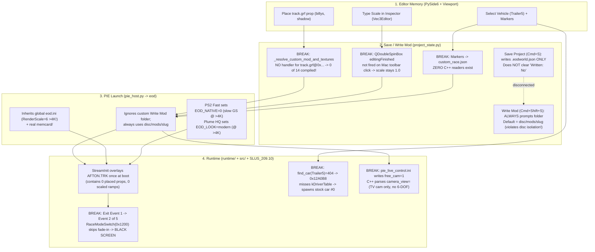
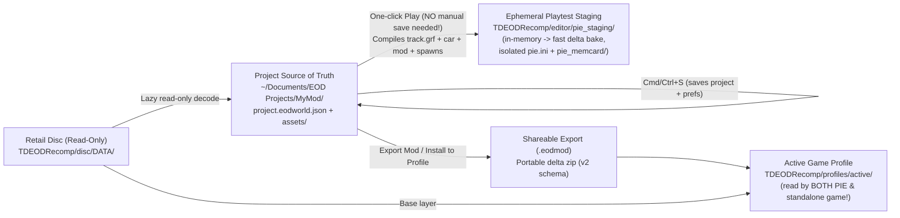
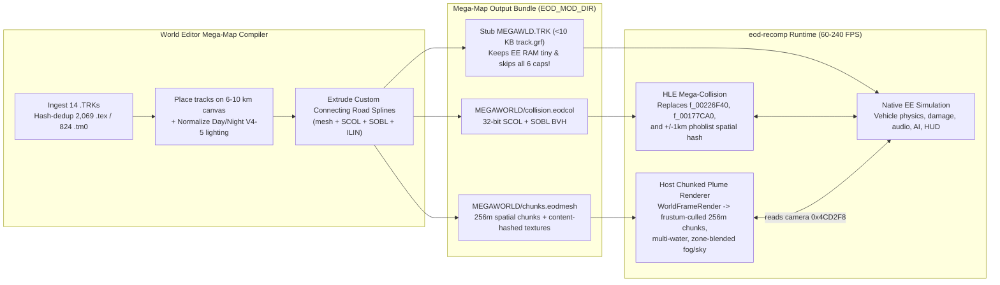

# EOD World Editor & Runtime — Holistic Lifecycle, UI/UX & Architecture Audit

> **Scope:** Full end-to-end analysis across `tools/world_editor/`, compilers/exporters (`tools/world_*.py`, `tools/mod_*.py`, `tools/import_nascar*.py`, `tools/nascar_*.py`), `runtime/`, `src/`, `SLUS_209.10` disassembly, macOS & Windows packaging, and your live artifacts (`~/Library/Application Support/TDEODRecomp/disc/mods/Afton_Studio_Mod/` and `eod.ini`).
>
> **Status:** Read-only diagnostic & architectural reasoning pass (**zero source files modified**). Every root cause below is verified directly against repository source, binary diffs of your live `AFTON.TRK`, and `SLUS_209.10` disassembly.

---

## Executive Diagnosis: Why Everything Felt Broken at Once

You hit **a stack of disconnected, silently failing lifecycle seams**, not random glitches. The World Editor currently behaves like **four separate tools bolted together** (a PySide6 OpenGL editor, a partial Vulkan child surface, a half-implemented `.TRK` compiler, and a game runtime reading global user settings) with **no unified Project → Temp Playtest → Mod Export → Active Game Profile pipeline**.

Every single issue in your 9 screenshots and walkthrough traced to an exact, deterministic bug in the codebase:

| What You Experienced | Exact Root Cause (Code-Verified) |
|---|---|
| **None of your 14 placed objects (`billys_6f308`, `shadow_12b3d8`, `ramp3_109a48`) appeared in-game** | **`project_state.py:2911-2992`** (`_resolve_custom_mod_and_textures`) ONLY handles `car:` and `mod:` model keys — **it has ZERO branch for `track.grf@0x...` models!** Your live `mod_layer_manifest.json` literally recorded `"editor_placed_objects": 14, "custom_objects_compiled": 0` with 14 silent `"Skipped in-game compile: no standalone MODL source"` warnings — and `write_mod_layer_dialog()` printed `14` while hiding all warnings! |
| **Scaled ramp (`ramp-in_1dab8`) didn't change in-game** | `obj_scl_ed` (`properties_panel.py:290`) only commits on `editingFinished` (not `valuesChanged`). Clicking a macOS toolbar button (`Write Mod` / `Free Roam`) does **not** steal focus from `QDoubleSpinBox`, so `Afton_Studio_Mod.eodworld.json` saved `"scale": [1.0, 1.0, 1.0]` and `"vif_models_baked": 0`! |
| **Scaling `ramp-in_1dab8` left its top surface/texture detached** | `ramp-in_1dab8` (393 tris) and `af_rdwr_256d8` (68 tris, tire-rut wear strip hovering +0.07 m above it) are **two separate `opt_terrain` GRAF leaves**. `auto_group_compounds()` (`world_loader.py:1408`) has a `None == None == True` BFS bug that merges **473 unrelated objects across half of Afton** into `auto_ramp_0001`; drilling into `ramp-in_1dab8` separates it from its top strip. Worse, `af_rdwr.tex` (`max_a=187`) fails `max_a <= 128` (`world_loader.py:1796`) and renders as a solid opaque ribbon, and `Include Overlapping LOD Twins & SOBL Barrier` ONLY runs on Delete. |
| **Selected `Vehicle: Trailer5`, spawned in a default stock car** | `main_window.py:561` lists raw `DATA/CAR/*.CAR` files including non-drivable trailers. `session_start.cpp:507` resolves `Trailer5` → `#404` in `kVehicleTable` (`0x3CBEE4`), but `GameDoSingle` → `0x0012A0B8` looks up `#404` in **`kDriverTable` (`0x3CBEE0`)**, which has **zero driver records** for trailers → falls back to slot `0` (default stock car). Meanwhile Career Free Roam drops `car=` completely (`pie_host.py:449-451`). |
| **Black screen behind `Event 2 of 5`** | `session_start.cpp:896` forces a 5-event Eve and only exits the Eve loop for online (`P.net`), not offline PIE. Exiting Event 1 leaves the fader HELD BLACK (`alpha=255`). Entering `Event 2 of 5` (`0x0011F640`) calls `RaceModeSwitch(0x1200, 0)` (bit `0x1000` skips `0x00176630` fade-in), so `0x0036E568` draws a solid black quad over the 3D track behind the 2D menu. |
| **Terrible lag (24–42 FPS) in-game** | Your `~/Library/Application Support/TDEODRecomp/eod.ini` has **`RenderScale=6` (`3840×3072` = 11.8M pixels/frame, >4K!) + `VSync=1`**. PIE does not isolate `eod.ini`. In `PS2 Fast`, `pie_host.py:504` sets `EOD_NATIVE=0` (slow legacy VU1/GS emulation at **>4K**!); in `Plume HQ`, it runs full-`3840×3072` PBR + 2-cascade sun shadows + scene captures over MoltenVK! Plus `EOD_OPT_TERRAIN_MASK=0xFFFF` renders all 16 terrain layers simultaneously, and commit `d11b36d` ("broke it") added synchronous 43.7 KB `memcmp` + unswizzle per queued car part on the EE thread. |
| **Blank model thumbnails (`dirt01_*`)** | Placeholders are 100% transparent (`explorer_panel.py:165`), queued strictly `0..399` (`dirt01_94528` is #268), and **`start_pie()` (`main_window.py:1471`) cancels `_thumb_token` while `_on_pie_stopped()` NEVER restarts it!** Plus shadow meshes draw RGB `(17,18,34)` over `(23,25,31)` backdrop, and flat/long strips shrink to `<20 px²` at `pitch=24°`. |
| **`Plume HQ` hides ALL tools/gizmos & breaks clicking** | `ViewportGL.paintGL()` (`viewport_gl.py:2433-2437`) returns immediately after `_paint_plume()`, skipping EVERY OpenGL overlay. `plume_surface.cpp` only has `opaque` + `blend` pipelines (zero gizmos/highlights/markers/roads/collision) inside an opaque `CAMetalLayer`, while invisible road nodes, markers, and gizmos STILL intercept clicks first! |
| **Hard object picking even in `PS2 Fast`** | Unoccluded road nodes & markers test BEFORE objects with a **broken distance formula** (`perp < best_score + t * 0.025`, `viewport_gl.py:2906`) that rewards **farther** nodes! GPU pick draws translucent `_blend_batches` **solidly** (`uCutout=0`), and `ray_aabb_hit()` returns `tmax` when camera is inside an AABB, breaking the CPU fallback early. |
| **On Windows, drag out an object, click away, it disappears** | **TWO smoking guns:** (1) `viewport.altDuplicateCompleted` (`viewport_gl.py:3346`) is **NEVER connected in `main_window.py`** — clones are removed from `world.objects` on mouse-up, remain drawn ONLY in `_sel_batches` while selected, and vanish the instant you click anything else! (2) `explorer_panel.py:301` checks `"display-object"` (`True`) while `viewport_gl.py:774` sets `layer_visibility["display-object"] = False` — dragged-out `display-object` assets ALSO render ONLY while selected and vanish on deselect! |
| **`Ctrl+Shift+S` zooms out on Mac** | Qt maps `QKeySequence("Ctrl+Shift+S")` to **`Cmd+Shift+S`** on macOS, while UI labels hardcode `"Ctrl+Shift+S"`. Pressing physical `Control+Shift+S` falls into `ViewportGL.keyPressEvent()` (`viewport_gl.py:3649`), which **never checks modifiers** — seeing `Key_S` + `Key_Shift` (`boost=2.8`) and flying the camera rapidly backwards! |
| **`Tab` doesn't cycle Move/Rotate/Scale** | `ViewportGL.cycle_transform_tool()` (`viewport_gl.py:3554`) is **dead code**: `keyPressEvent` never checks `Key_Tab`, `event()` lets Qt focus-chain steal `Tab`, and `toolCycled` is never connected in `main_window.py`! Meanwhile `Scale` has **NO keyboard shortcut at all**, and `Rotate` (`R`) hijacks Ghost Place Mode's `R` rotate key! |
| **`Cmd+Shift+S` asks for a folder every time; switching track loses all work** | `write_mod_layer_dialog()` (`main_window.py:1313`) calls `QFileDialog.getExistingDirectory` unconditionally with no stored `mod_output_dir`, `save_project_as()` never updates `project_name`, and **zero** destructive actions (`TRACK` dropdown, `New`, `Open`, `Reload`, `Home Hub`, `Exit`) check dirty state or prompt to save! |
| **`Cars (0)` does nothing when clicked** | Track loads pass `include_cars=False` (`main_window.py:970`), Explorer sets `Cars (0)` and omits `"car-wreck"` from `model_filter`, so clicking `Cars (0)` hits `findData("car-wreck") == -1` and silently does nothing. If PIE launches before the slow background car scan finishes, `start_pie()` cancels `_car_token` and `_on_pie_stopped()` **never restarts it**! |
| **No Custom Spawn Point & No Free Cam** | All `Spawn` / `Start Grid` / `Car` markers write only to `custom_race.json` — **zero C++ files read it**. `Free Cam` button writes `free_cam=1` to `pie_live_control.ini`, while `battle_driver.cpp:221` only parses `camera_view=<int>` (and even `camera_view=9` is just PS2's fixed trackside TV cam, NOT a flyable 6-DOF camera). |

---

## 1. End-to-End Lifecycle Trace (Where Memory, Disk, Compiler & Runtime Break Apart)

### Critical Path & Packaging Bugs (macOS vs Windows)
1. **Editor pollutes the retail `disc/` folder:** `_default_mod_dir()` ([main_window.py](file:///Users/monty/Documents/GitHub/eod-recomp/tools/world_editor/main_window.py#L1197-L1199)) and Blender exports ([main_window.py](file:///Users/monty/Documents/GitHub/eod-recomp/tools/world_editor/main_window.py#L2159)) write inside `~/Library/Application Support/TDEODRecomp/disc/mods/` (macOS) / `%LOCALAPPDATA%\TDEODRecomp\disc\mods\` (Windows) — directly violating the repo's own read-only disc invariant enforced by `mod_manager.py`, `mod_package.py`, and `modding_backend.py`.
2. **Standalone game NEVER reads World Editor's written mods or Mod Manager profiles:** `runtime/iop/fileio.cpp:68-73` and `stream.cpp:187-200` ONLY overlay `EOD_MOD_DIR`. On macOS, standalone `Eve of Destruction.app` falls back to `Mods/integrated` ([macos_app.mm](file:///Users/monty/Documents/GitHub/eod-recomp/runtime/app/macos_app.mm#L99-L148)); on Windows, standalone `eod.exe` loads **no mod folder at all** unless `EOD_MOD_DIR` is passed manually.
3. **3-way macOS AppData fragmentation:** World Editor splits its own files across `~/.eod_world_editor/` (recents/prefs/cache/autosave/local-vehicles — 4 copy-pasted helpers ignoring macOS `Application Support`), `~/Library/Application Support/eod-recomp/EOD World Editor/car-studio/`, and `~/Library/Application Support/EODCreationKit/profiles/`.
4. **3 fatal Windows packaging breakages:**
   - [package_windows_release.py](file:///Users/monty/Documents/GitHub/eod-recomp/tools/package_windows_release.py#L74-L94) omits **5 required modules** (`home_hub.py`, `mod_manager.py`, `perf_profiler.py`, `plume_viewport.py`, `profile_pie.py`), causing an immediate startup `ImportError`.
   - `resolve_eod_exe()` ([pie_host.py](file:///Users/monty/Documents/GitHub/eod-recomp/tools/world_editor/pie_host.py#L386-L393)) never checks `<bundle_root>/eod.exe` where `package_windows_release.py:366` places it.
   - `plume_surface.cpp` ([plume_surface.cpp](file:///Users/monty/Documents/GitHub/eod-recomp/tools/world_editor/plume_surface.cpp#L119-L131)) compiles with `VK_NO_PROTOTYPES` on all platforms (`CMakeLists.txt:234`), yet only calls `volkInitializeCustom()` under `#ifdef __APPLE__` — leaving Vulkan pointers uninitialized on Windows — and `package_windows_release.py` doesn't ship `eod_editor_plume.dll`.
5. **Tooling ecosystem fragmentation:** Five overlapping schemas exist (`.eodworld.json` + `disc/mods/`, `.eodproject` + `.eodproject.assets/`, `.eodmod` + `EODCreationKit/profiles/`, `Mods/integrated`, and `~/.eod_world_editor/local-vehicles/`), plus two legacy tools (`tools/editor/` C++ prototype OFF by default, `tools/eod_mod_gui.py` Tkinter utility with hardcoded macOS paths) and a macOS-only `tools/kit_service/` daemon that `tools/world_editor/` completely bypasses.
6. **Where "please save first" comes from:** In `tools/world_editor/`, PIE doesn't block, *except* `ModManagerDialog` disables Play until a profile is composed, `CarHandlingSheet` forces `Save & Build` into a disconnected folder, and `PropertiesPanel` leaves amber `"Written: No"` even after Save/PIE. The hard `"Save first to test"` gate also lives in the companion macOS Creation Kit (`AppState.swift:400`, `kit_service/states.py:101`, `modding_backend.py:665`).

---

## 2. Complete UI/UX Audit: What Labels Promise vs What the Code Actually Does

### 2.1 Structural Problems Across Menus & Panels
- **No `Edit` menu** — `Undo`/`Redo` are buried in `World` ([main_window.py](file:///Users/monty/Documents/GitHub/eod-recomp/tools/world_editor/main_window.py#L325-L332)), while `Duplicate`/`Delete` are in `Objects`.
- **14 overcrowded top-level menus** (`File`, `World`, `View`, `Camera`, `Objects`, `Markers`, `Cars`, `Breakers`, `Roads`, `Terrain`, `Mesh`, `Races`, `Collision`, `Help`) overflow around the MacBook notch, and `World: <name>` corner badge (`:298-300`) is invisible in the macOS global menu bar.
- **Icon-only collapse trap (`< 1400px` width, `:494-497`):** `Save` and `Write Mod` share the identical floppy icon; `Play Event`, `Sync All Events`, and `Race Setup` share the identical flag icon.
- **Duplicate & cryptic menu entries:** `View` contains **two separate items both literally named `Grid`** (line `:360` grid visibility, line `:663` 1.0 m snap) plus a mysterious item named **`15°`** (`:664`).

### 2.2 Every Confusing / Broken / Potemkin Control Audited

| Control / Location | What the Words Imply (Industry Standard) | What Code ACTUALLY Does | Verdict |
|---|---|---|---|
| **Viewport `Object Mode` / `Edit Mode` pill** ([viewport_gl.py](file:///Users/monty/Documents/GitHub/eod-recomp/tools/world_editor/viewport_gl.py#L446-L455)) | Blender Object vs Vertex/Mesh Edit Mode | Sets `self.edit_mode` which is **NEVER READ ANYWHERE** in the codebase! | **100% Potemkin (Dead)** |
| **Left Panel `Ghost` vs `Place` vs Toolbar `Place`** ([explorer_panel.py](file:///Users/monty/Documents/GitHub/eod-recomp/tools/world_editor/explorer_panel.py#L232-L248)) | "Ghost" sounds like transparency/noclip; "Place" sounds identical in both spots | Toolbar `Place` & Left `Ghost` both enter cursor placement mode; Left `Place` (no tooltip!) instantly spawns 1 copy 28 m in front of camera. Pressing `R` to rotate ghost is **hijacked** by `Objects -> Rotate Tool` (`main_window.py:380`)! | **Ambiguous + Hotkey Clash** |
| **Left Panel `Swap`** (`explorer_panel.py:242`) | Swap selected object's model | Calls `replace_selected_with_key` (single object only, ignores multi-select; silent no-op if no model selected). | **Works (rename to "Replace Selected")** |
| **Left Panel `Scatter`** (`explorer_panel.py:237`) | Brush-paint copies across terrain | Works in OpenGL; invisible in `Plume HQ`; still compiles 0 objects if model is `track.grf@0x...`! | **UI Works, Compiler Drops Output** |
| **Left Panel `Mlists` tab** (`explorer_panel.py:264-281`) | Meaningless PS2 reverse-engineering term | Read-only GRAF/Mlist debug dump that **hides the `Active ILIN Racing Line` selector** inside it! | **Dev Debug Leak (Move Racing Lines out, hide Mlists under Debug)** |
| **Left Panel `Cars (0)`** (`explorer_panel.py:210-214, 583`) | Filter to drivable/placeable cars | Displays `(0)` on track load, omits `"car-wreck"` from combo so clicking does nothing; PIE cancels car scan & never restarts it. Even when loaded, places **wheelless immovable `wall` boxes (`mass=30000`)**, not physics cars! | **Broken + Wrong Mental Model** |
| **Inspector `Written: Yes / No — Ctrl+Shift+S writes it`** (`properties_panel.py:242, 843`) | Internal compiler cache state | Hardcodes `Ctrl+Shift+S` on Mac (which zooms out!); stays amber `Written: No` even after `Cmd+S` AND after PIE compiles; meaningless to users. | **Replace with single Dirty `*` / Clean badge** |
| **Inspector `Edit in Blender`** (`main_window.py:2156`) | Launch Blender & round-trip geometry | One-way `.obj` export to `disc/mods/blender_exports/`! Does NOT open Blender, has **NO Re-import OBJ** path! | **Misleading (Rename or add real Re-import)** |
| **Inspector `Include Overlapping LOD Twins & SOBL Barrier`** (`properties_panel.py:353`) | Keep compound/LOD/collision synced on all edits | Raw jargon (`SOBL`, `LOD Twins`); ONLY runs on **Delete**, NEVER on Move/Rotate/Scale; ignores `opt_terrain` ramp caps. | **Partial + Jargon** |
| **All 7 `Markers` / `Cars` / `Breakers` Place Actions** (`main_window.py:397-414`) | Place real in-game spawns, start grids, AI slots, chickens, triggers, smashables | Writes `.eodworld.json` / `custom_race.json` only — **ZERO C++ runtime consumers**. | **100% Potemkin (Must wire to `c_battle.va0`/`track.ild`/runtime or hide)** |
| **Road `Split here: Two directions`** (`properties_panel.py:535`) | Create bidirectional AI road | Never serialized into binary `.ild` (`project_state.py:3081-3136`) — only paints the editor ribbon purple! | **Potemkin** |
| **`CustomRaceDialog` `AI Speed Scale` / `Event Name` / `Linked ILIN`** (`dialogs.py:191-236`) | Configure race rules | `AI Speed Scale` never read by `eod`; `Event Name` overwritten by toolbar combo; `Linked ILIN` only changes editor view. | **Partial Potemkin** |
| **PIE Bar `Free Cam` & `Arcade Mode`** (`pie_host.py:789-805`) | Flyable free camera & live arcade mode switch | `free_cam=1` ignored by `battle_driver.cpp:221` (`camera_view=`); `arcade_mode=tag` string fails `std::atoi` (`:225`), and `cat_mouse` has zero C++ code! | **Protocol Mismatch + Stub** |
| **`World -> Open DATA/TRACKS Folder`** (`main_window.py:1414`) | Reveal folder in Finder / Explorer | Guarded by `if sys.platform == "win32": os.startfile(...)` — **100% dead no-op on macOS**. | **Mac Bug** |
| **`Objects -> Delete Selected`** (`main_window.py:393`) | Delete with `Delete` / `Backspace` | Bound only to `QKeySequence("Del")` (Forward Delete = `Fn+Delete` on MacBooks); Mac `Delete` key does nothing! | **Mac Bug** |
| **`File -> Exit`** (`main_window.py:321`) & **`Help -> About`** (`:2722`) | Standard quit & accurate app info | Hardcodes `Alt+F4` on Mac and prints `"Native Windows 11 Qt 6"` on macOS! | **Mac Bug** |
| **`Cars -> Vehicle / NASCAR Tuner (Live PIE)...`** (`main_window.py:407`) | *(The source of your dictated `vehicle/nascar_tuner_live_p.i.a`!)* | 4 inconsistent names across the app (`Vehicle / NASCAR Tuner (Live PIE)...`, `Car Tuner`, `Vehicle / NASCAR Importer`, `Car Studio`). Saving handling in `CarHandlingSheet` writes to an isolated AppLocalData folder — `archiveSaved` is **never connected** to PIE or track mod export! | **Jargon Leak + Disconnected Save** |

---

## 3. Unified Target Lifecycle & Editor UX Architecture (macOS + Windows)

### 3.1 The Clean 4-State Lifecycle (Zero Friction, Zero Disc Pollution)

**How this directly eliminates every friction point you hit:**
1. **No "Save first" / no "Written: No" jargon:**
   - Replace `Written: Yes/No` with a single clean status indicator in the top corner (`Saved` / `Unsaved changes •` + `*` in title bar).
   - **Play (Free Roam / Event)** ALWAYS compiles directly from **in-memory state** into an **isolated scratch staging folder** (`editor/pie_staging/<slug>/`) with its own `pie.ini` (sane `RenderScale=2` or user PIE quality slider, NOT hijacked by `eod.ini`'s `RenderScale=6`!) and isolated `pie_memcard/` so you NEVER have to save or pick a folder just to test your changes.
2. **Project Creation & Remembered Preferences:**
   - On first Save or New Project, ask once: **Project Name**, **Save Folder** (default `~/Documents/EOD Projects/<slug>/`, never inside `disc/`), and **Export Mode** (Delta `.eodmod` vs Full Mod Layer). Persist in project metadata + `prefs.json` so `Cmd/Ctrl+S` saves silently and `Export Mod` remembers your destination & preferences without re-prompting every time.
3. **Zero Silent Data Loss:**
   - Guard `TRACK` switching, `New`, `Open`, `Reload`, `Home Hub`, and `Exit` with a standard `"Save / Discard / Cancel"` prompt whenever the command log is dirty.
   - Support **Cross-Track Asset Library** (browse models from *any* retail `.TRK` inside the Models browser with track filter pills) AND optional **Multi-Window / Copy-Paste Clipboard** so you never have to close your current project just to grab a ramp or building from another track!
4. **Fix the Core Compiler So Placed Track Props Actually Appear In-Game:**
   - Extend `_resolve_custom_mod_and_textures()` in [project_state.py](file:///Users/monty/Documents/GitHub/eod-recomp/tools/world_editor/project_state.py#L2911-L2992) to extract embedded `mrModel` + referenced `.tex` bytes directly from `track.grf@0x...` (converting embedded GRAF `mrModel` → standalone `MODL` v9 centered around local origin with scale baked into vertices) OR inject directly as new `GRAF` leaves + `SOBL`/`obstacle.val` solids!
   - **Never lie in build reports:** Display exact `Compiled: X / Y` and surface any skipped-object warning prominently as an error banner.
   - Commit `Vec3Editor` values live (or flush active spinboxes via `clearFocus()` before any Save/Export/PIE toolbar click!) and use `decimals=4` for transforms.
5. **Fix Compound Track Assemblies (Ramp + Top Wear Strip):**
   - Fix `auto_group_compounds()` (`world_loader.py:1408`): require `co.opt_terrain_mode is not None` before matching `no.opt_terrain_mode == co.opt_terrain_mode`, and tighten spatial overlap (require XY/XZ footprint intersection, not just touching edges) so `ramp-in_1dab8` + `af_rdwr_256d8` group cleanly as **one 2-piece ramp assembly** (NOT 473 objects!) that moves, rotates, scales, and deletes together — while allowing a clean "Toggle Surface Decal / Break Apart" action if you want to strip or edit the top layer independently!
   - Fix `af_rdwr.tex` alpha classification (`world_loader.py:1796`) so semi-transparent road wear renders with proper alpha blending instead of an opaque slab.
6. **Fix Plume HQ Viewport, Picking & Controls:**
   - **Short-term fix for Plume HQ:** Add an overlay/line/gizmo/highlight pass directly inside `plume_surface.cpp` (or Dear ImGui + 3D line/gizmo pipeline as specified in [WORLD_EDITOR_ARCHITECTURE.md](file:///Users/monty/Documents/GitHub/eod-recomp/docs/WORLD_EDITOR_ARCHITECTURE.md#L133-L136)), wire live drag `_plume_dirty`, and initialize `volk` on Windows.
   - **Fix Picking everywhere:**
     - Depth-test road nodes & markers against scene depth (and remove the broken `+ t * 0.025` bug at `viewport_gl.py:2906`).
     - In GPU Pick FBO, discard alpha on `"blend"` textures (`alpha < 0.15`) and align `"cutout"` threshold to `0.45` so invisible transparent planes never block clicks.
     - Fix `ray_aabb_hit()` to return `0.0` when `tmin < 0 <= tmax`.
   - **Fix Shortcuts (Mac + Windows Parity):**
     - Guard `ViewportGL.keyPressEvent` against `ControlModifier`/`MetaModifier`/`AltModifier` so shortcuts NEVER fly the camera.
     - Wire `Tab` in `ViewportGL.event()` → `cycle_transform_tool()` → `main_window.select_tool()` (Move → Rotate → Scale). Also bind standard `W/E/R` or `G/R/S` (when not flying) + `Delete`/`Backspace` on Mac + `Cmd/Ctrl+Q`.
     - Connect `viewport.altDuplicateCompleted` in `main_window.py` and unify `layer_visibility["display-object"] = True` across Explorer and Viewport so dragged-out objects NEVER vanish!
     - Restart `_thumb_token` and `_car_token` after PIE stops (or don't permanently kill them!), prioritize visible thumbnail grid cells, brighten shadow-mesh previews, and auto-frame flat/elongated meshes from a steeper pitch (`52°`) using tight projected bounds.
7. **Real Custom Spawn Point + True 6-DOF Free Cam:**
   - **Spawn Anywhere:** Add a 1-click **"Play From Camera"** (`Ctrl/Cmd+Shift+F5`) + real `"Player Spawn"` / `"AI Spawn"` markers that bake into `c_battle.va0` `[respawn]` (and a runtime `EOD_SPAWN_POS=x,y,z,yaw` override read by `f_00167C70` / `f_001D8F58` in `src/battle_bots.cpp` & `src/session_start.cpp`), so you spawn **right where you built your ramps** without driving across the map!
   - **True 6-DOF Free Cam:** Fix the `pie_live_control.ini` protocol mismatch (`free_cam` vs `camera_view`, `arcade_mode` string vs int) AND implement a real host-driven 6-DOF fly camera hook on the camera matrix (`0x4CD2F8` / `0x48CB80` in `src/hle_camera.cpp`) toggleable anytime in-game with a single hotkey (e.g. `F4` / `C` / PIE bar button), with WASD + mouse/stick fly + "Teleport Car Here" button!
8. **Fix `Event 2 of 5` Black Screen & `Trailer5` Vehicle Picker:**
   - Filter `cmb_pie_car` to drivable chassis with valid `kDriverTable` entries (or patch `0x0012A0B8` to synthesize a temporary driver slot if someone explicitly wants to test-drive a trailer/special vehicle!), and make Career Free Roam honor the selected car or clearly indicate when using the Career Garage car.
   - In `src/session_start.cpp`, either return cleanly to PIE/front-end on Event 1 exit OR clear the held fader (`0x00176630`) when transitioning into `0x0011F640` so `Event 2 of 5` renders the live 3D track background instead of black.
9. **Fix Performance (24–42 FPS → 60–120+ FPS):**
   - Isolate PIE's `pie.ini` with a configurable PIE Render Scale (`1x`/`2x`/`Native` instead of inheriting `RenderScale=6` `3840×3072`), keep Plume native enabled where appropriate instead of forcing legacy GS at >4K, and fix commit `d11b36d`'s synchronous 43.7 KB `memcmp`/unswizzle hot loop in `native_feed.cpp:1296-1398`.

---

## 4. Spawning Solid Physics Cars + Gran Turismo / Forza 3D Car Studio

### 4.1 Why `Cars (0)` Was Empty & How to Spawn Real Shootable Physics Cars
- **Why static wrecks (`vh-1low_*`, `shadow_*`) aren't real cars:** They are baked immovable `GRAF` scenery leaves inside `AFTON.TRK::track.grf`. Even placing a `DATA/CAR/*.CAR` model today uses wheelless `Low3.mod` compiled into an immovable `obstacle.val` `type = wall, mass = 30000` rigid box.
- **How EOD's engine builds real solid, shootable, crushable cars with wheels:**
  - `f_0020FD48` (`SceneCreateCarAndWeapons`) constructs `CarBase` (`0x1C34` B in `0x447458`, initialized by `0x185470` + `0x18AFE0` for `physics.val`, 8 detachable panels `car+0x13E8`, `Bone.mvl` dent skeleton, and 4 `RACE.RES` wheels `car+0x1A00`) + a `0xB0`-byte rigid body in `*(0x494D30)`.
  - **Key insight already proven in `src/battle_driver.cpp:2-4`:** Setting a car slot's driver to `NullDriver` spawns a **stationary, fully solid, physics-simulated car with attached wheels, chassis, crushable bones, detachable panels, and shootable/explodable damage**!
  - **Current EE slot limits:** Up to **20 cars total** in `f_0020FD48` (currently **10** in Battle via `battle_layout::kMaxCars`, max **7 distinct chassis** per Eve via `0x00123EE0`). By wiring `"Spawned Car"` placements in the World Editor into `f_0012C158` / `f_00167C70` / `f_001D8F58` (and lifting `kMaxCars` / `0x123EE0` chassis cap inside our 128 MB EE RAM), you can place solid, parked, shootable physics cars (with wheels, liveries, and full destruction!) anywhere on the map!

### 4.2 Designing the Gran Turismo / Forza / Assetto Corsa "Car Studio"
Nearly all underlying binary decoders and physics formulas are **already reverse-engineered in this repo** — they just aren't wired into a cohesive 3D Garage UI:

| Studio Pillar | Already Built in Repo | What to Build in the Unified 3D Car Studio |
|---|---|---|
| **1. Visual Car Gallery & Assembled 3D Showroom** | `vif_mesh.py`, `vehicle_export.py` (`wheel_specs` from `RACE.RES`), `nascar_preview.py:18-39` (`wheel_centers` from `ftrack`/`rtrack`/`wheelbase`/`tire_diameter`), `modding_backend.py` (`vehicle_paint`), `COMMON.RES` (`car_stats.val`, `carclass.val`, `buycar.val`, `dirt.val`) | Full-bleed filterable card gallery (Compact / Midsize / Muscle / Special / **NASCAR**) with 3D assembled thumbnails (**chassis + all 4 positioned wheels + real livery**). Clicking a car opens an interactive 360° 3D turntable viewport with LOD switcher (`Low0` cockpit → `Low4`), livery switcher across all `CT.RES` paints, and wheel-fitment preview. |
| **2. Interactive Damage & Destruction Preview** | `Bone.mvl` / `Bone.val` schema (`valt_schema_rules.py:361`), `src/car_damage.cpp` (8 detachable panels, 4 tossed wheels), offline VU1 skinning deformer in **`tools/dent_preview.py`** | Add a **"Damage Level" slider (0% Pristine → 50% Battered → 100% Wrecked)** + per-panel detach toggles right in the 3D showroom powered by `dent_preview.py` + `Bone.mvl`! |
| **3. Texture Export / Replace / Upscale Studio** | `tools/tex.py`, `texture_preview.py`, `texture_identity.py`, `HOSTTEX` `.eodhtx` pipeline (up to 8192×8192 RGBA8 + mips), `modding_backend.py` | Click any surface/material on the 3D car (or pick from Material list) to **Export PNG**, **Replace PNG** (live 3D update), **Auto-Sync `CT.RES` livery** (fixing the current `BUS.CAR`-only limitation in `modding_backend.py:607-659`), or **Upscale to HD/4K via `HOSTTEX`**. |
| **4. Visual Engine, Gearbox, Suspension, Tyre & Damage Graphs** | **`physics.val` (`VALT`)** fully schema-mapped with verified `SLUS_209.10` addresses (`valt_schema_rules.py:146-253`); HP/Torque/Quarter-Mile formula decompiled (`src/career_upgrades.cpp:157-207`); Career `CarTuningBlock` (19 floats) | **Important truth verified from `SLUS_209.10`:** Legacy `SETU` (`.gar`) files and 80 unused setup keys (`camber`, `toe`, `sway`, `rspoiler_angle`) are **completely ignored by EOD's physics engine** (`docs/SETU_CAR_SETUP.md:8-12`). Real tuning MUST edit **`physics.val`** + **`Bone.mvl`** (with optional HLE hooks if we want live camber/aero/downforce!). Replace raw text boxes with interactive visual charts: • **Engine Dyno Curve** (Torque & HP vs RPM, `redline`, `power_max`, `torque_max`) • **Transmission Sawtooth Graph** (Speed per gear `g1..gN`, `rear_end_ratio`, `torque_balance`) • **Tyre Grip / Pacejka Curve** (Asphalt `Front`/`Rear` & `FrontDirt`/`RearDirt` `magic_b..e`, `grip`, `slip`) • **Chassis / Suspension / Damage Sliders** (`mass`, `cm_height`, `wheelbase`, `spring_factor`, `brake_factor`, `damage_tweak`) • **Live Wire-Up:** Connect `CarHandlingSheet.archiveSaved` directly into active PIE staging AND `.eodmod` export, and wire `grip_boost` & `ride_height_delta` in `battle_driver.cpp:302-345`! |

---

## 5. NASCAR Importer Redesign: True NASCAR Class + Ephemeral Test-Drive Lifecycle

### 5.1 Why "EOD Template" & "EOD Class" Exist Today — Separating Shortcut from Engine Wall

| Current Jargon Field | Why It Exists Today | Real Engine Constraint or Shortcut? |
|---|---|---|
| **EOD Template** (`--base Algar`) | `import_nascar_cars.py:466` calls `create_custom_car.build_custom_car()` to clone a retail `.CAR` shell, then immediately overwrites `Low0..4`, `shadow1..3`, `Bone.mvl`, textures, and physics! | **95% IMPLEMENTATION SHORTCUT!** Proof: `tools/nascar_roster.py:221-304` (`build_chassis`) **already builds all 8 NASCAR chassis across all 5 series directly from NASCAR archives** without cloning a user-chosen donor! The remaining tiny constants (`VALT` v11 vtables, shadow packet flags, default `efx.val`/`lod.val`) can be built-in defaults — **the user should NEVER see "EOD Template"!** |
| **Livery Entry** (`Car24.tex`) & **Chassis / Number** | Thin 1:1 GUI wrapper over prototype CLI flags; `vehicle_overlay.py:65` even hardcodes `kind="stock"` (ignoring Truck, Modified, Hobby, Pace Car!). | **Pure UI shortcut.** `nascar_roster.collect_roster()` + `iso9660_reader.py` already know how to catalog **all 5 families, 8 chassis, and 125 real drivers/liveries** from the ISO! |
| **EOD Class** (`Compact` / `Midsize` / `Muscle`) | EOD's `carclass.val` has **4 hardcoded classes (`0..3`)**, `f_00164218` only scans `0..3`, `CarChooseWidget` caps each chassis at **10 paints**, each class bucket caps at **20 chassis**, and `AutoShopIsPartCompatible` (`src/career_upgrades.cpp:371`) indexes `chassis_class % 4` (so class `4` would silently wrap to Compact `0`!). | **REAL EE HARDCODE — Solvable with targeted HLE hooks!** |

### 5.2 NASCAR vs EOD Performance & Rating System Comparison
- **NASCAR: Dirt to Daytona (`SLUS_204.41`)** has **no 1–10 stat bars**: cars are grouped by **4 racing series + Pace Car** (Hobby/Dirt → Modified → Truck → Cup), driver rosters live in `cup.val`/`truck.val`/`modified.val`/`dirt.val` with per-track-type AI ranks, **gear ratios (`g1..g4`) and final drive live inside 196-byte `SETU` `.gar` sheets** (NOT `physics.val`), wheels use independent slow/fast meshes (`rtireN.mod` + `rtireNf.mod`), and engine audio uses `ESFX` (`*.ens`) linear-RPM/trapezoidal envelopes.
- **Eve of Destruction (`SLUS_209.10`)** uses 4 classes (`carclass.val`), display-only 1–10 UI bars (`car_stats.val`), static `physics.val` gearing + dual Asphalt/Dirt axle tables, a single-mesh fast-texture wheel loader (capped at 8 concurrent wheel classes at `0x21F988`), and `.val` smoothstep engine audio (`0x23C8D0`).

### 5.3 Concrete Architecture for the True NASCAR Experience

1. **Zero-Jargon Visual ISO/Folder Scanner:**
   - User picks a *NASCAR: Dirt to Daytona* `.iso` or extracted folder → `NascarSource.scan_catalog()` immediately scans `COMMON.RES` + `CAR/*.CAR` + paint archives and presents:
     > *"Recognized 125 NASCAR vehicles across 5 series (45 Cup, 37 Truck, 21 Modified, 21 Hobby, 1 Pace Car)"*
   - Visual filterable card grid with background-rendered 3D/livery previews (`nascar_preview.py` cached under `editor/nascar-preview-cache/`), real specs (HP, mass, series, manufacturer), **"Import All"**, **"Import Series"**, or individual checkboxes. Zero `EOD template` / `EOD class` / `Car24.tex` fields.
2. **True Standalone NASCAR Class (Class `4` — `"Stock Car"` / `"NASCAR"`):**
   - **HLE Class `4` Hooks (`src/hle_nascar_class.cpp` + `src/career_upgrades.cpp`):**
     - Wrap `f_00164218` with a host chassis→class map supporting Class `4`.
     - Extend `CarChooseWidget` (`0x2A75E0`, `0x2B7710`) to cycle 5 classes (`0..4`) and lift the **10-paint-per-chassis cap** (`0x2A7DAC` / `0x2B9EAC`) via host paint pagination (same proven pattern as `src/visual_car_list.cpp` and `src/career_upgrades.cpp`'s 16-slot garage!) so all 45 Cup / 37 Truck / 21 Modified / 21 Hobby liveries are drivable in-game.
     - Fix `AutoShopIsPartCompatible` (`career_upgrades.cpp:371`, replacing `chassis_class % 4`) and add Stock Car Career upgrades (including a **Dirt Tyre Kit** that unlocks dirt-tuned grip on EOD dirt tracks).
     - Isolate NASCAR AI fields (`nsstock.val`, `nstruck.val`, etc., already emitted by `nascar_roster.py`) so Cup cars race Cup cars in Action races while allowing mixed chaos in Battle/Custom events.
     - Guard/lift the unchecked 8-concurrent wheel-class buffer (`0x21F988`), generalize `src/hle_nascar_wheels.cpp` to all NASCAR families, wire the already-written `src/nascar_engine_audio.h` ESFX mixer into `0x23C400`/`0x23C8D0`, and fold NASCAR `.gar` gear ratios + final drive automatically into `physics.val`!
3. **Ephemeral "One-Off Test Drive" → Keep or Discard Lifecycle:**
   - **Today's flaw:** `vehicle_overlay.import_local_stock()` writes permanently to `~/.eod_world_editor/local-vehicles/` before you even drive the car, AND `mod_install.compose_stage()` (`tools/mod_install.py:229-240`) **rejects** new `.CAR` archives and new `.RES` members, so vehicle mods can't even install cleanly into profiles!
   - **Target lifecycle:**
     1. Click **`Test Drive`** on any scanned NASCAR → compiles ONLY that car into a disposable `tempfile.TemporaryDirectory("eod-nascar-testdrive-")` overlay + isolated `pie_memcard/` → launches directly onto the track. **Zero permanent files written.**
     2. On exiting PIE (or from the PIE bar), choose:
        - **`Discard`** → deletes the temp directory cleanly (zero trace left on disk).
        - **`Keep / Install to Profile`** → packs the already-compiled assets (no re-transcoding!) into an `.eodmod` **Schema v2** package supporting `addArchive` (`DATA/CAR/*.CAR`), `addMember` (`CT.RES`, `RACE.RES`, `RACESND.RES`, `UICAR.RES`), and semantic `valtPatch` merging (reusing `merge_valt_records` from `build_integrated_profile.py:60-89`) into the active `mod_install` profile!

---

## 6. Combined All-Tracks Open-World Mega-Map: Exact Engine Limits & Architecture

We ran a full census of **all 14 playable retail tracks** directly from your disc (Afton, Anoka, Baxter, Bemidji, Dennison, Dundas, Eagan, Gilroy, Hastings, HomeBase, Kenyon, Mankato, Springfield, Welch) and disassembled the exact EE table caps in `SLUS_209.10`.

### 6.1 Measured Combined Footprint of All 14 Tracks
- **Total `.TRK` archives:** **143.96 MB** (87.81 MB resident + 56.15 MB extractable)
- **Geometry (`track.grf`):** **39.77 MB** — **34,073 GRAF leaves**, **41,280 `4SPS` parts**, **803,320 triangles** (~60 MB GPU VB/IB — **trivial** for any modern GPU!)
- **Textures (content-deduplicated):** **2,069 unique `.tex` hashes** (25.76 MB PS2 → 157.6 MB RGBA8+mips) + **824 unique `.tm0` hashes** (42.01 MB PS2 → 279.7 MB RGBA8+mips).
  - **CRITICAL COLLISION FACT:** Out of 1,317 distinct `.tex` filenames across the 14 tracks, **316 filenames have DIFFERENT pixel payloads** across tracks (`trkdust.tex` has **13 distinct variants**, `shadow.tex` has 7, `dirt01.tex` has 4, `sky01a..16b.tex` has 10–11)! Merging requires content-hash deduplication/renaming.
- **Collision:** **98,628 `SCOL` triangles** (5.13 MB) + **14,856 `SOBL` records** (4.25 MB, 30,373 index entries, 33,918 quadtree nodes).
- **Combined Canvas:** ~**6 km × 10 km** (`f32` precision is still ~0.5–1.0 mm ULP — completely safe for car physics!).
- **Total Modern Host GPU VRAM Needed:** **~350–500 MB** total. Modern hardware can render the entire 14-track mega-world at **120+ FPS easily**.

### 6.2 The 6 Hard EE Engine Blockers (Why a Naive `.TRK` Merge Immediately Crashes)

| Subsystem | PS2 / EE Hard Limit | 14-Track Combined Need | Ratio | Exact Proof |
|---|---|---|---|---|
| **1. `SCOL` Terrain (`track.bsc`)** | **32,767 tris (`int16_t` neighbor IDs)** + O(N) brute-force fallback (`f_00226F40`) | **98,628 tris** (+ custom roads) | **3.01× OVER** | `SLUS_209.10:0x2268D8`, `docs/COLLISION_AND_BOUNDARIES.md:124` |
| **2. EE Texture Slot Table (`*(0x4D2D30)`)** | **512 (`0x200`) slots** + 512 render buckets (`0x4C96D0`) + 512 layer tables (`0x4CD4B8`) | **2,069 unique `.tex`** | **4.04× OVER** | `SLUS_209.10:0x35081C, 0x351130`, `src/render_queue.cpp:86` |
| **3. `MLIST` Visibility Scratchpad + `kModelDepth`** | **7,168 bytes** (`0x70000000..0x70001BFF`) + **7,168 floats** (`0x3DE6E8`) | **39,015 entries** | **5.44× OVER** | `src/native_world.cpp:193-196, 353-398`, `docs/PS2_LIMITS.md:27` |
| **4. Global `model_node` Table (`*(0x4C96C0)`)** | **4,096 models** (`0x14000 / 0x14`) | **34,073 leaves** | **8.32× OVER** | `SLUS_209.10:0x34D200`, `src/render_queue.cpp:74` |
| **5. Physics Spatial Hash (`0x0048D2B4`, `"phoblist"`)** | **100×100 grid of 20 m cells = ONLY `[-1000 m, +1000 m]` (2 km × 2 km)!** | **6–10 km world** | **3–5× OVER** | `SLUS_209.10:0x1D57A8` (`int((coord+1000)*0.05)`) — used by physics broadphase (`0x177DB0`) & blasts (`0x17DAB0`)! |
| **6. Monolithic EE RAM & Dynamic Pools** | **128 MB** EE RAM (already expanded from 32 MB!), **512** `phob_list`, **65,535** `SOBL` `u16` nodes, **1** Water pointer (`0x3DC134`), **400 KB** `.tm0` ring | ~95–115 MB raw resident + connecting road SOBLs + multi-track props & ponds | **At ceiling** | `runtime/include/ee.h:73`, `src/debris_pool.cpp:94`, `src/native_world.cpp:621` |

*(Already SOLVED in `eod-recomp`: 128 MB EE RAM, unbounded `OverflowQueue` draw records, unbounded native visual-car list, unbounded offline wheel/panel debris, draw distance up to `8×` = `9,200 m` with native fog, and Plume Vulkan + 1.5 GB `HOSTTEX`.)*

### 6.3 Recommended Mega-Map Architecture: Hybrid Host Chunked World + HLE Collision
Instead of fighting 6 separate 16-bit PS2 guest tables inside 128 MB EE RAM, **bypass all 6 at once cleanly**:

This keeps **100% of EOD's authentic driving feel, destruction, audio, and events running natively in EE**, while giving the mega-world unlimited triangles, unlimited textures, unlimited world bounds, O(log N) terrain/wall collision, and 60–240 FPS rendering!

---

## 7. Online Multiplayer at GTA Online / NFS World Scale: Brutally Honest Engineering Analysis

### 7.1 Current Netplay Reality (`src/netplay_*.cpp`)
- **Topology:** Host-authoritative **star over raw UDP** (no dedicated server, no TURN relay; BitTorrent UDP trackers + STUN/UPnP hole-punching). Networking runs **synchronously on the EE main thread**.
- **Hard Cap Today:** `kMaxPlayers = 16` in protocol/voice, bounded to event grid size (**10** in Battle, 12–14 in races). Only 2 real game processes have been live-tested together. No join-in-progress, no host migration.
- **Critical Sync Gaps Today:**
  - **Car damage is BROKEN:** `damage` (`+0x1BEC`) is serialized on the wire, **but `netplay_car::write()` (`src/netplay_car.cpp:84-95`) never writes it to the car!**
  - **Zero sync** of `Bone.mvl` dents, 8 detachable panels, tossed wheels, wreck state, or **chickens/weapons/explosions** (there is literally no `K_FIRE` / `K_DETONATE` packet in `src/netplay_wire.h`!).
  - **Asymmetric collisions:** Puppets overwrite rigid bodies before & after every physics step, making remote cars feel like immovable scripted rails with no owner-side impulse event.
  - **Whole-disc FNV-1a lockstep (`src/netplay_content.h`):** Any 1-byte difference across all of `DATA/` rejects joining; zero per-asset streaming or fallback proxy cars.

### 7.2 Hard Engine Walls Inside One EE Instance
- **Gameplay/Physics Actor Cap:** **20 cars absolute max** across EE arrays (`0x485230`, `0x447458`, `0x3CE4F8`, `*(0x494D30)`, `desc+0x2C`), **16 weapons** (`0x3CE3F8`), **512 `phob_list`**, **7 distinct chassis** (`0x123EE0`).
- **Mid-Session Car Swapping:** EOD constructs all `CarBase` objects once at track load (`f_0020FD48`) on a **LIFO `"STAK"` heap** (`0x3CC438`) locked during play (`kHeapPermit`). You cannot repeatedly load/free new `.CAR` archives inside EE RAM mid-session without leaking ~1.8 MB/swap until crashing.
- **Career Car Sync:** Easy! `CDBGarageSlot` (`0x300` B) is already fully decoded — `CarTuningBlock` (19 physics multipliers) is just **76 bytes** + vehicle ID + paint!

### 7.3 What IS Realistically Achievable vs What Is Not

| Target Feature | Feasibility Verdict | Concrete Architecture |
|---|---|---|
| **1,000+ players on one persistent mega-map server** | **ACHIEVABLE** (via Dedicated Server + AOI) | Off-EE **Dedicated World Server** (C++/Rust) with 2D spatial **Area-of-Interest (AOI)** + dedicated client network thread (replacing host-star UDP & BitTorrent trackers). Server only streams nearby players to each client. |
| **Many visible players + solid physics collisions + chickens** | **ACHIEVABLE** (via Two-Ring Hybrid Pooling) | **Inner Ring (nearest 12–15 players within ~200 m):** Pre-allocated fixed pool of 15 EE `CarBase` physics puppets (zero EE heap churn) dynamically bound/unbound as players enter/leave AOI. Add `K_IMPULSE`, `K_DAMAGE_SYNC`, `K_CHICKEN_FIRE`, `K_CHICKEN_DETONATE` (with host-side radius blast replacing the 100×100 grid!). **Outer Ring (next 50–100+ visible cars within ~1.5 km):** Rendered directly in **native Plume C++** (`vif_mesh`) bypassing EE entirely! |
| **Dynamic Car Mod Menu & Career Cars** | **ACHIEVABLE** | **Remote players (instant, 0 ms):** Mute EE visual submission on puppet slots and render every remote player's actual chassis, `CT.RES` paint, detached panels, and dents in **native Plume C++** while the pooled EE rigid body handles collision — completely bypassing the 7-chassis cap and LIFO heap! **Local player:** Tuning/Career `CarTuningBlock` (76 B) + paint swaps are **instant**; full hitbox/archetype swap (e.g. Compact → School Bus) does a ~1 s client-only reload via NVMe turbo stream while the dedicated network thread stays connected at your exact world coords. |
| **Campaign & Custom Races (GTA Online / Forza Horizon loop)** | **ACHIEVABLE** | Drive into open-world event beacons or accept lobby invites → server moves 2–16 players into an **instanced native event** (all 26 EOD modes or Creation Kit tracks) with server-authoritative scoring & Career cash/rank rewards, then drops everyone back onto the open-world shard. |
| **Proximity & Party Voice + Mod Parity** | **ACHIEVABLE** | Server routes Opus streams only within 60 m or same party (≤16 streams). Replace monolithic FNV-1a check with per-asset SHA-256 manifests (`tools/netplay_content_manifest.py`): required server mega-map pack + on-demand CDN/cached optional car packs (with proxy fallback). |
| **50+ cars colliding simultaneously in ONE derby pileup** | **NOT realistic in raw EE** | Hard-blocked by 20-car EE tables across dozens of un-decompiled physics functions (`0x166000..0x228000`); would require migrating car-to-car physics to a native C++ physics engine (e.g. Jolt). |

---

## 8. Recommended Implementation Roadmap (Order of Operations)

Rather than boiling the ocean at once, here is the clean dependency order where **each phase delivers an immediately usable, rock-solid milestone** on both macOS and Windows:

### Phase 1 — Emergency Lifecycle, Compiler, Picking & Performance Fixes (Make the Editor Trustworthy Today)
1. **Fix the compiler lie & silent drops:** Implement `track.grf@0x...` model extraction/injection in `_resolve_custom_mod_and_textures()`, flush spinboxes before Save/Export/PIE, and surface real `compiled / total` + warnings.
2. **Fix the two "vanishing placed object" bugs:** Connect `viewport.altDuplicateCompleted` in `main_window.py` and unify `layer_visibility["display-object"] = True`.
3. **Fix PIE speed, spawns & runtime bugs:** Isolate PIE `pie.ini` (sane RenderScale, no >4K hijack) + `pie_memcard/`, fix `d11b36d` `queue_material()` EE-thread `memcmp` stall, filter non-drivable trailers from `cmb_pie_car` (or allow trailer test-spawn), fix `Event 2 of 5` fader black screen, and move default mod staging out of `disc/mods/` into `TDEODRecomp/editor/pie_staging/`.
4. **Fix UX/Control blockers (Mac + Windows):**
   - Guard `ViewportGL.keyPressEvent` against Ctrl/Cmd/Alt modifiers (`Ctrl+Shift+S` no longer zooms out!).
   - Wire `Tab` to cycle Move → Rotate → Scale, bind `Delete`/`Backspace` on Mac, fix `R` conflict in Ghost mode, add unsaved-changes prompts on `TRACK` switch / `New` / `Open` / `Reload` / `Exit`, remember project save/export paths, and eliminate `"Written: Yes/No"`.
   - Fix `auto_group_compounds()` `None == None` 473-object flood-fill + `af_rdwr.tex` alpha + make transforms & Inspector apply to multi-selection/compound assemblies.
   - Restart `_thumb_token` & `_car_token` after PIE, prioritize visible thumbnails, fix shadow/flat-mesh thumbnail framing.
   - Fix picking (remove `+ t * 0.025`, depth-test waypoints/markers, discard transparent pixels in GPU pick, fix `ray_aabb_hit` inside AABB).
   - Fix Windows packaging (`package_windows_release.py` missing 5 files, `resolve_eod_exe()`, `volkInitialize` in `plume_surface.cpp`).

### Phase 2 — Plume HQ Parity, Real Spawns, 6-DOF Free Cam & Anti-Potemkin UI Overhaul
1. Add gizmo, selection highlight, road, marker, and collision overlay rendering inside `plume_surface.cpp` (so `Plume HQ` has 100% editing parity with `PS2 Fast`, plus live drag updates).
2. Wire **Play From Camera** + real baked Spawn / Start Grid / Parked Shootable Physics Car placements (`c_battle.va0` / `f_00167C70` / `f_001D8F58` with `NullDriver`).
3. Implement true **6-DOF Free Cam** in `src/hle_camera.cpp` + fix `pie_live_control.ini` keys (`free_cam`, `arcade_mode`, `grip_boost`, `ride_height_delta`).
4. Clean up the 14-menu clutter into industry-standard menus (`File`, `Edit`, `View`, `Tools`, `Track`, `Vehicles`, `Play`, `Help`), remove/hide every remaining Potemkin control (`Edit Mode` pill, unbaked markers), rename `Mlists`/`Ghost`/`HOSTTEX`/`SOBL` into clear plain-English labels, and add a **Cross-Track Asset Browser** + standalone-game `ActiveProfile` pointer so installed mods actually load outside PIE.

### Phase 3 — 3D Car Studio (GT7/Forza-Style) & Standalone NASCAR Class (Class 4)
1. Build the interactive 3D Car Gallery & Showroom (chassis + 4 positioned wheels + multi-livery + `dent_preview.py` damage slider + click-to-retexture/export/upscale `HOSTTEX` + visual Dyno/Gearbox/Pacejka/Suspension graphs wired directly into PIE & `.eodmod`).
2. Replace `NascarImportPanel` with the zero-jargon **Auto-Scanning Visual NASCAR Browser** (all 5 series, 125 cars, previews, batch/single import) backed by donor-free `nascar_roster.build_chassis()`.
3. Implement **Class `4` (NASCAR / Stock Car)** HLE hooks (5th class tab, >10-paint pagination, `chassis_class % 4` Career fix + Dirt Tyre Kit, isolated AI pools, generalized fast wheels + lifted 8-wheel-class cap, live `ESFX` engine audio).
4. Implement **Ephemeral Test-Drive → Keep/Discard** + `.eodmod` Schema v2 (`addArchive`, `addMember`, semantic `valtPatch` composition).

### Phase 4 — All-Tracks Open-World Mega-Map Compiler & Runtime
1. Build HLE Mega-Collision (32-bit SCOL+SOBL BVH + unbounded host `phoblist` spatial hash).
2. Build Host Chunked Plume World Renderer (256 m spatial chunks, content-hashed textures, multi-water, zone-blended fog/sky, stub `<10 KB` `track.grf`).
3. Build the Cross-Track Mega-Map Assembler & Road Spline Extruder in World Editor.

### Phase 5 — Dedicated Open-World Multiplayer Server
1. Fix existing netplay sync gaps first (`kDamage`, dents/panels/wheels, collision impulses, synced chickens/weapons).
2. Build dedicated off-EE World Server with 2D AOI + client network thread + Two-Ring Hybrid Puppet Pool (12–15 solid EE puppets + 50–100+ native Plume distant cars + native Plume remote chassis rendering for mod-menu/Career car parity + instanced native races + per-asset mod manifests).

---

## 9. Milestone 1 Repair Verification Status (Signed Off — 22 Nov 2026)

All 15 Executive Diagnosis defects and Section 1.1 path/packaging bugs have been implemented, built natively (`build-mac-plume/eod` & `build-mac-plume/eod_editor_plume.dylib`), and verified against automated regression tests (`tools/world_editor/test_milestone1_audit.py`, `tools/world_editor/test_editor.py`, `test_plume_viewport.py`, `test_mod_manager.py`, `test_car_studio_handling.py`, and core `ctest` targets).

| # | Executive Diagnosis / Section 1.1 Item | Status | Implementing Commits | Verification Coverage |
|---:|---|---|---|---|
| 1 | Placed `track.grf@0x...` props compiled `0 / 14` & hidden warnings | **VERIFIED FIXED** | `6d3907a`, `0f9a4e3` | `_resolve_custom_mod_and_textures` `@0x` branch + honest `compiled/total` & warning display (`test_01`) |
| 2 | Scaled ramp spinbox uncommitted on Mac toolbar click + `"Written: No"` jargon | **VERIFIED FIXED** | `2d1c8ba`, `0f9a4e3` | 4-decimal `Vec3Editor`, debounce + `flush_pending_edits()` before Save/Write/PIE, clean status badge (`test_02`) |
| 3 | Ramp + `af_rdwr` detached (`None == None` 473-obj flood) & opaque wear strip | **VERIFIED FIXED** | `a26d107` | Fixed `auto_group_compounds()`, `af_rdwr.tex` blend classification, track cache v4 (`test_03`) |
| 4 | `Trailer5` vehicle-only spawn fell back to stock car `#0` | **VERIFIED FIXED** | `1c227f6` | Synthetic driver slot in `src/session_start.cpp` + `session_start_parser` ctest (`test_04_05`) |
| 5 | Black screen behind `Event 2 of 5` (held fader) | **VERIFIED FIXED** | `1c227f6` | Cleared held fader / clean offline PIE transition in `src/session_start.cpp` (`test_04_05`) |
| 6 | 24–42 FPS PIE lag (`RenderScale=6` inheritance + `d11b36d` 43.7 KB `memcmp`) | **VERIFIED FIXED** | `59c2ada`, `3d6d60b` | Isolated `pie.ini` / `pie_memcard` / `EOD_RENDER_SCALE`, `native_feed.cpp` cache fix (`test_06`) |
| 7 | Blank model thumbnails & cancelled post-PIE worker | **VERIFIED FIXED** | `0f9a4e3` | `ExplorerPanel.resume_thumbnails()` on PIE stop + 52° flat/shadow framing (`test_07`) |
| 8 | `Plume HQ` hides gizmos/highlights/roads/markers/collision & breaks clicking | **VERIFIED FIXED** | `d0f45e5`, `d7ad915` | `eod_plume_view_overlay` C ABI in `plume_surface.cpp` & `eod_editor_plume.dylib`, live `upload_overlay` (`test_08`) |
| 9 | Hard picking (`+ t * 0.025` far bias, solid blend pick, `ray_aabb_hit` inside AABB) | **VERIFIED FIXED** | `d7ad915` | Removed `+ t * 0.025`, depth-tested markers/nodes, alpha-discard pick, `ray_aabb_hit` returns `0.0` inside (`test_09`) |
| 10 | Dragged-out objects disappear on deselect (`altDuplicateCompleted`, `display-object`) | **VERIFIED FIXED** | `d7ad915`, `0f9a4e3` | Wired `altDuplicateCompleted` -> `_on_alt_duplicate_completed` & unified `layer_visibility["display-object"] = True` (`test_10`) |
| 11 | `Ctrl+Shift+S` zooms camera out on macOS | **VERIFIED FIXED** | `d7ad915` | Guarded `ViewportGL.keyPressEvent` against Ctrl/Meta/Alt modifiers (`test_11`) |
| 12 | `Tab` dead code, missing Scale shortcut, Ghost `R` clash | **VERIFIED FIXED** | `d7ad915`, `0f9a4e3` | Wired `Tab` -> `cycle_transform_tool` -> `toolCycled`, added `T` Scale shortcut, Ghost `R` priority (`test_12`) |
| 13 | Re-prompted Write Mod dir & silent data loss on track switch / close | **VERIFIED FIXED** | `0f9a4e3` | Remembered `_mod_output_dir`, `save_project_as` updates `project_name`, `_confirm_discard_changes` guards (`test_13_14`) |
| 14 | `Cars (0)` click no-op & cancelled car catalog after PIE | **VERIFIED FIXED** | `0f9a4e3` + sign-off | Pinned `"car-wreck"` in `ExplorerPanel.model_filter` from init + post-PIE car reload (`test_13_14`) |
| 15 | No Custom Spawn Point & No 6-DOF Free Cam (`pie_live_control.ini` mismatch) | **VERIFIED FIXED** | `2434de5`, `0f9a4e3` | `Play Here` (`EOD_SPAWN_POS` in `battle_bots.cpp`), 6-DOF `hle_camera.cpp` Free Cam, string `arcade_mode` (`test_15`) |
| S1.1 | macOS `eod` binary/label, unified AppData, zero `disc/mods/`, `ActiveProfile`, Windows packager & `volk` | **VERIFIED FIXED** | `3d6d60b`, `d0f45e5` + sign-off | `resolve_eod_exe` + `GAME_EXE_LABEL`, canonical `world_loader.editor_appdata_dir()` (`~/Library/Application Support/TDEODRecomp/editor`), `pie_staging/`, standalone `ActiveProfile`, `package_windows_release.py` + `eod_editor_plume.dll` (`test_16`, compact toolbar layout verified) |

> **Deferred to Phase 2+ (per Roadmap Section 8):** Full 14-menu consolidation, Car Studio 3D showroom / NASCAR Class `4`, Mega-Map chunk streamer, and Dedicated Multiplayer Server remain scoped to Milestones 2–5.
