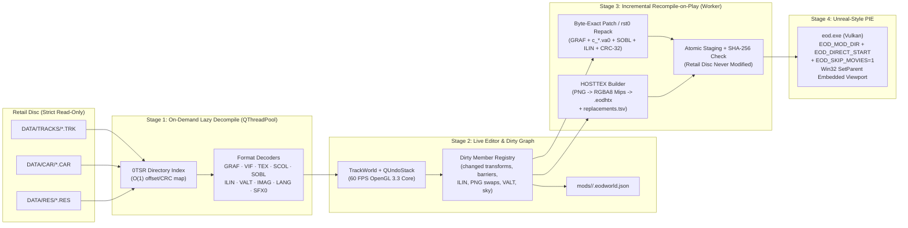

# EOD World Editor — Comprehensive Modding, JTBD & Lumion / Twinmotion / Unreal Engine UX Blueprint

> **Product Vision:** Turn **Test Drive: Eve of Destruction** into a first-class, non-destructive creative sandbox where modders, tinkerers, texture artists, and track designers can inspect, reshape, retexture, populate with wrecked/parked cars, re-script races, flatten invisible walls, and **Play In Editor (PIE)** directly inside a responsive 60 FPS Qt 6 + OpenGL 3.3 Core Windows 11 studio — without ever corrupting a single byte of the retail disc.

This blueprint is grounded directly in the reverse-engineered `SLUS_209.10` formats and tooling across this repository (`docs/FORMAT_COVERAGE.md`, `docs/WORLD_FORMAT.md`, `docs/SKY_EXPORT.md`, `docs/ILIN_RACING_LINES.md`, `docs/HOST_TEXTURE_REPLACEMENT.md`, `docs/CREATION_KIT_TEXTURE_CONTRACTS.md`, `docs/VEHICLE_OBJ_PIPELINE.md`, `docs/VALT_TABLES.md`, `docs/COLLISION_AND_BOUNDARIES.md`, `docs/MODDER_JOURNEYS.md`, `docs/MOD_PROFILES.md`, `tools/world_graf.py`, `tools/world_export.py`, `tools/world_collision.py`, `tools/trk.py`, `tools/sky_export.py`, `tools/texture_edit.py`, `tools/texture_identity.py`, `tools/vehicle_export.py`, and `src/session_start.h`).

---

## 1. Guiding Principles & Personas (Cross-Referenced with `docs/MODDER_JOURNEYS.md`)

Borrowing proven lessons from **Lumion**, **Twinmotion**, **Unreal Engine 4/5**, **FlatOut 2**, **GTA San Andreas**, **Halo Sapien/Guerilla**, and **Mod Organizer 2**:

1. **Zero-Guesswork, Edit-Run-Look in Seconds:** The value of a world editor is the *edit → compile → drive → see it* loop time. Unreal-style **Play In Editor (PIE)** collapses that loop to one click inside the viewport.
2. **Retail Disc Is Sacred (Read-Only):** `D:\Test Drive - Eve of Destruction (USA)\DATA\` is **never** written to. Every edit lives in `mods\<ProjectName>\` (project overlay JSON + patched archive copies + `HOSTTEX/` replacements + `PROFILE.TXT`) loaded by `eod.exe` via `EOD_MOD_DIR`.
3. **Byte-Exact Unchanged Round-Trips Earn Trust:** Before any native binary type is marked editable, a zero-edit recompile must match retail byte-for-byte, with directory CRC-32 (`rst0.eod_crc`) verified on every untouched member.
4. **Honest Scope & Diagnostics:** Never silently swallow unsupported edits or misbound textures. Surface exact reasons (e.g., `HOSTTEX` hit/miss logs, `SOBL` shrink-only quadtree limits, `ILIN` node count locks).
5. **60 FPS Non-Blocking UI Always:** Heavy I/O, `.TRK`/`.CAR` decoding, thumbnail rasterization, and PIE mod compilation run on background `QThreadPool` workers — the Qt 6 UI and OpenGL 3.3 Core viewport never freeze.

| Persona (from `MODDER_JOURNEYS.md`) | Core Need | Key Editor Workflow |
|---|---|---|
| **Tinkerer** | One visible in-game change in < 5 minutes | Swap sky, flatten barn wall, scatter wrecked buses, click **Play Free Roam (PIE)** |
| **Texture Artist** | Replace/upscale world, sky & car art up to 4K | Click surface → Texture Inspector → **Replace PNG…** → auto `.eodhtx` + `HOSTTEX/replacements.tsv` |
| **Track / Prop Tweaker** | Move/remove props, open barriers, tune AI lines | Ghost placement, Replace With…, SOBL barrier flatten, ILIN spline drag |
| **Vehicle / Event Modder** | Tune handling (`physics.val`), author custom races | Custom Race & AI dialog, `VALT` inspector, car/wreck library |
| **Distributor** | Clean, conflict-checked, rollback-safe mod packs | `eodmod.json` / `mods/<Project>/` with SHA-256 manifests & `PROFILE.TXT` |

---

## 2. Complete EOD Moddable Asset Matrix (All 72 Archives · 7,329 Members · 24 Types + External Files)

Every retail asset on the EOD disc (unencrypted 0TSR v6 archives + external media) mapped to its exact native format, decoder/encoder tool, `SLUS_209.10` loader, current read/write status, and `EOD_MOD_DIR` load path in `eod.exe`:

| # | Asset Domain | Native Format / FourCC / Dir Ver | Disc Path & Retail Count | Primary Tools in `tools/` | `SLUS_209.10` Loader Evidence | Read / Write Status | What `eod.exe` Loads from `mods/<Project>/` (`EOD_MOD_DIR`) |
|---|---|---|---|---|---|---|---|
| 1 | **World Scene Graph & Scenery** | `GRAF` v18 (`track.grf`), display tree (`0x0` LOD, `0x101`/`0x103` cond, `0x102` cull sphere, `0x4` leaf), 2 `mlist` draw lists, embedded `mrModel` + `4SPS` VIF | `DATA/TRACKS/*.TRK#track.grf` (15 tracks; 1,523–3,858 leaves/track) | `world_graf.py`, `world_export.py`, `vif_mesh.py`, `vif_patch.py` | `f_00214678` (GRAF), `f_00214258`/`f_00214468` (display list), `f_003582B8` (mlist), `f_0034B530` (mrModel) | **Read:** Full. **Write:** Static/OptTerrain translate (`q199` + bbox + mlist spheres + cull spheres), hide/delete (`Y=-5000`), spawned Dyno 4×3 rigid matrix, same-topology vertex patch (`vif_patch.py`). | `DATA/TRACKS/<TRACK>.TRK` (patched `track.grf` + CRC-32) |
| 2 | **Optional Terrain (Ramps & Crossings)** | `GRAF` display object subtype `20` (`Optional Terrain`) + `SCOL` triangle flag bits (`+0x1E`) | Embedded in `track.grf` (9–169 per track) + `track.bsc` | `world_graf.py`, `world_export.py`, `world_collision.py` | `f_002230F8`/`f_00223008` (mask `1<<(mode-1)` vs `0x495BE0+0x3C`), `f_00227830` (SCOL bits) | **Read:** Full. **Write:** Visual translate in `track.grf`; `opt_terrain` mask in `COMMON.RES#<track>_eves.val`. Collision triangles stay separate unless SCOL edited. | `DATA/TRACKS/<TRACK>.TRK` + `DATA/RES/COMMON.RES` |
| 3 | **Event Props & Smashables / Breakers** | `VALT` (`c_<event>.va0`) `$NNNN$object` (`dyno` + 64-char `unfloat_frame64`) + `obstacle.val` (`dx/dy/dz`, `model`, `type`, `@local_frame`) | `DATA/TRACKS/*.TRK#c_*.va0` (342 files) + `RACE.RES#obstacle.val` | `world_export.py` (`event_props`, `encode_frame64`), `valt.py`, `modding_backend.py` | `f_00134A70` (VALT), `f_00133A50` (`frame64`), `f_001C0878` (`SolBuilder`), `f_00225808` (Dyno kinds 0..7) | **Read:** Full. **Write:** Full 4×3 rigid move/rotate/hide in `c_<event>.va0` (byte-exact 64-byte frame rewrite + CRC); VALT field edits in `obstacle.val`. | `DATA/TRACKS/<TRACK>.TRK` (`c_<event>.va0`) + `DATA/RES/RACE.RES` |
| 4 | **Standalone & Prop 3D Models** | `MODL` v9 (`*.mod`), `mrModel` + `4SPS` VIF strips (MSCAL `0x4E`, `0x55`, `0x6A`) | `DATA/TRACKS/*.TRK` (`a_stfn.mod`, `b_stfn.mod`, `blades.mod`), `RACE.RES`, `HOMEBASE.TRK` (490 total) | `vif_mesh.py`, `vif_patch.py`, `modl.py` | `f_0034B720` (standalone MODL), `f_0034B530` | **Read:** Full 3D mesh + textures. **Write:** Same-topology vertex/UV/normal patch (`vif_patch.py`) + texture swap. Arbitrary new topology not yet supported. | `DATA/TRACKS/<TRACK>.TRK` / `DATA/RES/*.RES` |
| 5 | **Playable Cars & Wrecked / Dead AI Car Props** | 0TSR v6 `.CAR` archives (`Low1..4.mod`, `shadow1..3.mod`, `physics.val`, `lod.val`, `bone.val`, embedded `.tex`) + `CT.RES` liveries + `RACE.RES` wheels | `DATA/CAR/*.CAR` (**37 retail vehicles**: 31 drivable chassis + 5 trailers + Bus; 395 models, 288,917 tris) | `vehicle_export.py`, `vehicle_import.py`, `create_custom_car.py`, `vehicle_materials.py`, `world_editor/world_loader.py` | `f_0034B720` (MODL), vehicle table `0x003CBEE4`, damage groups (`group & 0xFFFF`), paint bit (`group & 0x10000`) | **Read:** All 37 `.CAR` meshes + textures decode (0 failures). **Write:** Same-topology mesh patch, livery texture swap (native + 4K host), new cloned chassis (`create_custom_car.py`), editor scene car/wreck placement & Replace With…. | `DATA/CAR/<CAR>.CAR`, `DATA/RES/CT.RES`, `DATA/RES/COMMON.RES`, `HOSTTEX/` |
| 6 | **Spawns, Start Grids & Event Triggers** | `ILIN` node 0..N centerline origin, `a_stfn.mod`/`b_stfn.mod`, `GRAF` subtype `19` (`NamedPoint`), `c_<event>.va0` `bound`/`ringout`/`safe_bound`/`play_area`/`home_endzone`/`away_endzone`, `camera*.val` | Per-track `*.ild`, `track.grf`, `c_<event>.va0`, `camera*.val`, `COMMON.RES#<track>_eves.val` | `world_collision.py` (`event_polygons`), `formats/ilin.py`, `valt.py` | `f_00137A68` (AI line), `0x004026A8` (`arenabnd`), `f_00221C00` (`NamedPoint`), `src/session_start.cpp` (`EOD_DIRECT_START`) | **Read:** Start grid derived from ILIN + NamedPoints + event polygons. **Write:** Movable/rotatable editor markers + `c_<event>.va0` polygon VALT edits + `EOD_DIRECT_START` PIE routing. | `DATA/TRACKS/<TRACK>.TRK`, `DATA/RES/COMMON.RES`, `custom_race.json` |
| 7 | **AI Racing & Pathfinding Lines** | `ILIN` (`*.ild` AI centerline + `*.ili` ghost run), 48B header + ptr table + 60B nodes (`X,Z, dirX,dirZ, idx, next, segLen, dist, flags, sidePtr`) | `DATA/TRACKS/*.TRK` (125) + `GHOSTCAR.RES` (86) = **211** members (21 empty `.ili` placeholders) | `formats/ilin.py`, `trk.py` (`decompile_ild`/`compile_ild`) | `f_00137A68` (AI centerline), `f_0013D9A8` (`fig8`/`oval`/`track`/`bw_*`), `f_002EC2BC` (wear/smoke), `f_001174D0` (ghost) | **Read:** All 190 non-empty decode. **Write:** Node `X,Z` edit + CRC (`ilin.encode`); tangent/length recalculation planned for Phase 2; full add/remove requires pointer-table rebuild (`trk.compile_ild`). | `DATA/TRACKS/<TRACK>.TRK` (patched `*.ild` + CRC-32) |
| 8 | **Static Collision & Invisible Walls** | `SOBL` v3 (`track.sol`), 0x14 header + `0x108`-byte records (`BOX `, `TUBE`, `rows`, `centre`, `surface_type`, `rx/ry/rz`, `sphere_radius`, `box_flags`) + u16 index + 8B quadtree | `DATA/TRACKS/*.TRK#track.sol` (15 tracks; 709–1,457 boxes/track; typical wall `ry=15m` → 16m invisible ceiling) | `world_collision.py` (`parse_sobl`, `plan_box_edit`, `apply_box_edits`) | `f_001A00B8` (loader → `0x004473FC`), `f_00177CA0` (2D XZ quadtree broadphase; ignores Y!) | **Read:** 15/15 exact. **Write:** Shrink-only `ry` / `top-above-ground` (including flatten/remove below ground!) + `centre` + `sphere_radius` + CRC-32. Growing or adding boxes requires quadtree rebuild (Phase 2). | `DATA/TRACKS/<TRACK>.TRK` (patched `track.sol` + CRC-32) |
| 9 | **Drivable Terrain Collision** | `SCOL` v4 (`track.bsc`), 12B header + Table1 (32B: 3 edge planes `i16 nx,nz, f32 d`, 3 neighbors, `u16 opt_bits`) + Table2 (20B: plane `a,b,c,d`, `i16 surface`, 2 aux bytes) | `DATA/TRACKS/*.TRK#track.bsc` (15 tracks; 4,622–11,434 tris/track) | `world_collision.py` (`parse_scol`, `Terrain.ground`) | `f_00226768` (loader → `0x003D2098`), `f_00226F40` (lookup), `f_00227AE0` (height), `f_00227878` (surface) | **Read:** 15/15 exact + surface normal extraction. **Write:** Read-only in Phase 1; plane height/surface/flag patching in Phase 2. | `DATA/TRACKS/<TRACK>.TRK` (`track.bsc`) |
| 10 | **Spatial Partition Trees** | `BSPT` (`track.bsp`, 108B 1-tri tree) & `BPPT` (`track.bpp`, serialized Win32 heap pointers) | `DATA/TRACKS/*.TRK` (15 each) | `world_collision.py` | `f_00216D98` (BSPT), `f_00216F60` (BPPT — unused by retail) | **Read:** Inspected. **Write:** Preserved byte-for-byte. | Preserved inside `<TRACK>.TRK` |
| 11 | **Skybox, Fog & Lighting** | `GRAF` subtype `4` (`Sky`: embedded MODL with 16×2 tiles `sky01A..16B.tex` + 32 cull cones), subtypes `9` (`Sun`), `15` (`Ambient`), `16` (`Shadow`), `17` (`SunBright`), `18` (`FogColor`), plus `shadow.val` | 14 tracks with skies (`EMPTYT_1` has none); 32 sky textures/track (`128×128` A, `64×64` B) | `sky_export.py` (`export`, `reimport`, `registry`), `texture_edit.py`, `texture_identity.py` | `f_00221E00`/`f_00223858` (camera-locked sky + cone cull), `0x0032AC00` (`trkshad` for `shadow.val`) | **Read:** 13/14 topology verified (`WELCH` mirrored lower hemisphere). **Write:** Sky tiles verified native same-size + 4K (`k=32`) `HOSTTEX` swap + cross-track sky borrow; `shadow.val` VALT editable; GRAF light/fog node payloads TBD. | `HOSTTEX/replacements.tsv` + `.eodhtx` (live Vulkan), `DATA/TRACKS/<TRACK>.TRK` (`sky*.tex`, `shadow.val`) |
| 12 | **Textures & Materials** | `TEX` (`.tex` 3,309, `.tm0` 1,547, `.art` 67): PS2 PSMT4/PSMT8 swizzled indexed + RGBA CLUT, or direct color | Across all 72 archives (**4,923** total; 100% decode) | `tex.py`, `texture_preview.py`, `texture_edit.py`, `texture_identity.py`, `mod_install.py` | Vulkan `gs_vulkan.cpp` `vram_texture()` + `runtime/gs/texture_replacements.cpp` (`F_TEX_HOST = 0x8000`) | **Read:** 4,923/4,923 decode. **Write:** Native same-size indexed recompile (`texture_edit.import_png`) **AND** unlimited-palette 1×–32× (up to 4096px) Vulkan `.eodhtx` + `HOSTTEX/replacements.tsv` keyed by FNV-1a 64 `indexKey`/`paletteKey`. | `HOSTTEX/replacements.tsv` + `HOSTTEX/*.eodhtx` (primary HD path) and/or patched native `.tex`/`.tm0` in archives |
| 13 | **Event Scripts, Career & Physics Tables** | `VALT` (`.val`, `.va0`, `.mvl`, `.bvl`, `.pln`) — nested key/value tables with `$NNNN$` child inheritance | **755** files across 25 families (`physics.val`, `track.val`, `shadow.val`, `obstacle.val`, `*_eves.val`, `catalog.val`, `camera*.val`, `c_*.va0`) | `valt.py`, `formats/valt_schema.py`, `valt_schema_build.py`, `modding_backend.py` | `0x00134A70` (open), `0x00134EA0` (section), `0x00135C80` (case-insensitive key + parent lookup) | **Read:** 755/755 decoded with 2,851 documented key patterns (1,443 traced). **Write:** Full edit (except v6) with validation & CRC. | `DATA/CAR/*.CAR`, `DATA/TRACKS/*.TRK`, `DATA/RES/COMMON.RES`, `RACE.RES`, `PART.RES` |
| 14 | **Car Setup Sheets (Legacy)** | `SETU` (`.gar`), 196 B (49 floats) | **64** files across `.TRK` archives | `formats/setu.py` | **None** — verified unused by `SLUS_209.10` (driving uses `physics.val`) | **Read/Write:** 64/64 round-trip, clearly flagged **"Unused by runtime — edit `physics.val` instead"**. | None (no in-game effect) |
| 15 | **Localization & Game Text** | `LANG` (`.lng`), 877 `Group:Name` entries | `DATA/RES/LOCALE.RES#usenglish_lang.lng` (2 total) | `formats/lang.py` | `0x001342A8` (loader), `0x00134620` (lookup) | **Read/Write:** Full (including longer strings; `%d` + Latin-1 enforced). | `DATA/RES/LOCALE.RES` |
| 16 | **UI Images & Menu Layouts** | `IMAG` (`.img`, 264 files, 1–20 frames 8-bit RGBA), `LAYT` (`.lyt`, 200 files, 640×480 widgets), `GTEX` (62), `CANV` (35), `STMP` (4), `ICON` (1) | `DATA/RES/UIACTION.RES`, `UICAR.RES`, `OVERLAYS.RES`, `GENESIS.RES`, `PAINTKIT.RES`, `HOMEBASE.TRK` | `formats/imag.py`, `formats/layt.py` | `0x00349078` (IMAG), `0x00270F10` (LAYT) | **Read/Write:** `IMAG` (264/264 PNG replace), `LAYT` (200/200 widget move/size/text). `GTEX`/`CANV`/`STMP`/`ICON`: generic blocks → Phase 3 decoders. | `DATA/RES/*.RES`, `DATA/TRACKS/HOMEBASE.TRK` |
| 17 | **Lookup String Tables** | `STAB` (`.tab` 74, `.obt` 15) | `COMMON.RES`, per-track `track.obt` (**89** total) | `modding_backend.py` | `f_00132E98` ("Wrong string table version") | **Read:** Generic blocks. **Write:** Phase 3 table editor. | `DATA/RES/COMMON.RES`, `<TRACK>.TRK` |
| 18 | **Audio, Engine & Speech** | `SFX0` (`.sfx`/`.sf_`, 112 PS2 ADPCM), `ESFX` (`.ens`, 6 engine defs), `SPEECH.BNK` (81 MB), `XDSP` (1) | `DATA/RES/OVERLAYS.RES`, `PART.RES`, `*.TRK`, `DATA/SPEECH.BNK` | `audio.py` (ADPCM↔WAV), `nascar_engine_audio.py` | `f_0033ACB8` (SFX0), SPU2 HLE (`runtime/spu2/`) | **Read/Write:** `SFX0` WAV round-trip via `audio.py`; `ESFX`/`SPEECH.BNK` Phase 3 audio browser. | `DATA/RES/*.RES`, `DATA/SPEECH.BNK`, `mods/music/` |
| 19 | **Animations, Options & Video** | `Anim` (`.anm`, 18), `Anm0` (`.an0`, 15), `BOPT` (`.opt`, 2), `.PSS`/`.M2V` movies (40) | `RACE.RES`, `HOMEBASE.TRK`, `GENESIS.RES`, `DATA/VIDEO/` | `audio.py` (PSS audio), `hle_movie.cpp` (`EOD_SKIP_MOVIES=1`) | `hle_movie.cpp` | **Read:** Census/blocks; movies skipped in PIE via `EOD_SKIP_MOVIES=1`. **Write:** Phase 4. | `DATA/VIDEO/` |

---

## 3. Jobs-To-Be-Done (JTBD) Specification — Every Asset Class

Each job below defines the **User Desire**, **Editor + In-Game Expectation**, **UI & Interaction State Machine**, and **On-Demand Decompile → Edit → Incremental Recompile Contract**.

### JTBD-01 — World Geometry & Scenery Placement (`.TRK` / `GRAF` v18)
- **User Job:** *"When I want to move, rotate, delete, or add ramps, trees, buildings, and barriers on a retail track, so I can build a custom arena or stunt course and drive it immediately."*
- **What the User Expects:**
  - Instant 3D picking with bright translucent green highlight and crisp R/G/B Move/Rotate/Scale gizmos.
  - Lumion/Twinmotion-style **Ghost Preview** snapped to `SCOL` terrain height + surface normal before clicking to stamp, plus a **Scatter / Paint Brush** to populate forests, tire piles, or junkyard wrecks smoothly.
  - Clicking **Write to Mod (`Ctrl+Shift+S`)** or **Play In Editor (PIE)** reflects moved/deleted retail objects directly inside `eod.exe`, with retail `.TRK` SHA-256 provably untouched and `Ctrl+Z` rollback at any time.
- **State Machine:**
  ```mermaid
  stateDiagram-v2
      [*] --> Idle
      Idle --> ObjectSelected : LMB pick object
      Idle --> GhostPlaceMode : Select model + Place Mode
      Idle --> ScatterBrushMode : Click Scatter tool
      ObjectSelected --> GizmoDragging : Drag R/G/B axis or ring
      GizmoDragging --> ObjectSelected : Release -> push QUndoCommand (dirty)
      GhostPlaceMode --> GhostPlaceMode : Hover SCOL normal / R rotate 15deg / LMB stamp (dirty)
      GhostPlaceMode --> Idle : Esc
      ScatterBrushMode --> ScatterBrushMode : LMB drag paint -> ScatterPlaceCommand (dirty)
      ScatterBrushMode --> Idle : Esc
      ObjectSelected --> CompilingMod : Ctrl+Shift+S or Play PIE
      CompilingMod --> PieRunning : Build OK -> launch eod.exe
      CompilingMod --> ErrorRollback : Build error -> keep previous mod intact
      PieRunning --> Idle : Stop PIE (Esc)
  ```
- **On-Demand Contract:** Retail `track.grf` is parsed in memory on track load (never unpacked to disk unless edited). Dirty retail static/optional-terrain translations patch `q199` + model bbox + mlist spheres + cull spheres; deleted retail objects translate to `Y=-5000`; spawned Dyno matrices rewrite `+0x38`; event props rewrite 64-byte `unfloat_frame64` in `c_<event>.va0`; only modified members' CRC-32s update.

### JTBD-02 — Cars & Wrecked / Dead AI Car Props (`DATA/CAR/*.CAR`)
- **User Job:** *"When I want to park dead/wrecked cars on the infield, stack school buses as jumps, or swap any tree/prop into a rusted sedan or trailer, so I can dress the track with authentic EOD vehicles."*
- **What the User Expects:**
  - All 37 retail `.CAR` vehicles appear automatically in a dedicated **Cars & Wrecks** category in Explorer with shaded 3D studio thumbnails (loaded asynchronously on a worker thread so startup never stalls).
  - Drag-drop, Ghost Place, Scatter Brush, or Twinmotion/UE **"Replace Selection With…"** swaps any existing scenery prop into any car/trailer (preserving position/rotation, undoable!).
- **State Machine:** `CatalogIdle → WorkerScanning37Cars → CatalogReady → (GhostPlace | ScatterBrush | ReplaceWithDialog → ReplaceObjectModelCommand → DirtyOverlay)`.
- **On-Demand Contract:** Lazy decode of `Low3.mod`/`Low1.mod` + default livery via `modding_backend.vehicle_paint` cached per `game_dir`. Placed/swapped car props serialize into `.eodworld.json` and `mod_layer_manifest.json` (and Phase 2 GRAF/event-prop model injection).

### JTBD-03 — Invisible Wall & Barrier Removal (`SOBL` `track.sol` / `SCOL` `track.bsc`)
- **User Job:** *"When I want to lower or completely remove the 16-metre invisible walls around a barn, fence, or outer oval, so I can jump off-course or drive anywhere in Free Roam."*
- **What the User Expects:**
  - Toggling the Shield / Collision overlay shows `SCOL` terrain mesh in teal and `SOBL` walls color-coded by height above ground (**Red ≥ 10 m invisible ceilings**, **Orange 3–10 m**, **Yellow < 3 m**).
  - Clicking any barrier lets them dial **"Target Top Above Ground (m)"** or click **"Flatten Barrier (-0.5 m)"**, AND one-click **`Collision → Remove / Flatten Track Barriers`** lowers every vertical invisible wall on the track below ground in one undoable command — written straight into `mods/<Project>/DATA/TRACKS/<TRACK>.TRK#track.sol`!
- **State Machine:** `CollisionHidden → CollisionVisible → BarrierSelected → HeightEdited (Dirty) → RecompileTrackSol (world_collision.apply_box_edits) → VerifyCrc`.
- **On-Demand Contract:** Retail `track.sol` records stay untouched until edited; `world_collision.apply_box_edits()` patches only `centre` (12 B), `ry` (4 B), `sphere_radius` (4 B), and `track.sol` CRC-32, refusing tilted/growing boxes so the quadtree stays 100% valid.

### JTBD-04 — Skybox, Lighting & Fog Environment (`Sky` subtype 4 / `shadow.val` / `HOSTTEX`)
- **User Job:** *"When I want to turn Anoka into Sunset, Anoka Night, Overcast Storm, or borrow Dundas's skybox, so I can change the mood of a track visually and see it in-game."*
- **What the User Expects:**
  - Live **Environment / Skybox** drawer in Properties (`World → Environment / Skybox`) with instant OpenGL 3.3 Core preview for presets, Sun Azimuth/Elevation, Ambient Brightness, Fog Color/Distance/Density, AND **"Borrow Sky From Track…"** dropdown.
  - Borrowing another retail track's sky automatically extracts its `sky01A..16B.tex` tiles and emits Vulkan `.eodhtx` + `HOSTTEX/replacements.tsv` keyed to the current track's sky `indexKey`s so `eod.exe` renders the swapped sky immediately!
- **State Machine:** `EnvDefault → LiveUniformPreview (60 FPS) → PresetOrBorrowedSkySelected (Dirty) → ExportHostSkyTiles (.eodhtx) → PieVerify`.
- **On-Demand Contract:** Viewport uniforms update zero-copy; on export/PIE, only when `borrowed_sky_track` or custom sky tiles exist are the 32 sky textures decoded, mipmapped, and emitted to `HOSTTEX/`.

### JTBD-05 — Click-Surface Texture Inspector & 4K Host Texture Replacement (`TEX` / `.eodhtx`)
- **User Job:** *"When I want to click any road, billboard, ramp, or barn and drop in a custom or 4K PNG texture, so I can reskin the track with zero hex editing or palette headaches."*
- **What the User Expects:**
  - Selecting any object displays its decoded EOD textures as clickable thumbnails in Properties, showing resolution and `[Replaced]` badge.
  - Clicking **"Replace PNG…"** updates the OpenGL viewport texture on the very next frame (undoable via `Ctrl+Z`).
  - Writing the mod automatically computes the retail texture's `indexKey` / `paletteKey` (`tools/texture_identity.py`), scales/validates the PNG to power-of-two `orig * k` (up to 4096px), generates the full 2×2 box-filtered RGBA8 mipmap chain (`.eodhtx`), and appends `HOSTTEX/replacements.tsv` so `eod.exe` binds it live under Vulkan!
- **State Machine:** `ObjectSelected → TextureListDisplayed → PickPng → ReplaceTextureCommand (LiveGLUpload + Dirty) → EmitEodhtxAndTsv → PieBound`.
- **On-Demand Contract:** Retail `TEX` bytes stay untouched; `indexKey` computed lazily on replace/export; `.eodhtx` validated with `check_eodhtx` before atomic move.

### JTBD-06 — Custom Races, Spawns, Start Grids & AI Pathfinding (`ILIN` / `VALT` / `EOD_DIRECT_START`)
- **User Job:** *"When I want to reshape the AI racing line, move the Start Grid or event triggers, configure a custom race (event type, laps, AI count, vehicle, AI speed), and immediately playtest it."*
- **What the User Expects:**
  - Interactive **ILIN Road Tool** (Green = join, Cyan = split, White = new node) with live spline ribbons and undoable node dragging; edited retail node X/Z positions patch straight into `*.ild` with CRC-32 update.
  - Visible, 3D-gizmo-movable **Start Grid**, **Spawn**, **Car**, **Chicken**, and **Trigger** markers with heading arrows.
  - **Custom Race & AI Pathfinding Dialog** (`Races → Custom Race & AI Editor…`) selecting event type, track, laps, AI opponents, player vehicle (from all 37 retail cars), AI speed scale, and active `.ild` line — feeding straight into **`Play Event / Race` (PIE)**!
- **State Machine:** `RoadOrMarkerIdle → EditIlinOrMarker (Dirty) → OpenCustomRaceDialog → SaveAndCompileMod → LaunchPieWithDirectStart`.
- **On-Demand Contract:** Only dirty `.ild` members re-encode via `formats/ilin.encode()`; `custom_race.json` persists alongside `.eodworld.json`; PIE translates settings directly into `EOD_DIRECT_START="mode=action;track=...;event=...;car=...;ai=...;humans=1"`.

### JTBD-07 — Physics, Handling & Career Tables (`physics.val`, `VALT`, `SETU`)
- **User Job:** *"When I want to tune a car's mass, grip, torque curve, or damage multiplier — or inspect event rules (`track.val`, `*_eves.val`) — without guessing raw key names."*
- **What the User Expects:** Plain-English labels, units, retail min/max ranges, and explicit "Not used by runtime" warnings (e.g., on `SETU` `.gar` files and 80 unused `physics.val` keys per `docs/VALT_TABLES.md`), with dry-run diff preview before patching `DATA/CAR/<CAR>.CAR#physics.val`.
- **On-Demand Contract:** Lazy `valt_schema.py` decode on open; single-member recompile + CRC-32 patch into `mods/<Project>/DATA/CAR/<CAR>.CAR` (Phase 2 Inspector Dock).

### JTBD-08 — UI Layouts, Game Text, Audio & Movies (`LANG`, `IMAG`, `LAYT`, `SFX0`, `ESFX`, `SPEECH.BNK`, `.PSS`)
- **User Job:** *"When I want to rename a custom track/event in menus, swap a menu icon, replace an engine/crash sound with a WAV, or skip attract movies while iterating."*
- **What the User Expects:** Dedicated format tabs (Phase 3) for `LANG` string editing, `IMAG` PNG frame replacement, `LAYT` 640×480 visual canvas drag, `SFX0` WAV import/export (`tools/audio.py`), and automatic `EOD_SKIP_MOVIES=1` during PIE.
- **On-Demand Contract:** Each member decompiles only when opened in its inspector, saves to `mods/<Project>/work/<archive>/<member>.*`, and repacks into `mods/<Project>/DATA/RES/*.RES` only when dirty.

---

## 4. "Every Asset Decompiled & Recompilable On Demand" Architecture

Instead of forcing modders to unpack gigabytes of retail archives upfront, the World Editor uses a **4-Stage Lazy On-Demand Pipeline** with deterministic, incremental compilation:



### Key Architectural Guarantees
1. **Zero-Cost Untouched Assets:** Opening `AFTON.TRK` reads only the 0TSR directory + `track.grf` + `track.bsc` + `track.sol` + `*.ild` + referenced textures into RAM. All 14 other tracks, untouched `RES` archives, and `SPEECH.BNK` incur zero disk writes.
2. **Incremental Dirty-Only Compilation:** On `Ctrl+Shift+S` or **Play (PIE)**, the compiler inspects the dirty set:
   - Same-size edits (`track.grf` translations/Dynos, `c_*.va0` frames, `track.sol` barrier heights, `*.ild` node X/Z, same-size `TEX`) patch **in-place** in a temporary copy outside `DATA/`, recompute only the edited member's `eod_crc`, verify every untouched member byte-for-byte, then atomically replace `mods/<Project>/DATA/TRACKS/<TRACK>.TRK`.
   - Variable-size edits (`LANG` longer strings, `VALT` new keys, `ILIN` rebuilt node arrays) repack deterministically via `tools/rst0.pack_archive`.
   - HD/arbitrary-palette texture edits emit `HOSTTEX/<project>/<idx>-<indexKey>.eodhtx` + `HOSTTEX/replacements.tsv` without touching native `TEX` bytes (zero palette banding, instant Vulkan hot-load).
3. **Clean Rollback & Retail Proof:** `mod_layer_manifest.json` records `retail_trk_sha256` and `mod_trk_sha256`. Disabling a mod or running without `EOD_MOD_DIR` returns instantly to 100% retail bytes.

---

## 5. Lumion / Twinmotion / Unreal Engine UX & UI Reference Spec (Qt 6 + OpenGL 3.3 Core)

### 5.1 Workspace Layout (3-Pane Studio + Embedded PIE)
- **Top Menu Bar (14 Menus) + Right-Aligned `World: <Project>` Badge.**
- **Commercial Toolbar:**
  - Project: `New` · `Open` · `Save` · `Write Mod`
  - **Unreal PIE Group:** **`▶ Play Free Roam`** · **`🏁 Play Event / Race`** · **`■ Stop (Esc)`** · **`⚙ Custom Race`**
  - Placement & Sculpting: `Move (G)` · `Rotate (R)` · `Scale` · **`Place (Ghost)`** · **`Scatter`** · `Road (ILIN)`
  - Snapping & Atmosphere: **`Grid Snap`** · **`Angle Snap`** · **`Env / Sky`** · `Marker` · `Car`
- **Left Sidebar (`ExplorerPanel`):**
  - Track selector dropdown (all 15 retail `.TRK`)
  - Tabs: `Tree` (live hierarchy), `Models` (2-column 3D studio thumbnail grid), `Mlists` (GRAF/collision stats), `Layers` (9 visibility toggles with live counts)
  - Dedicated **`Cars & Wrecks (37)`** filter category + quick pill button, plus `Place Mode`, `Scatter`, and `Replace Selected` actions.
- **Center Stacked Viewport (`QStackedWidget`):**
  - **Page 0 (`ViewportGL`):** 60 FPS OpenGL 3.3 Core viewport with floating `Object Mode / Edit Mode / Shield` pill bar, `Road Tool HUD`, and **`Scatter Brush HUD`**.
  - **Page 1 (`PieHostWidget`):** Embedded live `eod.exe` Vulkan game window with sleek top PIE bar (`● PIE RUNNING`, `Stop PIE (Esc)`, `Restart`, `Pop Out Window`).
- **Right Context-Sensitive Inspector (`PropertiesPanel` — 6 Pages):**
  - Page 0: Nothing selected (with quick **Environment / Skybox** shortcut)
  - Page 1: **Object Inspector** (Metadata, R/G/B Transform, **`Replace With…`**, **Texture / Material Inspector** with clickable thumbnails & live **`Replace PNG…`**, Snap/Delete/Blender/Collision dock)
  - Page 2: **Road Node (`ILIN`) Inspector** (Kind, Line, Lanes/Width, Auto Direction, Position, Pull Out / Split / Lanes dock)
  - Page 3: **Marker / Spawn / Start Grid Inspector** (Editable Name, Kind dropdown `Spawn`/`Start Grid`/`Car`/`Chicken`/`Trigger`/`Breaker`/`Marker`, Position, Heading — also draggable with 3D gizmos!)
  - Page 4: **Environment / Skybox Drawer** (Presets, Borrow Sky From Track, Sun Azimuth/Elevation, Ambient, Fog Color/Start/End/Density)
  - Page 5: **SOBL Barrier Inspector** (Record `#`, Surface, Ground Y, Height Above Ground, Target Height spinbox, **Apply Height**, **Flatten Barrier**, **Flatten All Track Barriers**).

### 5.2 Key Lumion / Twinmotion / UE Interactions
| Interaction | Shortcut / Trigger | Behavior |
|---|---|---|
| **Ghost Placement Preview** | Select model/car in Explorer + **Place** tool | Translucent cyan/green 3D ghost follows cursor snapped to `SCOL` height + surface normal. `LMB` stamps (undoable), `R` rotates +15°, `Shift+R` -15°, `Esc` exits. |
| **Scatter / Paint Brush** | **Scatter** toolbar button + floating HUD | Glowing 3D terrain brush ring (`Radius`, `Density`, `Random Yaw`, `Scale Jitter`, `Align to Normal`). `LMB` click/drag paints non-overlapping props or wrecked cars in one undoable stroke. |
| **Replace Selection With…** | Right-click object or Properties button | Opens searchable 3D thumbnail picker (with `Cars & Wrecks` filter); swaps selected object's model in-place keeping transform (undoable). |
| **Grid & Angle Snap** | Toolbar toggles (`Grid`, `Angle`) | Quantizes gizmo Move to grid step (1.0 m) and Rotate/Ghost Yaw to angle step (15°). |
| **Drop to Ground** | `End` or `Ctrl+G` | Raycasts `SCOL` terrain under object/marker and seats bounding box bottom cleanly on ground. |
| **Click-Surface Texture Swap** | Select object → Properties Texture card → **Replace PNG…** | Immediately uploads new texture to OpenGL 3.3 Core (undoable) and queues `.eodhtx` + `HOSTTEX/replacements.tsv` export. |
| **Remove / Flatten Barriers** | `Collision → Remove / Flatten Track Barriers` or click SOBL box | Lowers vertical `SOBL` walls below ground (`world_collision.apply_box_edits`) with live wireframe update and undo support. |
| **Play In Editor (PIE)** | `F5` / **Play Free Roam** / **Play Event / Race** | Background-compiles `mods/<Project>/`, launches `eod.exe` with `EOD_MOD_DIR` + `EOD_DIRECT_START` + `EOD_SKIP_MOVIES=1`, embeds Vulkan HWND inside central Qt widget via Win32 `SetParent` + `WS_CHILD` + DPI-synced `MoveWindow`. `Stop PIE (Esc)` cleanly terminates `eod.exe` and restores OpenGL viewport. |

---

## 6. Multi-Threading, Performance & Non-Blocking UI Architecture

To guarantee zero UI hangs and rock-solid 60 FPS OpenGL rendering on Windows 11, all work follows strict thread-ownership rules:

### Thread Ownership Boundaries
| Thread / Process | Owns | Strictly Forbidden |
|---|---|---|
| **Qt Main / OpenGL Thread** | All `QWidget` UI, `QUndoStack`, `QOpenGLWidget` context (`glTexImage2D`, VBO/VAO uploads, `paintGL`), Win32 `SetParent`/`MoveWindow` calls, mutating active `TrackWorld` | Heavy disk I/O (`.TRK`/`.CAR` parsing), VIF mesh decoding, PIL thumbnail rasterization, `.eodhtx` mipmap generation, archive repacking |
| **`QThreadPool` Background Workers (`workers.py`)** | `TrackLoadWorker`, `CarCatalogWorker` (37 `.CAR`s), `ThumbnailBatchWorker` (PIL rasterizer returning `QImage`), `ModCompileWorker` (PIE + `Ctrl+Shift+S` export) | Touching `QWidget`, `QPixmap`, or calling any `GL.*` OpenGL function |
| **Child Process (`eod.exe`)** | Independent OS process running Vulkan renderer + PS2 recomp engine with `EOD_MOD_DIR` / `EOD_DIRECT_START` | Direct memory sharing with Python; communicates only via filesystem mod layer, env vars, exit code, and Win32 HWND parenting |

### Concurrency & Cancellation Guarantees
- **Generation Tokens (`CancelToken`):** Rapidly switching tracks or filtering Explorer increments a monotonic token; stale worker completions are silently discarded on the main thread so race conditions cannot overwrite the active world.
- **Image Transfer (`QImage` → `QPixmap`):** Thumbnail workers rasterize into thread-safe `QImage` off-thread and emit `(generation, model_key, QImage)` via queued Qt signal; the main thread converts `QPixmap.fromImage()` in < 0.05 ms.
- **Non-Blocking Progress Bar:** `QStatusBar` hosts a sleek compact `QProgressBar` + `Cancel` button that appears automatically whenever any `QThreadPool` task is active and hides cleanly on completion.

---

## 7. Phased Implementation Roadmap

| Phase | Scope | Status |
|---|---|---|
| **Phase 1 (Live Today)** | Real in-game mod write-back (`Ctrl+Shift+S` with `GRAF`, `c_*.va0`, `SOBL`, `ILIN`, `HOSTTEX/.eodhtx`, `PROFILE.TXT`), 37 retail **Cars & Wrecks** with 3D thumbnails + **Replace With…**, **Ghost Placement** snapped to `SCOL` height+normal, **Scatter Brush HUD**, **Grid/Angle Snap**, **Environment / Skybox** live panel + cross-track sky borrow, **Texture / Material Inspector** + live PNG swap, **Spawns / Start Grid / Event Markers** with 3D gizmos, **SOBL Barrier Height & Flatten All**, **Custom Race & AI (`ILIN`) Dialog**, **UE-style PIE Embedded Vulkan Viewport**, and **`QThreadPool` Background Workers**. | **Implemented & Verified (`test_editor.py`)** |
| **Phase 2 (Next)** | `VALT` schema-driven live inspector dock (`physics.val`, `track.val`, `shadow.val`), `ILIN` tangent/length recalculator & full node add/remove pointer rebuild, `SOBL` quadtree rebuild for adding/growing custom collision walls, multi-object marquee selection & grouping, Blender live-reload bridge (`vif_patch.py`). | Planned |
| **Phase 3** | Full Creation Kit unification: `LANG` string editor, `IMAG`/`LAYT` 640×480 UI editor, `SFX0`/`ESFX` audio WAV studio, `.eodmod` package builder & conflict resolver (`mod_package.py`/`mod_install.py`). | Planned |
| **Phase 4** | Custom track registration & arbitrary new geometry compiler (new `track.grf` + `track.bsc` + `track.sol` synthesis from Blender/glTF scenes). | Research |
