# Architecture Overview — Emotion Engine, VU1, GS, IOP, Memory Map & PS2 Limit Removals

*Test Drive: Eve of Destruction* (Monster Games / Atari, 2004, North American PlayStation 2 release **`SLUS_209.10`**) is statically recompiled from MIPS R5900 Emotion Engine machine code into native C/C++ source code via `tools/recomp.py`, linked with hardware compatibility layers, high-level emulators (HLE), and the native **Plume** renderer into a single standalone executable (`eod.exe` on Windows x64, `eod` on macOS Apple Silicon).

---

## 1. Core Architecture Axioms

1. **Static EE Binary Translation (`tools/analyze.py` → `tools/recomp.py`):**
   - The 3.37 MB retail ELF (`SLUS_209.10`, SHA-256 `4f60053dc141365f5ae50737622f8408be30ced513b4c109427c926461f2e2ae`) is disassembled with `rabbitizer`, partitioned into **3,680 basic blocks and analyzed functions** (`build/functions.json`), and translated into native C source files (`gen/rec_*.c`) indexed through a global dispatch jump table (`gen/table.c`).
   - Verified functions are progressively replaced with human-readable C++ in `src/*.cpp` via `config/hle.txt` (`wrap` / `diff_run`) and proven bit-identical against the recompiled MIPS code by the **`EOD_DIFF`** runtime harness.
2. **Deterministic Linear Memory Model:**
   - **32 MB EE Physical RAM (`g_ram`):** Contiguous linear address space `0x00000000`–`0x02000000` (`EE_RAM_SIZE = 0x02000000u`) with a 64 KB guard page.
   - **16 KB Fast Scratchpad RAM (`0x70000000`–`0x70004000`):** Holds per-frame `mlist` frustum visibility bytes (`0x70000000..0x70001BFF`) and the 256-entry world matrix table (`0x70001C00`).
   - **2 MB IOP RAM (`g_iop_ram`):** Independent I/O Processor address space.
   - **4 MB GS Physical VRAM (`kVramSize = 4 * 1024 * 1024`):** 512 pages of 8 KB each, tracked by generation counters `g_page_gen[512]`.
3. **Hardware Emulation & Native Offload Partition:**
   - **Vector Units (VU0 / VU1):** Macro-mode VU0 runs inline as COP2 instructions (SSE2 on x86-64, mapped to ARM NEON via `runtime/include/sse_compat.h` with `-ffp-contract=off` on Apple Silicon). VU1 microprograms (`config/vu/vu_entries.txt`) are precompiled via `tools/vurecomp.py` into `gen/vu_rec.inc` or bypassed entirely by the **[Native Plume Renderer](Native-Plume-Renderer)**.
   - **Graphics Synthesizer (GS):** Decodes GIF packets across PATH1, PATH2, and PATH3 into the virtual 4 MB VRAM page table for reference replay (`--gs-replay`), while `EOD_NATIVE=1` routes 3D scene submission directly from decompiled EE C++ functions into **Plume** (Vulkan / Metal).
   - **I/O Processor (IOP):** High-level emulation modules replace Sony PS2SDK 2.8 services (`loadfile`, `fio`, `padman`, `mcman`/`mcserv` RPC `0x80000400`, `libsd` 24-voice SPU2 ADPCM mixer) and Monster Games' proprietary optical streaming driver **`stream.irx`** (`MGI_Streamer`, SIF RPC `0x8000021A`).
4. **Decoupled Asset & Overlay System (`0TSR` v6):**
   - All **7,329 internal files** across **72 archives** (`DATA/CAR/*.CAR`, `DATA/RES/*.RES`, `DATA/TRACKS/*.TRK`) are indexed via 68-byte (`0x44`) directory entries, verified by hardware CRC-32 (`0x00135FC8`, polynomial `0x04C11DB7`), and support non-destructive runtime mod overlays via `EOD_MOD_DIR` and Vulkan `HOSTTEX` (`.eodhtx`).

---

## 2. Master System Dependency Graph

```mermaid
flowchart TB
    subgraph BUILD["Build & Code Generation Toolchain"]
        ELF["Retail Disc Media<br/>SLUS_209.10 + DATA/*.TRK/*.CAR/*.RES"]
        ANALYZE["tools/analyze.py<br/>build/functions.json"]
        RECOMP["tools/recomp.py<br/>gen/rec_*.c + gen/table.c"]
        VURECOMP["tools/vurecomp.py<br/>gen/vu_rec.inc"]
        CMAKE["CMake + Ninja (LLVM-MinGW / Clang)<br/>Native Executable: eod.exe / eod"]
        ELF --> ANALYZE --> RECOMP --> VURECOMP --> CMAKE
    end

    subgraph RUNTIME["Core Recompilation Runtime Engine"]
        MEM["32 MB EE RAM (g_ram)<br/>16 KB Scratchpad (0x70000000)<br/>4 MB GS VRAM (g_page_gen[512])"]
        IOP["HLE IOP Kernel (SIF RPC)<br/>stream.irx (0x8000021A)<br/>mcserv (0x80000400)<br/>padman / libsd SPU2"]
        DIFF["EOD_DIFF & Limit Tracker<br/>Live MIPS vs C++ Equivalence<br/>EOD_HEAP_CHECK=1"]
        PLUME["Native Plume Renderer (Vulkan / Metal)<br/>VIF Mesh Decoder (vif_mesh.cpp)<br/>Classic PS2 & Modern PBR Looks"]
    end

    subgraph SUBSYS["9 Reverse-Engineered Game Engine Subsystems"]
        S1["1. Loading & Memory (STAK Heap 0x003CC438)"]
        S2["2. Vehicle Physics, 157-Bone Damage & Debris Pools"]
        S3["3. Explosive Chicken (0x228B Ball, 3 Regimes, 100x100 Grid)"]
        S4["4. Tracks & Collision (GRAF v18, SOBL v3, SCOL v4)"]
        S5["5. AI Spline Navigation (ILIN) & BattleMaster (26 Modes)"]
        S6["6. Career Progression, Valuation & HSCM v3 Saves"]
        S7["7. Modal UI Engine (MenuRun 0x00270C10) & Widescreen HUD"]
        S8["8. Asset Container Engine (0TSR v6 & CRC-32 0x04C11DB7)"]
        S9["9. Texture Streaming (.tm0 Ring & Vulkan HOSTTEX .eodhtx)"]
    end

    CMAKE --> RUNTIME
    RUNTIME --> SUBSYS
```



---

## 3. Physical Memory Architecture & Address Space Layout

```text
+───────────────────────────+ 0x00000000
| Exception Vectors & Kernel|   (0x00000000 - 0x0008FFFF, 576 KB)
| Relocated Contest Tables  |   0x00090000: g_RelocatedContestTable (12-byte event descriptors)
+───────────────────────────+ 0x00100000
| Recompiled Text (.text)   |   (0x00100000 - 0x003BC290, ~2.73 MB)
| - CRT Startup & Main      |   0x00100008: _start()          | 0x00100138: main()
| - Race Loop & Teardown    |   0x00114020: RaceFrameLoop()   | 0x00114358: RunRaceContest()
| - HUD Edge Rendering      |   0x00119888: HudDrawLeftRaceRows() | 0x00119F40: HudDrawRightSpeedRows()
| - STAK Heap Allocator     |   0x0012DDB8: MemAlloc()        | 0x0012DB78: MemFree()
| - Archive & CRC32 Engine  |   0x001323E8: ResLoadAsset()    | 0x00135FC8: Hardware CRC32
| - BattleMaster Lifecycle  |   0x00166C38: BattleCreate()    | 0x00167D58: BattleUpdate()
| - 59.94 Hz Physics Step   |   0x00177718: WorldSimulationStep()
| - Contact & Impulse Bridge|   0x0017B918: CarContactEvaluateObstacleImpulse()
| - Explosive Chicken       |   0x0017DFA8: ChickenWeaponAlloc() | 0x0017E000: ChickenWeaponTrigger()
|                           |   0x0017E718: ChickenWeaponDetonate() | 0x0017DA58: ApplyShockwave()
| - Car Damage & Panels     |   0x0018AFE0: CarSetupDamageAndPanels() | 0x0018CA98: CarApplyCollisionDamage()
|                           |   0x0018CFE8: CarUpdateDetachablePanels()
| - Human & AI Drivers      |   0x0018F2A8: HumanDriverUpdate() | 0x001A2D20: AICarUpdate()
| - Debris Phob Pools       |   0x001B3068: DetachedWheelSpawn() | 0x001E1E88: DetachedPanelSpawn()
| - World & Track Loaders   |   0x001A00B8: TrackLoadSolidCollision (track.sol SOBL v3)
|                           |   0x00214678: TrackLoadVisualScene (track.grf GRAF v18)
|                           |   0x00226768: TrackLoadSurfaceCollision (track.bsc SCOL v4)
|                           |   0x00230CD8: TrackEnvironmentMasterLoad()
| - World & Sky Rendering   |   0x00214B68: WorldFrameRender() | 0x00223858: SkyDraw()
| - Modal UI & Career       |   0x00270C10: MenuRun()         | 0x002A1298: MainMenuUpdate()
| - Glare, Water & Shadows  |   0x00304D50: FlareRender()     | 0x00325728: WaterDraw()
|                           |   0x0034C208: ShadowSubmit()    | 0x0034C7D0: ShadowBegin()
| - Render Queue & Bones    |   0x0034AF98: RenderQueueFlush()| 0x0034BDA8: ModelSubmitVu1Packets()
|                           |   0x0034C9F8: BonePaletteUpload()| 0x003582B8: MlistVisibilityCalc()
|                           |   0x00358BD0: WorldRenderPass()
| - Particles & Sprites     |   0x003639D0: ParticleAdd()     | 0x00363DE8: SpriteAdd()
+───────────────────────────+ 0x003BC290
| Initialized Data (.data)  |   (0x003BC290 - 0x003DC000, ~127 KB)
| - VU0/VU1 Microcode Images|   0x003BD4D0..0x003C3450: Embedded VU0/VU1 binary programs
| - Master Event Registry   |   0x003C3A70: g_MasterEventRegistry (26 event descriptors x 12B)
| - Active Cheat Bitmask    |   0x003C4190: g_CheatMaskActive (0x1 Master, 0x2 Turbo, 0x8 Weapon, 0x20 Vengeance)
| - Viewport & HUD Queues   |   0x003C4310: ViewportBounds | 0x003C4370: LeftHUD | 0x003C4600: RightHUD
| - STAK Heap Root          |   0x003CC438: kPool descriptor
| - Primary Spline Cache    |   0x003CD190: g_PrimaryCourseCache (tag 0x104F128B, 60B ILIN nodes)
| - Monotonic Float Clock   |   0x003CDACC: g_EngineTimeSeconds
| - Weapon Registry Pool    |   0x003CE3F8: g_WeaponRegistry (16 slots x 12B, count at 0x003CE4B8)
| - BattleMaster Pointer    |   0x003CF194: g_BattleMasterPtr (0x5AC bytes)
| - World & Terrain Pointers|   0x003D1C18: g_TrackVisualGraf | 0x003D2098: g_TrackTerrainScol
| - Career Save Root        |   0x003D9384: kCareerSave (0xE7C bytes)
| - Water Surface Pointer   |   0x003DC134: Active track Water surface (Woodly / AFTON.TRK)
+───────────────────────────+ 0x003DC000
| Read-Only Data (.rodata)  |   (0x003DC000 - 0x003F6000, ~104 KB)
| - CRC32 Lookup Table      |   0x003F2598: 256 words (polynomial 0x04C11DB7)
| - Battle & Weapon Vtables |   0x003F7770: BattleMaster | 0x003F9528: ChickenWeapon | 0x003F9538: BallisticPhys
+───────────────────────────+ 0x003F6000
| BSS & Global State        |   (0x003F6000 - 0x00500000, ~1.04 MB)
| - View Count LOD Factors  |   0x004062A8: g_ViewCountLodFactors ({1.0, 1.0, 2.0, 2.0})
| - UI Input Jump Table     |   0x004111B0: D-pad / Cross / Triangle modal handler table
| - Career Rank Gates       |   0x0041EFF8: {79, 49, 0}
| - Solid Collision & Phobs |   0x004473FC: g_TrackSolidSobl | 0x00447404: phob_list (512 entries)
| - Detachable Panel Table  |   0x0044AE68: 8 panel hinge rows x 0x40 bytes
| - Detached Wheel Pool     |   0x00484E68: 16-word guest window (+ ExpandDebris host reserve)
| - Recovery Config Flag    |   0x00485098: g_AutoResetEnabled
| - Participant Pool        |   0x00485230: g_DriverTable (20 slots x 0x78 bytes)
| - 2D Spatial Hash Grid    |   0x0048D2B4: 100x100 grid (8.0m cells, queried by explosions)
| - Rigid Body Master Array |   0x00494D30: Contiguous array of 0xB0-byte bodies
| - Detached Panel Pool     |   0x00494D60: 16-word guest window (+ ExpandDebris host reserve)
| - Draw Distance Far Plane |   0x00495D58: g_DrawDistanceFar (1150.0m, doubled in 2P maximum detail)
| - Modal Return Registers  |   0x004A1AC0: done flag | 0x004A1AC4: exit result ID
| - Hi-Res .tm0 Cache Ring  |   0x004A9830: 400 KB circular mip0 streaming buffer
| - Draw Record Pool        |   0x004C96C4 / 0x004C96C8: Render queue record pool
| - Active Camera & Fog     |   0x004CD2F8: Camera matrix | 0x004D8B80: Fog colour & range state
+───────────────────────────+ 0x00500000
| Dynamic Heap Pool ("STAK")|   (0x00500000 - 0x01E00000, ~25 MB)
| - 0x40-byte 'STAK' headers|   Checked on every alloc/free when EOD_HEAP_CHECK=1
+───────────────────────────+ 0x01E00000
| EE Main Thread Stack      |   (0x01E00000 - 0x02000000, 2 MB descending)
+───────────────────────────+ 0x02000000 (32 MB EE RAM Boundary)
```

---

## 4. The 6-Phase Execution Lifecycle

1. **Phase 1 — Boot (`0x00100138 main`):** Initializes SIF RPC, mounts `DATA/RES/COMMON.RES`, allocates the `"STAK"` heap pool (`0x003CC438`, 64-byte cookie headers), and initializes the 400 KB `mip0` cache (`0x004A9830`). Under JTBD 5 (Instant PC Boot), startup `.PSS` movies and memory-card checks are skipped automatically.
2. **Phase 2 — Front-End Menus (`0x002A1298 MainMenuUpdate` → `0x00270C10 MenuRun`):** Loads `start.lyt`, restores the player's `HSCM` v3 profile (`0x003D9384`), and runs the modal UI state machine until an event is launched (or jumps straight to Phase 3 when `EOD_DIRECT_START` is set).
3. **Phase 3 — Track Staging (`0x00230CD8 TrackEnvironmentMasterLoad`):** Mounts `DATA/TRACKS/<TRACK>.TRK` (merging any active `EOD_MOD_DIR` overlay), parsing `track.grf` (`GRAF` v18 visual scene), `track.sol` (`SOBL` v3 solid barriers), `track.bsc` (`SCOL` v4 terrain triangles), `track.bsp` (`BSPT`), and `*.ild` (`ILIN` AI racing lines).
4. **Phase 4 — Vehicle & Weapon Spawning (`0x0020FD48 SceneCreateCarAndWeapons`):** Iterates up to 20 participant slots (`0x00485230`, `0x78` bytes each), loads `MODL` v9 vehicle meshes, clones shared chassis (`0x0021C130 VisualCarCloneShared`, saving ~1.8 MB EE RAM per duplicate car), allocates `0xB0`-byte rigid bodies (`*(0x00494D30)`), initializes the 8-row detachable panel table (`0x0018AFE0`), and attaches explosive chicken launchers (`0x00227EE8`).
5. **Phase 5 — 59.94 Hz Lockstep Race Loop (`0x00114020 RaceFrameLoop`):**
   - Advances rigid-body physics and wheel raycasts (`0x00177718 WorldSimulationStep`).
   - Steps human input (`0x0018F2A8`) and AI spline/pursuit logic (`0x001A2D20 AICarUpdate`).
   - Evaluates visibility (`0x003582B8 MlistVisibilityCalc`), submits world passes (`0x00358BD0`), poses character bones (`0x0034C9F8`) and 157 car dent bones (`0x0035DD28`), submits shadows (`0x0034C208`), particles (`0x003639D0`), sprites (`0x00363DE8`), and flares (`0x00304D50`), and flushes the draw queue (`0x0034AF98`) to **Plume**.
6. **Phase 6 — Teardown (`0x00114358 RunRaceContest`):** Releases participant allocations, resets debris pools (`0x001B3180`, `0x001E29C0`), verifies `"STAK"` heap cookies (`EOD_HEAP_CHECK=1`), and returns cleanly to the menus (`0x00437BA8 = 1`).

---

## 5. Reconciled Cross-Subsystem Shared Interfaces

| # | Interface Contract | Producer → Consumer | Key Addresses & Mechanism |
|---|---|---|---|
| **1** | **Contact Impulse & Panel Detachment** | Track/Car Collision → Vehicle Deformation & Debris | `CarContactEvaluateObstacleImpulse` (`0x0017B918`) records `0x24`-byte contacts (`0x003CE3F0`) → `CarApplyCollisionDamage` (`0x0018CA98`) dents the nearest of 157 `Bone.mvl` bones within `1.5m` (`2.25` sq) and spreads deformation to neighboring bones → increments damage scalar `car + 0x1BEC` → detaches any of the 8 panels (`0x0044AE68`) exceeding hinge displacement into the panel phob pool (`0x00494D60`), and tosses a wheel (`0x001B3068`) into `0x00484E68` on wreck (`damage >= 1.0`). |
| **2** | **Spatial Hash Grid Radial Shockwave** | Explosive Chicken → Vehicle Physics & Deformation | `ChickenWeaponDetonate` (`0x0017E718`) calls `ChickenExplosionApplyShockwave` (`0x0017DA58`, base $R = 7.5\text{ m}$, $F = 25{,}000\text{ N}$) → `SpatialHashQueryRadial` (`0x001D57A8`) queries the 100×100 2D grid at `0x0048D2B4` (8.0m cells) → applies linear/angular impulse via `0x0017B708` and structural damage. |
| **3** | **Spline Navigation & Course Cache** | Track Loader (`*.ild`) → AI Driver (`AICarUpdate`) | Loaded `ILIN` spline stamped with `0x104F128B` at `0x003CD190` (60-byte nodes: `X/Z`, unit tangent `dirX/dirZ`, `next` offset, `segLen`). `AICarUpdate` (`0x001A2D20`) computes dynamic lookahead $\min(\text{arc}, \text{clamp}(5.0 + 0.65 \times v, 8.0, 20.0\text{ m}))$ and injects controls into `car + 0x1B6C..0x1B90`. |
| **4** | **Modal Dialog & Command Return** | Front-End UI (`LAYT`) → Career & Race Loops | `MenuRun` (`0x00270C10`) routes D-pad/button inputs through `0x004111B0` and blocks until `*(0x004A1AC0) == 1`, returning exit code `*(0x004A1AC4)`. |
| **5** | **Persistence Container & Checksum** | Career (`CareerSaveInfo`) → IOP `mcserv` | Aggregates `CareerSaveInfo` (`0xE7C` B at `*(0x003D9384)`), `CDBupgr` (`0xC68` B), and `CDBResSaveInfo` (`0x194` B) into an `HSCM` v3 container (144-byte header) protected by a 32-bit rotational XOR checksum seeded with `0xFEEDFACEu` (`+0x10`), transmitted over SIF RPC `0x80000400`. |
| **6** | **Archive Virtual Filesystem & CRC-32** | `0TSR` v6 Container Engine → All Subsystems | `StrmMountArchive` (`0x0033D408`) mounts 70 retail archives (`0x28` header, `0x44` directory entries at `0x80`), splitting resident entries (`offset < extract_block`) from DVD-streamed entries (`offset >= extract_block`), verified by MSB-first CRC-32 (`0x00135FC8`, table `0x003F2598`, poly `0x04C11DB7`). |

---

## 6. PS2 Limits Removed & Adaptive Host Storage

Under **Master Spec §3 ("PS2 limits must go")**, every fixed PlayStation 2 pool or cap owned by a decompiled subsystem is replaced with adaptive host storage that grows on demand and releases when unused, monitored at runtime by `runtime/core/limit_tracker.h` (`[limit]` telemetry):

| PS2 Fixed Limit | Guest Address / Owner | Original PS2 Cap | Native Recomp Status & Implementation |
|---|---|---|---|
| **Detached Wheel Debris Pool** | `0x00484E68` (`0x1B3068` in `src/debris_pool.cpp`) | 16-word ring array (scene only spawns 5 `'WHLP'` objects, stealing flying wheels on overflow) | **REMOVED (`ExpandDebris=1` default offline):** Live wheels about to be overwritten move to a dynamic host `std::vector` reserve and a newly constructed `'WHLP'` phob takes the guest slot (up to `phob_list` 512 entries). Verified in Gilroy Night Battle with **105 simultaneously live flying wheels** and 0 stolen! |
| **Detached Panel Debris Pool** | `0x00494D60` (`0x1E1E88` / `0x1E0DC8` in `src/debris_pool.cpp`) | 16-word array (scene spawns 12 `'Panl'` objects, stealing oldest hood/door on overflow) | **REMOVED (`ExpandDebris=1` default offline):** Live detached hoods, doors, bumpers, and decklids move to the host reserve and new `'Panl'` phobs are instantiated on demand. Verified with **34 simultaneously live panels** and 0 stolen. |
| **Projected Shadow Render Target** | `0x0034C7D0` → `0x0035DA30` (`src/native_shadows_flares.cpp`) | Clamped to **`320×512`** (`PSMCT16` / `PSMZ16`) to fit 4 MB GS VRAM | **REMOVED (Stage R4):** Plume allocates a dedicated host shadow accumulation texture (`R8G8B8A8_UNORM`) at **full scaled display resolution** (e.g. `1280×896` at 2x, `3840×2688` at 6x) depth-tested against the full-resolution `D32` depth buffer. |
| **Particle VU1 Chunk Cap** | `0x00363FF8` (`src/native_effects_imm.cpp`) | **16 particles** per VU1 DMA packet chunk | **REMOVED (Stage R4):** Streams all particles in a `ParticleBegin..ParticleEnd` pass into a single dynamically growing Plume mesh. |
| **Effect Sprite VU1 Chunk Cap** | `0x00364548` / `0x003642B8` (`src/native_effects_imm.cpp`) | **33 sprites** per VU1 DMA packet chunk | **REMOVED (Stage R4):** Streams all simple and atlas sprites into a single dynamically growing Plume mesh per pass. |
| **Immediate Geometry Chunk Cap** | `0x00361468` (`src/native_effects_imm.cpp`) | **60 vertices** per VU1 DMA packet chunk | **REMOVED (Stage R4):** Dynamically grows to accommodate any vertex count per pass (96+ vertices/pass observed in Dundas Battle). |
| **Native Water Surface Mesh** | `0x00325728` (`src/native_world.cpp`) | `ImmediateBegin(0x3000)` in 60-vertex chunks; disabled in 2P/4P split-screen (`*(0x439858) < 2`) | **REMOVED (Stage R2):** Native water mesh grows dynamically with the visible water tile list and is enabled across all 1P, 2P, and 4P split-screen viewports under `SplitScreenParity=1`. |
| **Native World Leaf List & Facing Quads** | `0x00358BD0` (`runtime/render/native_feed.cpp`) | Bounded by VU1 2,048-qword memory and fixed guest DMA buffers | **REMOVED (Stage R2):** `g_leaves` uses dynamic host `std::vector` storage; camera-facing `MSCAL 0x6A` (`VU1 0x350`) quads expand on the CPU per frame. |
| **2P Split-Screen Passes, Flares & Draw Distance** | `0x00214B68`, `0x0020F2D8`, `0x00212B58` | PS2 skipped world passes 1, 2, 4 in split-screen, used coarse `mlist +8`, halved draw distance (`575m`), and disabled flares (`*(0x3D1A74) == 1`) | **REMOVED (Stages R2 & R4, `SplitScreenParity=1`):** Every split-screen viewport runs all 5 world passes (0..4) with the fine `mlist +4`, full flares (`0x304D50`), and full `2300m` far plane under `Detail=maximum`. |
| **DAVMap Stack Frame Growth** | `0x0012A700` (`DAVMapMakeForEve`) | Fixed stack frame overflowed on high-roster Eve loads | **REMOVED (`eod_davmap_stack_growth`):** Automated stack expansion in `tools/recomp.py` prevents high-roster stack corruption. |
| **Tracked Guest-Layout Limits** | `0x004C96C4` (Draw records `0xC00`), `0x0070000000` (Scratchpad `mlist` bytes `0x1C00`), `obj+0x190` (16 contacts/obj) | Fixed guest struct arrays | **TRACKED (`[limit]` watcher):** Monitored every frame by `limit_tracker.h` and scheduled for host-vector replacement as their remaining guest readers are decompiled. |

---

## See Also

- **[Native Plume Renderer](Native-Plume-Renderer)** — Deep dive into Stages R0–R8, VIF mesh decoding, and Classic vs. Modern rendering
- **[File Formats Encyclopedia](File-Formats-Encyclopedia)** — Binary layouts for all 24 FourCC asset formats
- **[Decompiled Subsystems & Symbols](Decompiled-Subsystems-and-Symbols)** — Function tables, `EOD_DIFF` proofs, physics, chicken weapons, and AI
- **[World Editor & Creation Kit](World-Editor-and-Creation-Kit)** — Editor architecture, JTBD matrix, and modding tools
