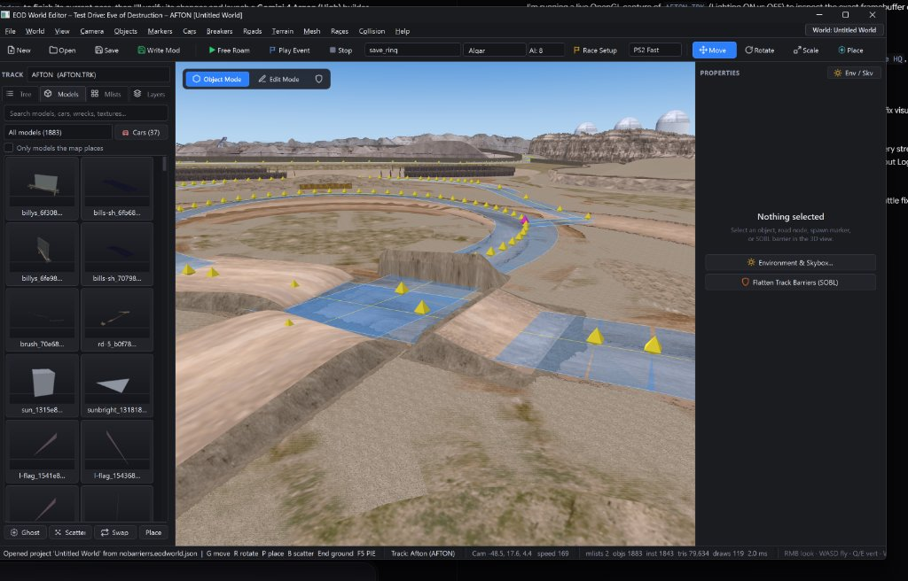
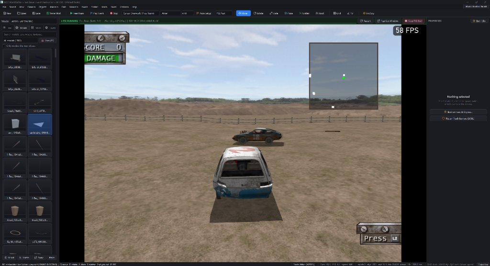
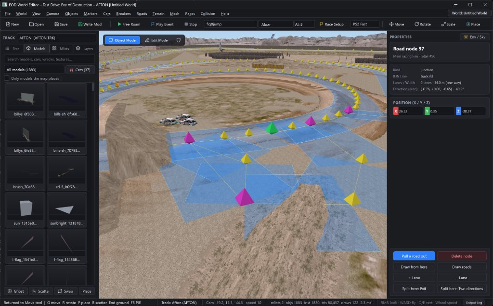
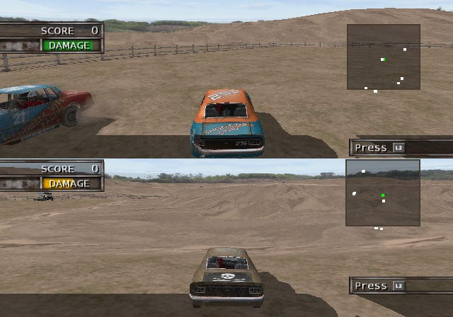
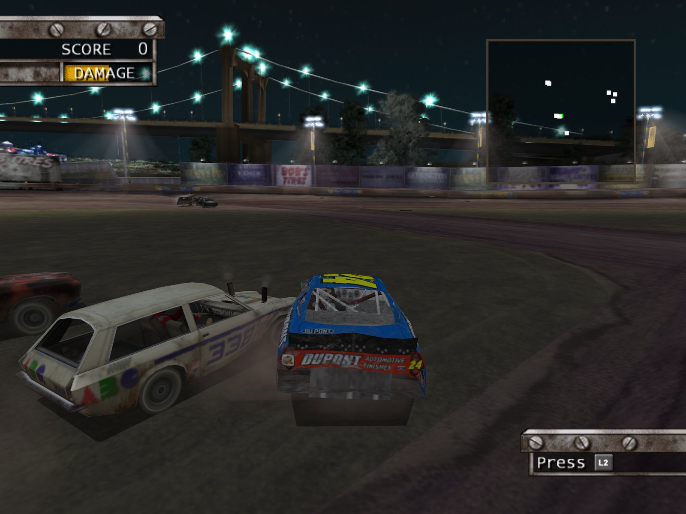

# Test Drive: Eve of Destruction (`SLUS_209.10`) — Native Recompilation & Creation Kit Wiki

Welcome to the official technical encyclopedia and modding wiki for **EOD Recomp** — a commercial-grade native PC (Windows 11 x64, Vulkan) and Apple Silicon (macOS, Metal) static recompilation, remaster, and **World Editor & Creation Kit** for Monster Games' 2004 PlayStation 2 demolition racing classic, ***Test Drive: Eve of Destruction*** (North American release **`SLUS_209.10`**).


---

## Quick Navigation

| Section | Wiki Page | What You Will Find |
|---|---|---|
| **1. Tutorials & Modding Guide** | **[Modding-Tutorials](Modding-Tutorials)** | Step-by-step visual tutorials (Tutorials 1–7): Zero-friction PS2 `.ISO` setup, **`F9`** Classic/Modern toggle, **`F1`** Mods menu, World Editor track modding, Play-In-Editor (**PIE**), fence & **`SOBL`** invisible-wall removal, **Ghost Place (`P`)** & **Scatter Brush (`B`)** with all 37 retail **Cars & Wrecks**, **`ILIN`** AI pathfinding & custom modes (*Tag*, *Cat & Mouse*, *Fat Kid / Juggernaut*), 4K **`HOSTTEX`** textures, skybox swapping, *NASCAR: Dirt to Daytona* car importing, and **`.eodmod`** packaging. |
| **2. Engine Architecture** | **[Architecture-Overview](Architecture-Overview)** | Emotion Engine (MIPS R5900) static binary translation (`tools/recomp.py`), 32 MB linear EE RAM map, 16 KB Scratchpad, VU0/VU1 vector microcode (`tools/vurecomp.py`), 4 MB GS VRAM, IOP HLE (`stream.irx`, `mcserv`, `padman`, `libsd`), 6-phase boot-to-race lifecycle, 9 core subsystems, and **PS2 limit removals**. |
| **3. Native Plume Renderer** | **[Native-Plume-Renderer](Native-Plume-Renderer)** | Why we built on **Plume** (Vulkan / Metal) instead of Filament, 1-frame **`F9`** Classic PS2 vs. Modern PBR toggle, Stages **R0–R8 & R9**, C++17 **VIF Mesh Decoder** (`44,584` parts in `160 ms`), `V4-5` prelit world colors vs. `V4-8` normals, character skinning & 157-bone `Bone.mvl` car crumpling, full-resolution shadow volumes, particles/sprites/flares, and **P1–P13 / S1–S4 / D1–D5** gates. |
| **4. File Formats Encyclopedia** | **[File-Formats-Encyclopedia](File-Formats-Encyclopedia)** | Complete binary specifications for all **72 archives**, **7,329 internal assets**, and **24 FourCC types**: `0TSR` v6 (`.TRK`/`.CAR`/`.RES`, CRC-32 `0x04C11DB7`), `GRAF` v18, `MODL` v9, `4SPS` VIF, `TEX` v10 & `.tm0`, `.eodhtx` (`HOSTTEX`), `ILIN` v27 (`.ild`/`.ili`), `SCOL` v4 (`track.bsc`), `SOBL` v3 (`track.sol`), `VALT` v11, `SETU` v2 (`.gar`), `LAYT` v5, `IMAG` v3, `LANG` v1, `STAB`, `GTEX`, `CANV`, `SFX0`/`ESFX`/`SPEECH.BNK`, `Anim`/`Anm0`, and `HSCM` v3 saves (`0xFEEDFACE`). |
| **5. Decompiled Subsystems & Symbols** | **[Decompiled-Subsystems-and-Symbols](Decompiled-Subsystems-and-Symbols)** | Canonical function & global address catalog (`config/symbols.txt`), HLE hooks (`config/hle.txt`), the **`EOD_DIFF`** & **`EOD_DIFF_REPLAY`** live verification harness, 6-DOF vehicle physics, 8-panel detachment & expandable debris phob pools, Explosive Chicken 3 ballistic regimes & 100×100 spatial hash shockwave, AI control injection & `BattleMaster` 26 event modes, Career progression, and deterministic netplay. |
| **6. World Editor & Creation Kit** | **[World-Editor-and-Creation-Kit](World-Editor-and-Creation-Kit)** | Standalone Windows 11 World Editor (`tools/world_editor/`) & Creation Kit (`tools/kit_service/`) software architecture (ADRs 01–08), 4-tier process isolation, 6 Ishikawa Fishbone friction analyses, 80.lv UX principles & 5-competitor synthesis (*NFSU2 FRS*, *Twinmotion*, *Lumion*, *UE5*, *Minecraft Bedrock Editor*), JTBD-01..08, and CLI modding tools. |

---

## Core Product Pillars (Master Spec JTBD 1–5)

1. **Instant Classic / Modern Toggle (`F9` or `L1+R1+R3`):** Switch mid-race in **1 frame (`<= 33 ms`)** with flat GPU memory between a pixel-faithful PlayStation 2 Classic look (`SSIM >= 0.98` vs. software GS replay) and a 2026 Remastered PBR look with cascaded sun shadows, sky IBL, clear-coat car paint, water refraction, and GPU particle VFX.
2. **Unthrottled Scale, Maximum LOD & Split-Screen Parity:** Render at **`1x` (`640×448`) up to `8x+` (`5120×3584`)**, unlocked frame rates (`60–240+ FPS`), native **Hor+ 16:9 widescreen** with edge-anchored HUD gauges, **`Detail=maximum`** locking all 20 vehicles to `Low1.mod` at every distance, and **`SplitScreenParity=1`** giving 2P/4P split-screen the full 1P world passes, draw distance, flares, and Woodly (`AFTON.TRK`) water.
3. **Photo Mode & Video Ready:** Pause anywhere, hide the HUD, fly the free camera with roll/FOV/DOF, and export **`7680×4320` (8K)** PNGs in `< 2 s`.
4. **First-Class Modding & Creation Kit:** Non-destructive overlay architecture (`EOD_MOD_DIR`), 4K/8K Vulkan **`HOSTTEX`** (`.eodhtx`) texture replacement, full 3D **World Editor** with embedded **Play-In-Editor (PIE)**, delta-only **`.eodmod`** packages with 3-tier conflict merging, and **`[MOD]`** roster badges in Single & Multiplayer Arcade.
5. **Instant PC Boot:** Skips startup `.PSS` intro movies, artificial loading delays, and PS2 memory-card checks by default—booting straight to the main menu in under 2 seconds.

---

## Visual Showcase

````carousel

<!-- slide -->

<!-- slide -->

<!-- slide -->

<!-- slide -->

````

---

## 60-Second Quick Start

### 1. Extract Your Retail PS2 `.ISO` (`SLUS_209.10`)
Launch the World Editor (`tools\world_editor\launch_editor.bat`) and drag-and-drop your retail North American `Test Drive - Eve of Destruction (USA).iso` onto the **First-Run ISO Setup Wizard**—or extract via CLI:
```powershell
python tools/iso_extractor.py --iso "Test Drive - Eve of Destruction (USA).iso" --out "D:\Test Drive - Eve of Destruction (USA)"
```

### 2. Play the Native Remaster (`eod.exe`)
```powershell
.\eod.exe --data "D:\Test Drive - Eve of Destruction (USA)"
```
- Press **`F9`** mid-race to toggle **PS2 Classic ↔ Modern Remastered**.
- Press **`F1`** (or controller **`L3 + R3`**) to configure **RenderScale (1x–8x)**, **16:9 Widescreen**, **Maximum LOD**, **Explosive Chicken Fight (`L2`)**, **Turbo Boost**, **Single-Player Battle Mode**, **Battle Bots**, and **Manual Recovery**.

### 3. Open the EOD World Editor & Play-In-Editor (PIE)
```powershell
tools\world_editor\launch_editor.bat
```
- Pick any of the **15 retail tracks** (e.g. `AFTON (Woodly)` or `DUNDAS`), scale a jump ramp, flatten the 16 m **`SOBL`** invisible barriers, scatter wrecked School Buses with **`B`**, and press **`F5`** to drive your modded track immediately inside the viewport!
