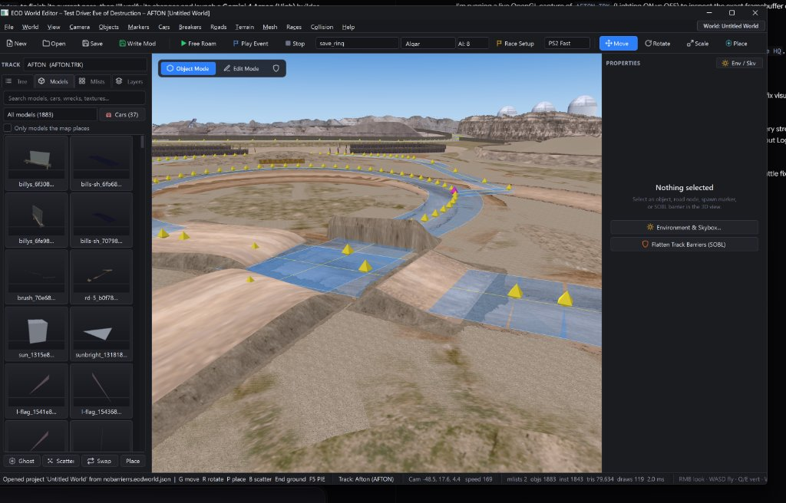
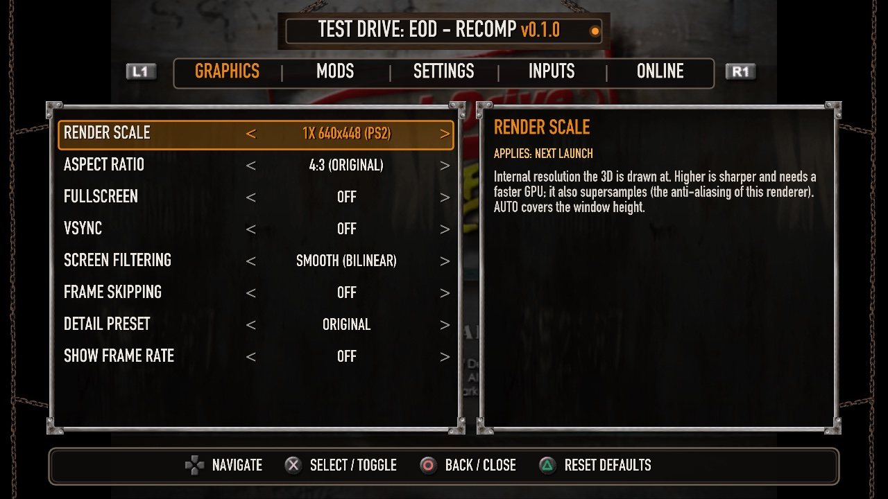
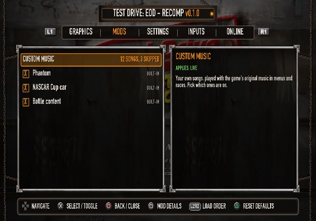
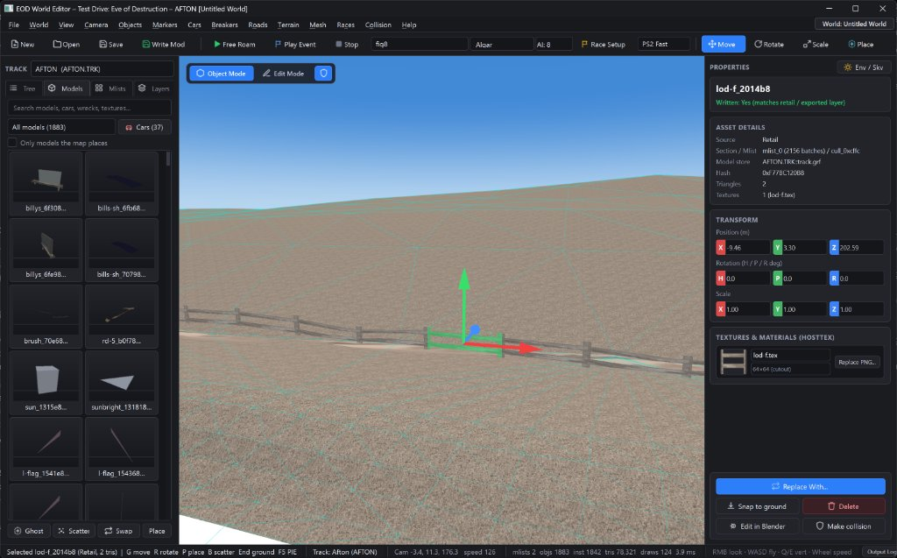
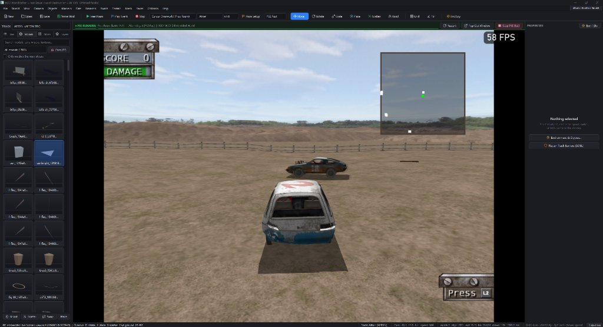
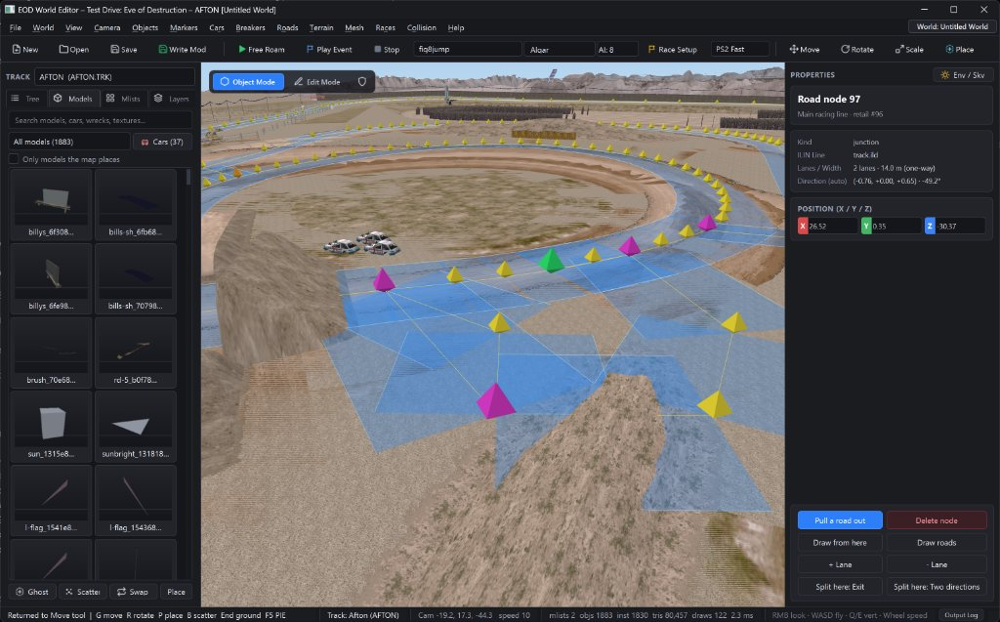
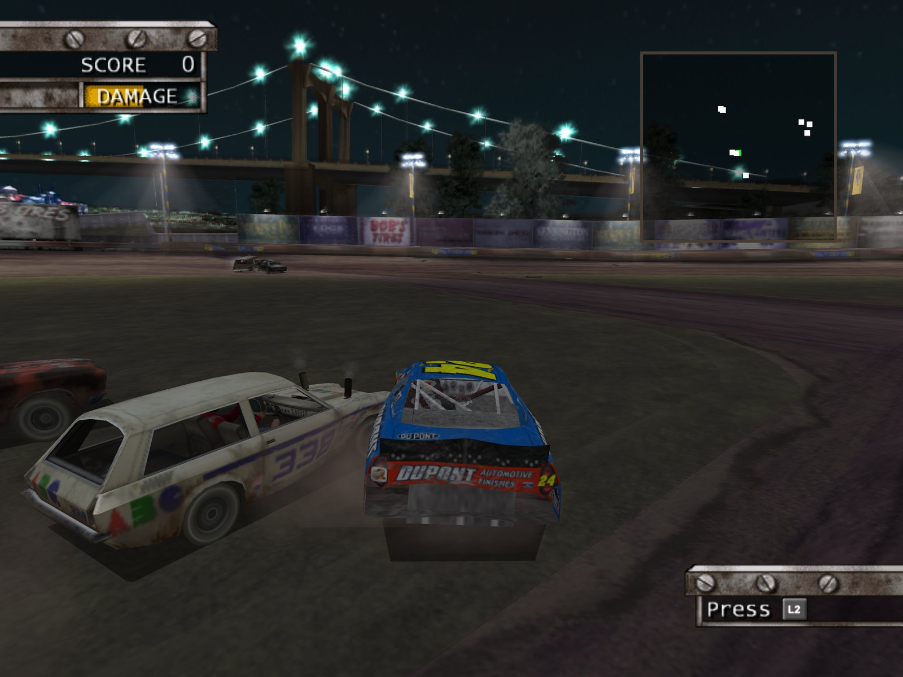
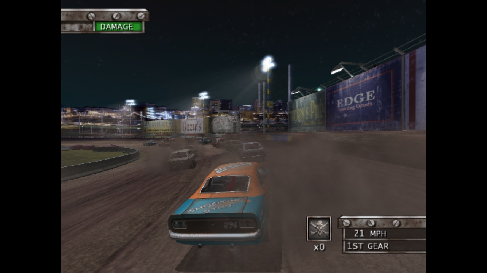

# Modding & World Editor Tutorials (Complete Step-by-Step Guide)

Welcome to the complete visual tutorial guide for **EOD Recomp** and the **EOD World Editor & Creation Kit** (`SLUS_209.10`).

You can read all seven tutorials continuously on this page, or jump directly to any individual tutorial page from the Wiki sidebar:
1. **[Tutorial 1: Zero-Friction Setup from a Retail PS2 ISO (`SLUS_209.10`)](Tutorials-1-Setup-and-Controls)**
2. **[Tutorial 2: Your First Track Mod in the EOD World Editor](Tutorials-2-First-Track-Mod-and-PIE)**
3. **[Tutorial 3: Deleting Fences, Removing Invisible Barriers (`SOBL`) & Multi-Selection](Tutorials-3-Fences-Barriers-and-MultiSelect)**
4. **[Tutorial 4: Placing Cars, Wrecked AI Cars & Scattering Props (Lumion/Twinmotion Workflow)](Tutorials-4-Cars-Wrecks-and-Scatter-Brush)**
5. **[Tutorial 5: Editing AI Pathfinding (`ILIN` Road Tool) & Inventing Custom Game Modes](Tutorials-5-AI-Pathfinding-and-Custom-Modes)**
6. **[Tutorial 6: Live 4K Textures (`HOSTTEX`), Skybox Swapping & Importing *NASCAR: Dirt to Daytona* Cars](Tutorials-6-4K-Textures-Skyboxes-and-NASCAR)**
7. **[Tutorial 7: Packaging, Sharing & Installing `.eodmod` Mods Online](Tutorials-7-Packaging-and-Sharing-Mods)**



---

## Quick Keyboard & Controller Shortcut Reference

### In-Game (`eod.exe`)

| Shortcut / Pad Chord | Action |
|---|---|
| **`F9`** or **`L1 + R1 + R3`** | **Instant Classic / Modern Toggle** (switches in 1 frame `<= 33 ms` between PS2 Classic and Modern Remastered PBR) |
| **`F1`** or **`L3 + R3`** | **Open / Close In-Game Menu & Mods Overlay** (Display, Audio, Controls, Gameplay/Mods, System) |
| **`F11`** or **`Alt + Enter`** | Toggle Borderless / Exclusive Fullscreen |
| **`Triangle`** (Pad) | Cycle Gameplay Camera Views (`NearChase`, `Chase`, `Chassis`, `Bumper`, `Cockpit`) |
| **`Select`** (Pad) | Manual Vehicle Track Recovery (when `ManualRecovery=1` disables the 3-second auto-reset timer) |
| **`L2`** (Pad, with mods) | Fire Explosive Chicken (`ChickenFight=true`) and/or Activate High-Velocity Turbo Boost (`TurboBoost=true`) |
| **`L1 + R1 + Up`** | Live toggle Straight-Shot Chicken Fight |
| **`L1 + R1 + Right`** | Live toggle High-Velocity Turbo Boost |
| **`L1 + R1 + Square`** | Live toggle Human Invincibility (`GodMode`) |

### EOD World Editor (`tools/world_editor/`)

| Shortcut | Action |
|---|---|
| **`RMB` (Hold) + `W/A/S/D`** | Fly Camera Forward / Left / Backward / Right |
| **`RMB` (Hold) + `Q / E`** | Fly Camera Down / Up |
| **`Shift`** (while flying) | **2.8× Camera Speed Boost** (`Mouse Wheel` adjusts base fly speed) |
| **`F`** | **Frame Selection** (smoothly focuses camera on selected 3D object, road node, or barrier) |
| **`G`** / **`R`** / **`S`** | **Move** / **Rotate** / **Scale** 3D Gizmo Mode |
| **`P`** | **Ghost Place Mode** (live 3D preview snapped to `SCOL` terrain height & normal; `R` / `Shift+R` rotates ±15°; `LMB` stamps) |
| **`B`** | **Scatter / Paint Brush Mode** (paint non-overlapping props or wrecked cars inside a 3D terrain circle) |
| **`End`** or **`Ctrl + G`** | **Drop to Ground** (raycasts `SCOL` terrain under selection and seats its bounding-box base on the surface) |
| **`Shift + LMB`** | **Multi-Select** (add/remove objects from active selection set) |
| **`Ctrl + D`** | Duplicate selected object in place |
| **`Del`** | Delete selected object(s) (moves retail static/event props to `Y = -5000.0` tombstones or removes editor-placed items) |
| **`F2`** | Export selected model to Blender OBJ round-trip |
| **`Ctrl + Z`** / **`Ctrl + Y`** | Undo / Redo (full `QUndoStack` history across transforms, scatter strokes, barriers, textures, and roads) |
| **`Ctrl + S`** | Save non-destructive `.eodworld.json` project overlay |
| **`Ctrl + Shift + S`** | **Write Mod Layer** (compiles patched `.TRK`, `c_*.va0`, `track.sol`, `*.ild`, and `HOSTTEX/.eodhtx` to `mods/<Project>/`) |
| **`Ctrl + Shift + E`** | **Package Mod as `.eodmod`…** (exports compact delta-only distributable mod archive) |
| **`F5`** | **Play Free Roam (PIE)** — compiles dirty changes and launches `eod.exe` directly inside the central viewport |
| **`Shift + F5`** | **Play Event / Race (PIE)** — launches the configured event/race inside the embedded viewport |
| **`Esc`** / **`Shift + Esc`** | Exit active placement/brush tool, or **Stop PIE** and return to the 3D editor |

---

## Tutorial 1: Zero-Friction Setup from a Retail PS2 ISO (`SLUS_209.10`)

*(Full standalone page: **[Tutorials-1-Setup-and-Controls](Tutorials-1-Setup-and-Controls)**)*


1. **Verify & Extract Your Retail PS2 `.ISO` (`SLUS_209.10`):**
   - Double-click **`tools\world_editor\launch_editor.bat`** and drag-and-drop your North American `Test Drive - Eve of Destruction (USA).iso` directly onto the **First-Run ISO Setup Wizard** (or run `python tools/iso_extractor.py --iso "EOD.iso" --out "D:\Test Drive - Eve of Destruction (USA)"`).
   - The pure-Python ISO-9660/UDF reader verifies `SYSTEM.CNF` (`SLUS_209.10`, SHA-256 `4f60053dc141365f5ae50737622f8408be30ced513b4c109427c926461f2e2ae`), rejects PAL `SLES_527.67` or truncated dumps upfront, strips `;1` suffixes, and verifies every `0TSR` v6 archive's internal `eod_crc` checksum (`0x04C11DB7`).
2. **Launch `eod.exe` (Instant PC Boot):**
   - Run `.\eod.exe --data "D:\Test Drive - Eve of Destruction (USA)"`. Startup `.PSS` movies and PS2 memory-card checks are skipped automatically so you land on the Main Menu in `< 2 s`.
3. **Press `F9` (`L1 + R1 + R3`) for the 1-Frame Classic vs. Modern Toggle:**
   - Switch instantaneously (`<= 33 ms`, 0 MB GPU growth) between pixel-faithful **PS2 Classic** (`Cv * Ct >> 7`, exact `TEX1` mip LOD) and **2026 Modern Remastered PBR** (Filament BRDF/IBL, cascaded sun shadows, clear-coat car paint, water refraction, GPU particle VFX).
4. **Press `F1` (`L3 + R3`) for the In-Game Menu & Mods Overlay:**
   - **Display Tab:** Set `RenderScale` (`1x`–`8x+`), `Aspect = 16:9 Widescreen` (Hor+ FOV with edge-anchored HUD), and `Detail = Maximum` (locks all 20 cars to `Low1.mod` at all distances).
   - **Gameplay / Mods Tab:** Enable **Unlock All Out of the Box**, **Straight-Shot Chicken Fight (`L2`)**, **Chicken Blast Force/Radius Sliders (`1.0x–4.0x`)**, **Turbo Boost (`L2`, `174+ mph`)**, **Single-Player Battle Mode**, **Battle Bots**, **Manual Recovery Only (`Select`)**, and **Custom Music** (`mods/music/`).




---

## Tutorial 2: Your First Track Mod in the EOD World Editor

*(Full standalone page: **[Tutorials-2-First-Track-Mod-and-PIE](Tutorials-2-First-Track-Mod-and-PIE)**)*



1. **Open Woodly (`AFTON.TRK`) or Dundas (`DUNDAS.TRK`):**
   - Launch `tools\world_editor\launch_editor.bat` and select **`AFTON (Woodly)`** in the Left Explorer dropdown.
   - Fly around with **`RMB + W/A/S/D/Q/E`** (`Shift` for 2.8× speed boost, **`F`** to frame selection).
2. **Switch Event Templates:**
   - Switch between **`Jump Race` (`c_jump_race`)**, **`Figure 8` (`c_fig8_race`)**, **`Battle` (`c_battle`)**, and **`Gauntlet`** to inspect how event-specific `c_<event>.va0` props and `Optional Terrain` (`GRAF` subtype 20 + `SCOL` triangle bits `+0x1E`) toggle dynamically.
3. **Select, Move & Scale a Dirt Jump Ramp (`G` / `R` / `S`):**
   - Filter Explorer by **`[Ramp]`** or click a dirt jump ramp in the 3D viewport.
   - Use **`G`** (Move), **`R`** (Rotate), and **`S`** (Scale—e.g. `Scale Y = 1.85` for an 85% taller launch peak), then press **`End`** (`Drop to Ground`) to seat the ramp flush on the `SCOL` terrain.
4. **Bake Both Visual VIF Vertices AND Driving Collision (`SCOL` / `SOBL`):**
   - In the Object Inspector, check **`☑ Bake Scaled/Moved Vertices into VIF Stream`** (updates `4SPS` `q199` / `V3-16` vertices via `vif_patch.py` plus `mrModel`, `mlist`, and `0x102` spheres) and click **`🔨 Bake / Sync Driving Collision (`SCOL` + `SOBL`)`** so your tires physically climb the new scaled ramp slope!
5. **Test Immediately in Play-In-Editor (PIE) (`F5`):**
   - Press **`F5`** (`Play Free Roam`) or **`Shift + F5`** (`Play Event / Race`) to compile dirty changes in `< 200 ms` and drive your giant ramp right inside the central viewport! Press **`Shift + Esc`** to return to editing.



---

## Tutorial 3: Deleting Fences, Removing Invisible Barriers (`SOBL`) & Multi-Selection

*(Full standalone page: **[Tutorials-3-Fences-Barriers-and-MultiSelect](Tutorials-3-Fences-Barriers-and-MultiSelect)**)*

1. **Multi-Select with `Shift + Click`:**
   - Hold **`Shift`** and **`LMB` Click** multiple fence panels to select and move or delete (`Del`) them as a single undoable group.
2. **Wipe Out Entire Fence Lines + Hidden `lod-*` Twins (`Select / Delete All Similar`):**
   - Click one fence segment, right-click (`RMB`), and choose **`Select All Similar`** or **`Delete All Similar (Fences + LOD Twins)`** (or **`Delete Selected + Overlapping LOD Twins in Radius`**).
   - This automatically removes both the high-detail `child 0` fence meshes **and** their low-detail `GRAF` group (`0x0`) / `MSCAL 0x6A` `lod-*` billboard twins (patching their `q199.y` offset to `Y = -5000.0 m`) so distant fence sprites never pop back in!
3. **Flatten 16-Metre Invisible Walls (`SOBL` `track.sol`):**
   - Click **`🛡 Collision Shield`** in the top-left viewport pill bar to reveal `track.sol` `SOBL` v3 boxes color-coded by height (**Red `>= 10 m`** 16-metre invisible ceilings, **Orange `3–10 m`**, **Yellow `< 3 m`**).
   - Click any red barrier to click **`Flatten Barrier (-0.5 m)`**, or choose **`Collision → Flatten Interior Barriers (Keep Outer Perimeter)`** / **`Collision → Remove / Flatten All Track Barriers`** for true open-world driving!

---

## Tutorial 4: Placing Cars, Wrecked AI Cars & Scattering Props (Lumion/Twinmotion Workflow)

*(Full standalone page: **[Tutorials-4-Cars-Wrecks-and-Scatter-Brush](Tutorials-4-Cars-Wrecks-and-Scatter-Brush)**)*



1. **Browse `🚗 Cars & Wrecks (37)`:**
   - Open `Explorer → Models` and click **`🚗 Cars & Wrecks (37)`** to browse shaded 3D studio thumbnails for all 31 playable cars, 5 trailers, and `BUS (School Bus)`.
2. **Ghost Place (`P`) Snapped to Terrain Normals:**
   - Select any vehicle or prop and press **`P`**. The translucent cyan ghost glides across `SCOL` terrain, auto-tilting pitch and roll to match hill slopes (`normal_to_pitch_roll`). Press **`R` / `Shift+R`** to rotate ±15° and **`LMB`** to stamp.
3. **Scatter / Paint Brush (`B`):**
   - Press **`B`** to project the glowing green 3D terrain brush ring (`Radius 3m–120m`, `Density 1–40`, `Random Yaw`, `Scale Jitter`, `Align to Normal`, automatic AABB overlap rejection) and drag across the infield to paint junkyard car piles or forests in one undoable stroke.
4. **`Replace Selection With…` (Trees → Wrecked Buses with Collision):**
   - Select any existing trees, hay bales, or barriers, right-click → **`Replace Selection With…`**, and pick **`BUS`**, **`HEARSE`**, or **`AMBULA_1`**. On compile (`Ctrl+Shift+S` / `F5`), your swapped and scattered vehicles are compiled directly into `track.grf` / `c_<event>.va0` with physical collision so you can smash into them in-game!

---

## Tutorial 5: Editing AI Pathfinding (`ILIN` Road Tool) & Inventing Custom Game Modes

*(Full standalone page: **[Tutorials-5-AI-Pathfinding-and-Custom-Modes](Tutorials-5-AI-Pathfinding-and-Custom-Modes)**)*

1. **Edit 60-Byte `ILIN` (`.ild`) AI Splines with the `Road` Tool:**
   - Click **`Road`** in the toolbar to reveal the 3D directional racing-line ribbon and yellow/magenta diamond waypoint handles (`oval.ild`, `fig8.ild`, `track.ild`).
   - Drag nodes (`White` hover) onto your new jump ramps or shortcuts, click segments (`Cyan` hover) to **Split** and insert waypoints, or link side branches (`Green` hover).
   - **Auto-Recomputed Tangents & Lap Lengths:** On save/compile, `tools/formats/ilin.py` automatically recalculates every node's unit tangent (`dirX, dirZ` at `+8, +12`), `segLen` (`+24`), cumulative `dist` (`+28`), the 3 header lap-length floats (`+12/+16/+20`), and the pointer fix-up table (`+44`) so AI drivers accelerate smoothly through your custom line!
2. **Force Free Roam, AI Auto-Drive & Free Cam:**
   - In **`⚙ Custom Race`** (`Races → Custom Race & AI Editor…`), force **Free Roam** on any race layout, check **`☑ AI Auto-Drive Player Car`** to watch AI test your new `ILIN` spline hands-free, and use **Photo Mode (`P11`)** for free-camera 8K captures.
3. **Set Up Custom Game Modes:**
   - **Tag / Keep-Away:** Flatten interior `SOBL` walls on Dundas, scatter jump ramps in the infield, enable **`AI Vengeance`** (`0x003C4190` bit `0x20`—all AI hunt the player!) with `AI Speed Scale = 1.15x`, and try to survive in a nimble `MOTH`.
   - **Cat & Mouse:** Narrow the `ILIN` spline through a bus-lined gauntlet on Woodly or Gilroy and pit fast Compacts (`MOTH`, `BLITZ`) against heavy `BUS` / `HEARSE` blockers.
   - **Fat Kid / Juggernaut:** Drive an invincible **`BUS (School Bus)`** with `Chicken Blast Force = 3.0x` (`75,000 N`) and `Turbo Scale = 1.5x` against 8 fast runners—or flip the roles and survive in a `MOTH` against 3 explosive-chicken-firing AI School Buses!

---

## Tutorial 6: Live 4K Textures (`HOSTTEX`), Skybox Swapping & Importing *NASCAR: Dirt to Daytona* Cars

*(Full standalone page: **[Tutorials-6-4K-Textures-Skyboxes-and-NASCAR](Tutorials-6-4K-Textures-Skyboxes-and-NASCAR)**)*



1. **Click-Surface 4K Texture Swap (`HOSTTEX` / `.eodhtx`):**
   - Click any 3D object → **Texture / Material Inspector** → click **`🖼 Replace PNG…`** and choose any power-of-two upscaled PNG ($1\times..32\times$, up to `4096×4096`).
   - The viewport updates on the next frame, and compiling (`Ctrl+Shift+S` / `F5`) automatically emits a mipmapped `.eodhtx` file + `HOSTTEX/replacements.tsv` keyed by FNV-1a 64 `indexKey`/`paletteKey`.
2. **Skybox Swapping & Atmosphere (`☀ Env / Sky`):**
   - Pick 1-click mood presets (*Golden Sunset*, *Anoka Night*, *Overcast Storm*), adjust Sun/Fog sliders at 60 FPS, or use **`Borrow Sky From Track…`** to transplant all 32 `sky01A..16B.tex` dome tiles from another track via `HOSTTEX`.
3. **Import *NASCAR: Dirt to Daytona* (`SLUS_204.41`) Stock Cars (`tools/import_nascar_cars.py`):**
   ```powershell
   python tools/import_nascar_cars.py --nascar-data "D:\NASCAR\DATA" --eod-data "D:\EOD\DATA" --output "mods\nascar_cupcar" --kind stock --name Cupcar --number 777 --class midsize --paint Car24.tex
   ```
   Automatically transcodes VIF `MSCAL 0x2D → 0x5C` and `V4-5 → V4-8` normals, generates a 157-bone `Bone.mvl` damage skeleton, upgrades `TEX` v9 → v10 liveries in `CT.RES`, and imports independent slow/fast `ncu0..4f.mod` Cup wheels into `RACE.RES`.
4. **Live Suspension & Gearing Tuning (`physics.val` vs. `SETU`):**
   - Ignore legacy `.gar` (`SETU`) files (verified unused by `SLUS_209.10`!). Edit **`DATA/CAR/<CAR>.CAR#physics.val`** (`mass`, `spring_factor`, `grip`, `slip`, `brake_factor`, `damage_scale`, `g1..g4`, `rear_end_ratio`, `redline`, `wheel_class`) in the **VALT Schema Inspector** for immediate in-game handling changes.

---

## Tutorial 7: Packaging, Sharing & Installing `.eodmod` Mods Online

*(Full standalone page: **[Tutorials-7-Packaging-and-Sharing-Mods](Tutorials-7-Packaging-and-Sharing-Mods)**)*



1. **Export Legal Delta-Only `.eodmod` Packages (`Ctrl + Shift + E`):**
   - Use **`File → Package Mod as .eodmod…`** (or `python tools/mod_package.py from-project ...`) to bundle **only** modified archive members (`native/`), 4K `HOSTTEX` replacements (`host/`), `.eodworld.json` sub-record deltas (`deltas/`), and a `preview.png` thumbnail into a compact `50 KB – 8 MB` `.eodmod` file with cryptographic SHA-256 verification.
2. **1-Click Install & 3-Tier Conflict Merging (`tools/mod_install.py`):**
   - Drag-and-drop `.eodmod` files onto the World Editor (or run `python tools/mod_install.py install <pkg> --disc <disc>`).
   - **3-Tier Hierarchical Composition:** Automatically merges mods editing disjoint members in the same `.TRK` (Tier 1), merges non-overlapping object/barrier/ILIN/VALT sub-records via `deltas/*.eodworld.json` (Tier 2), and prompts for an explicit winner (`accept-conflict`) only on true same-record collisions (Tier 3).
3. **Multiplayer Netplay Parity (`0` Desyncs):**
   - Verify all peers share matching `active/PROFILE.TXT` native member hashes for physics-affecting archives (`.TRK`, `.CAR`, `COMMON.RES`). Visual-only settings (`HOSTTEX` 4K textures, `RenderScale` 1x–8x, and **`F9` Classic vs. Modern**) are 100% client-independent and never cause netplay desyncs!
