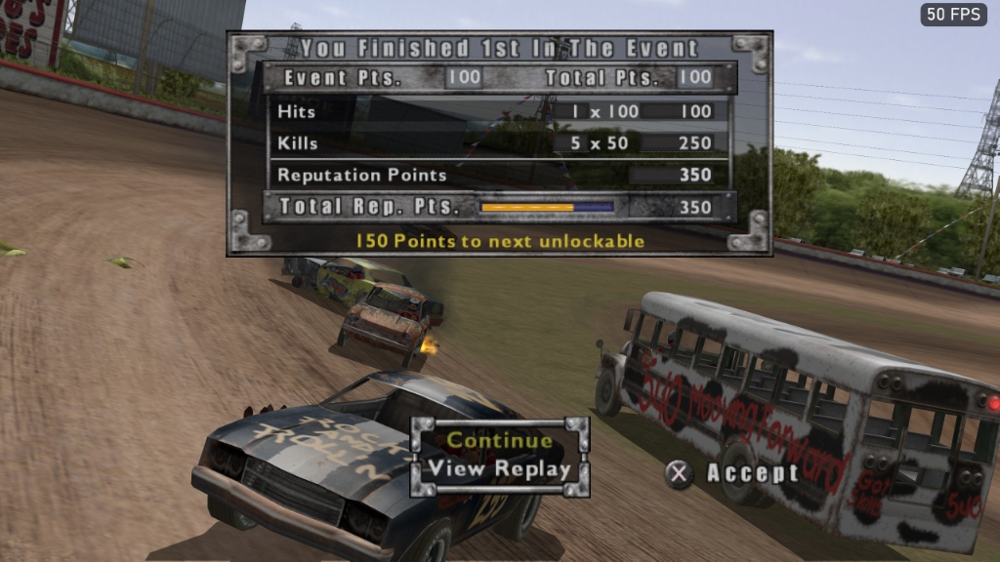
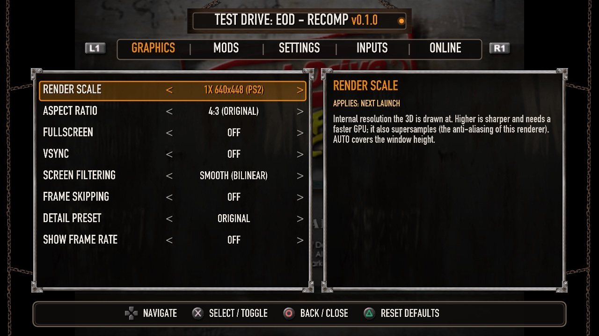
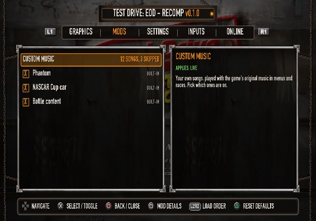

# Tutorial 1: Zero-Friction Setup from a Retail PS2 ISO (`SLUS_209.10`)

> **Part of the [EOD Recomp Modding & World Editor Tutorials](Modding-Tutorials)** · **Next:** **[Tutorial 2: Your First Track Mod in the EOD World Editor](Tutorials-2-First-Track-Mod-and-PIE)**



---

## Overview

In this tutorial, you will take a legally dumped retail North American PlayStation 2 `.ISO` of *Test Drive: Eve of Destruction* (**`SLUS_209.10`**), extract and verify all 72 `0TSR` v6 archives with zero external tools, boot **`eod.exe`** straight to the main menu, switch live between the **PS2 Classic** and **2026 Modern Remastered PBR** renderers with **`F9`**, and configure widescreen, 4K resolution scaling, maximum LOD, and live gameplay mods in the **`F1`** overlay menu.

---

## Step 1: Verify Your Retail PS2 Disc Image (`SLUS_209.10`)

EOD Recomp is statically recompiled from the North American NTSC-U release (`SLUS_209.10`).
- **Accepted Inputs:** Standard `2048`-byte sector `.iso` files, raw `2352`-byte Mode 1 / Mode 2 Form 1 `.bin` images, or an already-unpacked directory containing `SLUS_209.10` and `DATA/`.
- **Expected `SLUS_209.10` SHA-256:**
  ```text
  4f60053dc141365f5ae50737622f8408be30ced513b4c109427c926461f2e2ae
  ```
- **Automatic Region & Integrity Guard:** Before unpacking, `tools/iso_extractor.py` reads `SYSTEM.CNF` from the ISO-9660 primary volume descriptor (sector 16). If a European PAL image (*Driven to Destruction*, `SLES_527.67`), *NASCAR: Dirt to Daytona* (`SLUS_204.41`), or a truncated rip (`< 1.8 GB`) is provided, it displays an immediate human-friendly diagnostic banner.

---

## Step 2: Extract Your ISO (Drag-and-Drop or CLI)

### Method A: World Editor First-Run ISO Setup Wizard (Recommended)
1. Double-click **`tools\world_editor\launch_editor.bat`**.
2. On first launch, the **First-Run ISO Setup Card** appears automatically.
3. **Drag and drop** your `Test Drive - Eve of Destruction (USA).iso` onto the dropzone (or click **Auto-Scan PC** to search `Downloads`, `Desktop`, `Documents`, and mounted optical drives `D:..Z:`).
4. The built-in ISO-9660/UDF extractor:
   - Verifies at least **2.6 GB** of free disk space (`2.18 GB` unpacked).
   - Strips ISO-9660 `;1` version suffixes (`AFTON.TRK;1` → `DATA/TRACKS/AFTON.TRK`).
   - Validates every `0TSR` v6 archive entry's MSB-first CRC-32 (`rst0.eod_crc`, polynomial `0x04C11DB7`).
   - Atomically swaps the verified staging directory into `%LOCALAPPDATA%\EODRecomp\disc\` (or your chosen game folder) and saves `disc_manifest.json`.

### Method B: Command-Line Extraction (`tools/iso_extractor.py`)
```powershell
python tools/iso_extractor.py --iso "C:\Downloads\Test Drive - Eve of Destruction (USA).iso" --out "D:\Test Drive - Eve of Destruction (USA)"
```

---

## Step 3: Launch `eod.exe` & Instant PC Boot

```powershell
.\eod.exe --data "D:\Test Drive - Eve of Destruction (USA)"
```
- **Instant PC Boot (JTBD 5):** Skips startup `.PSS` intro movies, artificial 50 ms PS2 loading screen pauses, and the PS2 memory card slot check by default, booting straight to the Main Menu in under 2 seconds.
- **Direct Race Jump (`EOD_DIRECT_START`):**
  ```powershell
  $env:EOD_DIRECT_START="mode=action;track=AFTON;event=jump_race;car=Bus;ai=8;humans=1"
  $env:EOD_SKIP_MOVIES="1"
  .\eod.exe
  ```

---

## Step 4: The **`F9`** Instant Classic / Modern Toggle

Press **`F9`** on your keyboard (or **`L1 + R1 + R3`** on a controller) at any time during a race:
- **PS2 Classic Look (`ModernRenderer=0`):** Native Plume rendering with exact PS2 submission order, GS alpha-blend equations `(A - B) * C + D`, `V4-5` prelit vertex colors (`Cv * Ct >> 7`), and GS `TEX1` mipmap LOD math (`SSIM >= 0.98` vs. offline software GS replay).
- **Modern Remastered Look (`ModernRenderer=1`):** Physically based rendering (Filament BRDF/IBL math in native HLSL) driven by 2,728 tagged textures in `material_table.json`, cascaded sun shadows, sky IBL, clear-coat paint, chrome, glass, water refraction on Woodly (`AFTON.TRK`), and depth-faded GPU particle VFX.
- **Zero-Hitch 1-Frame Switch (Gate P5):** Completes in `<= 33 ms` with `0 MB` GPU memory growth over 100 toggles.

---

## Step 5: Configure Graphics & Live Mods in the **`F1`** Overlay Menu

Press **`F1`** (or click both analog sticks **`L3 + R3`**) to open the in-game overlay:




1. **Display Tab:**
   - **RenderScale:** `1x` (`640×448`) up to `6x` (`3840×2688` 4K) and `8x` (`5120×3584`).
   - **Aspect Ratio:** `16:9 Widescreen` (true Hor+ FOV expansion at `0x0034D328` with automatic `±106.67` HUD edge anchoring).
   - **Detail Preset:** `Maximum` (locks all 20 vehicles to `Low1.mod` at all distances and doubles 2P split-screen draw distance from `1150m` to `2300m`).
2. **Gameplay / Mods Tab:**
   - **Unlock All Out of the Box (`UnlockAll=true`):** Unlocks all Career Eves, all 8 Feat cheats, all 7 prize-mask bytes, and all 16 points-gated tracks/cars (including Welch).
   - **Straight-Shot Chicken Fight (`ChickenFight=true`):** Press **`L2`** to launch forward ballistic explosive chickens at $\vec{v}_{\text{car}} + 28.0\text{ m/s}$ (3.0s reload cooldown), with live **Blast Force (`1.0x–4.0x`)** and **Blast Radius (`1.0x–4.0x`)** sliders.
   - **Turbo Boost (`TurboBoost=true`) & Turbo Scale:** Press **`L2`** for rocket thrust lifting the 100 mph PS2 cap up to `174+ mph` (`1.75x–3.0x`).
   - **Single-Player Battle Mode & Battle Bots:** Unlocks 4-car Battle arena combat across all 14 tracks in solo mode with armed AI Battle Bots.
   - **Manual Recovery Only (`ManualRecovery=1`):** Disables the 3-second off-track/rollover auto-teleport; hold **`Select`** to recover manually.

---

**Next Tutorial:** **[Tutorial 2: Your First Track Mod in the EOD World Editor](Tutorials-2-First-Track-Mod-and-PIE)**
