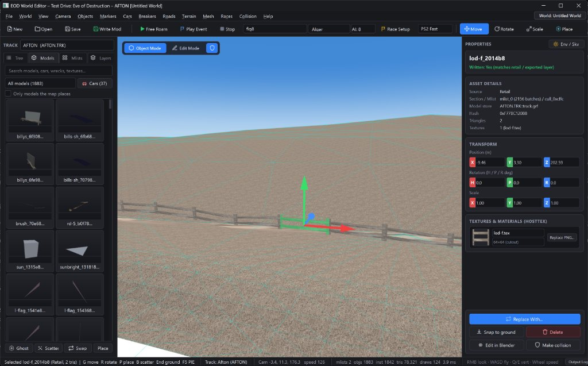
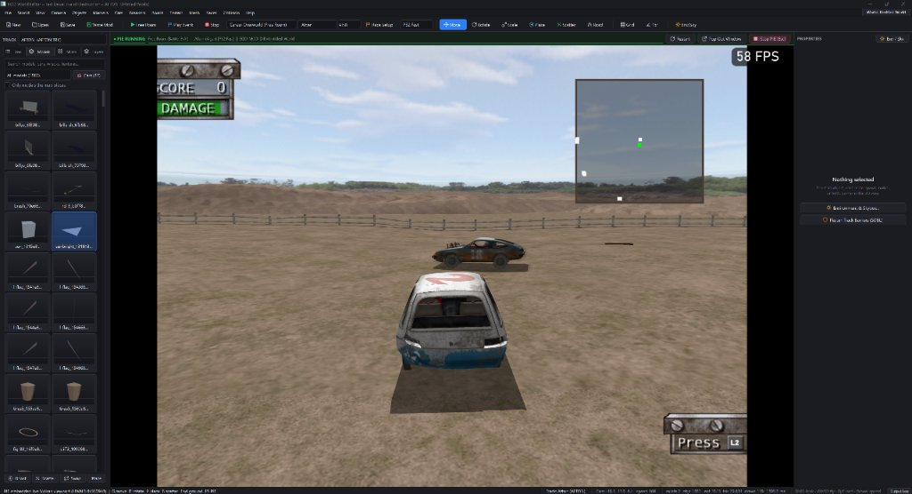

# Tutorial 2: Your First Track Mod in the EOD World Editor

> **Part of the [EOD Recomp Modding & World Editor Tutorials](Modding-Tutorials)** · **Previous:** **[Tutorial 1: Setup & Controls](Tutorials-1-Setup-and-Controls)** · **Next:** **[Tutorial 3: Deleting Fences & SOBL Barriers](Tutorials-3-Fences-Barriers-and-MultiSelect)**

---

## Overview

In this tutorial, you will open **Woodly (`AFTON.TRK`)** or **Dundas (`DUNDAS.TRK`)** in the EOD World Editor, master the 60 FPS 3D fly camera, switch between **Event Templates** (`Jump Race`, `Figure 8`, `Battle`, `Gauntlet`), select and scale a dirt jump ramp (baking both its visual `4SPS` VIF vertices and its `SCOL`/`SOBL` driving collision), and drive off your giant ramp inside **Play-In-Editor (PIE)**.

---

## Step 1: Open Woodly (`AFTON.TRK`) or Dundas (`DUNDAS.TRK`)

1. Launch **`tools\world_editor\launch_editor.bat`** (or `python tools/world_editor/app.py --track AFTON`).
2. In the **Left Explorer Panel**, select **`AFTON (Woodly)`** or **`DUNDAS`** from the **Track** dropdown.
3. The background worker loads `track.grf` (`GRAF` v18 visual scene), `track.bsc` (`SCOL` v4 drivable terrain), `track.sol` (`SOBL` v3 solid collision), `*.ild` (`ILIN` AI racing lines), and the track's 32-tile PS2 sky dome (`sky01A..16B.tex`).
4. Note how Woodly renders with authentic PS2 prelit **`V4-5` vertex colors** (`0x80 = 1.0`) and backface culling disabled (`glDisable(GL_CULL_FACE)`), preserving every trackside shadow pool and barn interior.

---

## Step 2: Navigate the 3D Viewport

- **Fly Camera:** Hold **`RMB`** and press **`W / A / S / D`** to fly horizontally, **`E`** to ascend, and **`Q`** to descend.
- **Speed Boost & Wheel Control:** Hold **`Shift`** for a **2.8× speed boost**, or roll the **`Mouse Wheel`** to adjust base fly speed.
- **Frame Selection (`F`):** Click any object in the 3D viewport (or in `Explorer → Tree`) and press **`F`** to focus the camera directly on it.

---

## Step 3: Switch Event Templates (`Jump Race`, `Figure 8`, `Battle`, `Gauntlet`)

Each `.TRK` archive contains up to 27 event prop layouts (`c_<event>.va0`) and **Optional Terrain** (`GRAF` subtype 20 + `SCOL` triangle bits `+0x1E`):
1. Use the **Event Template** selector in the toolbar (or `Races → Custom Race & AI Editor…`) to switch between:
   - **`Jump Race` (`c_jump_race`)** — enables dirt crossover jump ramps (`Optional Terrain` masks `2/3/4/6`), wall chicanes, hay bales, and explosive barrels.
   - **`Figure 8` (`c_fig8_race`)** — activates figure-8 crossover geometry and perimeter walls.
   - **`Battle` (`c_battle`)** — opens the full multi-car combat arena with respawn markers.
   - **`Gauntlet` / `Demolition Derby` (`c_demo_derby`)** — switches to tight derby boundaries (`bound`, `ringout` polygons) and trailer obstacles (`Semi_Trailer`, `tank`).

---

## Step 4: Select, Move & Scale a Dirt Jump Ramp (With Drivable Collision!)

1. **Select a Jump Ramp:** Type **`ramp`** in the Explorer search bar (or filter by **`[Ramp]`**) or click a dirt jump ramp in the 3D viewport with **`LMB`**.
2. **Position & Drop to Ground (`G` / `R` / `End`):**
   - Press **`G`** (Move) or **`R`** (Rotate) and drag the **R/G/B** 3D gizmo handles (`Red = X`, `Green = Y`, `Blue = Z`).
   - Enable **`Grid Snap` (`1.0 m`)** and **`Angle Snap` (`15°`)** in the toolbar for precision alignment.
   - Press **`End`** (or **`Ctrl + G`**) to **Drop to Ground**, raycasting `SCOL` (`track.bsc`) so the base of the ramp sits flush on the dirt track.
3. **Scale the Ramp (`S`):**
   - Press **`S`** (Scale) or enter values in **Right Properties Panel → Transform → Scale**:
     - Set **`Scale X = 1.50`**, **`Scale Y = 1.85`** (85% taller launch peak!), **`Scale Z = 1.40`**.
4. **Bake Visual VIF Vertices AND Driving Collision (`SCOL` + `SOBL`):**
   - In the PS2 engine, visual meshes (`track.grf`) and driving collision (`track.bsc` `SCOL` + `track.sol` `SOBL`) are stored separately.
   - In the **Object Inspector (Right Panel)** under **Collision & Mesh Baking**:
     - Check **`☑ Bake Scaled/Moved Vertices into VIF Stream`** (patches `4SPS` `q199` / `V3-16` vertices via `vif_patch.py` and updates `mrModel`, `mlist`, and `0x102` cull spheres).
     - Click **`🔨 Bake / Sync Driving Collision (`SCOL` + `SOBL`)`** so overlapping `SCOL` optional-terrain triangles (`Table 1` edge planes + `Table 2` plane equations) and `SOBL` ramp collision prisms update in lockstep with your scaled visual ramp!

---

## Step 5: Test Immediately in Play-In-Editor (PIE) (`F5`)

1. Press **`F5`** (`▶ Play Free Roam`) or **`Shift + F5`** (`🏁 Play Event / Race`).
2. The editor compiles only your dirty archive members (`< 200 ms`), verifies all untouched `0TSR` member CRCs, suspends the OpenGL editor loop, and embeds the live `eod.exe` Vulkan viewport inside the central window.
3. Hit your giant dirt jump at 100+ mph! Press **`Shift + Esc`** (or click **`■ Stop PIE`**) at any time to return immediately to the 3D editor.

---

**Next Tutorial:** **[Tutorial 3: Deleting Fences, Removing Invisible Barriers (`SOBL`) & Multi-Selection](Tutorials-3-Fences-Barriers-and-MultiSelect)**
