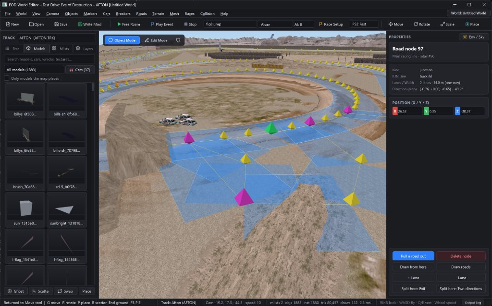

# Tutorial 4: Placing Cars, Wrecked AI Cars & Scattering Props (Lumion/Twinmotion Workflow)

> **Part of the [EOD Recomp Modding & World Editor Tutorials](Modding-Tutorials)** · **Previous:** **[Tutorial 3: Deleting Fences & SOBL Barriers](Tutorials-3-Fences-Barriers-and-MultiSelect)** · **Next:** **[Tutorial 5: Editing AI Pathfinding (`ILIN`) & Custom Modes](Tutorials-5-AI-Pathfinding-and-Custom-Modes)**

---

## Overview

In this tutorial, you will browse all **37 retail vehicles and trailers** (`Cars & Wrecks (37)`), stamp individual cars and props aligned to terrain slopes with **Ghost Place (`P`)**, paint entire demolition junkyards or forests with the **Scatter Brush (`B`)**, and use **Replace Selection With…** to turn existing trees or hay bales into crashed School Buses with real in-game collision.

---

## Step 1: Browse `🚗 Cars & Wrecks (37)` in the Explorer

1. In the **Left Explorer Panel**, click the **`Models`** tab and click the **`🚗 Cars & Wrecks (37)`** filter pill.
2. The editor decodes all 37 retail `.CAR` archives from `DATA/CAR/` (31 playable chassis including `ALGAR`, `VENOM`, `COPCAR`, `AMBULA_1`, `TAXI`, `HEARSE`, `LIMO`, `POSTAL`, `GLADIA_1`, plus `BUS.CAR` and the 5 trailers `TRAILER`..`TRAILER5`) along with their `CT.RES` liveries.
3. Shaded 3D studio thumbnails render in the 2-column grid (and cache to `%LOCALAPPDATA%\EODRecomp\cache\thumbnails\` for instant `< 15 ms` startup on future sessions).

---

## Step 2: Precision Stamping with Ghost Place (`P`)

1. Click any vehicle or prop card in the Explorer grid (e.g. **`BUS (School Bus)`**, **`HEARSE`**, or **`W_Jump4`**).
2. Press **`P`** (or click **`Place (P)`** in the toolbar).
3. Move your cursor across the 3D terrain:
   - A translucent cyan/green **3D Ghost Preview** follows your cursor across `SCOL` (`track.bsc`) triangles.
   - Its pitch and roll automatically align to the underlying terrain surface normal (`normal_to_pitch_roll`)!
4. Press **`R`** (`+15°`) or **`Shift + R`** (`-15°`) to rotate the ghost heading before stamping.
5. **`LMB` Click** to stamp an instance on the track. Repeat to build a bus barricade or ramp line, and press **`Esc`** to exit Ghost Place Mode.

---

## Step 3: Painting Junkyards & Forests with the Scatter Brush (`B`)

1. Select a vehicle or scenery prop in Explorer (e.g. **`TAXI`**, **`COPCAR`**, or a pine tree / tire stack).
2. Press **`B`** (or click **`Scatter (B)`** in the toolbar).
3. Configure the floating **Scatter Brush HUD** at the top center of the viewport:
   - **Radius (`3 m – 120 m`):** Size of the glowing green 3D terrain ring.
   - **Density (`1 – 40`):** Number of objects spawned per paint tick.
   - **Random Yaw (`☑`):** Randomizes heading `0°..360°`.
   - **Scale Jitter (`0% – 35%`):** Adds natural size variation.
   - **Align to Normal (`☑`):** Tilts instances to match hill slopes.
   - **Auto-Overlap Rejection:** Prevents scattered vehicles from clipping inside existing objects.
4. **Hold `LMB` and drag** across the infield to paint a cluster of wrecked cars in a single undoable stroke (`Ctrl+Z`).

---

## Step 4: Turn Trees into Wrecked Buses with `Replace Selection With…`

1. Select one or more existing props in the 3D viewport (e.g. `Shift + Click` 8 trees or hay bales along a corner).
2. **Right-click (`RMB`) → `Replace Selection With…`** (or click **`🔄 Replace With…`** in the Object Inspector).
3. Filter by **`🚗 Cars & Wrecks (37)`**, select **`BUS (School Bus)`** or **`AMBULA_1 (Ambulance)`**, and click **OK**.
4. Every selected tree swaps in-place into a School Bus or Ambulance while preserving its exact position and rotation!
5. When you compile (`Ctrl+Shift+S` or `F5` Play PIE), `export_mod_layer` compiles your swapped and scattered vehicles directly into the binary `.TRK` (`track.grf` / `c_<event>.va0` `$NNNN$object` `unfloat_frame64` records + injected `.mod`/`.tex` members and `obstacle.val` / `SOBL` collision boxes) so they appear with full physical collision inside `eod.exe`!

---

**Next Tutorial:** **[Tutorial 5: Editing AI Pathfinding (`ILIN` Road Tool) & Inventing Custom Game Modes](Tutorials-5-AI-Pathfinding-and-Custom-Modes)**
