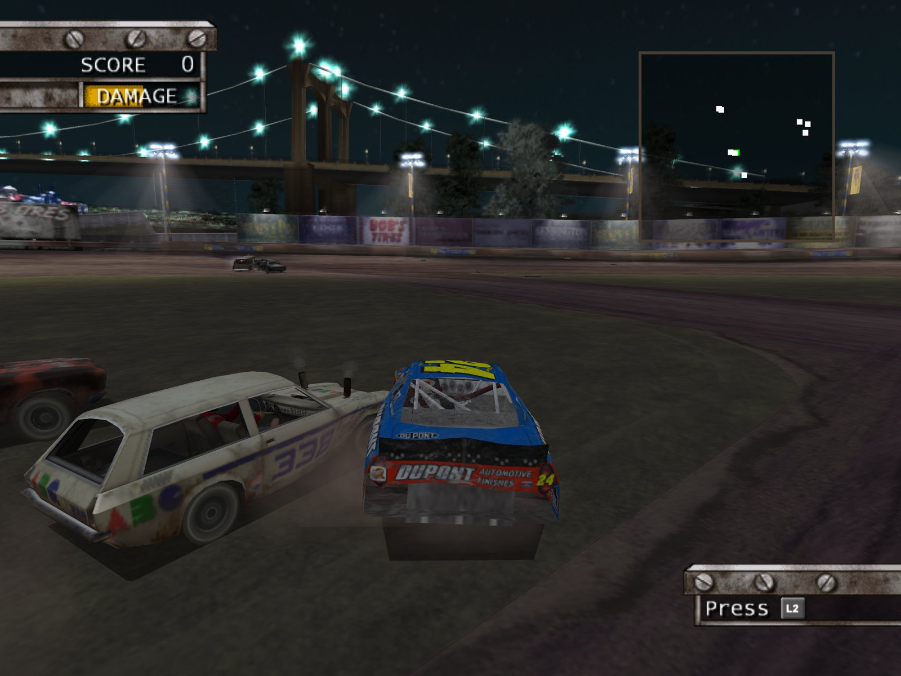

# Tutorial 6: Live 4K Textures (`HOSTTEX`), Skybox Swapping & Importing *NASCAR: Dirt to Daytona* Cars

> **Part of the [EOD Recomp Modding & World Editor Tutorials](Modding-Tutorials)** · **Previous:** **[Tutorial 5: AI Pathfinding & Custom Modes](Tutorials-5-AI-Pathfinding-and-Custom-Modes)** · **Next:** **[Tutorial 7: Packaging & Sharing `.eodmod` Mods](Tutorials-7-Packaging-and-Sharing-Mods)**



---

## Overview

In this tutorial, you will click any 3D object in the World Editor to replace its texture with a 4K PNG via Vulkan **`HOSTTEX`** (`.eodhtx`), swap skyboxes and fog across tracks, import playable stock cars and Cup wheels from *NASCAR: Dirt to Daytona* (`SLUS_204.41`) using `tools/import_nascar_cars.py`, and tune live vehicle suspension and gearing in `physics.val`.

---

## Step 1: Click-Surface 4K Texture Replacement (`HOSTTEX` / `.eodhtx`)

1. Click any 3D object in the World Editor viewport (e.g. a billboard, barn, or asphalt road section).
2. In the **Right Properties Panel → Texture / Material Inspector**, inspect the clickable texture cards showing the texture's retail name, dimensions, and FNV-1a 64-bit `indexKey` / `paletteKey`.
3. Click **`🖼 Replace PNG…`** and select any 8-bit RGBA `.png` whose dimensions are a power-of-two multiple $k \in \{1, 2, 4, 8, 16, 32\}$ of the retail texture (up to `4096×4096`).
4. The viewport updates on the very next frame (undoable with `Ctrl+Z`).
5. On compile (`Ctrl+Shift+S` or `F5`), the editor automatically converts alpha to the PS2 GS domain, builds a full 2×2 box-filtered RGBA8 mipmap chain in **`mods/<Project>/HOSTTEX/*.eodhtx`**, and updates **`HOSTTEX/replacements.tsv`** so `eod.exe` loads your 4K texture in both Classic and Modern modes!

---

## Step 2: Skybox Swapping & Atmosphere (`☀ Env / Sky`)

1. Click **`☀ Env / Sky`** in the toolbar (or `World → Environment / Skybox`).
2. Pick a 1-click mood preset (*Track Default*, *Clear Day*, *Golden Sunset*, *Anoka Night*, *Overcast Storm*, *Desert Noon*) or adjust **Sun Azimuth/Elevation**, **Ambient Brightness**, and **Fog Color/Start/End/Density** at 60 FPS.
3. **Cross-Track Skybox Transplant (`Borrow Sky From Track…`):**
   - Select any donor track (e.g. **`ANOKA`** or **`GILROY`**) in the **`Borrow Sky From Track`** dropdown.
   - The viewport immediately displays the donor track's 32-tile sky dome (`sky01A..16B.tex`), and compiling (`Ctrl+Shift+S` / `F5`) emits `.eodhtx` replacements keyed to the active track's sky `indexKey`s!

---

## Step 3: Import *NASCAR: Dirt to Daytona* (`SLUS_204.41`) Vehicles

Run `tools/import_nascar_cars.py` pointing to your extracted *NASCAR: Dirt to Daytona* (`SLUS_204.41`) and *Eve of Destruction* (`SLUS_209.10`) `DATA` directories:
```powershell
python tools/import_nascar_cars.py `
  --nascar-data "D:\NASCAR - Dirt to Daytona (USA)\DATA" `
  --eod-data "D:\Test Drive - Eve of Destruction (USA)\DATA" `
  --output "mods\nascar_cupcar" `
  --kind stock `
  --name Cupcar `
  --number 777 `
  --class midsize `
  --paint Car24.tex
```
- **What the Importer Does Automatically:**
  1. Registers **`CUPCAR.CAR`** in the `Midsize` class (`COMMON.RES#carclass.val`, `buycar.val`, `dirt.val`, racing `#777`, dealer `#778`) with custom `UICAR.RES` portraits.
  2. Transcodes `Low0..3.mod` `4SPS` VIF streams from NASCAR `MSCAL 0x2D` (`V4-5` 5-bit normals) to EOD `MSCAL 0x5C` (`V4-8` 8-bit normals with `STROW 0x47800000`) and synthesizes a 157-bone `Bone.mvl` damage skeleton.
  3. Upgrades NASCAR `TEX` v9 (`0x60` header) liveries to EOD `TEX` v10 (`0x80` header) `.tex` and `.tm0` streams in `CT.RES`.
  4. Converts NASCAR slow (`Rtire0..4`) and independent high-speed fast (`Rtire0f..4f`) Cup wheels (`MSCAL 0x26 → 0x55`) into namespaced `ncu0..4.mod` / `ncu0f..4f.mod` inside `RACE.RES` (`wheel_class = ncu`).

---

## Step 4: Live Suspension & Gearing Tuning (`physics.val` vs. `SETU`)

> [!WARNING]
> **Why `SETU` (`.gar`) Files Have No In-Game Effect:**
> All 64 `.gar` files (`default.gar`, `Advanced.gar`, `arcade.gar`, `ai.gar`) in the track archives are unused leftovers from the NASCAR engine—`SLUS_209.10` has zero loader for `SETU`. The editor flags them with an **`[Unused by PS2 Runtime]`** warning badge.

Always edit **`DATA/CAR/<CAR>.CAR#physics.val`** (`VALT` v11, loaded by `0x00185470`) via the Creation Kit **VALT Schema Inspector**:
- **`[Chassis]`:** `mass` (lbs), `spring_factor` (suspension stiffness), `grip`, `slip`, `brake_factor`, `damage_scale` (durability).
- **`[Transmission]`:** `num_gears`, `g1..g4` (gear ratios), `rear_end_ratio` (final drive differential, default `5.0`).
- **`[Engine]`:** `redline`, `torque_curve`.
- **`[Front]` / `[Rear]`:** `wheel_class` (`mid`, `com`, `mus`, `bus`, or imported `ncu`).

---

**Next Tutorial:** **[Tutorial 7: Packaging, Sharing & Installing `.eodmod` Mods Online](Tutorials-7-Packaging-and-Sharing-Mods)**
