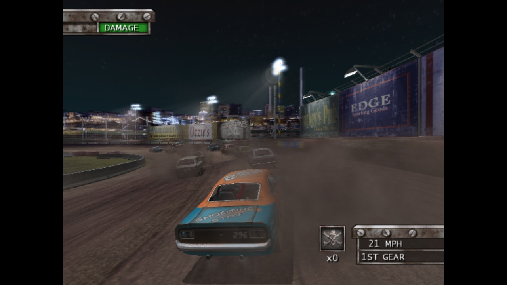
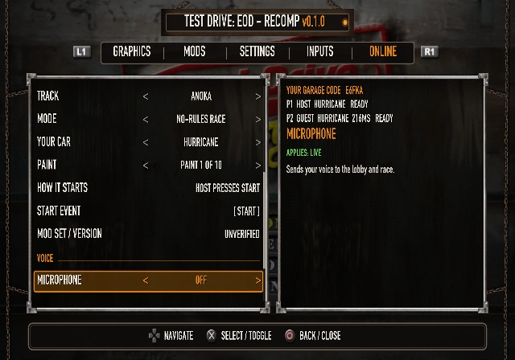

# Tutorial 7: Packaging, Sharing & Installing `.eodmod` Mods Online

> **Part of the [EOD Recomp Modding & World Editor Tutorials](Modding-Tutorials)** · **Previous:** **[Tutorial 6: 4K Textures, Skyboxes & NASCAR Cars](Tutorials-6-4K-Textures-Skyboxes-and-NASCAR)** · **Back to Overview:** **[Modding-Tutorials](Modding-Tutorials)**



---

## Overview

In this tutorial, you will export your custom track, 4K textures, and custom race into a compact, legal, delta-only **`.eodmod`** package (`50 KB – 8 MB` instead of a 70 MB copyrighted `.TRK` archive), install and combine multiple mods using **3-Tier Hierarchical Conflict Resolution**, and race friends online with **0-desync netplay parity**.

---

## Step 1: Export a Legal Delta-Only `.eodmod` Package (`Ctrl + Shift + E`)

### In the World Editor GUI
1. Press **`Ctrl + Shift + E`** (or click **`File → Package Mod as .eodmod…`**).
2. Enter a **Mod ID** (`woodly-mega-jumps`), **Display Name**, and **Version** (`1.0.0`). Choose where to save the `.eodmod`.
3. The editor bakes a snapshot of the current world, including unsaved edits. The package contains changed retail archive members, indexed HOSTTEX replacements with their mip chains, and a manifest with SHA-256 hashes.

Added archive members, structured sub-record deltas, and standalone environment or PIE settings are pending package support.

### Via CLI (`tools/mod_package.py`)
For a baked World Editor layer, use the directory containing `DATA/` and optional `HOSTTEX/`.

```sh
python tools/mod_package.py from-overlay mods/WoodlyJumps \
  --disc "/path/to/extracted-disc" --id woodly-mega-jumps \
  --version 1.0.0 --name "Woodly Mega Jumps" --out build_pkgs/woodly-mega-jumps
python tools/mod_package.py zip build_pkgs/woodly-mega-jumps Woodly-Mega-Jumps-v1.0.0.eodmod
```

For a Creation Kit project with a built overlay, use `from-project`.

```powershell
python tools/mod_package.py from-project "mods\WoodlyJumps\project.eodproject" `
  --disc "D:\Test Drive - Eve of Destruction (USA)" `
  --id woodly-mega-jumps --version 1.0.0 --name "Woodly Mega Jumps" `
  --out "build_pkgs\woodly-mega-jumps"

python tools/mod_package.py verify "build_pkgs\woodly-mega-jumps" --disc "D:\Test Drive - Eve of Destruction (USA)"
python tools/mod_package.py zip "build_pkgs\woodly-mega-jumps" "Woodly-Mega-Jumps-v1.0.0.eodmod"
```

---

## Step 2: Install `.eodmod` Packages & Resolve Load-Order Conflicts

### World Editor or CLI

Open **File → Mod Manager & Profiles**, select or name a profile, and pick a
local `.eodmod` with **Install Package**. The dialog installs it disabled.
Enable the package when ready to compose the profile. The dialog also shows
package conflicts, allows you to choose a winner, and displays the active
overlay path.

With a track open, choose **Play Free Roam in PIE** or **Play Event in PIE**
for the selected profile. The editor bakes the current project into a private
overlay for that session. Installed archive members carry through where the
project leaves the retail member unchanged. Project edits take precedence for
the same archive member or host texture. For a standalone launch with just
the installed profile, use `launch-env` to get the value for `EOD_MOD_DIR`.

```powershell
python tools/mod_install.py install "Woodly-Mega-Jumps-v1.0.0.eodmod" --disc "D:\Test Drive - Eve of Destruction (USA)"
python tools/mod_install.py status
python tools/mod_install.py compose
python tools/mod_install.py launch-env
```

### How conflicts are composed

- **Different archive members.** If one mod edits `AFTON.TRK#track.grf`
  and another edits `AFTON.TRK#track.sol`, both members appear in the
  active Afton archive.
- **Different payloads for the same member or host texture.** Choose a winner
  in the dialog, or run `python tools/mod_install.py accept-conflict
  "DATA/TRACKS/AFTON.TRK#track.grf" woodly-mega-jumps`. Same-member
  sub-record merging is pending.

---

## Step 3: Multiplayer Netplay Parity (`0` Desyncs)



1. **Match `PROFILE.TXT` for Physics-Affecting Mods:** All players in an online lobby must run identical physics-affecting `.eodmod` packages (`track.sol`, `track.bsc`, `c_*.va0`, `*.ild`, `physics.val`, `COMMON.RES`). Verify that `active/PROFILE.TXT` native member SHA-256 hashes match across peers.
2. **Client-Independent Visual Mods:** `HOSTTEX` 4K texture packs (`.eodhtx`), `RenderScale` (`1x–8x+`), and the **`F9` Classic vs. Modern toggle** only affect the host Plume rendering layer—never EE RAM (`0x00000000..0x02000000`) or the 59.94 Hz physics step (`0x00177718`)—so every player can choose their own visual look and resolution with **0 desyncs**!
3. **`[MOD]` Roster Badges:** Any modded track or vehicle automatically displays a **`[MOD]`** badge in the Single-Player and Multiplayer Arcade rosters.
