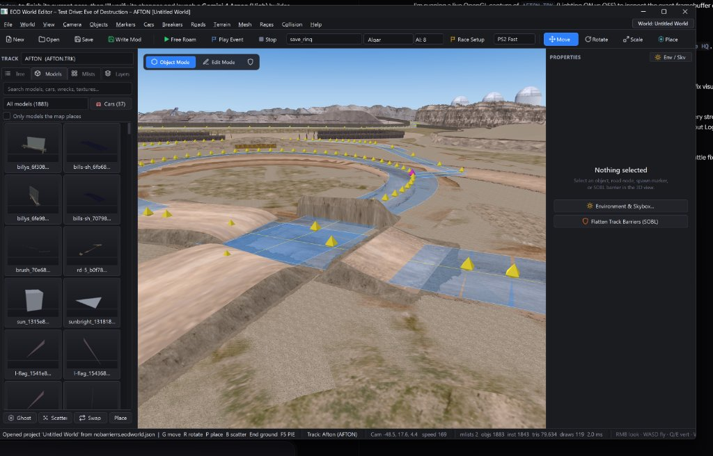
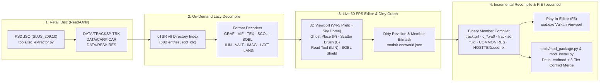

# World Editor & Creation Kit — Architecture, JTBD Matrix, PIE & Modding Pipelines

The **EOD World Editor & Creation Kit** (`tools/world_editor/`, `tools/kit_service/`, `tools/*.py`) is a standalone Windows 11 x64 (and macOS) 3D level design, vehicle modding, texture replacement, and package distribution suite for *Test Drive: Eve of Destruction* (`SLUS_209.10`), featuring an embedded **Unreal-style Play-In-Editor (PIE)** viewport and a non-destructive 4-stage lazy on-demand decompile/recompile pipeline.

---

## 1. Architecture Decision Records (ADRs 01–08)

Grounded in [`docs/WORLD_EDITOR_ARCHITECTURE.md`](https://github.com/catsandsoup/eod-recomp/blob/main/docs/WORLD_EDITOR_ARCHITECTURE.md) and [`docs/WORLD_EDITOR_FRICTION_AND_UX.md`](https://github.com/catsandsoup/eod-recomp/blob/main/docs/WORLD_EDITOR_FRICTION_AND_UX.md):

| ADR | Architectural Decision | Why It Matters |
|---|---|---|
| **ADR-01 (UI & Render Host)** | **Qt 6 Widgets Shell + Hardware-Accelerated 3D Viewport + C++17 `vif_mesh` / Plume Core** | Combines rich docking/tree/inspector tool UI with authentic PS2 prelit `V4-5` vertex-color rendering and Dear ImGui floating viewport HUDs (`ModePillOverlay`, `ScatterHudOverlay`, `RoadToolHudOverlay`, `PlaceHudOverlay`). |
| **ADR-02 (Dual-Profile Viewport)** | **`PS2-Fast` vs. `Plume-HQ` vs. `Eco / Laptop` Profiles** | Both profiles use prelit `V4-5` vertex colors (`Cv * Ct >> 7`, `0x80 = 1.0`) as the lighting truth with backface culling disabled on world geometry—eliminating the fake normal lighting and `fix_winding()` triangle-flip bugs that broke Woodly (`AFTON.TRK`) and Anoka Night. Idle mouse movement consumes **0.0% CPU / 0.0% GPU**. |
| **ADR-03 (PIE Integration)** | **Play-In-Editor (`F5` / `Shift+F5`) with Live Telemetry & Background Gamepad Support** | Launches `eod.exe` (`EOD_MOD_DIR`, `EOD_DIRECT_START`, `EOD_SKIP_MOVIES=1`, `SDL_HINT_JOYSTICK_ALLOW_BACKGROUND_EVENTS=1`), streams live startup stages (`[SESSION]`), and transitions smoothly between 3D editing and live Vulkan driving. |
| **ADR-04 (Process Isolation)** | **4 Isolation Tiers + Win32 Job Object (`JOB_OBJECT_LIMIT_KILL_ON_JOB_CLOSE`)** | Separates UI/Store (Tier 1), 3D Viewport Render (Tier 2), Out-of-Process Kit Service & Background Workers (Tier 3), and `eod.exe` PIE (Tier 4). Kernel Job Objects guarantee `eod.exe` never leaks or locks `.TRK` files if the editor closes unexpectedly. |
| **ADR-05 (App State & Undo)** | **Immutable Overlay Snapshot + `QUndoStack` Command Log + GPU Transform Uniforms** | Retail `.TRK` data is never mutated; edits are stored as structured `.eodworld.json` v2 overlay commands. Transforming a selected object updates its GPU `uModel` uniform in `< 0.1 ms` without rebuilding the static world VBO. |
| **ADR-06 (IPC Transport)** | **JSON-RPC 2.0 NDJSON over Windows Named Pipes / POSIX Sockets** | Cross-platform IPC (`msvcrt.locking` on Windows 11, `fcntl.flock` on macOS/Linux) with bulk payloads passed via Content-Addressed Storage (CAS). |
| **ADR-07 (Hashing & Caching)** | **BLAKE3-256 (`b3:`) for Derived CAS Blobs + SHA-256 (`s256:`) for Retail Provenance** | Caches `(world_dirty_revision, mod_dir)`, `.eodhtx` mip chains by `(png_path, mtime_ns, indexKey)`, and `112×84` 3D studio thumbnails on disk (`%LOCALAPPDATA%\EODRecomp\cache\thumbnails\`) so repeat launches and PIE starts are near-instant (`< 25 ms`). |
| **ADR-08 (Safe Mod Distribution)** | **Declarative `.eodmod` Delta Packages + 3-Tier Hierarchical Conflict Merging** | Mods distribute only changed archive members, `HOSTTEX` PNGs, and `.eodworld.json` sub-record deltas—never 70 MB copyrighted `.TRK` dumps or arbitrary executable code. |

---

## 2. 4-Stage Lazy On-Demand Decompile & Recompile Pipeline

---

## 3. Jobs-To-Be-Done (JTBD) & Feature Matrix

| JTBD ID | Modder Job | World Editor UI & Keyboard Workflow | Binary Write-Back Target (`mods/<Project>/`) |
|---|---|---|---|
| **JTBD-01** | **Move, Rotate, Scale & Delete Track Scenery or Jump Ramps** | Pick any object (`LMB` / `Shift+LMB`), transform with `G`/`R`/`S` gizmos, `End` Drop to Ground, `Select/Delete All Similar` (including `lod-*` twins), and bake visual VIF + `SCOL`/`SOBL` driving collision. | `DATA/TRACKS/<TRACK>.TRK#track.grf` (`q199` offset, `vif_patch.py` vertices, `mrModel` bbox, `mlist` & `0x102` spheres, `Y=-5000` delete tombstones) + `c_<event>.va0` (`unfloat_frame64`) + `eod_crc`. |
| **JTBD-02** | **Place & Scatter All 37 Retail Cars, Wrecks & Trailers** | Filter Explorer by **`🚗 Cars & Wrecks (37)`**, use **Ghost Place (`P`)** snapped to `SCOL` surface normals, paint junkyard piles with **Scatter Brush (`B`)**, or right-click any tree/prop → **`Replace Selection With…`**. | Compiles placed/swapped vehicles & props into `track.grf` display leaves and `c_<event>.va0` `$NNNN$object` records (injecting `.CAR` `.mod`/`.tex` members into the mod `.TRK` so they spawn with collision in `eod.exe`). |
| **JTBD-03** | **Remove 16m Invisible Walls (`SOBL`)** | Toggle **`🛡 Collision Shield`** (Red `>= 10m`, Orange `3–10m`, Yellow `< 3m`), click any wall to set `Target Top Above Ground`, or run **Flatten Interior Barriers** / **Flatten All Track Barriers**. | `DATA/TRACKS/<TRACK>.TRK#track.sol` (`world_collision.apply_box_edits`: patches `centre.y`, `ry`, `sphere_radius`, and `eod_crc` while keeping the 2D XZ quadtree 100% valid). |
| **JTBD-04** | **Swap Skyboxes, Sun & Fog Atmosphere** | Open **`☀ Env / Sky`** drawer, pick mood presets (*Clear Day*, *Golden Sunset*, *Anoka Night*, *Overcast Storm*), tweak Sun/Fog sliders, or select **`Borrow Sky From Track…`**. | Extracts donor track's 32 `sky01A..16B.tex` tiles and emits Vulkan `.eodhtx` + `HOSTTEX/replacements.tsv` keyed to the active track's sky `indexKey`s, plus `shadow.val` overrides. |
| **JTBD-05** | **Click-Surface 4K Texture Replacement (`HOSTTEX`)** | Click any 3D object → **Texture / Material Inspector** → click **`🖼 Replace PNG…`** (`1x`–`32x` up to `4096×4096`). Instant viewport upload + `Ctrl+Z` undo. | Computes FNV-1a 64 `indexKey`/`paletteKey` (`texture_identity.py`), converts GS alpha domain, generates 2×2 box-filtered RGBA8 mip chains (`.eodhtx`), and updates `HOSTTEX/replacements.tsv`. |
| **JTBD-06** | **Edit AI Racing Lines (`ILIN`) & Author Custom Races** | Activate **`Road (ILIN)`** tool to drag, split (`Cyan`), or branch (`Green`) `.ild` nodes; move Start Grid/Spawn markers; configure **`⚙ Custom Race`** (event type, laps, AI count/speed, vehicle, Free Roam, AI Auto-Drive). | `DATA/TRACKS/<TRACK>.TRK#*.ild` (auto-recomputes `dirX/dirZ`, `segLen`, `dist`, 3 header lap-length floats, and pointer fix-up table) + `DATA/RES/COMMON.RES#<track>_eves.val` + `EOD_DIRECT_START`. |
| **JTBD-07** | **Tune Vehicle Physics (`physics.val`) & Import NASCAR Cars** | Inspect 2,851 schema-labeled `VALT` keys (`valt_schema.py`, flagging unused `SETU` `.gar` files), or import *NASCAR: Dirt to Daytona* (`SLUS_204.41`) stock cars & Cup wheels via `tools/import_nascar_cars.py`. | `DATA/CAR/<CAR>.CAR` (`physics.val`, transcoded `MSCAL 0x5C` `Low0..3.mod`, 157-bone `Bone.mvl`), `CT.RES` liveries, `UICAR.RES` portraits, `RACE.RES` (`ncu0..4f.mod` wheels), `COMMON.RES`. |
| **JTBD-08** | **Package, Share & Merge `.eodmod` Mods** | Press **`Ctrl + Shift + E`** (`File → Package Mod as .eodmod…`) or drag-and-drop `.eodmod` files into the **Mod Manager & Profiles** dialog. | Produces delta-only `.eodmod` zip archives (`native/`, `host/`, `deltas/`, `preview.png`) and composes multi-mod profiles into `active/` with 3-tier conflict resolution. |

---

## 4. Competitor UI Synthesis (5 Reference Tools)

The EOD World Editor synthesizes proven ergonomics from five industry and community tools (following 80.lv game-dev tool UX principles):
1. **NFSU2 FRS World Editor:** 1-click in-viewport driving (**PIE** `F5`), 3D diamond spline handles on **`ILIN`** roads, dedicated wall/road inspectors, and an always-on 4-segment profiler status bar (`Action` | `Track` | `XYZ` | `FPS · ms · Draws · Tris`).
2. **Twinmotion:** Dark luminance hierarchy (`#111318` → `#171A21` → `#1E222B`), right-side **Environment / Skybox** slider drawer with mood presets, clickable material cards, and **`Replace Selection With…`** preserving transforms.
3. **Lumion:** **Ghost Place (`P`)** snapped to `SCOL` terrain height and surface normal before stamping, plus the **Scatter / Paint Brush (`B`)** projecting a 3D ring on the terrain to paint forests or wrecked car piles with automatic AABB overlap rejection.
4. **Unreal Engine 5:** Top toolbar **PIE Control Group** (`▶ Play Free Roam`, `🏁 Play Event`, `■ Stop`, `⚙ Custom Race`), **Grid (`1.0m`) & Angle (`15°`) Snapping**, and **Renderer Scalability Dropdown** (`⚡ PS2 Fast`, `✨ Plume HQ`, `🍃 Eco / Laptop`).
5. **Minecraft Bedrock Editor:** Top-left floating **`ModePillOverlay`** (`Object Mode` · `Edit Mode` · `🛡 Collision Shield`), emerald translucent selection highlight, and crisp R/G/B 3D gizmos.

---

## 5. Complete Modding CLI Toolchain Reference (`tools/`)

Every operation in the World Editor GUI is backed by a clean, scriptable Python CLI tool in `tools/`:

| Tool Script | Primary Purpose & Example Command |
|---|---|
| **`tools/iso_extractor.py`** | Pure-Python ISO-9660/UDF retail disc extractor (`2048`/`2352` sector support, `SLUS_209.10` validator, `0TSR` CRC verifier): `python tools/iso_extractor.py --iso "EOD.iso" --out "D:\Test Drive - Eve of Destruction (USA)"` |
| **`tools/world_editor/app.py`** | Launch the standalone Qt 6 + OpenGL 3.3 + Embedded PIE World Editor: `tools\world_editor\launch_editor.bat` or `python tools/world_editor/app.py --track AFTON` |
| **`tools/world_export.py`** | Export any `.TRK` world (`track.grf` + `c_*.va0` + textures + top-down PNG) to Blender OBJ/MTL or write placements back: `python tools/world_export.py export --disc DISC --track DATA/TRACKS/AFTON.TRK --dest out_dir --blender --event c_jump_race` |
| **`tools/world_collision.py`** | Inspect, export, render, or lower/flatten `SOBL` (`track.sol`) invisible walls and `SCOL` (`track.bsc`) terrain: `python tools/world_collision.py set-limit Anoka --records 357-379 --field top-above-ground --value 1.5 --out mod/DATA/TRACKS/ANOKA.TRK` |
| **`tools/vif_mesh.py` & `vif_patch.py`** | Decode `MODL` v9 / `GRAF` `4SPS` VIF geometry to OBJ and patch edited Blender vertex positions/UVs/normals back into VIF packets. |
| **`tools/sky_export.py`** | Export/reimport 32-tile track skyboxes (`sky01A..16B.tex`) as seamless panoramic PNG strips or transplant skies across tracks. |
| **`tools/texture_edit.py` & `texture_identity.py`** | Compute FNV-1a 64 `indexKey`/`paletteKey` hashes, compile native indexed `TEX` v10 files, or build 4K `.eodhtx` `HOSTTEX` mip chains. |
| **`tools/create_custom_car.py`** | Clone and register a new playable vehicle chassis in `COMMON.RES`, `CT.RES`, and `UICAR.RES` with custom livery and physics. |
| **`tools/import_nascar_cars.py`** | Transcode and import *NASCAR: Dirt to Daytona* (`SLUS_204.41`) stock cars, liveries, and slow/fast `ncu` Cup wheels into EOD. |
| **`tools/mod_package.py` & `mod_install.py`** | Build, verify, and zip delta-only `.eodmod` packages and compose multi-mod profiles with 3-tier conflict resolution. |
